# REST API Design: Complete Revision Notes

> **Source:** [YouTube: API Design (Backend from First Principles series, part 11)](https://www.youtube.com/watch?v=RG6q57DwV8Y&list=PLui3EUkuMTPgZcV0QhQrOcwMPcBCcd_Q1&index=11)
> **Length:** ~2h 3m
> **Previous videos:** [HTTP_Notes.md](HTTP_Notes.md) · [Routing_Notes.md](Routing_Notes.md) · [Serialization_Notes.md](Serialization_Notes.md) · [Auth_Notes.md](Auth_Notes.md) · [Validation_Notes.md](Validation_Notes.md) · [Handlers_Middleware_Context_Notes.md](Handlers_Middleware_Context_Notes.md)
> **Next video:** Database schema design
> **Goal of the video:** Pull a clear set of **rules and guidelines** out of the existing REST standards, so you stop second-guessing plural vs singular, PUT vs PATCH, which status code to use, and how to handle custom actions, and can focus on business logic.

> 💡 Diagrams use **Mermaid**. They render in GitHub, VS Code (with a Mermaid preview extension), Obsidian, Notion, and the Claude app. Anything marked **📌 Extra** was added to clarify a point and is not in the video.

---

## 📑 Table of Contents

1. [TL;DR: The Whole Video in 15 Lines](#-tldr-the-whole-video-in-15-lines)
2. [Why API Design Is Still Confusing](#1-why-api-design-is-still-confusing-0000)
3. [History: Tim Berners-Lee, Roy Fielding and REST](#2-history-of-the-web-and-rest-0443)
4. [Roy Fielding's Six REST Constraints](#3-roy-fieldings-six-rest-constraints-0816)
5. [What "REST" Actually Means](#4-what-rest-actually-means-1500)
6. [Anatomy of a URL and an API URL](#5-anatomy-of-a-url-and-an-api-url-2153)
7. [Route Design Rules (Plural, Slugs, Hierarchy)](#6-route-design-rules-2512)
8. [Idempotency and HTTP Methods](#7-idempotency-and-http-methods-3100)
9. [POST for Custom Actions](#8-post-for-custom-actions-4359)
10. [The API Design Workflow (Wireframes → Resources → Schema → Interface)](#9-the-api-design-workflow-4630)
11. [Demo: Organization Endpoints (Full CRUD)](#10-demo-organization-endpoints-5908)
12. [Pagination](#11-pagination-10514)
13. [Sorting](#12-sorting-11606)
14. [Filtering](#13-filtering-12119)
15. [Update, Get, Delete (and 404 vs Empty List)](#14-update-get-delete-and-404-vs-empty-list-12337)
16. [Custom Action: Archive Organization](#15-custom-action-archive-organization-13316)
17. [Demo: Project Endpoints and Consistency](#16-demo-project-endpoints-and-consistency-13937)
18. [Best-Practice Checklist](#17-best-practice-checklist-15630)
19. [Status Code Cheat Table for REST APIs](#18-status-code-cheat-table)
20. [Cheat Sheet / Quick Revision](#-quick-revision-cheat-sheet)
21. [Self-Test Questions](#-self-test-questions)

---

## ⚡ TL;DR: The Whole Video in 15 Lines

1. The video covers **REST** only (not RPC or GraphQL). Its goal: extract **rules from existing standards** so you can stop debating and focus on business logic.
2. **History:** Tim Berners-Lee built the **WWW** (1990): URI, HTTP, HTML, the first web server, browser and editor. The web grew too fast, and **Roy Fielding** (Apache co-founder, ~1993) proposed **constraints** to make it scale. That led to **HTTP/1.1** and, in his **2000 PhD dissertation**, the name **REST**.
3. **Six constraints:** client-server, uniform interface, layered system, cache, stateless, code on demand (optional).
4. **REST = REpresentational State Transfer:** resources have **representations** (JSON, XML, HTML), resources have **state**, and that state is **transferred** between client and server via HTTP methods.
5. **API URL:** `https://api.example.com/v1/books/harry-potter`, i.e. scheme, `api.` subdomain, version, then resource path.
6. **Resources are always PLURAL** (`/books`, even for one book: `/books/:id`). Lowercase. No spaces or underscores. Use **slugs** with hyphens (`harry-potter`).
7. `/` means a **hierarchy** (collection → single item → action).
8. **Idempotent:** GET, PUT, PATCH, DELETE (repeating causes no new side effects). **Non-idempotent:** POST (each call creates a new resource).
9. **POST is open-ended**: use it for **custom actions** that aren't CRUD, e.g. `POST /organizations/:id/archive`, `POST /projects/:id/clone`.
10. **Workflow:** wireframes (Figma) → find **nouns = resources** → **DB schema** → list **actions** (CRUD + custom) → **design the interface** (in Insomnia/Postman/Swagger) → **then** code.
11. **Status codes:** create → **201**, read/update/custom action → **200**, delete → **204** (empty body), missing single resource → **404**, **empty list → 200 with `[]`** (never 404).
12. **List APIs** support **pagination** (`page`, `limit` → `data`, `total`, `page`, `totalPages`), **sorting** (`sortBy`, `sortOrder`), and **filtering** (`?status=active&name=...`).
13. **Sane defaults:** page=1, limit=10–20, sortBy=createdAt, sortOrder=desc, status=active on create. Ask only for the fields you truly need.
14. Prefer **PATCH** for updates (partial fields, which suits modern SPAs). JSON fields are **camelCase**. **No abbreviations** (`description`, not `dsc`).
15. **Be consistent** across all endpoints (routes, payload keys, responses), and provide **interactive docs** (Swagger / OpenAPI).

---

## 1. Why API Design Is Still Confusing (00:00)

Despite years of standards and experience, people still get stuck on questions like:

| Common question | Answer in these notes |
|---|---|
| Should the URI path segment be **plural or singular**? | **Plural**, always ([§6](#6-route-design-rules-2512)) |
| Update with **PATCH or PUT**? | **PATCH** for partial updates (the usual case) ([§7](#7-idempotency-and-http-methods-3100)) |
| Which method for a **non-CRUD custom action** (send email, archive, clone)? | **POST** ([§8](#8-post-for-custom-actions-4359)) |
| Which **HTTP status code** for each scenario? | [§18 table](#18-status-code-cheat-table) |

**Why the confusion?** The standards were written when the web looked very different:

| Then | Now |
|---|---|
| **MPAs** (Multi-Page Applications): the server returns full HTML pages | **SPAs** (Single-Page Applications): the browser downloads the JS once, routing happens **client-side**, and data is exchanged as **JSON** |

**Purpose of the video:** not to invent new standards, but to **extract rules and guidelines** from the existing ones, so you stick to **one consistent style** for routes, payloads, responses and docs, and focus on **business logic**.

---

## 2. History of the Web and REST (04:43)

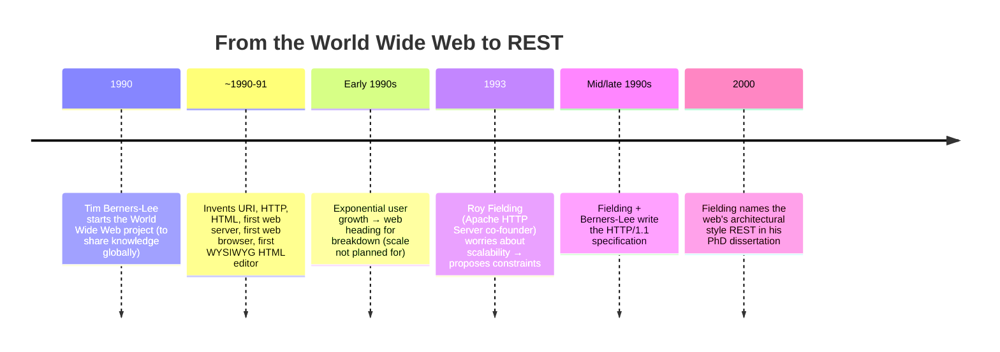

### Tim Berners-Lee's inventions (all still used today)

| # | Invention | Today |
|---|---|---|
| 1 | **URI** (Uniform Resource Identifier) | Every URL |
| 2 | **HTTP** | HTTP/1.1, 2, 3 |
| 3 | **HTML** (the "skeleton" of a page) | Every webpage |
| 4 | **First web server** | Many kinds of web servers |
| 5 | **First web browser** | Many browsers |
| 6 | **First WYSIWYG HTML editor** (built into the browser) | Browser dev tools / editors |

### The scalability crisis
The WWW's user base grew **exponentially**, and Berners-Lee **hadn't planned for that scale**. New techniques, standards and components were needed.

### Roy Fielding steps in (~1993)
- **Co-founder of the Apache HTTP Server project.**
- He was concerned about the web's scalability and proposed a set of **constraints** to fix it.
- He worked with Berners-Lee on the **HTTP/1.1** specification.
- In **2000**, once the crisis had passed, he described the web's architectural style in his **PhD dissertation** and named it **REST**.

> 📖 **Recommended reading:** search "Roy Fielding REST dissertation". The presenter calls it a **must-read** for backend engineers, because it explains where today's patterns come from.
>
> 📌 **Extra:** HTTP/1.0 existed before 1.1 (see [HTTP_Notes.md](HTTP_Notes.md)). HTTP/1.1 was the first version formally standardized by the IETF with Fielding as a main author.

---

## 3. Roy Fielding's Six REST Constraints (08:16)

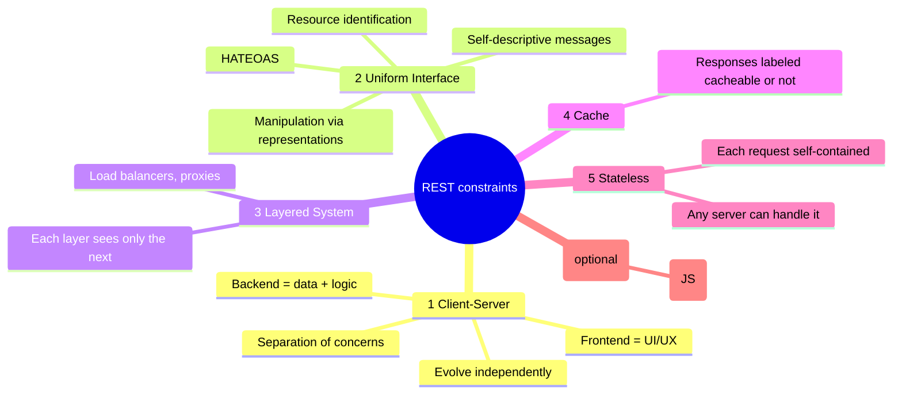

| # | Constraint | Meaning | Benefit |
|---|---|---|---|
| 1 | **Client-Server** | **Separation of concerns**: the client handles **UI/UX** (frontend), and the server handles **data storage and business logic** (backend) | Each side **evolves independently**, which improves scalability |
| 2 | **Uniform Interface** | A **standardized way** for components to communicate. Four sub-constraints: **resource identification**, **resource manipulation through representations**, **self-descriptive messages**, **HATEOAS** (Hypermedia As The Engine Of Application State) | A consistent interface across all services, which simplifies the architecture |
| 3 | **Layered System** | Hierarchical layers, where each layer **only sees and talks to the layer directly below it** | Scalability and security. You can add **load balancers, proxies** and other intermediaries without touching core functionality. |
| 4 | **Cache** | Server responses must be **explicitly labeled cacheable or non-cacheable** | Less server load, better network efficiency, faster responses |
| 5 | **Stateless** | Each request carries **all the info** needed to process it. The server keeps **no client context** between requests. | Reliability, scalability, visibility. **Any server can handle any request**, e.g. behind a load balancer using **round robin**. |
| 6 | **Code on Demand** *(optional)* | The server can temporarily extend the client by sending **executable code** (e.g. JavaScript) | Flexibility. Rarely used heavily. |

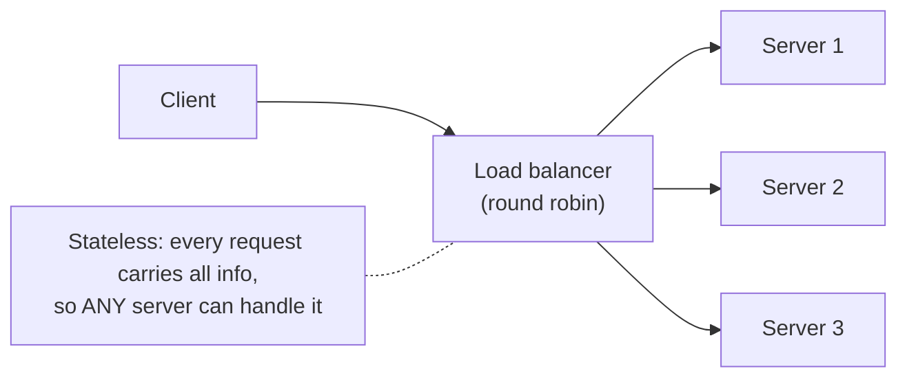

---

## 4. What "REST" Actually Means (15:00)

**REST = REpresentational State Transfer**

```
   RE-presentational      State                    Transfer
   ─────────────────      ─────                    ────────
   Resources have         Resources have a          State moves between
   FORMATS                current condition         client ⇄ server
   (JSON, XML, HTML)      (attributes/properties)   via HTTP methods
```

### Representational
- Resources (data/objects) are **represented in a specific format**: **JSON** (most popular), **XML**, **HTML**.
- **The same resource can have different representations** depending on the client:

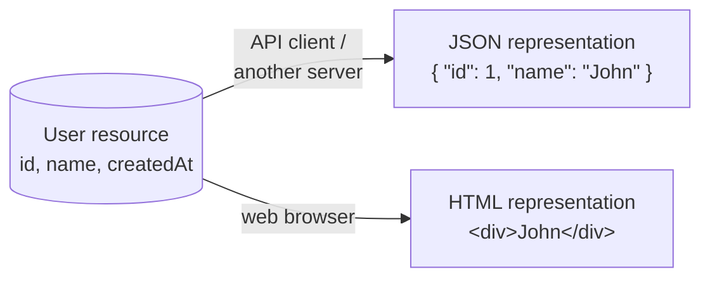

### State
- The **current condition or attributes** of a resource.
- **Example:** an Amazon **shopping cart's state** = the items, their quantities, and the total price. That state is transferred between client and server with each API call.

### Transfer
- The **movement of resource representations** between client and server, over HTTP using methods like **GET, POST, PUT, PATCH, DELETE, OPTIONS, HEAD**.
- E.g. a GET for a webpage **transfers a representation** from server to client.

### All together, REST describes an architecture where:
1. Resources are **represented in different formats**.
2. Their **state is transferred** between client and server.
3. Clients and servers **communicate by exchanging representations**.
4. The system follows **specific constraints** for scalability.

> 💡 You don't need to memorize this theory. It's context for **where these ideas came from**.

---

## 5. Anatomy of a URL and an API URL (21:53)

### A general website URL

```
  https://sriniously.xyz/blog/http-basics?ref=twitter&lang=en#caching
  └─┬─┘   └─────┬──────┘└───────┬───────┘└─────────┬────────┘└──┬──┘
  scheme    authority      path/resource     query params    fragment
           (domain)       "/" = hierarchy    key=value pairs  scrolls to a
                                              (filters etc.)   page section
```

| Part | Meaning |
|---|---|
| **Scheme** | `http` or `https` (secure/encrypted) |
| **Authority / domain** | The domain, optionally with a subdomain |
| **Path / resource** | What you're accessing. `/` = **hierarchical relationship** |
| **Query parameters** | Key-value pairs (usually on GET) for filters and options |
| **Fragment** (`#...`) | The browser **scrolls to that section** of the page |

### A typical API URL (industry best practice, not a hard rule)

```
  https://api.example.com/v1/books
  └─┬─┘   └─────┬───────┘└┬┘└─┬─┘
  scheme   "api." subdomain │  resource (PLURAL)
                         version
```

| Part | Convention |
|---|---|
| Scheme | `https` |
| Subdomain | `api.` (e.g. `api.example.com`) |
| Version | `/v1`, `/v2` (see versioning in [Routing_Notes.md](Routing_Notes.md)) |
| Resource path | Plural nouns, lowercase |

Example platform used here: **Goodreads** (books, authors, reviews, a readers' community).

---

## 6. Route Design Rules (25:12)

### Rule 1: Resources are ALWAYS plural

```
 ✅ GET /v1/books            → list all books
 ✅ GET /v1/books/123        → one book   (still "books"!)
 ❌ GET /v1/book/123         → common mistake: singular because "it's one book"
```

> Even when fetching **one** book, the **resource** is the *books collection*, so it stays plural.

### Rule 2: Lowercase, and no spaces or underscores
URLs travel through many **servers, clients and operating systems**, so avoid **case mismatches** and odd characters.

### Rule 3: Use slugs for human-readable identifiers

**Slug:** a **human-readable, URL-safe** version of a resource property, e.g. a book's name.

```
 "Harry Potter"
      │  1. lowercase everything        → "harry potter"
      │  2. replace spaces with hyphens → "harry-potter"
      ▼
 GET /v1/books/harry-potter
```

### Rule 4: `/` expresses hierarchy

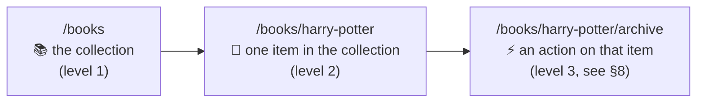

---

## 7. Idempotency and HTTP Methods (31:00)

> **Idempotency:** performing the same action **multiple times** has the **same effect** as performing it **once**. Call the API once or a thousand times, and the **side effect on the server** is the same.

(Also covered in [HTTP_Notes.md](HTTP_Notes.md).)

### The five main methods

| Method | Used for | Idempotent? | Why |
|---|---|---|---|
| **GET** | Fetch data | ✅ | Makes **no change** on the server |
| **PUT** | **Replace** a resource completely | ✅ | Replacing with the same payload gives the same state |
| **PATCH** | **Partially** update a resource | ✅ (per the video) | Setting name A→B, then B→B, then B→B... gives the same state |
| **DELETE** | Remove a resource | ✅ | 1st call deletes it. Later calls return **404**, but **cause no new side effect**. |
| **POST** | **Create** a resource / **custom actions** | ❌ | Each call creates a **new** resource with a new ID |

Other methods: **HEAD** (fetch headers only) and **OPTIONS** (used in the CORS preflight).

### ⚠️ Idempotency is about side effects, not identical responses

> "But if someone else adds a book between my GET calls, the response changes!"

True, but idempotency is about **what side effect YOUR request causes**. A GET never changes server state, so it's idempotent.

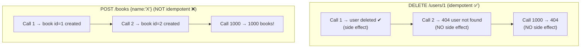

### Why POST is non-idempotent
- POST **creates** resources. The same payload sent again (e.g. re-running the same `curl`) creates **another** book.
- Book names usually **aren't unique** (many books can share a name). Books are told apart by **IDs**, which the **database generates** (UUID or serial `1, 2, 3...`).
- So there's no error, just **another book** with the same data and a **different ID**: a **different side effect** each time.
- (If you had a unique-name constraint, the 2nd call would error instead.)

### PUT vs PATCH

```
 Server has:  { id: 1, name: "A", createdAt: "..." }

 PATCH /users/1   { "name": "B" }                               → only name changes
 PUT   /users/1   { "id": 1, "name": "B", "createdAt": "..." }  → whole object REPLACED
                  (must send ALL fields)
```

| | **PATCH** | **PUT** |
|---|---|---|
| Sends | **Only the fields to change** | **The entire resource** |
| Effect | Partial update | Full replacement |
| Today | ✅ **Most common**. Suits JSON-heavy SPAs that send partial data. | Was more common in the MPA era. The presenter rarely uses it. |

- In practice PUT and PATCH are often **used interchangeably**. That's **OK-ish for internal APIs**.
- For **public APIs**, **stick to the semantics**. Integrators **assume you follow the standard**, and using PUT when you mean PATCH creates wrong assumptions.

> 📌 **Extra:** strictly per the HTTP spec, **PATCH is not *guaranteed* idempotent** (e.g. a patch like "increment views by 1"). A PATCH that **sets** fields to values (as in the video) **is** idempotent in practice.

---

## 8. POST for Custom Actions (43:59)

Some operations **aren't CRUD**: not a fetch, create, update or delete. They're **actions** you want the server to perform.

**Example: send an email.**

```http
POST /send-email
{ "target": "someone@example.com" }
```

- Not a fetch, not a create, not an update or delete. It's a **custom action**.
- The REST spec makes **POST open-ended**: **any action that doesn't fit the other methods goes under POST.**

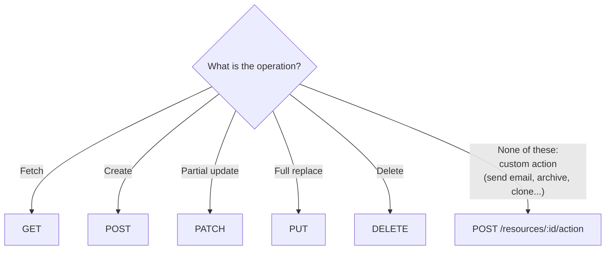

---

## 9. The API Design Workflow (46:30)

### Design before coding
> 🔑 **The first thing a backend engineer does when creating an API is design its interface, before writing any business logic.** The interface should be **intuitive**, **delightful to use**, **not vague**, and should **follow REST standards**.

### Why follow standards?
**To eliminate confusion, assumptions and human error.**

If you ignore standards (POST where PUT belongs, DELETE used to fetch...), an integrator has only two options:
1. **Read your code** (if they even have access), or
2. **Trial and error**: try methods and see what happens.

| Ignoring standards | Following standards (even ~80%) |
|---|---|
| Guesswork, bugs, confusion | **No guesswork**: behavior is predictable |
| Long integration time | **Much faster integration** |
| Lots of sync-up calls | Fewer meetings. Docs and playground do the talking. |

### The workflow

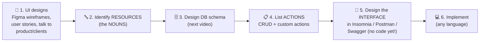

**Why start from wireframes?** They show how **end users** (not the frontend engineers, the actual platform users) interact with data. That connects the **highest level of consumption** (users) to the **lowest** (the database), skipping the middlemen.

```
 End users ──► Platform (frontend) ──► Your API ──► Database
    ▲                                                  ▲
    └──────── wireframes reveal this relationship ─────┘
```

### Step 2: Resources = nouns
**Rule of thumb:** after gathering requirements (wireframes, product people, clients), **the nouns you find are your resources.** (An oversimplification, but it works most of the time.)

**Example: a project-management SaaS (like Jira or Linear):**

| Noun found | Resource |
|---|---|
| Projects | `projects` |
| Users | `users` |
| Organizations (users belong to orgs) | `organizations` |
| Tasks (inside projects) | `tasks` |
| Tags (organize tasks) | `tags` |

### Step 3: DB schema (done quickly here, covered in depth next video)

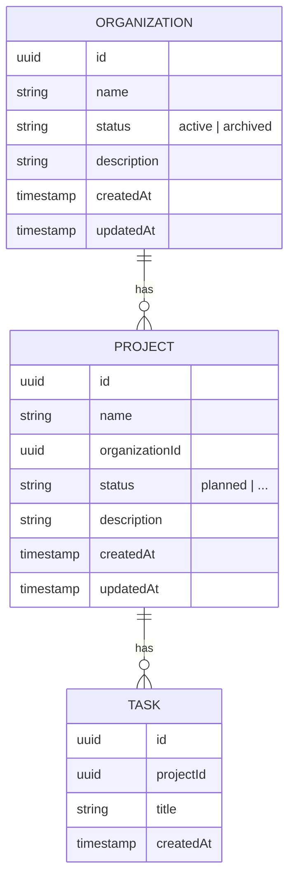

### Step 4: Actions
Start with the **CRUD template**: **C**reate, **R**ead (list all + get one), **U**pdate, **D**elete. Then add **custom actions**.

### Step 5: Design the interface
Tool: **Insomnia** (a lighter alternative to Postman). You design **how clients will call your API**, not the implementation (no language, framework, business logic or DB code yet).

---

## 10. Demo: Organization Endpoints (59:08)

Base URL in the demo: `http://localhost:3000` (no `/v1` in the demo. Production would use `https://api.example.com/v1`).

### The full endpoint set for one resource

| Action | Method | Route | Body | Success |
|---|---|---|---|---|
| **List** organizations | `GET` | `/organizations` | — | **200** + paginated list |
| **Create** organization | `POST` | `/organizations` | `{ name, status, description }` | **201** + created entity |
| **Get** one organization | `GET` | `/organizations/:id` | — | **200** + entity |
| **Update** organization | `PATCH` | `/organizations/:id` | partial fields | **200** + updated entity |
| **Delete** organization | `DELETE` | `/organizations/:id` | — | **204** (empty body) |
| **Archive** (custom action) | `POST` | `/organizations/:id/archive` | — | **200** + updated entity |

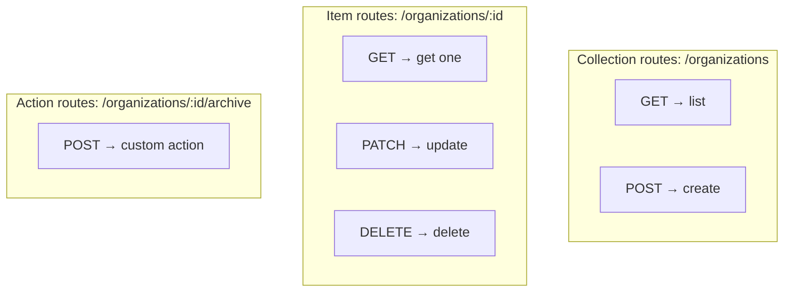

> 🔑 **Pattern:** **list and create share the same route** (`/organizations`). **Get, update and delete share the same route** (`/organizations/:id`). The **HTTP method** tells them apart, so the server routes each to a different controller.

### Create organization

```http
POST /organizations
Content-Type: application/json

{
  "name": "org1",
  "status": "active",
  "description": "some description"
}
```

**Don't accept server-handled fields** from the client: `id`, `createdAt`, `updatedAt` are generated by the server/DB.

```http
HTTP/1.1 201 Created

{
  "id": "a1b2c3...",
  "name": "org1",
  "status": "active",
  "description": "some description",
  "createdAt": "2025-01-11T10:00:00Z",
  "updatedAt": "2025-01-11T10:00:00Z"
}
```

> 🔑 **POST create → 201 Created** + the **newly created entity** in the response.

---

## 11. Pagination (1:05:14)

### Why paginate?

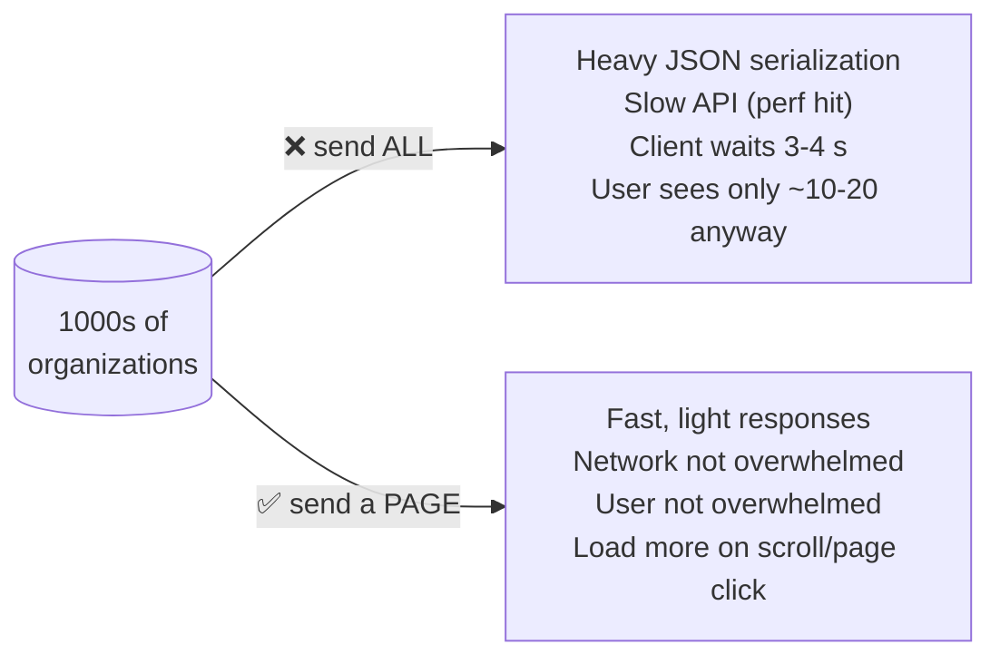

1. **Serializing** thousands of records into JSON is **resource-heavy** (see [Serialization_Notes.md](Serialization_Notes.md)) and slows the API.
2. The frontend sees a **perceived delay** (3–4 seconds), which users notice.
3. Users only **see 10–20 items** at first anyway. They scroll or click for more.

**Technique:** return a **portion** of the data (e.g. the latest 10, sorted by `createdAt`). When the user clicks page 2 or scrolls (infinite scroll), fetch the **next portion**.

### Request parameters (query params, since GET has no body)

| Param | Meaning | Default if missing |
|---|---|---|
| `page` | **Which portion** you want | **1** |
| `limit` | **How many items** per page | **10 or 20** |

### Response shape

```json
{
  "data": [ { "...org..." }, { "...org..." } ],
  "total": 5,
  "page": 1,
  "totalPages": 3
}
```

| Field | Meaning | Frontend use |
|---|---|---|
| `data` | The **current portion** of results | Render the list |
| `total` | **Total count** of all matching records in the DB (independent of page) | "Showing 10 of 50" |
| `page` | **Which page** this response is | Highlight the current page |
| `totalPages` | **How many pages** exist | Page buttons. For infinite scroll: **stop fetching when `page == totalPages`**. |

### Demo: 5 organizations, `limit=2`

```
 Sorted by createdAt DESC:  [ org5, org4 | org3, org2 | org1 ]
                              └ page 1 ┘ └ page 2 ┘ └ p3 ┘

 GET /organizations?limit=2          → data: [org5, org4]  total: 5  page: 1  totalPages: 3
 GET /organizations?limit=2&page=2   → data: [org3, org2]  total: 5  page: 2  totalPages: 3
 GET /organizations?limit=2&page=3   → data: [org1]        total: 5  page: 3  totalPages: 3

 totalPages = ceil(total / limit) = ceil(5 / 2) = 3
```

---

## 12. Sorting (1:16:06)

### Default sorting (always!)
> ⚠️ The **database doesn't store rows in any guaranteed order**. Without an explicit sort, the client could get results in a **different (random) order on each call**.

**Sane default:** `sortBy = createdAt`, `sortOrder = desc` (newest first), applied even when the client sends nothing.

### Client-controlled sorting

| Param | Meaning | Default |
|---|---|---|
| `sortBy` | **Which field** to sort by: `name`, `status`, `createdAt`... | `createdAt` |
| `sortOrder` | `asc` or `desc` | `desc` (even when `sortBy` is given) |

```
 GET /organizations?sortBy=name                    → org5, org4, org3, org2, org1   (name, DESC by default)
 GET /organizations?sortBy=name&sortOrder=asc      → org1, org2, org3, org4, org5
```

> 💡 **Sane defaults principle:** the server **shouldn't depend on the client to send obvious fields**. A bare `GET /organizations` should just work (page 1, limit 10, newest first) with **no validation error**.

---

## 13. Filtering (1:21:19)

Let users narrow a list, e.g. a toggle that shows only **active** or only **archived** organizations.

**Pattern:** use the **field name as the query param**:

```
 GET /organizations?status=archived          → only archived orgs
 GET /organizations?status=active            → only active orgs
 GET /organizations?name=org4                → orgs named "org4"
 GET /organizations?status=active&name=org4  → combine filters
```

### A complete list API

```
 GET /v1/organizations?page=2&limit=20&sortBy=name&sortOrder=asc&status=active
                       └─pagination──┘ └────────sorting────────┘ └─filter──┘
```

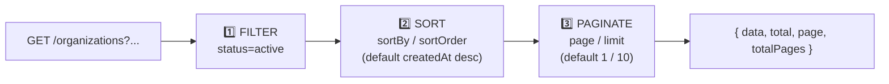

---

## 14. Update, Get, Delete (and 404 vs Empty List) (1:23:37)

### Update: PATCH

```http
PATCH /organizations/6f1c...      ← ID in the dynamic path parameter
{ "status": "active" }            ← only the fields to change

HTTP/1.1 200 OK                   ← 200: nothing created
{ "id": "6f1c...", "name": "org6", "status": "active", ... }   ← updated entity returned
```

> The presenter has **rarely used PUT** for updates. Modern SPAs send **partial fields**, and PATCH conveys that meaning better. **Use PATCH for partial updates.**

### Get one

```http
GET /organizations/6f1c...
HTTP/1.1 200 OK
{ ...organization... }
```

### Delete

```http
DELETE /organizations/6f1c...
HTTP/1.1 204 No Content
(empty body)
```

> **204 No Content:** "Success (2xx), but there's nothing to send back." It's the usual practice for DELETE.

### ⭐ 404 vs empty list

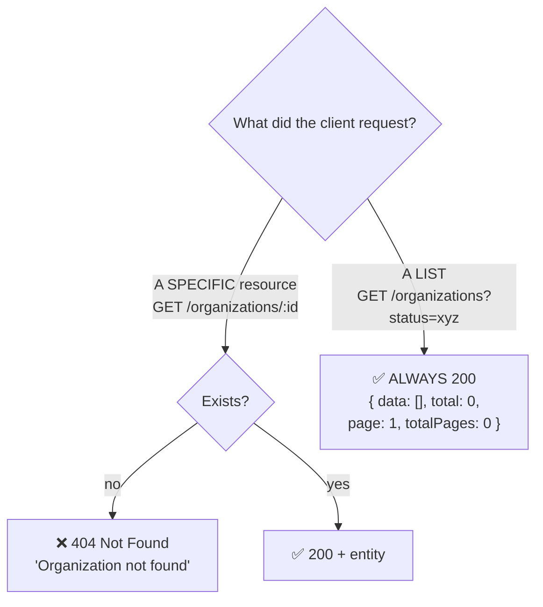

| Request | Nothing found → response |
|---|---|
| `GET /organizations/<deleted-id>` (a **specific** resource) | **404 Not Found** |
| `GET /organizations?status=randomvalue` (a **list**) | **200 OK** with `data: []`, `total: 0`, `totalPages: 0` |

> 🔑 **Rule:** **never return 404 for a list API.** An empty list is a valid, successful answer. **404 is only for when the client asks for a particular entity that doesn't exist.**

---

## 15. Custom Action: Archive Organization (1:33:16)

**Why isn't archiving just `PATCH { status: "archived" }`?**

Archiving an organization may trigger many **side operations** on the server:
- Remove or delete all **projects** under the org.
- Delete all **tasks** under those projects.
- Send **notifications/emails** to all users in the org.

So it's not a simple field update. It's a **custom action**, and it goes under **POST**:

```http
POST /organizations/5e2a.../archive

HTTP/1.1 200 OK                    ← 200, NOT 201: nothing new was created
{ "id": "5e2a...", "name": "org5", "status": "archived", ... }
```

**Route structure for custom actions:**

```
 /organizations   /5e2a...      /archive
 └ collection ┘   └ one item ┘  └ action ┘    → follows the "/" hierarchy perfectly
```

> ⚠️ **Don't assume every POST returns 201.** Custom actions that **don't create** anything return **200**. Those that **do** create something (like *clone*, see below) return **201**. The status code depends on **what actually happened** on the server.

---

## 16. Demo: Project Endpoints and Consistency (1:39:37)

The same patterns, repeated for **projects** (requests grouped in an Insomnia folder per resource):

| Action | Method | Route | Body | Response |
|---|---|---|---|---|
| Create | `POST` | `/projects` | `{ name, organizationId, status: "planned", description }` | **201** + entity |
| List | `GET` | `/projects?limit=1&page=2` (+ sort, filters) | — | **200** + paginated |
| Get one | `GET` | `/projects/:id` | — | **200** |
| Update | `PATCH` | `/projects/:id` | `{ "description": "new description" }` | **200** + updated |
| Delete | `DELETE` | `/projects/:id` | — | **204** |
| **Clone** (custom) | `POST` | `/projects/:id/clone` | optional overrides | **201** + new project |

### Why clone is a custom action, not "client calls create"
The client *could* simulate cloning by reading a project and calling `POST /projects` with the same values, but it **doesn't know what "clone" means on the server**:
- Clone all the project's **tasks** too?
- **Email** the project owner?
- Other server-side operations?

So it gets its own endpoint: `POST /projects/:id/clone`. It **creates** a new project, so it returns **201** (unlike archive's 200). Cloning a deleted project → **404 Project not found**.

### ⭐ JSON fields use camelCase

```json
{ "organizationId": "...", "createdAt": "...", "totalPages": 3 }     ✅ camelCase
{ "organization_id": "...", "created_at": "..." }                    ❌ (for JSON APIs)
```

camelCase is the established JSON convention, so clients don't have to guess. Apply it to **both** request payloads and responses.

### ⭐ Consistency across resources

```
 POST /organizations   { "name": "...", "description": "..." }
 POST /projects        { "name": "...", "description": "..." }    ✅ same keys, same meaning
 POST /projects        { "name": "...", "dsc": "..." }            ❌ renamed field → integrator's
                                                                      guess fails → validation error
 POST /project                                                    ❌ singular while /organizations
                                                                      is plural → 404
```

**Why it matters:** once a frontend engineer integrates **one** of your APIs, they **assume** the rest behave the same way (same plural routes, same field names, same response shapes). Inconsistency breaks those assumptions and forces them back to the docs, wasting their **time and effort**.

> 🔑 **Consistency is one of the most important traits of a good backend engineer.** Once you pick a style, stick to it across all routes, payloads and responses.

Once these patterns click, designing **tasks** (or any number of resources) is the same: list, get, create, update, delete, plus any custom actions.

---

## 17. Best-Practice Checklist (1:56:30)

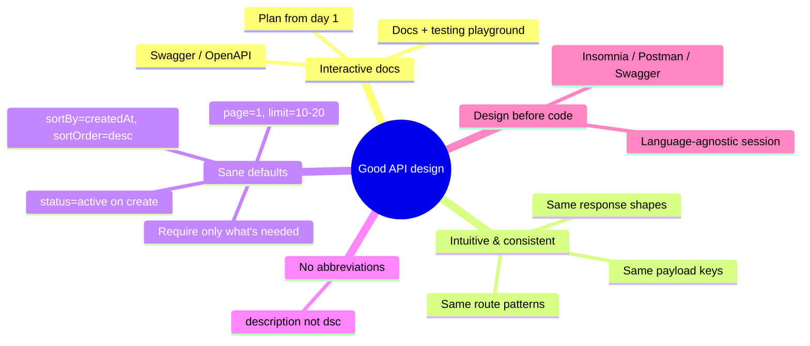

| # | Practice | Details |
|---|---|---|
| 1 | **Interactive documentation** | Use **Swagger / OpenAPI**. Plan it **from the start**. It works as **docs and a test playground** for you and integrators. Keeping it **created, maintained and updated** is something that sets backend engineers apart. |
| 2 | **Intuitive and consistent** | Routes, dynamic params, custom actions, JSON payloads: **one pattern everywhere**. Ideally follow REST standards. If not, **follow *something*** and **never change style between endpoints**. |
| 3 | **Sane defaults** | **GET:** `page=1`, `limit=10/20`, `sortBy=createdAt`, `sortOrder=desc`. **POST:** require only what's **absolutely needed**. Default the rest. E.g. a new org's `status` defaults to **`active`**, so `{ "name": "Acme" }` alone creates a valid org. |
| 4 | **No abbreviations** | `description`, not `dsc`. Integrators **don't have your context**. Keep fields and query params **readable and intuitive**. |
| 5 | **Design first, code second** | A REST API is **designed** before it's programmed. Spend a **separate, language-agnostic session** designing the interface in Swagger/Insomnia/Postman. It shows how consumers will use the API. |

---

## 18. Status Code Cheat Table

| Scenario | Method | Status | Body |
|---|---|---|---|
| List resources (even if empty) | GET | **200** | `{ data, total, page, totalPages }` |
| Get a single resource | GET | **200** | entity |
| Single resource doesn't exist | GET/PATCH/DELETE/POST action | **404** | error message |
| Create a resource | POST | **201** | created entity |
| Update (partial) | PATCH | **200** | updated entity |
| Delete | DELETE | **204** | *(empty)* |
| Custom action that **modifies** (archive) | POST | **200** | updated entity |
| Custom action that **creates** (clone) | POST | **201** | new entity |
| Invalid input | any | **400** | validation errors ([Validation_Notes.md](Validation_Notes.md)) |

---

## 🧾 Quick Revision Cheat Sheet

```
REST = REpresentational State Transfer   (Roy Fielding, PhD dissertation, 2000)
6 constraints: Client-Server · Uniform Interface · Layered · Cache · Stateless · Code-on-Demand (opt.)

https://api.example.com/v1/organizations/:id/archive?page=1#frag
        └─ api. subdomain ─┘└ver┘└─ PLURAL ─┘└item┘└action┘
```

| Topic | Rule |
|---|---|
| Resource names | **Plural**, lowercase, nouns. `/books/:id`, never `/book/:id`. |
| Readable IDs | **Slugs**: lowercase + hyphens (`harry-potter`). No spaces or underscores. |
| `/` | Hierarchy: collection → item → action |
| GET | Fetch. Idempotent. No body. Use query params. |
| POST | Create (**201**) or **custom action** (200 or 201). **Not idempotent.** |
| PATCH | Partial update (**preferred**). Returns 200 + updated entity. |
| PUT | Full replacement. Send all fields. Rarely needed. |
| DELETE | Returns **204**, empty body. Idempotent (2nd call → 404, no side effect). |
| Same-route pairs | `GET`/`POST` on `/things` · `GET`/`PATCH`/`DELETE` on `/things/:id` |
| Custom actions | `POST /things/:id/<action>` (archive, clone, send-email) |
| Pagination | `?page=&limit=` → `{ data, total, page, totalPages }`. Defaults 1 / 10–20. |
| Sorting | `?sortBy=&sortOrder=`. Defaults **createdAt / desc**. Always sort (the DB has no order). |
| Filtering | `?<field>=<value>`, e.g. `?status=active` |
| Empty list | **200** + `[]`, **never 404** |
| Missing single item | **404** |
| JSON keys | **camelCase**, consistent across all resources, **no abbreviations** |
| Server-handled fields | Never accept `id`, `createdAt`, `updatedAt` from the client |
| Workflow | Wireframes → nouns/resources → DB schema → actions (CRUD + custom) → design interface → code |
| Docs | Swagger / OpenAPI, interactive, from day 1, kept up to date |

---

## ❓ Self-Test Questions

<details>
<summary>1. Why do API-design questions still confuse people despite established standards?</summary>

The standards were written in the **MPA era** (server-rendered pages). Today's **SPAs** exchange JSON and route on the client, so the old guidance doesn't map cleanly onto modern apps.
</details>

<details>
<summary>2. Who invented the WWW, and what six things did they create?</summary>

**Tim Berners-Lee** (1990): **URI, HTTP, HTML, the first web server, the first web browser, and the first WYSIWYG HTML editor**.
</details>

<details>
<summary>3. What problem did Roy Fielding address, and what came out of it?</summary>

The web's **scalability crisis** from exponential growth. He proposed architectural **constraints**, co-wrote **HTTP/1.1**, and named the style **REST** in his **2000 PhD dissertation**.
</details>

<details>
<summary>4. List the six REST constraints. Which one is optional?</summary>

Client-server, uniform interface, layered system, cache, stateless, and **code on demand (optional)**.
</details>

<details>
<summary>5. Explain each word in "Representational State Transfer".</summary>

**Representational:** resources have formats (JSON, XML, HTML), and the same resource can have several. **State:** a resource's current attributes (e.g. cart items, quantities, total). **Transfer:** representations move between client and server via HTTP methods.
</details>

<details>
<summary>6. Fix this route: GET /v1/Book/Harry_Potter</summary>

`GET /v1/books/harry-potter`: plural resource, lowercase, slug with hyphens (no capitals or underscores).
</details>

<details>
<summary>7. Why is DELETE idempotent even though the second call returns 404?</summary>

Idempotency is about **side effects**. The first call deletes the resource. Later calls change nothing on the server; they just report that it doesn't exist.
</details>

<details>
<summary>8. Why is POST the only non-idempotent method among the five?</summary>

Each call **creates a new resource** with a new DB-generated ID, so repeating it gives a **different side effect** each time (1,000 calls → 1,000 books).
</details>

<details>
<summary>9. PATCH or PUT for updating a user's name? Why?</summary>

**PATCH.** You're sending a **partial** update (just the name). PUT means replacing the **whole** resource and sending every field.
</details>

<details>
<summary>10. Which method and route for "archive organization 5"? Why not PATCH status?</summary>

`POST /organizations/:id/archive`. Archiving is a **custom action** that may trigger many side operations (delete projects and tasks, notify users), not just a field update.
</details>

<details>
<summary>11. Describe the API design workflow, step by step.</summary>

Wireframes/requirements → identify **nouns (resources)** → **DB schema** → list **actions** (CRUD + custom) → **design the interface** in Insomnia/Postman/Swagger → then implement in code.
</details>

<details>
<summary>12. Which fields should a create endpoint NOT accept from the client?</summary>

Server/DB-managed fields: **`id`, `createdAt`, `updatedAt`**.
</details>

<details>
<summary>13. Give two reasons to paginate list APIs.</summary>

Serializing huge result sets is **slow and resource-heavy**, and users see a **perceived delay** even though they only look at 10–20 items at a time.
</details>

<details>
<summary>14. total=5, limit=2. What's totalPages, and what does page 3 contain?</summary>

`ceil(5/2) = 3` pages. Page 3 has **one** item: the oldest (org1, with the default `createdAt desc` sort).
</details>

<details>
<summary>15. Why should list APIs always sort by default?</summary>

The database **doesn't guarantee row order**. Without a sort, results may come back in a different order on each call. The default is `createdAt desc`.
</details>

<details>
<summary>16. GET /organizations?status=xyz matches nothing. What status code and body?</summary>

**200 OK** with `{ data: [], total: 0, page: 1, totalPages: 0 }`. Never 404 for a list.
</details>

<details>
<summary>17. Archive returns 200, but clone returns 201. Both are POST. Why?</summary>

The status code reflects **what happened**. Archive **modifies** an existing resource (200). Clone **creates** a new one (201). Never assume POST means 201.
</details>

<details>
<summary>18. What's wrong with using "dsc" in /projects when /organizations uses "description"?</summary>

It's **inconsistent** and an **abbreviation**. Integrators assume the same keys across resources, so they'll hit validation errors and waste time.
</details>

<details>
<summary>19. What does "sane defaults" mean for GET list calls and for POST create calls?</summary>

**GET:** `page=1`, `limit=10–20`, `sortBy=createdAt`, `sortOrder=desc`. **POST:** require only the essential fields and default the rest (e.g. `status=active` for a new org).
</details>

<details>
<summary>20. What tool should you set up early to document and test your API?</summary>

**Swagger / OpenAPI**: an interactive playground that serves as both documentation and a testing tool.
</details>

---

*Notes compiled from the video transcript. Timestamps (mm:ss / h:mm:ss) let you jump back to each section. Transcription fixes: "team mesly / Team Bal Le" → Tim Berners-Lee, "sly.XYZ" → the presenter's demo domain, "item poent / emut" → idempotent, "Cur" → curl, "same/CN defaults" → sane defaults.*
