# Authentication and Authorization: Complete Revision Notes

> **Source:** [YouTube: Authentication & Authorization (Backend from First Principles series, part 8)](https://www.youtube.com/watch?v=A95rliroC8Q&list=PLui3EUkuMTPgZcV0QhQrOcwMPcBCcd_Q1&index=8)
> **Length:** ~1h 36m
> **Previous videos:** [HTTP_Notes.md](HTTP_Notes.md) · [Routing_Notes.md](Routing_Notes.md) · [Serialization_Notes.md](Serialization_Notes.md)
> **Next video:** Validations and Transformations
> **Goal of the video:** Understand, at a high level and technically, how authentication and authorization work: their history, the building blocks (sessions, JWTs, cookies), the four main auth types, RBAC, and two key security practices.

> 💡 Diagrams use **Mermaid**. They render in GitHub, VS Code (with a Mermaid preview extension), Obsidian, Notion, and the Claude app. Anything marked **📌 Extra** was added to clarify a point and is not in the video.

---

## 📑 Table of Contents

1. [TL;DR: The Whole Video in 15 Lines](#-tldr-the-whole-video-in-15-lines)
2. [Authentication vs Authorization (Two-Sentence Summary)](#1-authentication-vs-authorization-0000)
3. [History of Authentication](#2-history-of-authentication-0151)
4. [Digital Era Origins: Passwords, Hashing, Cryptography](#3-digital-era-origins-0837)
5. [Multi-Factor Authentication (1990s)](#4-multi-factor-authentication-1300)
6. [Modern and Future Authentication](#5-modern-and-future-authentication-1500)
7. [Building Block 1: Sessions](#6-building-block-1-sessions-1832)
8. [Building Block 2: JWT (JSON Web Tokens)](#7-building-block-2-jwt-2538)
9. [Hybrid Approach and "Just Use an Auth Provider"](#8-hybrid-approach-and-auth-providers-3440)
10. [Building Block 3: Cookies](#9-building-block-3-cookies-3820)
11. [Auth Type 1: Stateful Authentication](#10-auth-type-1-stateful-authentication-4201)
12. [Auth Type 2: Stateless Authentication](#11-auth-type-2-stateless-authentication-4435)
13. [Stateful vs Stateless: Pros, Cons, and the Hybrid Strategy](#12-stateful-vs-stateless-4700)
14. [Auth Type 3: API Key Authentication](#13-auth-type-3-api-key-authentication-5021)
15. [Auth Type 4: OAuth 1.0, OAuth 2.0 and OpenID Connect](#14-auth-type-4-oauth-and-openid-connect-5801)
16. [Choosing the Right Auth Method](#15-choosing-the-right-auth-method-11720)
17. [Authorization and RBAC](#16-authorization-and-rbac-11910)
18. [Security Best Practices: Error Messages and Timing Attacks](#17-security-best-practices-12740)
19. [Cheat Sheet / Quick Revision](#-quick-revision-cheat-sheet)
20. [Self-Test Questions](#-self-test-questions)

---

## ⚡ TL;DR: The Whole Video in 15 Lines

1. **Authentication = "Who are you?"** (identity). **Authorization = "What can you do?"** (permissions), both within a given context.
2. History: **implicit trust** (village elder, handshake) → **seals** (*something you have*) → **passphrases** (*something you know*) → **passwords** (MIT CTSS, 1961) → **hashing** → **asymmetric crypto** (Diffie-Hellman, 1970s) → **Kerberos tickets** → **MFA** (+ *something you are*) → **OAuth, JWT, zero trust, passwordless**.
3. **Sessions** give stateless HTTP a memory. The server stores user data under a **session ID** (in a DB or **Redis**) and gives the client that ID in a **cookie**.
4. **JWT** = a **stateless, self-contained, signed** token with three parts: **header**, **payload** (`sub`, `iat`, role, ...), and **signature**.
5. JWT pros: **stateless**, **scalable**, **portable**. Cons: **a stolen token can impersonate you**, and you **can't revoke** a token before it expires (short of rotating the secret, which logs everyone out).
6. **Hybrid:** JWT plus a **blacklist** in Redis/DB. Practical advice: in production, use an **auth provider** (Auth0, Clerk, ...), but build your own auth while learning.
7. **Cookies:** the server stores data in the browser, and the browser **automatically sends it back** with every request to that server.
8. **Stateful auth:** session ID in an **HttpOnly cookie**, looked up in **Redis** on each request. Easy revocation, central control, less scalable.
9. **Stateless auth:** a **signed JWT** sent in the `Authorization` header and verified with a **secret key**, with no lookup. Scalable, but hard to revoke.
10. **API keys:** generated in a UI, used for **machine-to-machine** (programmatic) access, e.g. the OpenAI API.
11. **OAuth** solves **delegation** (one app accessing your data in another app) by sharing **scoped tokens instead of passwords**. Roles: **resource owner, client, resource server, authorization server**.
12. **OAuth 2.0** added **bearer tokens** and flows: **authorization code**, **implicit** (discouraged), **client credentials** (M2M), **device code** (smart TVs).
13. **OpenID Connect (OIDC)** adds **authentication** on top of OAuth 2.0 via an **ID token (a JWT)**. This powers "Sign in with Google".
14. **RBAC:** roles (user, admin, moderator) map to permissions. The server works out the role early in the request, and a missing permission gets **403 Forbidden**.
15. Security: use **generic auth error messages** ("Authentication failed"), and defend against **timing attacks** with **constant-time comparison** or **artificial delays**.

---

## 1. Authentication vs Authorization (00:00)

We meet authentication every day: login screens, sign-up screens. These are **authentication flows**.

| | **Authentication** | **Authorization** |
|---|---|---|
| Question | **Who are you?** | **What can you do?** |
| Technical definition | Assigning an **identity** to a **subject** | Determining the subject's **capabilities / permissions** |
| Scope | Within a **given context** (a platform, an OS, a phone) | Within that same context |
| Example | Logging in with email and password | Only admins can view deleted notes |

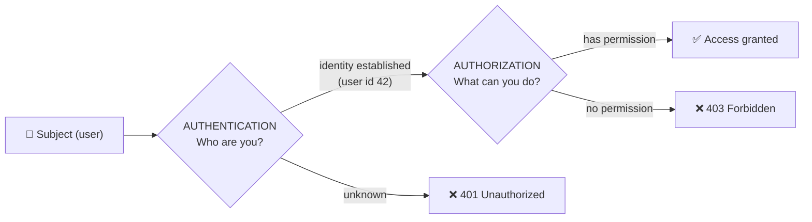

> 🔑 Authentication always comes **first**: you can't decide what someone can do until you know who they are.

---

## 2. History of Authentication (01:51)

### Timeline

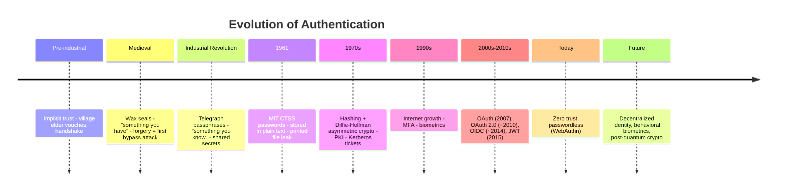

### 2.1 Pre-industrial societies: implicit trust
- Authentication was **intrinsic/implied**: your identity was your **recognition** in the community.
- A respected person (e.g. a **village elder**) could **vouch** for you, and deals were sealed with a **handshake** (mutual recognition and agreement).
- It was **human contextual trust**.
- ❌ **Didn't scale:** as populations grew and interactions went beyond familiar circles, the village elder wasn't trusted everywhere.
- This started the search for **explicit authentication**: proof of identity that works **independently of personal acquaintance**.

### 2.2 Medieval period: seals (something you HAVE)
- **Wax seals** with unique patterns were stamped on letters and agreements, acting as **signatures**.
- They were an early **cryptographic mechanism** and the **first widely adopted authentication tokens**: a physical representation of identity based on **possession**.
- ❌ Vulnerable to **forgery**, the first recorded **authentication bypass attacks** (skipping authentication with malicious intent).
- This led to **watermarks** and **encrypted codes** in trade documents, the foundation of **cryptographic thinking**.

### 2.3 Industrial Revolution: passphrases (something you KNOW)
- Communication systems advanced. The **telegraph** became critical infrastructure and needed **secure message validation**.
- Operators used **pre-agreed passphrases**, an early form of **shared secrets**.
- They were **static** (one fixed string), like today's static passwords.
- The principle shifted from **something you have** to **something you know**, which is more secure and the ancestor of the modern **password**.

```
 Something you ARE      ← 1990s+ (biometrics)
 Something you KNOW     ← Telegraph passphrases → passwords, PINs
 Something you HAVE     ← Wax seals → smart cards, OTP generators
 Implicit TRUST         ← Village elder / handshake
```

---

## 3. Digital Era Origins (08:37)

### 3.1 Mainframes and the first passwords (1961)
- In the mid-20th century, **mainframes** brought authentication into its **first digital phase**.
- **1961: MIT's Project MAC** worked on **CTSS (Compatible Time-Sharing System)** and introduced **passwords for multi-user systems**, so many users could share a computer **without seeing each other's data**.
- ❌ Passwords were stored in **plain text**. Someone **printed the password file**, exposing everyone's passwords.
- That incident marked the **genesis of secure password storage**, and the principle that **passwords must never be stored in plain text**.

### 3.2 Hashing
This led to **hashing**: cryptographic algorithms that turn a password into an **irreversible, fixed-length** representation.

```
   "abc"                         ──► HASH ──► 5e884898da28047151d0e56f8dc62927...  (fixed length)
   "a very long 100-char string" ──► HASH ──► 9f86d081884c7d659a2feaa0c55ad015...  (same length!)
   "abc" (again)                 ──► HASH ──► 5e884898da28047151d0e56f8dc62927...  (SAME output)
                                        ✗ cannot reverse back to "abc"
```

| Property | Meaning |
|---|---|
| **Fixed length** | Output length depends only on the algorithm, not on the input length (3 characters or 100) |
| **Deterministic** | The same input always gives the same hash |
| **Irreversible** | You can't get the plain text back from the hash |

- Authentication began aligning with the **CIA triad**, the core tenets of information security: **Confidentiality, Integrity, Availability**.

### 3.3 The 1970s: asymmetric cryptography
- An **explosion in cryptographic research**, driven by **Whitfield Diffie and Martin Hellman**.
- The **Diffie-Hellman key exchange** introduced **asymmetric cryptography**: two parties can establish a **shared secret over an untrusted medium**.
- Asymmetric crypto became the **backbone of modern authentication protocols**, a.k.a. **PKI (Public Key Infrastructure)**.

> 📌 **Extra:** asymmetric means there are **two keys**. A **public key** can be shared with anyone, and a **private key** is kept secret. Data locked with one can only be unlocked with the other. HTTPS/TLS certificates rely on this.

### 3.4 Kerberos
- **Kerberos** introduced **ticket-based authentication**.
- It relies on a **trusted third party** to issue **tickets** that verify **both the user's and the service's identity**.
- It's a **precursor to today's token-based authentication**.

---

## 4. Multi-Factor Authentication (13:00)

- In the **1990s** the internet grew, and **scalable** authentication was needed.
- Plain **username and password** wasn't strong enough against the new **brute-force** and **dictionary attacks**.
- **MFA (Multi-Factor Authentication)** combines **different factors**:

| Factor | Principle | Examples |
|---|---|---|
| 🧠 **Something you know** | Knowledge | Password, PIN |
| 💳 **Something you have** | Possession | Smart card, **OTP generator** / authenticator app |
| 👆 **Something you are** | Inherence | **Biometrics**: fingerprint, retina scan |

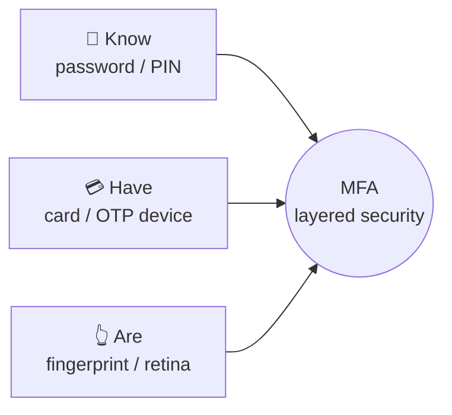

- **Biometric authentication** was a big step, using **pattern recognition** and **statistical models** to identify users by unique physical traits.
- ❌ But biometrics brought new problems: **false positives / false negatives** and **template security** (protecting the stored biometric data). They weren't a one-step solution.

---

## 5. Modern and Future Authentication (15:00)

### Modern (21st century)
**Cloud computing, mobile devices and API-based architectures** demanded more advanced frameworks. Key components that emerged and are still used today:

| Component | What it is |
|---|---|
| **OAuth / OAuth 2.0** | Delegated authorization with tokens (section 14) |
| **JWT** | Stateless, self-contained tokens (section 7) |
| **Zero Trust Architecture** | 📌 Extra: "never trust, always verify". Every request is authenticated, even inside the internal network. |
| **Passwordless** (e.g. **WebAuthn**) | Removes passwords entirely, using **public/private keys stored in hardware devices** |

### Future candidates
| Candidate | Idea |
|---|---|
| **Decentralized identity** | Identity built on technologies like **blockchain**. Still early-stage and experimental, but promising. |
| **Behavioral biometrics** | Identify users by behavior patterns (📌 Extra: typing rhythm, mouse movement, ...) |
| **Post-quantum cryptography** | Once **quantum computers** are common, they'll be fast enough to **break today's algorithms** (RSA and other public/private key algorithms). Post-quantum crypto means algorithms that stay **secure even against quantum computers**. Some already exist. |

---

## 6. Building Block 1: Sessions (18:32)

The video introduces three components used again and again in auth flows: **Sessions, JWTs, Cookies**.

### Why sessions exist
- **HTTP is stateless** by design: every request is an **isolated interaction** with **no memory** of past exchanges (see [HTTP_Notes.md](HTTP_Notes.md)).
- That was fine for the **early web**: static pages, images, read-only content, with no need for continuity.
- The web became **dynamic**, and statelessness became a **bottleneck**:
  - 🛒 E-commerce sites must **remember cart items**.
  - 🔐 Users must **stay logged in** while navigating between pages.
- That created the need for **stateful interactions**, so **sessions** were introduced.

> **Session:** a **temporary server-side context** for each user. It gives the server a **memory** of the user across requests.

### How sessions work

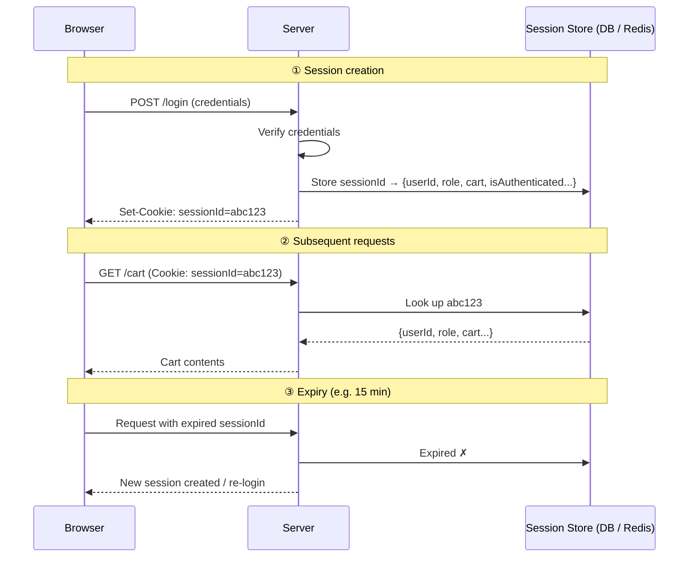

1. **Session creation:** on login, the server creates a **unique session ID** and stores it with the relevant **user data** (role, name, cart items, auth status, anything needed repeatedly) in a **persistent store** (a database or **Redis**).
2. **Session ID to client:** the server sends the ID to the browser **as a cookie**. Every later request **includes the cookie**, so the server can fetch the user's data using the ID.
3. **Expiry:** sessions are **short-lived** (e.g. 15 minutes). After expiry, a new session is created.

### Evolution of session storage

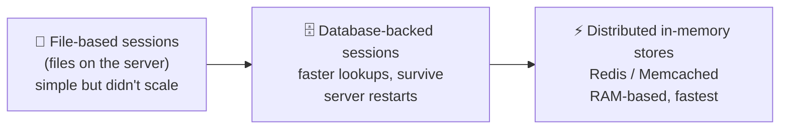

| Stage | Pros | Cons |
|---|---|---|
| **File-based** | Simple | **Scalability issues** as users grow |
| **Database-backed** | Handles large user bases, **persists across server restarts** | Slower than memory |
| **Redis / Memcached** (in-memory, distributed) | **Much faster**: data is in **RAM** instead of on disk | Extra infrastructure |

> Sessions are **still used today** for the same purpose: giving servers memory.

---

## 7. Building Block 2: JWT (25:38)

### Why JWTs appeared
By the **mid-2000s**, web apps had become **globally distributed systems**, and stateful sessions became a bottleneck:

| Problem | Explanation |
|---|---|
| 💾 **Memory** | Keeping session data for **millions of users** became **costly** |
| 🌍 **Replication** | Syncing session data **across servers/regions** (opposite sides of the world) added **latency** and **consistency** problems |

Developers wanted to **offload state from the server** while keeping **security and integrity**. That led to **JWT (JSON Web Token)**, **formalized in 2015**.

> **JWT:** a **stateless** mechanism for **transferring claims** between two parties/systems.
> **Key innovation:** **self-contained tokens**. User data (ID, role) plus a **cryptographic signature** in **one token**, **Base64-encoded**.

### JWT structure (see jwt.io)

```
 eyJhbGciOiJIUzI1NiIsInR5cCI6IkpXVCJ9 . eyJzdWIiOiIxMjM0NTY3ODkwIiwibmFtZSI6IkpvaG4iLCJpYXQiOjE1MTYyMzkwMjJ9 . SflKxwRJSMeKKF2QT4fwpMeJf36POk6yJV_adQssw5c
 └────────────── HEADER ─────────────┘   └─────────────────────────── PAYLOAD ──────────────────────────────┘   └──────────── SIGNATURE ────────────┘
```

| Part | Contains | Example |
|---|---|---|
| **1. Header** | **Metadata about the token**, e.g. the **signing algorithm** used | `{"alg": "HS256", "typ": "JWT"}` |
| **2. Payload** | The actual **data / claims** | `{"sub": "1234567890", "iat": 1516239022, "name": "John", "role": "admin"}` |
| **3. Signature** | Proves the token was **issued by you** and **not tampered with**, created using your **secret key** | `HMACSHA256(base64(header) + "." + base64(payload), secret)` |

**Common payload fields (claims):**

| Claim | Meaning |
|---|---|
| `sub` (subject) | The **user ID**, from your DB, an auth provider, any context |
| `iat` (**issued at**) | **When** the token was issued |
| Optional | `name`, `role` (admin / member / editor / viewer), anything else you need |

### How verification works

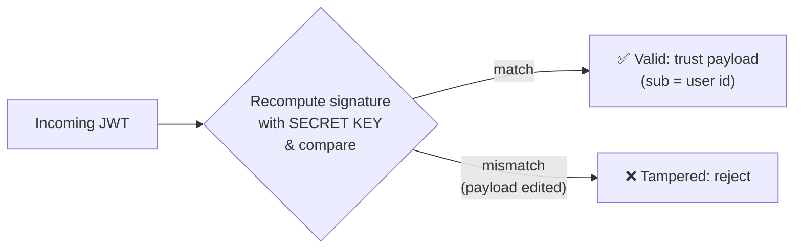

If anyone **modifies** the JWT, verifying it with your secret key **fails**, so you know it's been tampered with. You can verify identity **without storing anything**: verification is lightweight, happens on every request, and saves storage costs.

> 📌 **Extra:** **Base64 is encoding, not encryption.** Anyone can decode a JWT and **read** the payload (try it on jwt.io). The signature only stops **modification**, not reading. **Never put secrets (like passwords) in a JWT payload.**

### Advantages of JWTs

| Advantage | Explanation |
|---|---|
| **Statelessness** | **No server-side storage** cost |
| **Scalability** | In **microservice / distributed** setups, a cookie from one server may not work for another domain. With JWTs, the client sends the token to any server, and **every server that has the shared secret key can verify it**. Scale to many instances without worrying about auth. |
| **Portability** | Lightweight, **URL-friendly** Base64 string. It can be passed between systems and stored in cookies or local storage (⚠️ the presenter says you *shouldn't* use local storage), even in URL values. |

### Disadvantages of JWTs

| Disadvantage | Explanation |
|---|---|
| **Token theft** | Stateless means there's no stored record to check. **Whoever has your JWT can impersonate you** until it expires. |
| **No revocation** | The server can't invalidate a single token before it expires. The only option is **rotating the secret key**, which **logs out ALL users** just to kill one token. |

---

## 8. Hybrid Approach and Auth Providers (34:40)

### Typical JWT flow
User logs in → server returns a JWT → the client stores it → it's sent with every request (in the `Authorization` header, a cookie, ...) → the server verifies it with the secret key and reads the user ID. **No storage lookup.**

### Hybrid approach (stateless + stateful)
After verifying the JWT, **also check a blacklist** of revoked tokens stored in a **DB or Redis/Memcached**. This lets you **revoke or block** access (e.g. a **hacked account** or **malicious activity**).

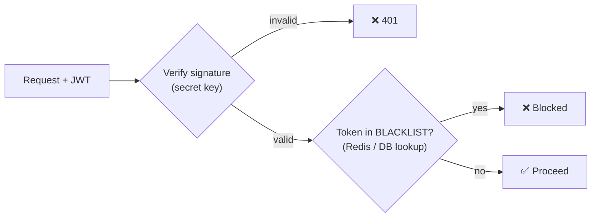

**The debate:** the whole point of JWT was statelessness. If you look up storage on every request anyway, **why not just use stateful sessions**, which are considered **more secure**? This question comes up often in the industry.

### 💡 The presenter's practical advice
- Don't agonize over every strategy. For **medium-to-large production systems**, use an **external auth provider** like **Auth0** or **Clerk**.
- Hashing, salting, secure algorithms and every other detail become **their** problem.
- **While learning** backend engineering, **implement auth yourself** to understand the parts, trade-offs, pros and cons.
- In production, use an auth provider **unless you're very confident** in your own auth workflows.

---

## 9. Building Block 3: Cookies (38:20)

> **Cookie:** a way for the **server to store a piece of information** (any string) **in the user's browser**.

Key properties (features provided by browsers):
- A cookie is **only accessible to the server that set it**. A server **can't see other servers' cookies** (a security feature).
- Once set, the browser **automatically sends the cookie with every later request** to that server.

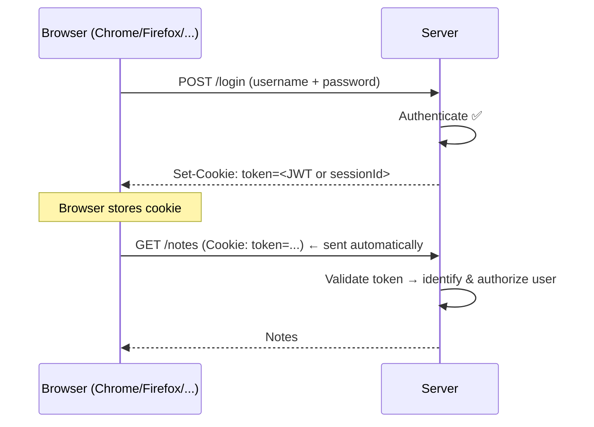

> 🔑 Cookies **automate** the token round trip: the server hands over the token and the client sends it back, **all controlled from the server side**.

---

## 10. Auth Type 1: Stateful Authentication (42:01)

The video lists the major auth types a backend engineer uses daily:
1. **Stateful** 2. **Stateless** 3. **API key** 4. **OAuth 2.0 / OIDC**

### Flow

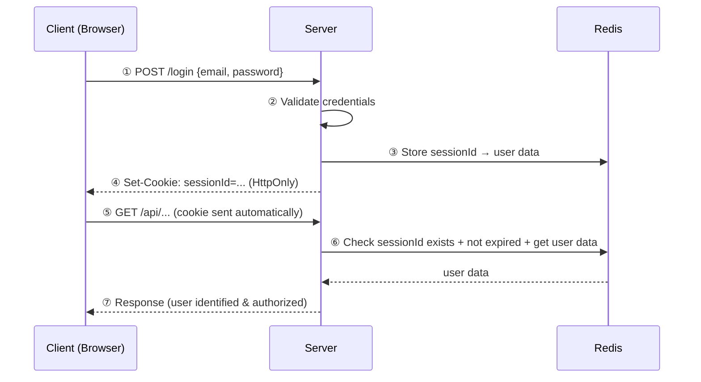

1. Client sends **username/email + password**.
2. Server checks they're correct and the user is eligible.
3. Server generates a **session ID**, bundles it with the **user data**, and stores it in **Redis** (or a DB). Redis is common because of its **fast reads**.
4. Server sends the session ID in an **HttpOnly cookie**, meaning **JavaScript can't read it**.
5. Every later request **automatically carries the cookie**.
6. Server takes the session ID and checks in Redis that it **exists**, its **expiry**, and the **user data**.
7. User is identified and authorized, and the API call succeeds.

> The session ID can be any **cryptographically random string**, or even a JWT, depending on the implementation.

---

## 11. Auth Type 2: Stateless Authentication (44:35)

### Flow

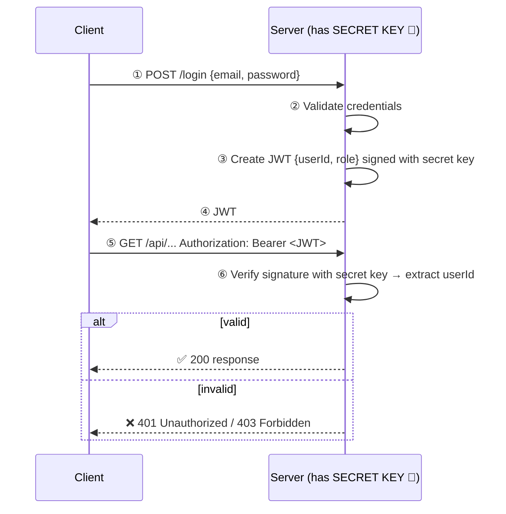

1. Client sends credentials.
2. Server validates them.
3. Server creates a **signed JWT** with user info (ID, role) using its **secret key**. The key must be **stored securely**, since it both **signs** and **verifies** tokens.
4. JWT is sent back to the client.
5. On later requests, the client sends the JWT, by standard in the **`Authorization` header**.
6. Server extracts and **verifies** it with the secret key and gets the user ID. Success means the API responds. Failure means an **Unauthorized / Forbidden** error.

### Why "stateless"?

```
 STATEFUL:   request ──► server ──► 🔍 lookup in Redis/DB ──► who is this?
 STATELESS:  request ──► server ──► 🔑 verify token itself ──► who is this?  (no lookup)
```

All the user info needed is **inside the signed token** itself. It's **self-contained**.

---

## 12. Stateful vs Stateless (47:00)

| | **Stateful** (sessions) | **Stateless** (JWT) |
|---|---|---|
| Where state lives | Server-side store (Redis/DB) | Inside the token |
| Lookup per request | ✅ Yes | ❌ No (just signature verification) |
| **Pros** | **Centralized control** · **real-time view of active sessions** · **easy revocation** (log out a user, kill a session) · well suited to moderate traffic with strict session needs | **Scalability** · **no session store dependency** · ideal for **distributed architectures** · **mobile-friendly** (where cookies aren't a thing) |
| **Cons** | **Limited scalability** · **higher operational complexity** in distributed, multi-region systems (latency) | **Token revocation is complex**: no way to revoke before expiry except rotating the secret, which logs out **everyone** |

> 💡 **Presenter's opinion:** **most applications should go with stateful authentication**, because it's more secure, revocation is convenient, and you get real-time information about user access.
>
> Example: a user's account is **compromised** and they contact support to kill their sessions. With stateless JWTs, you can't, unless you rotate the secret and log out all users.

### Hybrid strategy

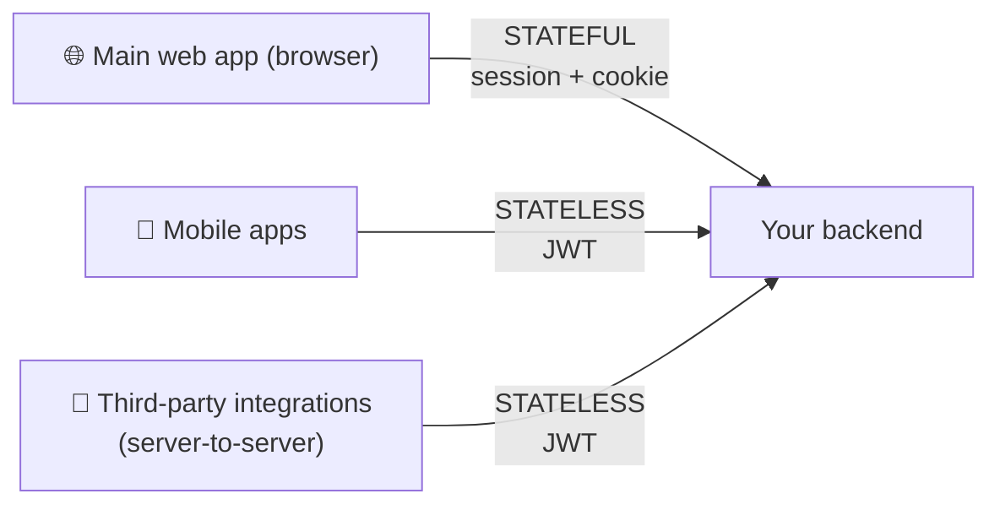

Use **stateful auth for browsers/web apps**, and **stateless auth for mobile apps and third-party integrations**, for scalability and simplicity. You get the benefits of both.

---

## 13. Auth Type 3: API Key Authentication (50:21)

Built for a **completely different set of use cases** from stateful/stateless auth.

### How it works
1. Log into the platform's UI and click **"Generate API key"**.
2. You get a **cryptographically secure random string**.
3. Use the string to access **the server behind that UI directly**, **programmatically**.

### Example: ChatGPT vs the OpenAI API

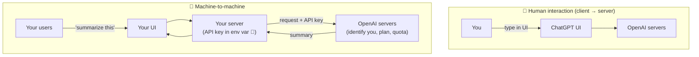

- **ChatGPT UI:** you type, servers respond, and the UI renders it nicely. That's **human/visual interaction**.
- **OpenAI API keys:** for people who want **programmatic access** to the model (GPT-4, GPT-3.5, ...) without the ChatGPT UI, e.g. to build their own UI or use the model inside **their own server**.
- API keys give access to **your server** (not your UI) to a different set of users, in a **confined**, **permission-based**, **expiry-based** way.
- The key is attached to requests (in **headers**, or however the server specifies), and you can do anything the native platform can do through the API.
- The provider's server uses the key to identify **you**, your **plan**, your **remaining quota**, and your **access level**.

### Advantages

| Advantage | Explanation |
|---|---|
| **Easy to generate** | Click a button in the UI and you're done |
| **Ideal for machine-to-machine (M2M) communication** | No human in the loop |

### Client-to-server vs machine-to-machine

| | Client-to-server (human) | Machine-to-machine |
|---|---|---|
| Trigger | Human (mouse, keyboard, login form) | Code / program |
| Auth flow | Type username + password → server validates → JWT/session returned and saved | Give the machine a **secret key** once, stored in an **env var** or secure storage, and send it with **every request** |
| Fits | Stateful / stateless auth | **API keys** |

---

## 14. Auth Type 4: OAuth and OpenID Connect (58:01)

### 14.1 The problems that led to OAuth
Every new site meant **new credentials** to remember and manage:
1. **Security risk:** people **reused passwords** (`12345`, `password`), so **one breach compromised many accounts**.
2. **Fatigue:** managing a huge number of accounts was overwhelming.

### 14.2 The delegation problem
Websites started needing **access to resources on other websites**:
- ✈️ A **travel app** wants to read your **Gmail** to find flight tickets automatically.
- 👥 A **social media app** wants to **import your contacts** from Google Contacts or another platform.

**Delegation:** a user giving one platform **programmatic access** to their resources on **another** platform.

**First (disastrous) solution: sharing passwords.**

| Problem with sharing passwords | Why it's bad |
|---|---|
| **Full access** | A password gives access to **everything**, with no way to **limit permissions** |
| **Revocation is impossible** | You can only revoke by **changing your password**, everywhere you reused it |

### 14.3 OAuth 1.0 (2007): share tokens, not passwords
- **OAuth = Open Authorization.** Engineers from companies like **Google and Twitter** standardized secure access-sharing **without passwords**.
- **Core idea: share TOKENS with SPECIFIC permissions.**

```
 🔑 PASSWORD → access to EVERYTHING: photos, maps history, contacts (read/add/delete), calendar...
 🎫 TOKEN    → access to ONE specific thing: e.g. "READ contacts" only (not add, not delete)
```

### OAuth roles

| Role | Who | Example (Facebook importing Google contacts) |
|---|---|---|
| **Resource owner** | The **user who owns the data** | **You** |
| **Client** | The **app requesting access** | **Facebook** |
| **Resource server** | The server **holding the data** | **Google's servers** (your contacts) |
| **Authorization server** | The server that **authenticates the user and issues the token** | **Google's auth server** |

> 📌 **Clarification:** the transcript runs the last two together. The **resource server** holds the data (the Google Contacts API), and the **authorization server** issues the tokens (Google's login/consent server). With big providers they're often run by the same company, but they're separate roles.

### OAuth 1.0 flow

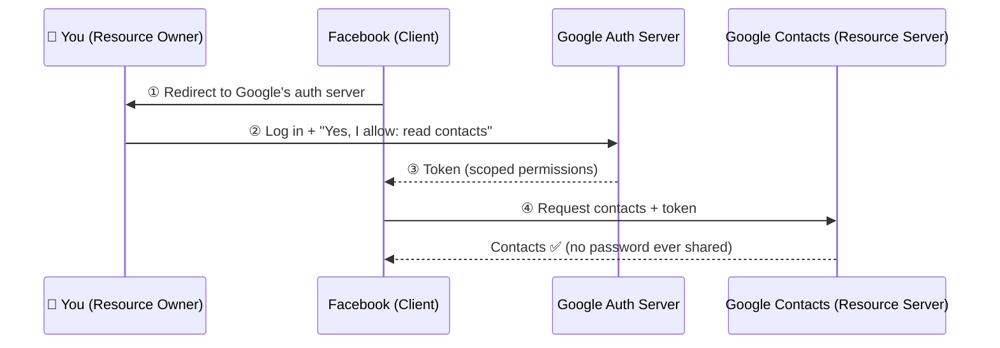

### 14.4 OAuth 2.0 (~2010)

**OAuth 1.0's limitations:**
1. **Too complex** for developers to implement.
2. Used **cryptographic signatures**, which were **error-prone**.

**What OAuth 2.0 changed:**
1. **Bearer tokens**: **much simpler** to implement (somewhat **more vulnerable**, since whoever holds the token can use it).
2. **Different flows for different app types:**

| Flow | For | Notes |
|---|---|---|
| **Authorization code flow** | **Server-side apps** | The most common and secure flow |
| **Implicit flow** | **Browser-based apps** | ⚠️ **Now discouraged** due to security risks |
| **Client credentials flow** | **Machine-to-machine** | Server ↔ server, **no user or browser** involved |
| **Device code flow** | **Limited-input devices** (no keyboard/mouse) | e.g. **smart TVs** |

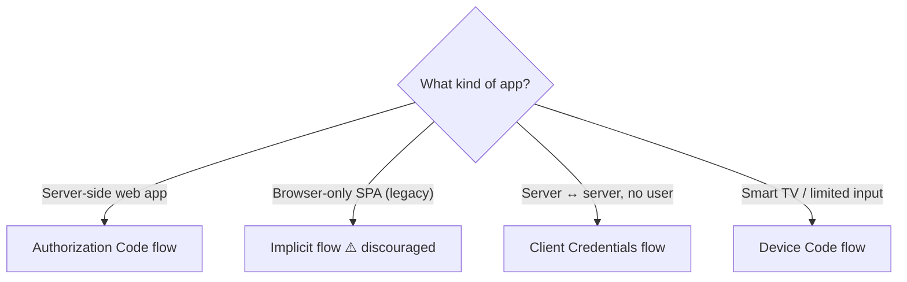

### 14.5 OpenID Connect (OIDC, ~2014)

**OAuth solved AUTHORIZATION (delegation), but not AUTHENTICATION.** It says what an app may access, but not **who the user is**.

**OIDC** is built **on top of OAuth 2.0** to fill the authentication gap.
- It adds an **ID token**, which is **a JWT** (one reason the video covered JWTs first).
- ID token contents:
  - **User ID** (`sub`)
  - **When they logged in** (`iat`, issued at)
  - **Issuing authority**: which platform issued it (📌 Extra: the `iss` claim)
  - **User's name, email**, and other profile info the client asked for

**This powers "Sign in with Google / Facebook / Discord".** The app takes your identity (email, name, profile picture) from Google and uses it to authenticate you, **without building its own auth system**.

### OIDC flow ("Sign in with Google" on a note-taking app)

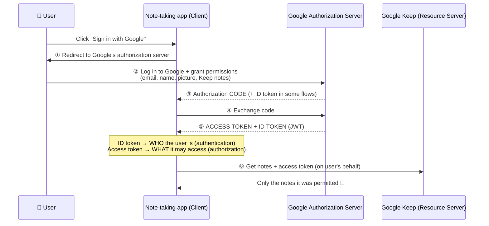

> 📌 **Clarification:** the transcript says the code is exchanged "with the resource server". In the standard flow, the authorization code is exchanged at the **authorization server's token endpoint**. The resulting **access token** is then used with the **resource server**.

| Token | Purpose | Format |
|---|---|---|
| **Authorization code** | Short-lived, one-time code exchanged for tokens | Opaque string |
| **ID token** (OIDC) | **Authentication**: who the user is | **JWT** |
| **Access token** (OAuth) | **Authorization**: act on the user's behalf on the resource server, **only within the granted permissions** | Often a JWT or opaque string |

> 🛡️ **Analogy:** OAuth 2.0 and OIDC are the **security guards / key makers of the digital age**. They make sure no user or platform gets **more access than it asked for and was granted**. Together they turned the internet from **password-sharing chaos** into a **secure, interconnected** system.

---

## 15. Choosing the Right Auth Method (1:17:20)

| Method | Use when | Typical examples |
|---|---|---|
| **Stateful** (session ID or JWT + persistent store) | **Web apps**, i.e. most **SaaS** products. User-specific session data stored on the server. | Dashboards, e-commerce, SaaS web apps |
| **Stateless** (JWT) | **APIs** and **scalable, globally distributed systems**. The token carries the user info. | Microservices, mobile backends |
| **OAuth / OIDC** | **Third-party integrations** and **login via external providers** | Sign in with Google/Facebook/Discord |
| **API keys** | **Server-to-server / M2M**, or **single-purpose client access** to APIs | OpenAI API, payment APIs |

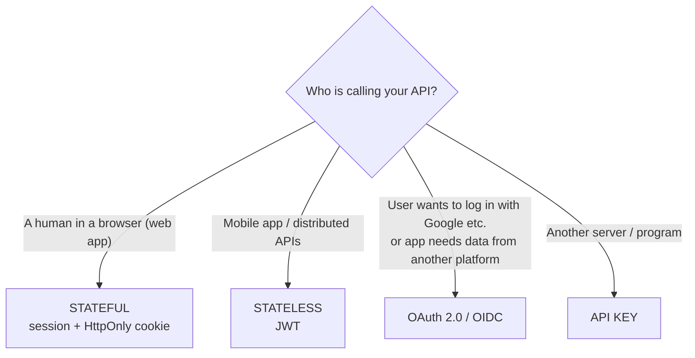

> 💡 In the presenter's experience, you'll use **stateful and stateless auth most of the time** when building APIs.

---

## 16. Authorization and RBAC (1:19:10)

### Recap
- **Authentication = WHO** (identity).
- **Authorization = WHAT** (permissions).

### Why authorization is needed: the note-taking example

```
 Note-taking platform
 ┌──────────────────────────────────────────────────────────────────────┐
 │ User: create / update / delete notes                                  │
 │   delete ──► 🗑️ Trash (user can restore or delete permanently)         │
 │                 └── after 30 days ──► ☠️ "DEAD ZONE"                    │
 │                                       (hidden from user, still in DB)  │
 │                                       ONLY the ADMIN may view these    │
 │                                       via a special "Admin UI"         │
 └──────────────────────────────────────────────────────────────────────┘
```

- You, as the **creator/admin**, want **special capabilities** (viewing dead-zone notes) that **regular users must not have**.

**❌ Naive solution: a secret "god mode" string sent with each API call.**
1. **Security risk:** if anyone **intercepts** it, they can wipe the DB or mess with other users' data.
2. **Doesn't scale:** to give friends or maintainers the same access, you either **share the string** or **add more strings**. Complex, hard to manage, more security flaws.

> **Authorization = giving specific permissions to specific users.** Not every user has the same access: some have more, some less, some a completely different set.
> **Multi-tenant example:** users create **organizations**, and the org admin assigns **read/write** to some members and **read-only** to others.

### RBAC: Role-Based Access Control

The most widely used authorization technique. **Roles** are assigned **sets of permissions**, and users are assigned **roles**.

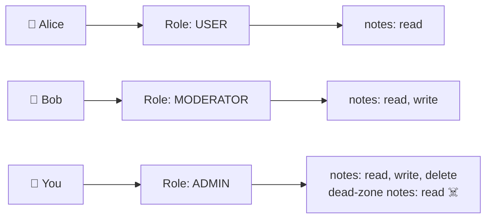

| Role | Notes | Dead-zone notes |
|---|---|---|
| **User** | read (as in the video's example) | ❌ |
| **Moderator** | read, write | ❌ |
| **Admin** | read, write (, delete) | ✅ |

- You can create **custom roles** with their own permissions, per resource, **as granular as you want**.

### RBAC request workflow

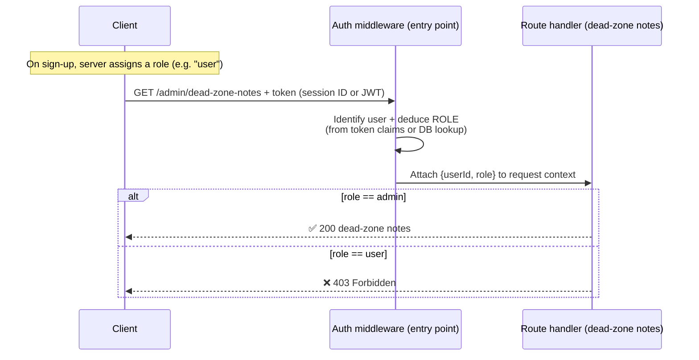

1. On **sign-up**, the server **assigns a role** (user, or admin depending on the case).
2. Each later request carries the identification: a **session ID** (stateful) or a **JWT** (stateless).
3. **Early in the request cycle** (the first entry point / middleware), the server works out the **role**, from the token or a **DB lookup**.
4. It **attaches the role** to the request so the **next middlewares and handlers** can use it. (**Middleware** gets its own video later.)
5. The handler checks: **admin** → access granted. **user** → **403 Forbidden** ("you don't have permission for this action/resource").

---

## 17. Security Best Practices (1:27:40)

### 17.1 Use generic error messages in auth flows

| ❌ "Helpful" message | 🕵️ What the attacker learns |
|---|---|
| "User not found" | That username **doesn't exist**, so **move on to the next** user on the list |
| "Incorrect password" | The username **is valid**, so focus on **brute-force / dictionary** attacks on the password |
| "Account locked due to too many failed attempts" | The account exists, plus details of your lockout policy |

✅ **Always** return a **generic** message for **every** auth failure, e.g. **"Authentication failed"** (or "Invalid credentials"). Keep attackers confused about their next step.

> User-friendly, specific messages are fine in **other** flows (form validation, other APIs), **just not in authentication**.

### 17.2 Timing attacks

**Typical login steps:**

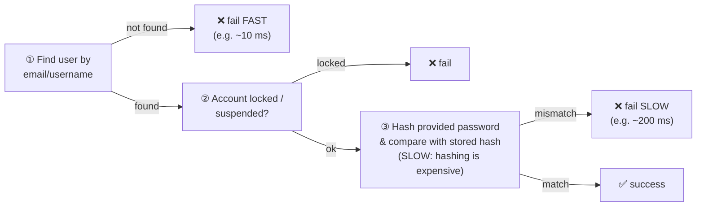

**Background: how password checking works.**
- Passwords are **never stored in plain text**. At sign-up, the password is **hashed** and the hash is stored in the DB. Even the server **can't recover the plain text**.
- At login, the server **hashes the provided password with the same algorithm** and **compares** it with the stored hash. If they match, the password is correct.

> 📌 **Extra:** the transcript sometimes says "encrypt", but password storage uses **hashing** (one-way), not encryption (two-way). Real systems use slow, salted password-hashing algorithms like **bcrypt, scrypt, or Argon2**. The **salt** (random data per user) is stored with the hash, so the same password gives different hashes for different users.

**The attack:**
- **Invalid username** → fails at step ① → **fast** response.
- **Valid username, wrong password** → fails at step ③ after the **expensive hash** → **slower** response (e.g. ~200 ms extra).
- By **measuring response times**, the attacker can tell **which step failed**, i.e. whether the **username exists**, and focus the attack. This leaks the same information as specific error messages.

```
 Response time
   │                                   ┌───────┐
   │                                   │ wrong │  ← valid user, wrong password (hashing ran)
   │                                   │  pwd  │
   │  ┌───────┐                        │       │
   │  │no user│                        │       │  ← invalid user (returned immediately)
   └──┴───────┴────────────────────────┴───────┴──►
        ~10 ms                            ~200 ms   👉 the difference leaks information!
```

**Defenses: equalize response times.**

| Defense | How |
|---|---|
| **Constant-time operations** | Use **cryptographically secure constant-time comparison functions** for password hashes. Execution time doesn't vary with how similar the inputs are. |
| **Simulated response delay** | Add an artificial delay so failures take the same time (Node: `setTimeout`, Go: `time.Sleep`). E.g. even when the username isn't found, wait ~200 ms before responding. |

> 📌 **Extra:** another common defense is to **always run the password hash**, comparing against a dummy hash when the user doesn't exist, so both paths cost the same.

---

## 🧾 Quick Revision Cheat Sheet

```
AUTHENTICATION = WHO are you?        → fails with 401 Unauthorized
AUTHORIZATION  = WHAT can you do?    → fails with 403 Forbidden
FACTORS: something you KNOW (password) · HAVE (card/OTP) · ARE (biometrics)
```

### History in one line
Village elder/handshake → wax seals (have) → telegraph passphrases (know) → MIT CTSS passwords 1961 (plain text, printed leak) → hashing → Diffie-Hellman/PKI 1970s → Kerberos tickets → MFA + biometrics 1990s → OAuth 2007 / OAuth 2.0 ~2010 / OIDC ~2014 / JWT 2015 → zero trust, passwordless → decentralized ID, behavioral biometrics, post-quantum crypto

### Building blocks
| | Key facts |
|---|---|
| **Session** | Server-side memory. Session ID → user data in DB/**Redis**. ID sent in a cookie. Expires. Storage evolved: files → DB → Redis/Memcached. |
| **JWT** | `header.payload.signature`, Base64. `sub` = user ID, `iat` = issued at. Signed with a secret key. ✅ stateless, scalable, portable. ❌ theft = impersonation, can't revoke. |
| **Cookie** | Server stores data in the browser. Only readable by the server that set it. Sent automatically with every request. `HttpOnly` = JS can't read it. |

### Four auth types
| Type | Mechanism | Best for |
|---|---|---|
| Stateful | Session ID in HttpOnly cookie + Redis lookup | Web apps / SaaS (presenter's default) |
| Stateless | JWT in `Authorization: Bearer` + secret-key verification | APIs, distributed systems, mobile |
| API key | Random secret generated in UI, sent in a header | Machine-to-machine |
| OAuth 2.0 / OIDC | Scoped tokens via an authorization server. OIDC adds an ID token (JWT). | Third-party access, "Sign in with Google" |

### OAuth essentials
- Roles: **resource owner** (you) · **client** (requesting app) · **resource server** (holds data) · **authorization server** (issues tokens)
- OAuth 1.0 (2007): tokens not passwords, but complex crypto signatures
- OAuth 2.0 (~2010): **bearer tokens** + flows: **auth code** (server apps), **implicit** (⚠️ discouraged), **client credentials** (M2M), **device code** (smart TV)
- OIDC (~2014): adds **authentication** via an **ID token (JWT)**: user ID, login time, issuer, name, email

### RBAC
User → **Role** → **Permissions** (per resource, as granular as needed). Role is worked out early (middleware) and attached to the request. Missing permission → **403**.

### Security
- Auth errors: **always generic** ("Authentication failed").
- Timing attacks: **constant-time comparison** + **artificial delay**.
- Never store passwords in plain text: **hash** them (bcrypt/argon2 + salt).
- Production: consider **Auth0 / Clerk**. Learning: build it yourself.

---

## ❓ Self-Test Questions

<details>
<summary>1. Define authentication and authorization in one question each.</summary>

Authentication: **"Who are you?"** Authorization: **"What can you do?"** Both are within a given context.
</details>

<details>
<summary>2. What were the three principles ("factors") of authentication, and which era introduced each?</summary>

**Something you have** (medieval wax seals), **something you know** (telegraph passphrases → passwords), **something you are** (biometrics, 1990s MFA).
</details>

<details>
<summary>3. What happened at MIT in 1961, and what did it lead to?</summary>

CTSS introduced passwords for multi-user systems but stored them in **plain text**. Someone printed the password file, which led to **secure password storage** and **hashing**.
</details>

<details>
<summary>4. Name three properties of a hash function.</summary>

**Fixed-length** output, **deterministic** (same input gives the same output), **irreversible**.
</details>

<details>
<summary>5. What did Diffie-Hellman introduce?</summary>

**Asymmetric cryptography**: two parties can establish a shared secret over an untrusted medium. It's the basis of PKI and modern auth protocols.
</details>

<details>
<summary>6. Why were sessions needed if HTTP is stateless?</summary>

Dynamic web apps needed **memory** across requests: shopping carts, staying logged in. Sessions provide a temporary **server-side context** per user.
</details>

<details>
<summary>7. Name the three parts of a JWT and what `sub` and `iat` mean.</summary>

**Header** (metadata/algorithm), **payload** (claims), **signature**. `sub` = subject (user ID). `iat` = issued at.
</details>

<details>
<summary>8. What are the two big downsides of JWTs, and the hybrid fix?</summary>

A stolen token lets anyone **impersonate** you, and there's **no revocation** before expiry (rotating the secret logs out everyone). Fix: keep a **blacklist** in Redis/DB, which brings back a stateful lookup.
</details>

<details>
<summary>9. What does an HttpOnly cookie protect against?</summary>

**JavaScript can't read it**, so injected scripts (XSS) can't steal the session ID or token.
</details>

<details>
<summary>10. Which auth type does the presenter recommend for most web apps, and why?</summary>

**Stateful.** It's more secure, you get centralized control and real-time session visibility, and revoking access is easy.
</details>

<details>
<summary>11. When would you use an API key instead of a JWT login?</summary>

For **machine-to-machine** communication, e.g. your server calling the OpenAI API. There's no human login flow, and the secret lives in an env variable.
</details>

<details>
<summary>12. What is the "delegation problem", and why was sharing passwords a bad fix?</summary>

One platform needs access to a user's resources on another platform. Sharing passwords gives **full access** with no limits, and access can only be revoked by **changing the password everywhere**.
</details>

<details>
<summary>13. Name the four OAuth roles using "Facebook imports your Google contacts".</summary>

Resource owner = **you**. Client = **Facebook**. Resource server = **Google Contacts**. Authorization server = **Google's auth server**.
</details>

<details>
<summary>14. Match each OAuth 2.0 flow to its use case.</summary>

**Authorization code** → server-side apps. **Implicit** → browser apps (discouraged). **Client credentials** → M2M. **Device code** → smart TVs / limited input.
</details>

<details>
<summary>15. What does OIDC add to OAuth 2.0?</summary>

**Authentication**, via an **ID token** (a JWT with user ID, login time, issuer, name, email). This powers "Sign in with Google".
</details>

<details>
<summary>16. In RBAC, a regular user requests admin-only dead-zone notes. What happens?</summary>

Middleware identifies the user and their role ("user") and attaches it to the request. The handler sees the role isn't admin and returns **403 Forbidden**.
</details>

<details>
<summary>17. Why should a login endpoint never say "Incorrect password"?</summary>

It confirms the **username is valid**, so the attacker can focus on brute-forcing the password. Always return a generic "Authentication failed".
</details>

<details>
<summary>18. Explain a timing attack on login and two defenses.</summary>

A missing user fails fast, while a wrong password fails slower because hashing runs. The time difference reveals whether the username exists. Defenses: **constant-time comparison** and an **artificial delay** (or always running a dummy hash).
</details>

---

*Notes compiled from the video transcript. Timestamps (mm:ss / h:mm:ss) let you jump back to each section. Transcription errors were corrected: "Arback" → RBAC, "Diffy Helman" → Diffie-Hellman, "karos" → Kerberos, "ozero" → Auth0, "OTB" → OTP, "wor/oath" → OAuth.*
