# Background Jobs and Task Queues: Complete Revision Notes

> **Source:** [YouTube: Background Jobs / Task Queues (Backend from First Principles series)](https://www.youtube.com/watch?v=r-nQsyguU1Y&list=PLui3EUkuMTPgZcV0QhQrOcwMPcBCcd_Q1&index=1)
> **Length:** ~56 min
> **Previous videos:** [HTTP_Notes.md](HTTP_Notes.md) · [Routing_Notes.md](Routing_Notes.md) · [Serialization_Notes.md](Serialization_Notes.md) · [Auth_Notes.md](Auth_Notes.md) · [Validation_Notes.md](Validation_Notes.md) · [Handlers_Middleware_Context_Notes.md](Handlers_Middleware_Context_Notes.md) · [API_Design_Notes.md](API_Design_Notes.md) · [Databases_Notes.md](Databases_Notes.md) · [Caching_Notes.md](Caching_Notes.md)
> **Goal of the video:** What background tasks are, why scalable and responsive backends need them, how task queues work (producer → broker → consumer), the types of tasks, design considerations, and best practices.

> 💡 Diagrams use **Mermaid**. They render in GitHub, VS Code (with a Mermaid preview extension), Obsidian, Notion, and the Claude app. Anything marked **📌 Extra** was added to clarify a point and is not in the video.

---

## 📑 Table of Contents

1. [TL;DR: The Whole Video in 12 Lines](#-tldr-the-whole-video-in-12-lines)
2. [What Is a Background Task?](#1-what-is-a-background-task-0000)
3. [The Problem: Sending a Verification Email Synchronously](#2-the-problem-sending-a-verification-email-synchronously-0127)
4. [The Solution: Offload to a Queue](#3-the-solution-offload-to-a-queue-0913)
5. [Failures and Retries (Exponential Backoff)](#4-failures-and-retries-1621)
6. [Benefits and Common Use Cases](#5-benefits-and-common-use-cases-1932)
7. [How a Task Queue Works (Producer → Broker → Consumer)](#6-how-a-task-queue-works-2455)
8. [Acknowledgements and Visibility Timeout](#7-acknowledgements-and-visibility-timeout-3124)
9. [Types of Background Tasks](#8-types-of-background-tasks-3420)
10. [Design Considerations](#9-design-considerations-4547)
11. [Best Practices](#10-best-practices-5128)
12. [Cheat Sheet / Quick Revision](#-quick-revision-cheat-sheet)
13. [Self-Test Questions](#-self-test-questions)

---

## ⚡ TL;DR: The Whole Video in 12 Lines

1. A **background task** is any code that runs **outside the request-response lifecycle**. It doesn't need to finish before the response is sent.
2. **Example:** after sign-up, **sending the verification email** through an external provider (Resend, Mailgun, Brevo) shouldn't block the API.
3. **Done synchronously:** if the provider is down, either the **whole sign-up fails**, or the UI says "email sent" when it wasn't. Bad UX either way.
4. **With a queue:** the API **serializes the email info to JSON**, **enqueues** it, and **returns 200/201 immediately**. A separate **worker** dequeues it, deserializes it, and calls the email API.
5. **On failure:** the task is **re-queued** and **retried** with **exponential backoff** (1 min → 2 → 4 → 8..., up to a max retry count). Provider outages are usually short, so a retry succeeds.
6. **Benefits:** **responsive APIs**, **no timeouts** caused by external dependencies, **automatic retries**, better UX.
7. **Common tasks:** emails, **image/video processing**, **report generation** (scheduled/cron), **push notifications** (via Google/Apple push services).
8. **Architecture:** **producer** (your app code) → **enqueue** → **broker / queue** (RabbitMQ, Redis, AWS SQS) → **dequeue** → **consumer / worker** (separate process). Libraries: **Celery** (Python), **BullMQ** (Node), **Asynq** (Go).
9. Workers send an **acknowledgement (ack)** when they finish. If none arrives within the **visibility timeout** (crash or hang), the task becomes **visible to other workers again**, so it's never lost.
10. **Task types:** **one-off** (emails, notifications), **recurring** (reports, cleanup of orphan sessions), **chain** (parent → child, e.g. encode video → thumbnails + transcription in parallel), **batch** (delete-account fan-out, mass reports).
11. **Design for:** **idempotency** (safe to rerun: transactions/rollback), **error handling**, **monitoring** (Prometheus + Grafana), **horizontal scaling** of workers, **ordering**, and **rate limiting** calls to external services.
12. **Best practices:** keep tasks **small and focused**, **avoid long-running** tasks (split or chain them), **log errors properly**, and **monitor queue length and worker health** with alerts.

---

## 1. What Is a Background Task? (00:00)

> **Background task / background job:** any code that runs **outside the request-response lifecycle**.

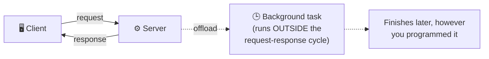

- It **doesn't need to happen immediately**.
- It's **not mission-critical to the response**, and it's **not synchronous**.
- So it can be **offloaded to a separate process** and finish in its own time.

**Why it matters:** understanding background jobs is essential for building **scalable** and **responsive** backends.

---

## 2. The Problem: Sending a Verification Email Synchronously (01:27)

### The sign-up flow

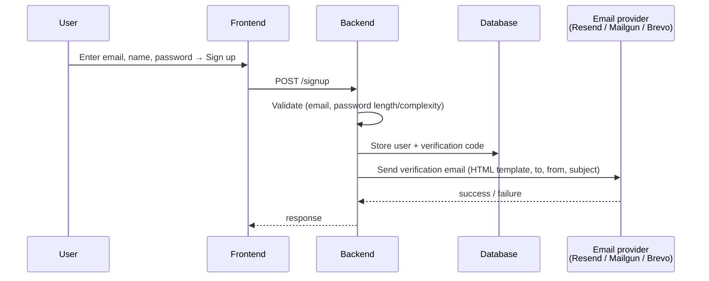

**Why send a verification email?** To prove the user **owns** the email address they gave. It contains a **link** (back to the frontend) or a **one-time code (OTP)** of 6–8 digits.

**How sending works:** build the email content (fill an **HTML template** with the link/code), set **to / from / subject**, and call the **email provider's API** (or SMTP). The provider checks your API key and so on, sends the email, and responds with success or failure.

### ❌ What goes wrong when it's synchronous

You have **no control over external servers**. They can hit **traffic spikes** or **downtime**.

| Scenario | Result |
|---|---|
| **No error handling** around the email call | The email call fails, so the **whole sign-up API fails**. Very bad UX. |
| **Error handling in place** | Sign-up succeeds, the UI says *"we've sent you a verification email"*, but **it was never sent**. The user has to click **"resend email"**, which may **fail again** if the provider is still down. |

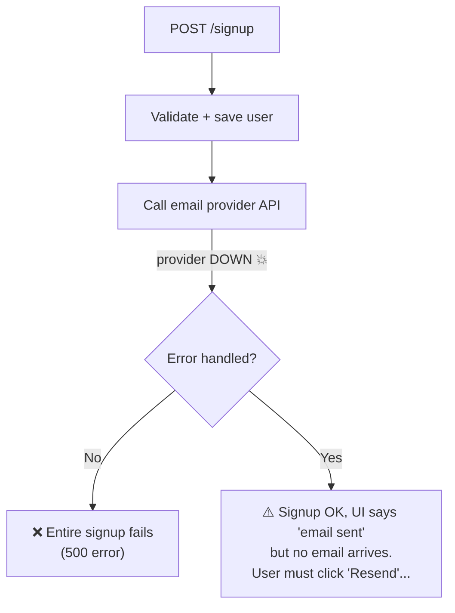

---

## 3. The Solution: Offload to a Queue (09:13)

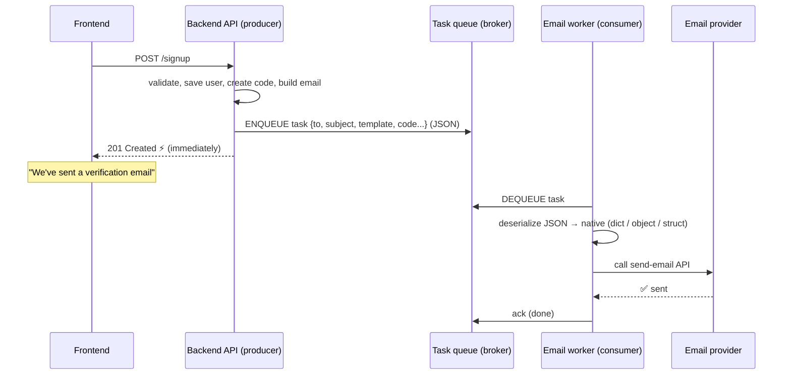

### Producer side (in the API)
1. Do all the normal processing (validate, save, generate the code, build the email).
2. Instead of calling the email API, **package** all the needed info and **serialize it** (e.g. to **JSON**).
3. **Push (enqueue)** it into a **queue**. The email is **not sent yet**. It's recorded as "a function to execute later, somewhere".
4. **Return immediately** with a success code (**200 / 201**). The user instantly sees the "check your email" screen.

### Consumer side (a separate process)
1. **Consumers / workers** run in a **different process** from the main backend.
2. They **take the task out** of the queue and **deserialize** it into native types: Python **dict**, JS **object**, Go **struct** (see [Serialization_Notes.md](Serialization_Notes.md)).
3. **Different queues for different jobs:** an email queue, an in-app notification queue, a push notification queue... each with its own consumers.
4. You **configure** each consumer with: **which queue** to read from, **what data shape** to expect (the deserialization layer), and a **registered handler**: the **same code** you would have run synchronously.
5. The handler **calls the email provider API**, and the user gets the email.

> ⏱️ **Latency isn't a problem:** processing takes **milliseconds to a few seconds** (up to ~5–10 s under heavy load), while verification links usually expire in **15–20 minutes**.

---

## 4. Failures and Retries (16:21)

**If the provider is down:** the API call fails, so the handler fails, so **the task fails**.
- **Synchronously** that would have broken the request (**500 Internal Server Error**).
- **In the background**, the framework (**Celery** for Python, **BullMQ** for Node.js, **Asynq** for Go) **puts the task back in the queue to retry**.

### Exponential backoff

> Each retry waits **longer** than the last, up to a **maximum number of retries**.

```
 attempt 1 ─❌─► wait 1 min ─► attempt 2 ─❌─► wait 2 min ─► attempt 3 ─❌─► wait 4 min ─► attempt 4 ─✅
                                                                             (then 8 min ... up to max retries, e.g. 5)
```

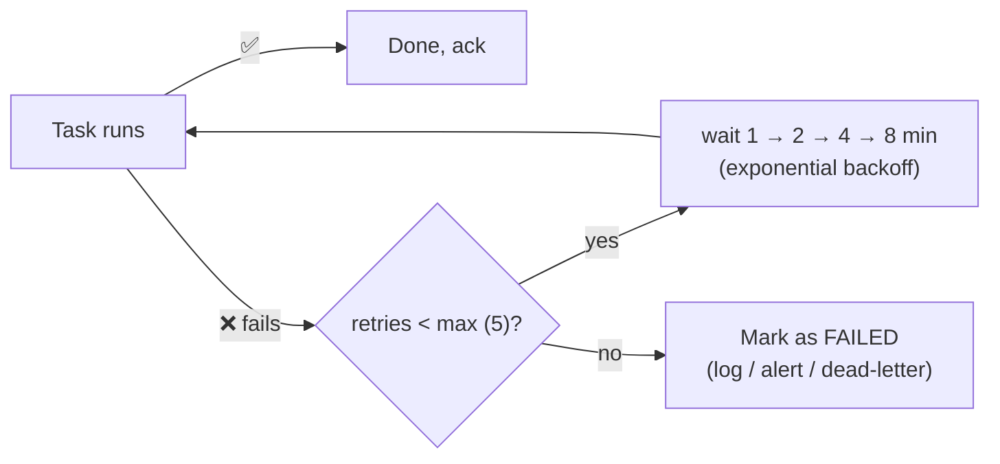

- Big providers (Resend, Mailgun) rarely stay down for **minutes**. Outages usually last **seconds or milliseconds**, so a task typically fails once or twice and **succeeds on the 3rd try**.
- **Result:** the email gets delivered **even though the provider was briefly down**, with no user action needed.

> 📌 **Extra:** tasks that exhaust their retries usually go to a **dead-letter queue (DLQ)** for inspection and manual replay.

---

## 5. Benefits and Common Use Cases (19:32)

### Benefits

| Benefit | Why |
|---|---|
| ⚡ **Responsiveness** | APIs aren't blocked by external services or heavy processing |
| ⏱️ **No timeouts** | Dependencies on slow external services don't time out your API |
| 🔁 **Retry mechanisms** | Failure-prone tasks are retried automatically |
| 😊 **Better UX** | Fast responses, reliable delivery |

> **Summary:** background tasks let you **offload time-consuming, non-critical operations**, so your API stays responsive, avoids timeouts from external dependencies, and gives a much better user experience.

### Common use cases in SaaS apps

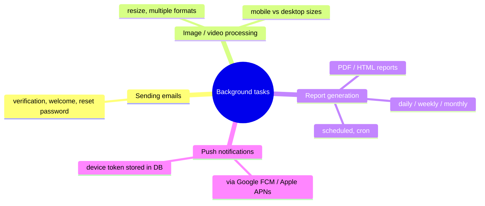

| Use case | Details |
|---|---|
| **Sending emails** | Depends on an external service (covered above) |
| **Image/video processing** | After upload, **resize/convert** into multiple formats optimized for **network conditions and devices** (small for mobile, large for desktop) |
| **Generating reports** | E.g. a project-management app emails **daily/weekly/monthly reports** (stats, completed/pending tasks in a sprint) as **HTML or PDF**, at **midnight** or **Sundays at 12:00**. Uses **cron jobs / scheduled tasks**, which Celery and BullMQ support. |
| **Push notifications** | Phone notifications (e.g. Swiggy/Zomato "your delivery partner reached the restaurant"). When you install the app, your **device registers** with the OS **push notification service** (Google's or Apple's). The backend **stores the device token** in its DB and calls **Google/Apple's service**, which actually delivers it. The backend **can't push directly to your phone**. It's an external call, so it goes in the background. |

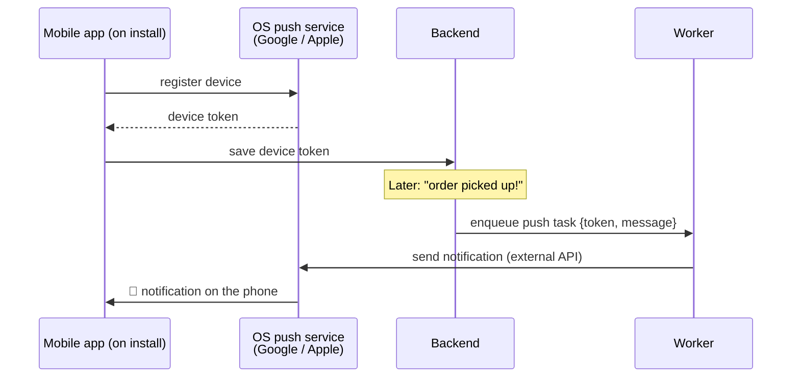

---

## 6. How a Task Queue Works (24:55)

> **Task queue:** a system for **managing and distributing background jobs**. It's the engine behind the scenes that lets you **reliably hand work off** to a separate process.

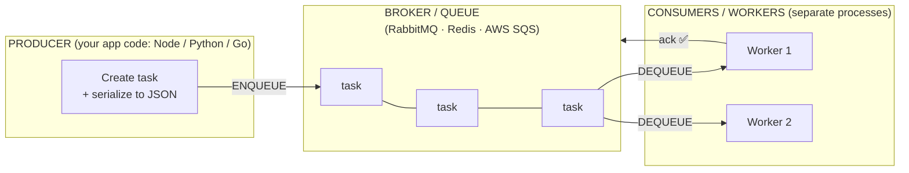

| Component | Role |
|---|---|
| **Producer** | **Your application code**. Creates a task containing **everything the worker needs** (user ID, name, email; the image for image tasks; the report data for report tasks), **serializes** it (JSON or the library's format), and pushes it in. |
| **Enqueue** | Adding an item to the queue (from data structures and algorithms) |
| **Broker / queue** | **Stores tasks** until a worker is ready, a **temporary holding area**. Implemented by technologies like **RabbitMQ**, **Redis**, or **AWS SQS** (managed, multi-region, scales globally). |
| **Consumer / worker** | Runs in a **separate process or thread** (same codebase or a separate one). **Constantly monitors** the queue, **dequeues** new tasks, and **executes** the registered handler. |
| **Dequeue** | Taking an item out of the queue |

> 🗒️ **Analogy:** a task queue is a **to-do list for your backend**. The app code **adds tasks**, and the workers **pick them off one by one** and do them.

> 📌 **Extra:** the video mentions "Redis Pub/Sub" for task queues. Pub/Sub itself is **fire-and-forget**: messages are lost if no subscriber is listening. Queue libraries like **BullMQ** and **Asynq** use Redis **lists, sorted sets and streams** instead, which keep tasks durable until processed.

---

## 7. Acknowledgements and Visibility Timeout (31:24)

### Acknowledgement (ack)
- When a worker **finishes a task**, it sends an **acknowledgement** back to the queue: *"processed successfully, you can remove it."*
- **No ack** → the queue decides from its parameters whether the task was **unresponsive** or **failed**, and applies the right **retry mechanism**.
- Celery, BullMQ and Asynq handle these edge cases for you.

### Visibility timeout

> **Visibility timeout:** the period during which a dequeued task counts as **"in progress"** by a worker and is **hidden** from other workers.

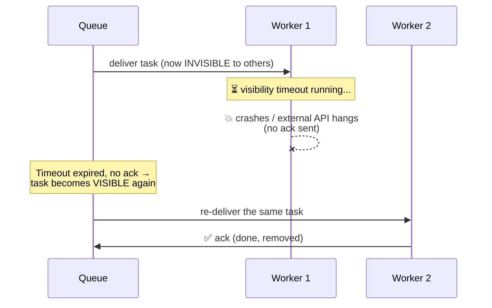

- If the worker **doesn't ack within the timeout** (it **crashed** or an external service **hung**), the queue makes the task **available to other workers** again.
- **Why:** the worker already took the task out of the queue, so without this the task would be **lost**. Someone must eventually **ack it as success or failure**.

---

## 8. Types of Background Tasks (34:20)

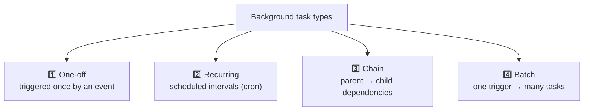

### 8.1 One-off tasks (most common)
A **single task triggered** by something in the request-response cycle:
- User registered → **verification email**
- Verified → **welcome email**
- Forgot password → **reset-password email**
- Someone messaged you (social app) → **notification**

### 8.2 Recurring tasks
Run **periodically** at set intervals:
- **Reports:** daily, monthly, annual stats.
- **Cleanup/maintenance:** e.g. with **stateful auth** ([Auth_Notes.md](Auth_Notes.md)), sessions pile up in a `sessions` table as users log in and out, leaving **orphaned/abandoned sessions**. A job every month (or 2–3 months) **deletes inactive old sessions** to free space.

### 8.3 Chain tasks (parent → child)
**Example: an LMS platform (like Udemy).** An instructor uploads a course video. The backend **acknowledges immediately** so the request isn't blocked, and the upload continues (e.g. straight to **S3 via a pre-signed URL**). After the upload:

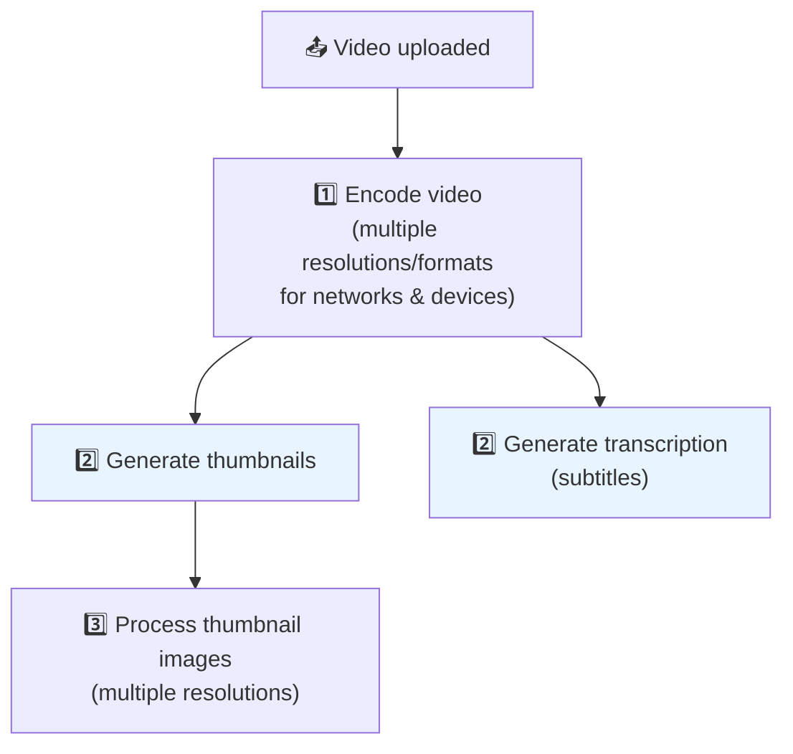

| Task | Depends on |
|---|---|
| Encode video | Upload complete |
| Generate thumbnails | **Encoding** |
| Generate transcription | **Encoding** (runs **in parallel** with thumbnails, since they're independent of each other) |
| Process thumbnail images | **Thumbnail generation** |

> A child task only runs once its **parent has completed successfully**.

### 8.4 Batch tasks
**Example 1: delete account.**
- A big platform holds **lots of user data**, possibly across **DB shards and regions**. Deleting it all inside one request could take **40–60+ seconds**, and you **can't block an API that long**.
- **Flow:** the API **enqueues a `delete_account` task**, responds **200 immediately**, and the frontend **logs the user out**.
  - Optionally there's a **grace period** (e.g. 3–7 days to log back in and cancel).
- The worker then **fans out** sub-tasks: remove the user from projects they own, delete their **profile**, delete **assets** (logos, cover images), delete the **account**, and send an **"account deleted" email**.

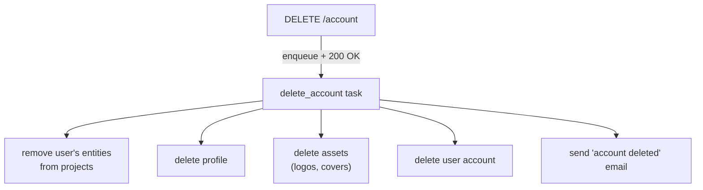

**Example 2: mass reports.** At midnight or week's end, trigger **thousands of identical tasks** (generate and send a report) for **thousands of users** at once.

---

## 9. Design Considerations (45:47)

These matter most **at scale** (thousands of users, big platforms).

| # | Consideration | What it means |
|---|---|---|
| 1 | **Idempotency** | Tasks must be **safe to execute multiple times** without unwanted side effects, because retries happen. E.g. in **delete account**, run the DB work in a **transaction**. If something fails midway (a DB error or an external call), **roll back**, so the retry **starts from scratch (0%)** with no half-done state. |
| 2 | **Error handling** | **Robust, extensive** handling and logging: everything happens in a **separate process**, so it's easy to miss edge cases. Catch, **log**, and **retry** failed tasks. |
| 3 | **Monitoring** | Always know: **tasks in the queue**, **successes**, **failures**, and **why** they failed (external service or internal bug). Use **metrics** (emit one per event) with **Prometheus + Grafana**. (Logs, traces and the ELK stack are covered in a later video.) |
| 4 | **Scalability** | Design so you can **add more consumers horizontally** (more worker nodes) when traffic grows, e.g. when users double. |
| 5 | **Ordering** | If tasks **must run in order**, make sure your library/broker supports **ordered delivery**. |
| 6 | **Rate limiting** | Tasks calling external services must **respect their rate limits** and avoid overloading them. They also **charge per call**. |

### Idempotency illustrated

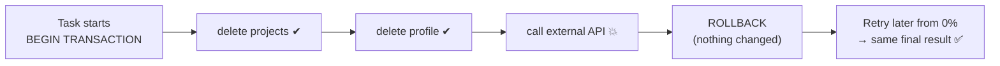

> 📌 **Extra:** another common technique is an **idempotency key / processed-task record**. Before doing side effects like charging a card or sending an email, check "did I already process task X?" so a duplicate delivery doesn't act twice.

---

## 10. Best Practices (51:28)

| # | Practice | Why |
|---|---|---|
| 1 | **Keep tasks small and focused** | One task = **one processing unit**. If one fails, others aren't affected. Dependent steps become **chain tasks**, so a failed child is retried **without redoing the parent**. A giant task that fails near the end **repeats everything** and **wastes CPU**. Small tasks are easier to **scale, debug, monitor, and retry**. |
| 2 | **Avoid long-running tasks** | A task taking a long time is a **signal to split it** into smaller **concurrent** tasks or **parent → child** chains. |
| 3 | **Proper error handling and logging** | Gives the queue a chance to **retry**, and gives you the info to **debug** (external service vs internal error) and **monitor**. |
| 4 | **Monitor queue length and worker health** | **Alerts** when the queue grows past a threshold (scale up) or workers keep **going down** (debug why). Always know the system is healthy. |

```
 ❌ ONE BIG TASK                                ✅ SMALL CHAINED TASKS
 ┌────────────────────────────────────┐        [encode]→[thumbs]→[process thumbs]
 │ encode → thumbs → process → subs   │                 ↘[subtitles]
 │            fails at the END 💥     │        fails at "process thumbs" 💥 → retry ONLY that
 │ → retry EVERYTHING from scratch    │
 └────────────────────────────────────┘
```

### Recap (from the video)
> Background tasks are essential for **scalable, reliable, responsive** backends. They let you **offload time-consuming, non-critical** work, **improve UX**, **prevent timeouts**, and get **retries** for external dependencies and heavy processing.

---

## 🧾 Quick Revision Cheat Sheet

```
Request ──► API: validate, save, ENQUEUE(task as JSON) ──► respond 200/201 immediately ⚡
                                        │
                              [ BROKER / QUEUE ]  (RabbitMQ · Redis · AWS SQS)
                                        │ DEQUEUE
                              WORKER (separate process): deserialize → run handler → ACK
                                        │ fail?
                              RETRY with exponential backoff (1→2→4→8 min, max N) → DLQ
```

| Topic | Key points |
|---|---|
| Background task | Code running **outside the request-response cycle**. Not needed immediately. |
| Why | Responsiveness · no timeouts from external deps · retries · better UX |
| Classic example | Verification email after sign-up (Resend, Mailgun, Brevo) |
| Sync problems | Provider down → sign-up fails, or "email sent" when it wasn't |
| Producer | App code: build task + **serialize** + **enqueue** |
| Broker | Stores tasks: **RabbitMQ**, **Redis**, **AWS SQS** |
| Consumer / worker | Separate process: **dequeue** → **deserialize** → **handler** → **ack** |
| Libraries | **Celery** (Python), **BullMQ** (Node.js), **Asynq** (Go) |
| Retries | **Exponential backoff** with a max retry count |
| Ack | Worker confirms success, so the task is removed |
| Visibility timeout | No ack in time → task visible to other workers again (never lost) |
| Separate queues | Email / in-app notifications / push notifications, each with its own workers |
| Use cases | Emails · image/video processing · reports (cron/scheduled) · push notifications (Google/Apple services) |
| Task types | **One-off** · **recurring** (reports, orphan-session cleanup) · **chain** (encode → thumbnails ∥ transcription → process thumbs) · **batch** (delete account, mass reports) |
| Design | **Idempotency** (transaction + rollback, safe reruns) · error handling · monitoring (**Prometheus + Grafana**) · horizontal worker scaling · ordering · rate-limiting external calls |
| Best practices | Small focused tasks · avoid long-running ones (split/chain) · log errors · alert on queue length and worker health |

---

## ❓ Self-Test Questions

<details>
<summary>1. Define a background task.</summary>

Any code that runs **outside the request-response lifecycle**. It doesn't need to complete before the response is sent, so it can be offloaded to a separate process.
</details>

<details>
<summary>2. Why is sending a verification email a classic background task?</summary>

It depends on an **external email provider** you don't control, which can be slow or down. Doing it synchronously risks failing the whole sign-up, or telling the user an email was sent when it wasn't.
</details>

<details>
<summary>3. Describe the two bad outcomes of sending the email synchronously when the provider is down.</summary>

Without error handling, the **sign-up API itself fails**. With error handling, sign-up succeeds and the UI says "email sent", but **no email arrives**, and "resend" may keep failing.
</details>

<details>
<summary>4. What does the API do instead with a task queue?</summary>

It serializes the email info (e.g. to JSON), **enqueues** a task, and **returns 200/201 immediately**. A separate worker sends the email later.
</details>

<details>
<summary>5. What does a worker do when it picks up a task?</summary>

**Dequeues** it, **deserializes** it into native types (dict / object / struct), runs the **registered handler** (e.g. calls the email API), then **acks** on success.
</details>

<details>
<summary>6. Explain exponential backoff with numbers.</summary>

Each retry waits longer: e.g. **1 min → 2 → 4 → 8...**, up to a **maximum retry count** (e.g. 5). Short provider outages usually clear before the 2nd or 3rd retry.
</details>

<details>
<summary>7. Name the three components of a task queue, and what enqueue and dequeue mean.</summary>

**Producer** (app code creates and serializes tasks), **broker/queue** (stores them), **consumer/worker** (executes them). **Enqueue** = add a task. **Dequeue** = take one out.
</details>

<details>
<summary>8. Name three broker technologies and three task-queue libraries.</summary>

Brokers: **RabbitMQ, Redis, AWS SQS**. Libraries: **Celery** (Python), **BullMQ** (Node.js), **Asynq** (Go).
</details>

<details>
<summary>9. What is an acknowledgement, and what is the visibility timeout?</summary>

An **ack** is the worker telling the queue a task finished, so it can be removed. The **visibility timeout** is how long a dequeued task stays hidden as "in progress". If no ack arrives in time (crash or hang), the task becomes visible to other workers again, so it isn't lost.
</details>

<details>
<summary>10. Why are push notifications sent from background tasks?</summary>

The backend can't push to phones directly. It must call **Google's or Apple's push service** with the stored **device token**, which is an external call.
</details>

<details>
<summary>11. Give an example of each task type: one-off, recurring, chain, batch.</summary>

**One-off:** welcome or reset-password email. **Recurring:** monthly reports, cleaning orphan sessions. **Chain:** encode video → thumbnails and transcription (in parallel) → process thumbnails. **Batch:** delete-account fan-out, or thousands of reports at midnight.
</details>

<details>
<summary>12. In the LMS chain, which tasks can run in parallel, and why?</summary>

**Thumbnail generation** and **transcription generation**. Both depend only on **encoding**, not on each other.
</details>

<details>
<summary>13. Why is deleting an account done as a background task?</summary>

The user may have lots of data across shards and regions, and deletion could take 40–60+ seconds. You can't block an API that long, so respond 200, log the user out, and delete in the background (optionally after a grace period).
</details>

<details>
<summary>14. What is idempotency for tasks, and how does the video achieve it?</summary>

A task is **safe to run multiple times** without extra side effects. Do the work in a **transaction** and **roll back** on failure, so a retry starts cleanly from scratch.
</details>

<details>
<summary>15. What should you monitor in a task system, and with what tools?</summary>

Queue length, success and failure counts, failure reasons, and worker health. Use **metrics** with **Prometheus + Grafana**, plus alerts.
</details>

<details>
<summary>16. Why should tasks be small and focused?</summary>

A failure only affects that one unit, retries don't redo successful parent work, and small tasks are easier to scale, debug and monitor. A large failing task wastes CPU repeating everything.
</details>

<details>
<summary>17. Why rate-limit tasks that call external services?</summary>

To avoid **overloading** those services, hitting **their** rate limits, and running up **per-call costs**.
</details>

---

*Notes compiled from the video transcript. Timestamps (mm:ss) let you jump back to each section. Transcription fixes: "recent" → Resend, "bravo" → Brevo, "salary" → Celery, "Bullmq / bulmq" → BullMQ, "async Q / asyncq" → Asynq, "Radius" → Redis, "SGS" → SQS, "it potency / Adamency" → idempotency, "graphana" → Grafana, "chron" → cron, "Zumato" → Zomato, "nqing / dqes" → enqueue / dequeue.*
