# Caching for Backend Engineers: Complete Revision Notes

> **Source:** [YouTube: Caching (Backend from First Principles series, part 13)](https://www.youtube.com/watch?v=estH64OkwxU&list=PLui3EUkuMTPgZcV0QhQrOcwMPcBCcd_Q1&index=13)
> **Length:** ~1h 4m
> **Previous videos:** [HTTP_Notes.md](HTTP_Notes.md) · [Routing_Notes.md](Routing_Notes.md) · [Serialization_Notes.md](Serialization_Notes.md) · [Auth_Notes.md](Auth_Notes.md) · [Validation_Notes.md](Validation_Notes.md) · [Handlers_Middleware_Context_Notes.md](Handlers_Middleware_Context_Notes.md) · [API_Design_Notes.md](API_Design_Notes.md) · [Databases_Notes.md](Databases_Notes.md)
> **Goal of the video:** What caching is, why high-performance systems depend on it (Google, Netflix, X), the three levels you'll meet (network, hardware, software), how in-memory stores like Redis work, caching strategies, eviction policies, and real backend use cases.

> 💡 Diagrams use **Mermaid**. They render in GitHub, VS Code (with a Mermaid preview extension), Obsidian, Notion, and the Claude app. Anything marked **📌 Extra** was added to clarify a point and is not in the video.

---

## 📑 Table of Contents

1. [TL;DR: The Whole Video in 12 Lines](#-tldr-the-whole-video-in-12-lines)
2. [What Is Caching?](#1-what-is-caching-0000)
3. [Example 1: Google Search](#2-example-1-google-search-0129)
4. [Example 2: Netflix and CDNs](#3-example-2-netflix-and-cdns-0551)
5. [Example 3: X/Twitter Trending Topics](#4-example-3-xtwitter-trending-topics-1225)
6. [When to Cache: The Pattern](#5-when-to-cache-the-pattern-1704)
7. [Three Levels of Caching](#6-three-levels-of-caching-1712)
8. [Network Cache 1: CDN in Depth](#7-network-cache-1-cdn-in-depth-1907)
9. [Network Cache 2: DNS Caching](#8-network-cache-2-dns-caching-2622)
10. [Hardware Cache: L1/L2/L3 and RAM](#9-hardware-cache-l1l2l3-and-ram-3502)
11. [In-Memory Key-Value Stores (Redis, Memcached)](#10-in-memory-key-value-stores-4110)
12. [Caching Strategies: Cache-Aside vs Write-Through](#11-caching-strategies-4250)
13. [Eviction Policies](#12-eviction-policies-4524)
14. [Backend Use Cases](#13-backend-use-cases-5101)
15. [Cheat Sheet / Quick Revision](#-quick-revision-cheat-sheet)
16. [Self-Test Questions](#-self-test-questions)

---

## ⚡ TL;DR: The Whole Video in 12 Lines

1. **Caching:** keep a **subset** of data in a **faster, easier-to-access** location to **cut the time and effort** of retrieving or computing it.
2. **Cache hit:** the data is in the cache, so return it fast. **Cache miss:** not there, so fetch or compute from the source, **store it in the cache**, then return it.
3. **Google** caches search results for popular queries in a **distributed in-memory cache** instead of re-running crawling, indexing and ranking.
4. **Netflix** uses a **CDN**: copies of popular content sit on **edge servers** close to users (chosen by ML trend analysis), with the origin servers in the US.
5. **X/Twitter** computes **trending topics** every few minutes (expensive ML) and serves them from an **in-memory cache like Redis**.
6. **Cache when** you want to avoid **heavy computation** or **sending heavy data** repeatedly, especially for **read-heavy, rarely-changing** data.
7. **Three levels:** **network** (CDN, DNS), **hardware** (L1/L2/L3, RAM), **software** (Redis, Memcached, AWS ElastiCache).
8. **CDN flow:** DNS → nearest **PoP** (point of presence, a group of edge servers) → edge checks the cache → hit: serve / miss: fetch from **origin**, cache with a **TTL**.
9. **DNS caching** happens at many layers: **OS**, **browser**, **recursive resolver** (ISP / Google / Cloudflare), even authoritative servers. Lookup chain: **root → TLD → authoritative**.
10. **RAM is fast** (random access via electrical signals) but **limited and volatile**. That's why Redis and Memcached keep data in RAM (and persist it to disk in the background). They are **in-memory key-value NoSQL databases**.
11. **Strategies:** **cache-aside (lazy)** caches on the first read. **Write-through** updates the DB **and** the cache on every write (always fresh, slower writes). **Eviction:** no-eviction, **LRU**, **LFU**, **TTL**.
12. **Use cases:** caching **expensive DB queries** (products, profiles), **sessions**, **external API responses** (weather, saves cost and rate limits), and **rate-limiting counters** (`X-Forwarded-For` IP → counter → 429).

---

## 1. What Is Caching? (00:00)

> **One sentence:** caching is a mechanism to **decrease the time and effort** it takes to perform some work.

> **Technical definition:** keeping a **subset** of some **primary data** (chosen by **how often it's used**, **how likely it is to be used next**, and other factors) in a location that is **faster** (less time) and **easier** (less effort) to access.

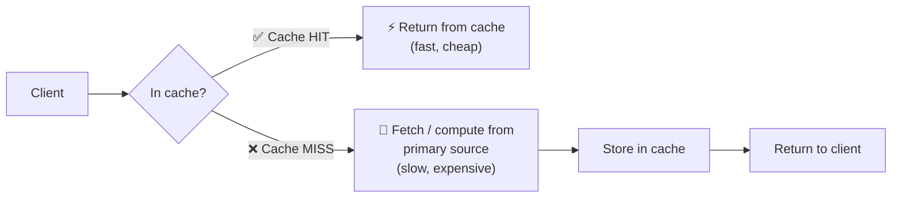

| Term | Meaning |
|---|---|
| **Cache hit** | The requested data **is found** in the cache |
| **Cache miss** | The data **isn't** in the cache, so go to the primary source |
| **Subset** | ⚠️ You **don't** cache everything. Cache storage is **more expensive** than disk, and caching everything defeats the purpose. |

> Caching is a **huge factor** in high-performance applications that track latency in **tens of microseconds or milliseconds**.

---

## 2. Example 1: Google Search (01:29)

**Without caching:** every query goes through Google's complex workflow: **crawling, indexing, ranking billions of pages**. That's **computationally expensive** (CPU, memory). Queries like *"what is the weather today"* are searched **millions of times a day**, so recomputing each one would mean **high latency and huge server load**.

**With caching:**
- Google uses a **distributed in-memory caching system**, with cache servers **spread across the world**.
- They store the **results** of the ranking algorithms.

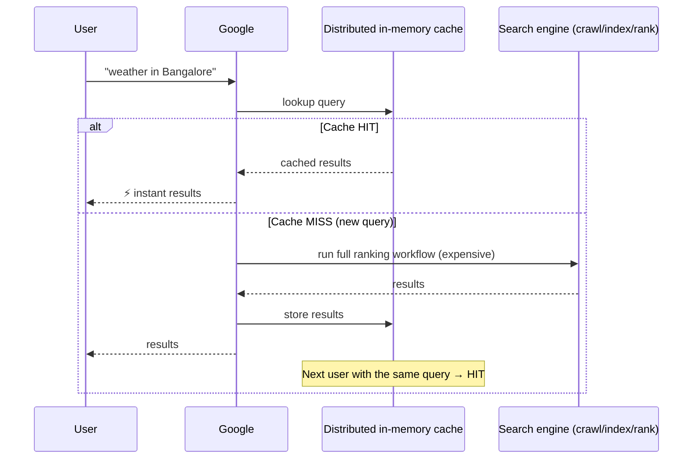

---

## 3. Example 2: Netflix and CDNs (05:51)

**Challenge:** deliver **terabytes** of movies, series and anime to **millions of users worldwide** with **minimal buffering** and without crashing Netflix's servers.

### Encoding (context)
Each movie is **encoded** into multiple resolutions (**1080p, 720p, 480p**...), and Netflix sends the version that suits your **device and network speed**. That saves bandwidth and server load.

### CDN (Content Delivery Network)

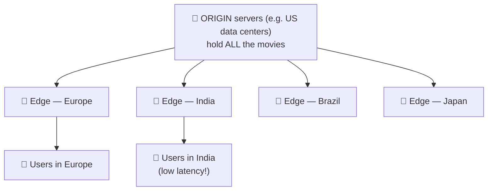

- **Origin servers** (e.g. in US data centers) hold the **actual** content.
- **Edge locations** are servers placed **strategically around the world**, based on infrastructure and network connectivity.
- **Why:** if everything were served from the US origin, **US users** would get low latency (they're close), but users far away (e.g. **India**) would get **high latency**. Edge servers bring content **geographically close** to every user.
- **Which content?** **A subset**, not all of Netflix. **ML algorithms and trend analysis** of what each region watches decide which titles to cache where. Caching everything everywhere would be far too costly.

> CDNs aren't Netflix-specific. Many companies use them for **videos, images, and static web assets (HTML, CSS, JS)**. **Vercel's edge network** serves frontend apps from the **region closest to you**.

---

## 4. Example 3: X/Twitter Trending Topics (12:25)

(The same applies to Facebook, LinkedIn, YouTube...)

- X finds **trending topics** by analyzing **millions of tweets in real time**: **ML algorithms**, lots of **GPUs**, **terabytes** of data. This is **very expensive**.
- If every user opening "Trending" triggered that computation, the servers would **crash in seconds**.
- **Trends don't change every second.** An election stays trending for **hours or days**, so it's **safe to cache**.

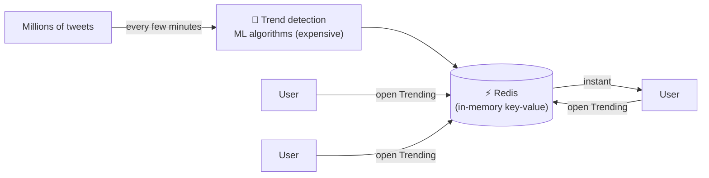

Users get trends **instantly** from the cache, with no visible delay on a decent connection.

---

## 5. When to Cache: The Pattern (17:04)

> 🔑 **Cache when you want to avoid:**
> 1. **Heavy computation** done again and again (Google ranking, Twitter trends, complex SQL).
> 2. **Sending heavy data** to lots of users from far away (Netflix videos).
>
> Especially when the data is **read-heavy** and **changes rarely**.

---

## 6. Three Levels of Caching (17:12)

Caching exists everywhere (hardware, software, browsers...). For **backend engineers**, the three levels you'll meet most often:

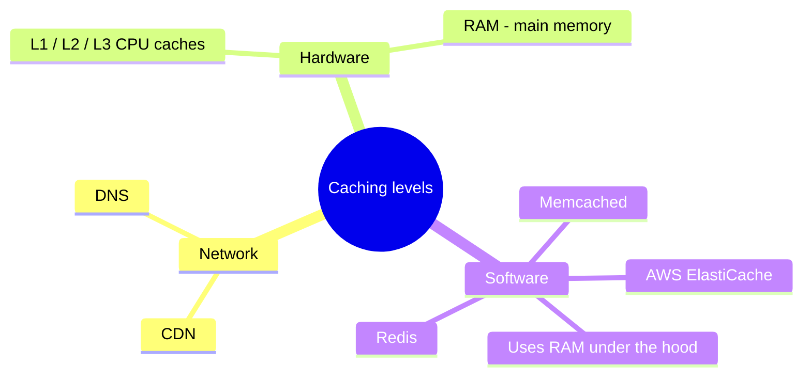

| Level | Examples | Note |
|---|---|---|
| **Network** | **CDN**, **DNS** | Data cached at network locations near users |
| **Hardware** | **L1/L2/L3** CPU caches, **RAM** | Speeds up CPU operations |
| **Software** | **Redis, Memcached, AWS ElastiCache** | Called "software" because you use it **through a library**, but it relies on **hardware (RAM)** for speed |

---

## 7. Network Cache 1: CDN in Depth (19:07)

**Idea:** cache content on servers **geographically closer** to users. These are called **edge servers / edge nodes**, and anything with "**edge**" in the name means "runs on a server close to you" instead of on the origin.

**Goals:** minimize **latency**, and reduce the **compute and resources** used by the **origin server**.

### How a CDN request works

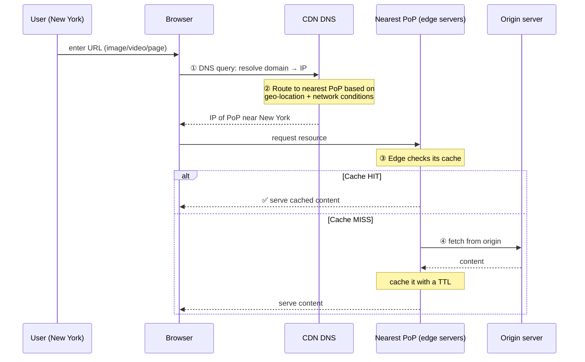

| Step | What happens |
|---|---|
| 1 | The user enters a URL. The browser sends a **DNS query** to turn the domain into an **IP address**. |
| 2 | **CDN DNS** routes the request to the **nearest PoP (Point of Presence)**, a **region with multiple edge servers**. It considers the **user's location** and **network conditions** (e.g. a bad connection may be routed to a PoP holding lower-quality video). Example: a New York user goes to a PoP near New York. |
| 3 | The edge server **checks its cache**: **hit**, serve it immediately (the happy path). **Miss**, go to step 4. |
| 4 | **Cache miss:** the edge server **fetches from the origin** (e.g. in the US, while the user is in India), caches it, and serves it. Cached copies are real copies of the origin content. |

### TTL (Time To Live)
- Each cached item has a **TTL**: how long to keep it (e.g. a few hours).
- After the TTL expires, the next request **fetches fresh content from the origin** and caches it with a new TTL. This handles **new versions** and **regional changes**.

---

## 8. Network Cache 2: DNS Caching (26:22)

**Scenario:** you type `example.com` and press Enter. DNS work is expensive, so caching happens at **many layers**.

### The full DNS resolution (on a cache miss)

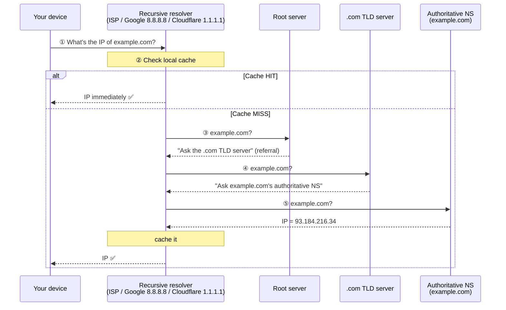

| Component | Role |
|---|---|
| **Recursive resolver** | Provided by your **ISP** (Jio, ACT, Airtel...) or a **public DNS** (Google, Cloudflare). It goes **deeper and deeper** through servers until it finds the IP, which is why it's called "recursive". |
| **Root servers** | Many, spread worldwide (📌 Extra: **13 named root server identities**, served by hundreds of machines via anycast). They don't know the IP, only **where the TLD servers are**. |
| **TLD server** (`.com`, `.in`...) | Doesn't know the IP either. Refers you to the domain's **authoritative name server**. |
| **Authoritative name server** | Holds the **actual IP** for `example.com` |

### Where DNS caching happens (layers)

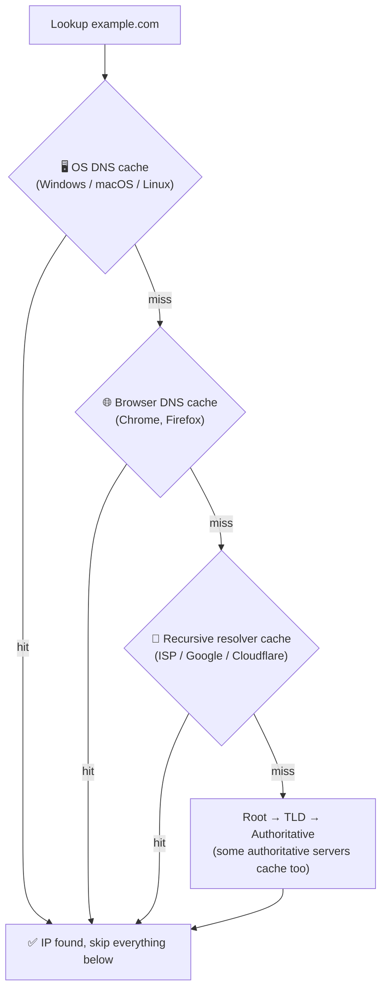

> 📌 **Extra:** in practice, browsers usually check **their own** DNS cache **before** asking the OS. The video presents the OS first. Either way, the point is the same: **several cache layers** sit in front of the full lookup, and each caches results for the record's **TTL**.

---

## 9. Hardware Cache: L1/L2/L3 and RAM (35:02)

```
        ┌───────────── CPU chip ─────────────┐
        │  Core 1          Core 2            │
        │ ┌──────┐       ┌──────┐            │   fastest, smallest
        │ │  L1  │       │  L1  │            │        ▲
        │ ├──────┤       ├──────┤            │        │
        │ │  L2  │       │  L2  │            │        │
        │ └──────┘       └──────┘            │        │
        │ ┌────────── L3 (shared) ────────┐  │        │
        │ └───────────────────────────────┘  │        │
        └────────────────────────────────────┘        │
                 │                                    │
        ┌────────▼────────┐  RAM / main memory  ← Redis lives here
        └────────┬────────┘                           │
        ┌────────▼────────┐  Disk (HDD / SSD)   ← Postgres lives here
        └─────────────────┘                     slowest, largest
```

- The CPU keeps **L1, L2, L3** caches for **repeated computations** and **frequently used or soon-to-be-used** data. L3 is **shared** between cores.
- **Example: arrays.** Sequential array access is fast because the CPU's **predictive algorithms** pull the surrounding memory block into L1/L2 as soon as you start iterating.

### Why RAM is fast (and why it isn't a database)

| | **RAM (main memory)** | **Disk (HDD/SSD)** |
|---|---|---|
| Access | **Random access**: capacitors plus **electrical signals** reach any address directly, so time is **nearly constant** whichever address you hit | HDD: a **mechanical head** moves over a spinning disk to find data |
| Speed | ⚡ Very fast | 🐢 Slower |
| Capacity | **Limited** | Large |
| Volatility | **Volatile**: power off = **data gone** | **Persistent**: data physically written, survives power-off |

> **Trade-off:** RAM gives up **non-volatility and capacity** for **speed**, so it **can't replace** disk storage. Each has its role.

---

## 10. In-Memory Key-Value Stores (41:10)

Backend examples: **Redis**, **Memcached**, and in the cloud **AWS ElastiCache**.

- They store data in **RAM**, which makes data access very fast.
- **Persistence:** behind the scenes they **also write to disk**. On startup they **load data from disk back into RAM**. **Reads and writes still happen in RAM**, so access stays fast.

### The name, broken down

> **"In-memory key-value NoSQL database"**

| Word | Meaning |
|---|---|
| **In-memory** | Data lives in **RAM**, unlike Postgres/MySQL, which use **disk** ([Databases_Notes.md](Databases_Notes.md)) |
| **Key-value** | Simple structure: a **key** maps to a **value** (string, number, list, JSON... types vary by tech) |
| **NoSQL** | **No strict schema**, no tables or rows like SQL databases |

```
 KEY                          VALUE
 "user:42:profile"      →     '{"name":"John","bio":"..."}'
 "session:abc123"       →     '{"userId":42,"role":"admin"}'
 "rate:203.0.113.7"     →     17
 "trending:IN"          →     ["#Election2025", "#IPL", ...]
```

Using it is **simple**: install a client library (e.g. `redis` for Node.js), **set** a key and value, **get** by key. No complex SQL, joins or aggregations.

```js
// 📌 Extra: Node.js example
await redis.set("user:42:profile", JSON.stringify(profile), { EX: 3600 }); // TTL 1 hour
const cached = await redis.get("user:42:profile");
```

---

## 11. Caching Strategies (42:50)

### 11.1 Cache-aside (lazy caching)

**Cache only when someone actually asks for the data.** No proactive caching or prediction.

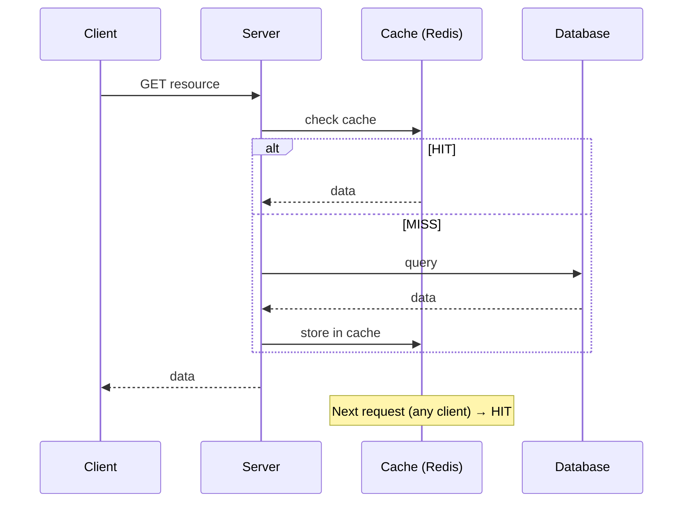

### 11.2 Write-through

A **cache update strategy**: on **every write** (POST/PUT/PATCH), update **the DB and the cache in the same request flow**.

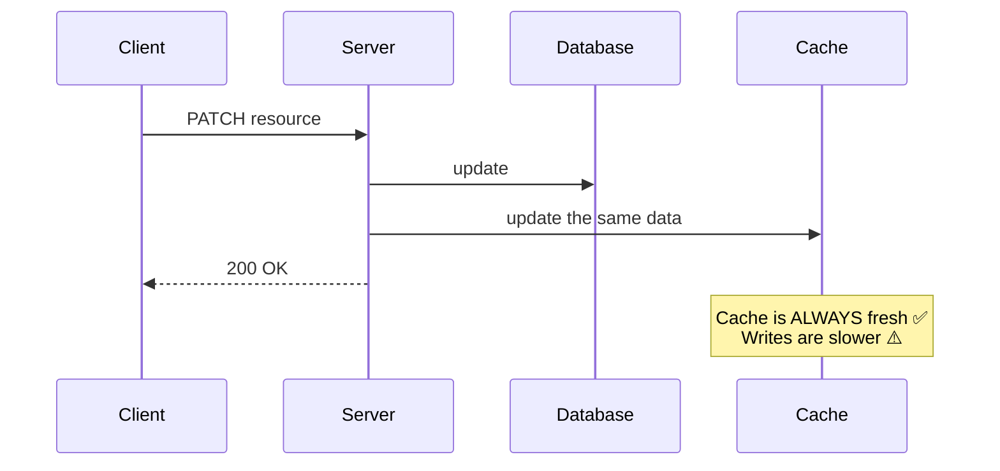

| | **Cache-aside (lazy)** | **Write-through** |
|---|---|---|
| When data enters the cache | On the **first read** (after a miss) | On **every write** |
| Freshness | Can serve **stale** data until TTL or invalidation | ✅ **Always fresh**, never serves old data |
| Cost | First read is slow (a miss) | ⚠️ **Every write has extra overhead** (DB + cache) |
| Popularity | Very common in backend work | Common when freshness matters |

---

## 12. Eviction Policies (45:24)

RAM is **limited** (managed services like ElastiCache also have limits), so **the cache will fill up**. A cache is only a **subset** of the primary data, so you must decide **what to remove** to make room for newer, **more important** data. That decision is the **eviction policy**.

| Policy | How it chooses the victim |
|---|---|
| **No eviction** | Nothing is removed. New inserts **fail with an error** ("memory full"). This is what you get if nothing is configured. |
| **LRU (Least Recently Used)** | Evicts the key **not accessed for the longest time** |
| **LFU (Least Frequently Used)** | Evicts the key with the **lowest access count** |
| **TTL-based** | Keys have a **time-to-live** and **expire automatically**. When space is needed, evict the key **closest to expiring**. |

### Worked examples (cache full with keys 1–4, key 5 arrives)

```
 LRU — track LAST ACCESS TIME
 ┌─────┬────────────────┐
 │ key │ last accessed  │
 ├─────┼────────────────┤
 │  1  │ today          │
 │  2  │ today          │
 │  3  │ today          │
 │  4  │ yesterday  ◄── │  evicted (least recently used)
 └─────┴────────────────┘   → key 5 goes in

 LFU — track ACCESS COUNT
 ┌─────┬──────────────┐
 │ key │ access count │
 ├─────┼──────────────┤
 │  1  │      5   ◄── │  evicted (least frequently used)
 │  2  │     10       │
 │  3  │      6       │
 │  4  │     23       │
 └─────┴──────────────┘   → key 5 goes in

 TTL — track TIME LEFT
 key with the SHORTEST remaining TTL is evicted → key 5 goes in
```

> 📌 **Extra:** in Redis you set this with `maxmemory-policy` (e.g. `allkeys-lru`, `allkeys-lfu`, `volatile-ttl`, `noeviction`).

---

## 13. Backend Use Cases (51:01)

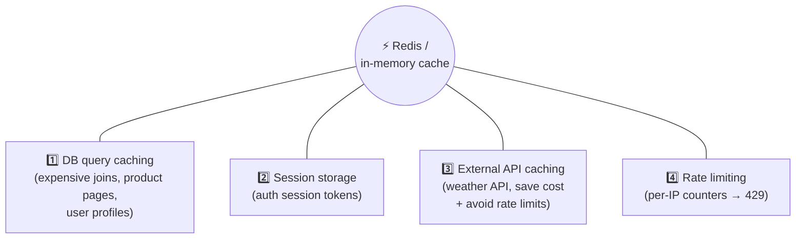

### 13.1 Database query caching
- **Scenario:** a query with **many joins and aggregations** over **millions of rows** returns a few rows. Monitoring shows the API that calls it (landing page, dashboard) is hit **very often**, putting **heavy load on the DB**.
- **Fix:** cache the result with a **TTL** (e.g. 1 hour). Check the cache first: **hit** → serve it. **Miss** → compute once and cache it. When related data changes, **update or delete (invalidate)** the cache entry.
- **Benefits:** less compute, less DB load, **lower API latency**.

| Real-world example | Why it's cacheable |
|---|---|
| **Amazon** product details, prices, inventory | During a **MacBook sale**, millions hit the same page. Product info **rarely changes**, so cache it and let the DB do the important work. |
| **Twitter/Facebook user profiles** | Profiles change **a few times a year**. A **celebrity's** profile might be fetched **thousands to millions of times a day**. On an edit, **invalidate** the cache. |

> 🔑 **Read-heavy + infrequent writes = a great caching candidate.**

### 13.2 Session storage
After successful **login**, a **session token** is generated and stored ([Auth_Notes.md](Auth_Notes.md)). **Every request** must look up the session, and RAM is far faster than the DB. **Storing sessions in Redis** avoids **latency on every API call** and **load on the DB**.

### 13.3 External API caching
- **Scenario:** your backend calls an external **weather API**, processes the result, and serves your frontend.
- **Without caching:** every frontend request triggers another external call, which quickly **runs up the bill** or **hits the provider's rate limit**.
- Weather **doesn't change every second**, so it's **safe to cache**: fetch once, cache with a **TTL of ~1 hour**, serve all requests from the cache, and let it **expire automatically**. The next request refetches and re-caches.

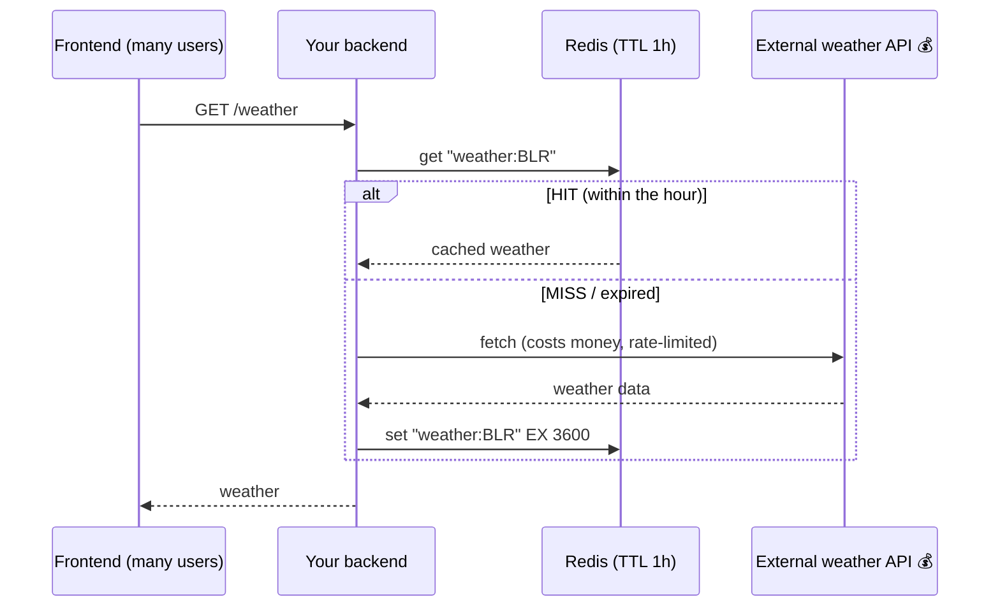

### 13.4 Rate limiting
(See the middleware section of [Handlers_Middleware_Context_Notes.md](Handlers_Middleware_Context_Notes.md).)

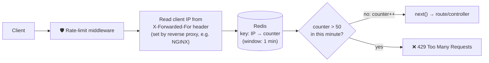

1. The middleware reads the client's **public IP** from the **`X-Forwarded-For`** header (usually added by a **reverse proxy** such as NGINX).
2. Rule example: **max 50 requests per minute** per IP. This protects against **bots** and saves compute on **expensive APIs**.
3. A **counter** is stored per IP in a key-value store: request 1 → `1`, then `2`, `3`, `4`... within the window.
4. If the counter **exceeds 50** within the minute, **block** the request with **429 Too Many Requests**.

**Why Redis and not Postgres for the counter?**
1. **Latency:** even **20–30 ms** extra per request matters, and this check runs on **every request**.
2. **DB load:** 1,000 users × 100 requests/min would **flood the DB with rate-limit queries** alone.

---

## 🏁 Next Steps (from the video)
Get hands-on: try **Redis**, or its open-source fork **Valkey**, with your language's client library, and compare data access with a relational database.

---

## 🧾 Quick Revision Cheat Sheet

```
CACHING = keep a SUBSET of data somewhere FASTER + EASIER to access
HIT  → serve from cache        MISS → fetch/compute from source → store in cache → serve
CACHE WHEN: heavy computation OR heavy data, read-heavy, rarely changes
```

| Topic | Key points |
|---|---|
| Google | Distributed in-memory cache of search results, skipping crawl/index/rank on hits |
| Netflix | Encoding (1080p/720p/480p) + **CDN** edge servers. ML picks which subset to cache per region. |
| X/Twitter | Trends computed every few minutes (ML/GPU), served from **Redis** |
| 3 levels | **Network** (CDN, DNS) · **Hardware** (L1/L2/L3, RAM) · **Software** (Redis, Memcached, ElastiCache) |
| CDN | DNS → nearest **PoP** (group of edge servers, by geo + network) → hit: serve / miss: fetch **origin** → cache with **TTL** |
| Edge | "Runs on a server close to the user" |
| DNS chain | Device → **recursive resolver** (ISP/Google/Cloudflare) → **root** → **TLD** → **authoritative** NS |
| DNS cache layers | OS · browser · recursive resolver · (some) authoritative servers |
| CPU cache | L1/L2 per core, **L3 shared**. Predictive prefetch makes sequential array access fast. |
| RAM vs disk | RAM: random access, fast, **limited, volatile**. Disk: mechanical/slow, large, **persistent**. |
| Redis/Memcached | **In-memory key-value NoSQL**. Reads/writes in RAM, persisted to disk in the background. Simple get/set. |
| Cache-aside | Lazy: cache on first read (miss). May be stale until TTL or invalidation. |
| Write-through | Write the DB **and** cache together. Always fresh, slower writes. |
| Eviction | No-eviction (error when full) · **LRU** (oldest access) · **LFU** (fewest accesses) · **TTL** (closest to expiry) |
| Use cases | Expensive DB queries · **sessions** · external API responses (cost/rate limits) · **rate-limit counters** (`X-Forwarded-For`, 429) |
| Invalidation | On writes, update/delete the cached key (or rely on TTL) |

---

## ❓ Self-Test Questions

<details>
<summary>1. Define caching in one sentence, and then technically.</summary>

A mechanism to **reduce the time and effort** of doing some work. Technically: keeping a **subset** of primary data in a **faster, easier-to-access** location, chosen by usage frequency and the likelihood of future use.
</details>

<details>
<summary>2. What are a cache hit and a cache miss? What happens on a miss?</summary>

A **hit** means the data is found in the cache and returned fast. A **miss** means it isn't there: fetch or compute it from the primary source, **store it in the cache**, then return it.
</details>

<details>
<summary>3. Why not cache everything?</summary>

Cache storage (RAM, edge servers) is **expensive and limited** compared to disk. The point is to cache the **subset** that's used most.
</details>

<details>
<summary>4. How does Netflix use caching, and how does it decide what to cache?</summary>

A **CDN**: copies of content on **edge servers** near users, with the originals on **origin** servers. **ML and trend analysis** of what each region watches decide which subset to cache where.
</details>

<details>
<summary>5. Why is X's "Trending" section safe to cache?</summary>

Trends change over **hours or days**, not seconds, and computing them is **very expensive** (ML over millions of tweets). Compute every few minutes and serve from Redis.
</details>

<details>
<summary>6. State the general rule for when to use caching.</summary>

When you want to avoid **repeated heavy computation** or **repeatedly sending heavy data**, especially for **read-heavy, rarely-changing** data.
</details>

<details>
<summary>7. Name the three levels of caching and an example of each.</summary>

**Network** (CDN, DNS), **hardware** (L1/L2/L3, RAM), **software** (Redis, Memcached, ElastiCache).
</details>

<details>
<summary>8. What is a PoP, and how does CDN DNS choose one?</summary>

A **Point of Presence**: a region containing multiple edge servers. CDN DNS routes to the **nearest** PoP based on the user's **location** and **network conditions**.
</details>

<details>
<summary>9. What does TTL mean in a CDN?</summary>

**Time To Live**: how long content stays cached. After it expires, the next request fetches fresh content from the origin and caches it with a new TTL.
</details>

<details>
<summary>10. Walk through a full DNS lookup on a cache miss.</summary>

Device → **recursive resolver** (ISP/Google/Cloudflare) checks its cache → miss → **root server** (refers to the TLD) → **.com TLD server** (refers to the authoritative NS) → **authoritative name server** returns the IP → the resolver caches it and returns it.
</details>

<details>
<summary>11. Where is DNS cached?</summary>

The **OS**, the **browser**, the **recursive resolver**, and some **authoritative servers**.
</details>

<details>
<summary>12. Why is RAM called "random access", and why can't it replace disk?</summary>

Any address can be reached directly by electrical signals in **nearly constant time**, whatever the access pattern. But RAM is **limited in capacity** and **volatile** (data is lost on power-off), so disk is still needed for persistence.
</details>

<details>
<summary>13. Break down "in-memory key-value NoSQL database".</summary>

**In-memory:** data in RAM (fast). **Key-value:** a simple key → value structure. **NoSQL:** no strict schema or tables.
</details>

<details>
<summary>14. How do Redis and Memcached keep data despite RAM being volatile?</summary>

They **persist to disk** in the background and **reload into RAM on startup**. Reads and writes still happen in RAM.
</details>

<details>
<summary>15. Cache-aside vs write-through: what's the trade-off?</summary>

**Cache-aside:** cache on the first read. Simple, but the first read is slow and data can be stale. **Write-through:** update the DB and cache on every write. The cache is always fresh, but every write has extra overhead.
</details>

<details>
<summary>16. Keys 1–4 have access counts 5, 10, 6, 23, and key 4 was last accessed yesterday (others today). Which key does LRU evict? Which does LFU evict?</summary>

**LRU** evicts **key 4** (least recently accessed). **LFU** evicts **key 1** (fewest accesses: 5).
</details>

<details>
<summary>17. What happens with a "no eviction" policy when the cache is full?</summary>

New inserts **fail with an error** (memory full).
</details>

<details>
<summary>18. Why cache an external weather API's response, and with what TTL?</summary>

To avoid hitting the provider's **rate limit** and running up the **bill** on every frontend request. Weather changes slowly, so a TTL of **about 1 hour** works.
</details>

<details>
<summary>19. Why are sessions stored in Redis rather than Postgres?</summary>

Sessions are looked up on **every request**. RAM access is much faster, which avoids per-request **latency** and **DB load**.
</details>

<details>
<summary>20. How does a Redis-based rate limiter work, and why not use the main DB?</summary>

Middleware reads the client IP from **`X-Forwarded-For`** and increments a **per-IP counter** in Redis for the time window. Over the limit (e.g. 50/min) → **429**. Using the main DB would add **latency to every request** and **flood the DB** with counter queries.
</details>

---

*Notes compiled from the video transcript. Timestamps (mm:ss / h:mm:ss) let you jump back to each section. Transcription fixes: "mcast / MC" → Memcached, "red is / redice" → Redis, "V key" → Valkey, "Gio / AEL" → Jio / Airtel, "po/poop" → PoP, "cash" → cache, "versel" → Vercel.*
