# Concurrency and Parallelism for Backend Engineers: Complete Revision Notes

> **Source:** [YouTube: Concurrency & Parallelism (Backend from First Principles series, part 23)](https://www.youtube.com/watch?v=bs9MEYRTA30&list=PLui3EUkuMTPgZcV0QhQrOcwMPcBCcd_Q1&index=23)
> **Length:** ~1h 28m
> **Related notes:** [Scaling_Performance_Part1_Notes.md](Scaling_Performance_Part1_Notes.md) (I/O-bound vs CPU-bound, sync logging bottleneck) · [Scaling_Performance_Part2_Notes.md](Scaling_Performance_Part2_Notes.md) · [Background_Jobs_Notes.md](Background_Jobs_Notes.md) · [Handlers_Middleware_Context_Notes.md](Handlers_Middleware_Context_Notes.md) · [Databases_Notes.md](Databases_Notes.md) · [Graceful_Shutdown_Notes.md](Graceful_Shutdown_Notes.md) (Go runtime, Asynq)
> **Goal of the video:** No tips or techniques. Build a **mental model**, from the ground up, of **how a backend handles many things at once**: why concurrency matters, **I/O-bound vs CPU-bound**, **concurrency vs parallelism**, **threads**, **event loops**, **async/await** (callbacks and state machines), **goroutines / virtual threads**, and **race conditions**.

> 💡 Diagrams use **Mermaid**. They render in GitHub, VS Code (with a Mermaid preview extension), Obsidian, Notion, and the Claude app. Anything marked **📌 Extra** was added to clarify a point and is not in the video.

---

## 📑 Table of Contents

1. [TL;DR: The Whole Video in 12 Lines](#-tldr-the-whole-video-in-12-lines)
2. [Why Concurrency Matters](#1-why-concurrency-matters-0000)
3. [The Cost of NOT Being Concurrent](#2-the-cost-of-not-being-concurrent-0257)
4. [I/O-Bound vs CPU-Bound](#3-io-bound-vs-cpu-bound-0557)
5. [Concurrency vs Parallelism](#4-concurrency-vs-parallelism-0949)
6. [Visualizing Concurrent Request Handling](#5-visualizing-concurrent-request-handling-1235)
7. [Which Workloads Need What](#6-which-workloads-need-what-1843)
8. [Mechanism 1: Threads](#7-mechanism-1-threads-2218)
9. [Thread Overhead and Context Switching](#8-thread-overhead-and-context-switching-3214)
10. [Mechanism 2: The Event Loop](#9-mechanism-2-the-event-loop-3712)
11. [Async/Await: Syntactic Sugar over Callbacks](#10-asyncawait-syntactic-sugar-over-callbacks-4257)
12. [Handling Two Requests: Thread Model vs Event Loop](#11-handling-two-requests-thread-model-vs-event-loop-4402)
13. [Goroutines / Virtual Threads (Go Runtime)](#12-goroutines--virtual-threads-1002)
14. [How Async/Await Works Under the Hood: State Machines](#13-asyncawait-as-a-state-machine-11043)
15. [Race Conditions and Shared State](#14-race-conditions-and-shared-state-11526)
16. [Solutions: Locks, Mutexes, Channels](#15-solutions-locks-mutexes-channels-12330)
17. [Summary](#16-summary-12557)
18. [Cheat Sheet / Quick Revision](#-quick-revision-cheat-sheet)
19. [Self-Test Questions](#-self-test-questions)

---

## ⚡ TL;DR: The Whole Video in 12 Lines

1. A server that handles **one request at a time** is useless: thousands of users would wait or get "busy" errors. Every backend must **handle multiple things at once**.
2. A DB query takes **~1–2 ms locally, ~20–30 ms cross-AZ, ~90–100 ms cross-region**. A modern CPU runs **~3 billion instructions/sec** (3 million/ms), so a 100 ms idle wait **wastes ~300 million instructions**.
3. A typical API call does ~5 network operations (~250 ms waiting) but only **~10 ms of CPU work**, so the CPU sits **idle ~95% of the time**. **>70%** of a typical backend's time is **I/O**.
4. **I/O-bound** = waiting on external things (DB, network, files, stdin/stdout). **CPU-bound** = actual computation (image processing, encryption/JWT, heavy parsing). **Backends are mostly I/O-bound.**
5. **Parallelism** = **doing** multiple things **at the same instant** (needs **multiple CPU cores**). **Concurrency** = **dealing** with multiple things at once by **structuring** the program to **start, pause and resume** tasks (works on **one core**).
6. **I/O-bound work → concurrency. CPU-bound work → parallelism.** Backends need both, but lean on **concurrency**.
7. All language primitives (goroutines, async/await, Java virtual threads...) build on two mechanisms: **threads** and **event loops**.
8. **OS threads:** each has its own **stack** (up to ~**8 MB** virtual on Linux) and **instruction pointer**, scheduled **preemptively** by the **OS scheduler** (time slices). Threads in the **same process share memory** (heap/globals), which is fast but dangerous. Costs: **memory**, **creation** (syscalls), and **context switches** (~1–10 µs each, pure overhead). Thread-per-request struggles at high concurrency.
9. **Event loop:** usually **one thread**. A task hits I/O → registers a **callback** → yields → the loop runs other tasks → the OS (**epoll** on Linux, **kqueue** on macOS) reports ready sockets → callbacks run. No context switches, tiny memory. **Never block the event loop** with CPU-heavy work.
10. **async/await** is **syntactic sugar over callbacks** (no more "callback hell"). Everything after `await` is effectively the callback. Under the hood an async function is a **state machine**: each `await` is a state transition. That's why `await` needs `async`, and why blocking the loop is fatal.
11. **Go goroutines** (virtual threads): Go's HTTP server spawns **one goroutine per request**. The **Go runtime scheduler** multiplexes many goroutines onto a few OS threads (default ≈ **CPU cores**, set by `GOMAXPROCS`). Switching is a cheap pointer swap, so you can have **millions**. Java has virtual threads too.
12. **Shared state → race conditions:** `counter++` is **read → add → write**. Two threads interleaving gives a **lost update** (1 instead of 2). Even **single-threaded async** code races (check balance → `await` → deduct leaves the balance at −100). Fixes: **locks/mutexes** (mutual exclusion), **channels** (message passing, Go). **The core goal: understand I/O-bound vs CPU-bound.**

---

## 1. Why Concurrency Matters (00:00)

> Every backend you'll ever build must **handle multiple things at once**.

- An HTTP server that processes **one request at a time** means the other ~**1,000 users** must **wait** or get "**server busy**" errors. That's impossible in production.
- How **servers and OSs** do many things at once, and how **Node.js, Python, Rust, Go** let you **express** it, shapes your **mental model**.

**What this video is (and isn't):**
- ❌ Not tips or immediately actionable techniques.
- ✅ A **mental model** of how your backend processes requests and does many tasks, which helps you **debug**, **structure apps better**, and make **architectural decisions**.

> Most of us learn **`async`/`await` makes things concurrent** and **threads parallelize execution** from docs, without knowing **what they do mechanically**. You can go far without knowing, but understanding it puts you **a step ahead**.

---

## 2. The Cost of NOT Being Concurrent (02:57)

### A single request's journey

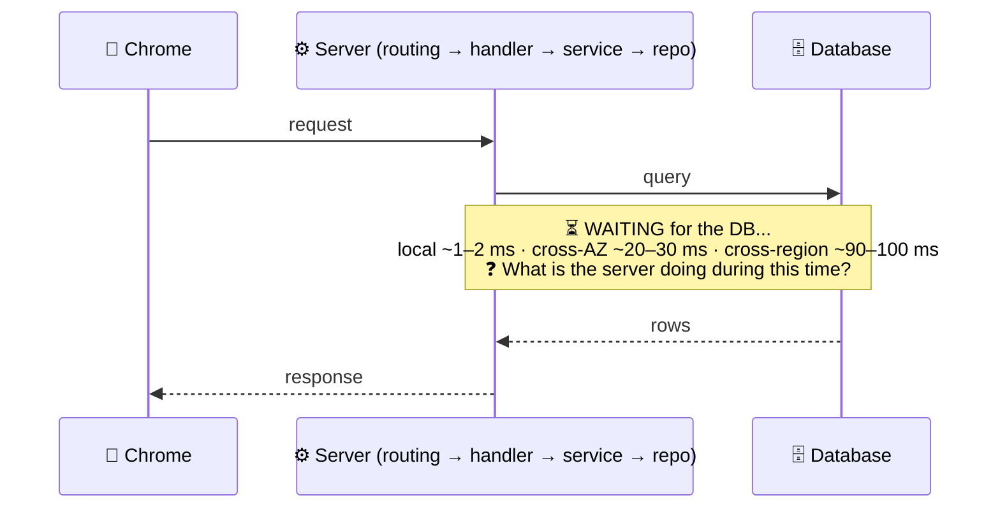

> ❓ **The question this video answers: while the server waits for the DB, what is it doing?**

### Naive synchronous server (one request at a time)
- Line-by-line execution with no concurrency, so during that 2/30/100 ms the **CPU is completely idle**, waiting for network packets.

### Quantifying the waste

```
 Modern CPU ≈ 3,000,000,000 instructions / second
           ≈ 3,000,000 instructions / millisecond

 Idle for 100 ms waiting on the DB  →  could have run ~300,000,000 instructions
 Actually ran                        →  0  😱
```

### A typical API call

```
 3–5 DB queries + 1–2 external services (email, Redis...) = ~5 network operations
 Average ~50 ms each  →  ~250 ms WAITING on I/O
 Actual CPU work      →  ~10 ms

 ┌──────────────────────────────────────────────────────────────┐
 │ CPU ██ (10 ms)                                                │
 │ I/O wait ████████████████████████████████████████████ (250 ms)│
 └──────────────────────────────────────────────────────────────┘
   → CPU & memory IDLE ~95% of the time
```

> 🔑 **This is exactly the problem concurrency solves:** use the CPU and memory for **other work** while waiting on the network. In a typical backend, **>70% of time is spent on I/O**.

---

## 3. I/O-Bound vs CPU-Bound (05:57)

| | **I/O-bound** | **CPU-bound** |
|---|---|---|
| What | **Waiting** for external resources: **network** (DB queries, external APIs, Redis), **files**, **stdin/stdout** (keyboard input, display, logging) | **Actual computation** using CPU cycles |
| Examples | DB queries, sending emails, cache calls, file uploads/downloads, logging, telemetry | Light: routing, validation, JSON (de)serialization (~1–2 ms). **Heavy:** **image processing** (matrix math), **video encoding**, **encryption / JWT verification**, ML |
| CPU during it | **Useless**: can't speed it up | **Busy**: the bottleneck |
| Needs | **Concurrency** | **Parallelism** |
| Typical backend | ✅ **Mostly this** | Only for niche work (video, crypto, ML...) |

> 🔑 **For backends, the bottleneck is almost always I/O**, whether you have 1 core or 8.

---

## 4. Concurrency vs Parallelism (09:49)

| | **Parallelism** | **Concurrency** |
|---|---|---|
| Definition | **Executing multiple instructions at the same instant** | **Structuring** a program so tasks can **start, pause and resume**, making progress on many at once |
| Hardware | **Needs multiple cores** (1 core = 1 instruction at a time) | Works on **1 core** |
| Nature | Hardware execution | Program **structure**, enabled by the OS / language runtime |
| One-liner | **Doing** multiple things at once | **Dealing with** multiple things at once |

> 🧠 *"Parallelism is about **doing** lots of things at once. Concurrency is about **dealing with** lots of things at once."* With concurrency, at any instant **only one thing runs per core**, but many are **in progress**.

> The one-instruction-per-core constraint isn't really a "limitation", as you'll see.

---

## 5. Visualizing Concurrent Request Handling (12:35)

**Two requests (A and B) arrive together, on ONE CPU core:**

```
 time (ms)   0     5     10    15    20    25    30    35    40    45    50    55    60
             │─────│─────│─────│─────│─────│─────│─────│─────│─────│─────│─────│─────│
 Request A   [CPU ]·····································(DB done@40)···[CPU]→ respond
             parse │← waiting for DB (I/O) ─────────────────────→│ wait for  │
             valid.│                                              │ CPU (sched)│
 Request B   wait  [CPU ──────────── 15 ms ────────────]··········(DB done@50)·[CPU]→ respond
                   │ validation, loops...             │← waiting for DB (I/O)→│

 CPU core    [ A  ][          B             ][ idle/other tasks ][ A ][ B ]
```

1. **0–5 ms:** A uses the CPU (validation, routing, JSON deserialization). **B waits.**
2. **5 ms:** A starts a **DB query** (I/O, ~40 ms) and **releases the CPU**. The **OS scheduler / runtime** gives the CPU to **B**.
3. **5–20 ms:** B uses the CPU (~15 ms of processing), then starts its **DB query** too.
4. **40 ms:** A's DB response arrives, but A **doesn't get the CPU instantly**. Scheduling and priority decide.
5. **~50 ms:** A gets the CPU, finishes processing, **responds**. Then B gets its turn and responds.

> 🔑 **Even with one core, the CPU was never wasted.** And in reality the server juggles not 2 but **hundreds** of things (logging/stdout, telemetry calls, background jobs...). The CPU jumps between them, and whenever a task needs I/O, it switches to another.

### From the outside vs zoomed in

| View | What you see |
|---|---|
| **Client's perspective** | Both requests are **in progress** at once (B hasn't errored or ended) |
| **Zoomed into a time slice** | **Only one** request is actually using the CPU |

**That's concurrency.**

### Parallel version (2 cores)

```
 Core 1:  [ A ]······(DB)······[ A ]
 Core 2:  [ B ]······(DB)······[ B ]     ← BOTH execute in the SAME time window
```

---

## 6. Which Workloads Need What (18:43)

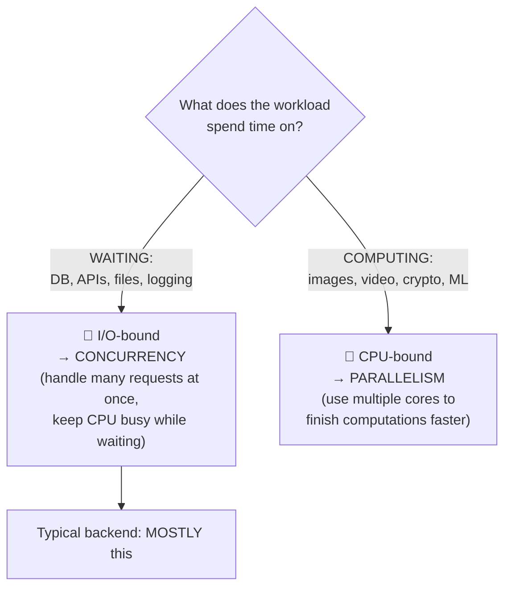

- **I/O-bound** needs **concurrency**. A server processing one request at a time wastes ~95% of its resources.
- **CPU-bound** benefits from **parallelism**: multiple cores finish heavy computations faster than interleaving on one.
- **Backends need both**, but are **mostly I/O-bound**.

---

## 7. Mechanism 1: Threads (22:18)

> Every concurrency feature you'll meet (**Go goroutines**, **JS/TS/Node async/await**, **Java virtual threads**...) is built on **two mechanisms**: **threads** and **event loops**.

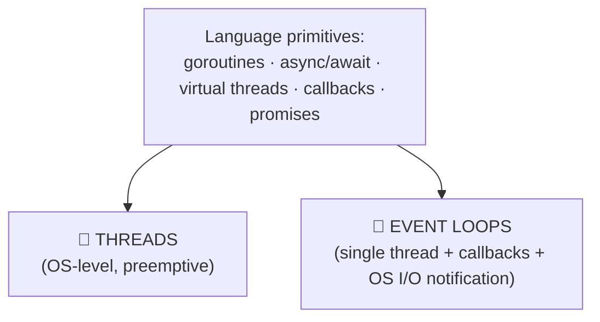

### What a thread is
> **Thread:** an **independent unit of execution** provided by the **operating system**, run on the CPU.

When created, the OS allocates:

| Component | Purpose |
|---|---|
| **Stack** | Tracks **function calls** (main → getUsers → ...) and **local variables** (e.g. `let a = 3`) |
| **Instruction pointer** | Tracks **where execution is** in the code, so the thread can resume after a context switch |

### The OS scheduler (preemptive)

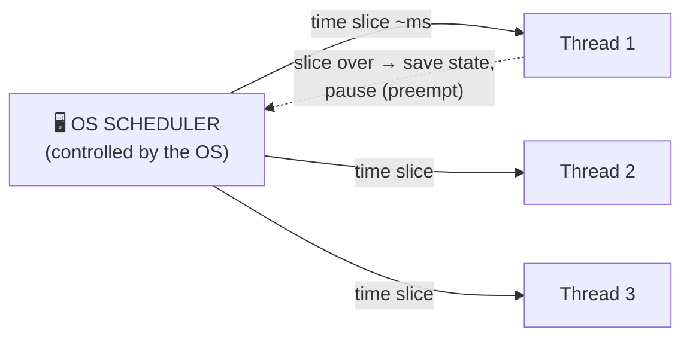

- The **scheduler** (owned by the **OS**) decides which thread **runs, stops, blocks, resumes**.
- Each thread gets a **time slice** (milliseconds or less) of CPU. When it expires, the scheduler **pauses** the thread, **saves its state** (last instruction...), and **switches** to the next.
- This is **preemptive scheduling**: threads are stopped **whether they like it or not**.
- Some language runtimes add **their own scheduler on top** (see Go below).

> 📚 Want depth? Read ***Operating Systems: Three Easy Pieces*** (OSTEP). It's optional, but it builds great intuition for concurrency abstractions.

### Blocking operations
- **Blocking operation** = anything where the **CPU is useless**: I/O (logging, network calls, packets/TCP/HTTP, **DB calls**).
- The thread tells the OS "I'm blocked on I/O". The OS **marks it blocked** and **switches** to another thread. When the I/O completes, the thread becomes **runnable** again (not instantly running) and the scheduler picks it up later.

### Processes vs threads: memory sharing

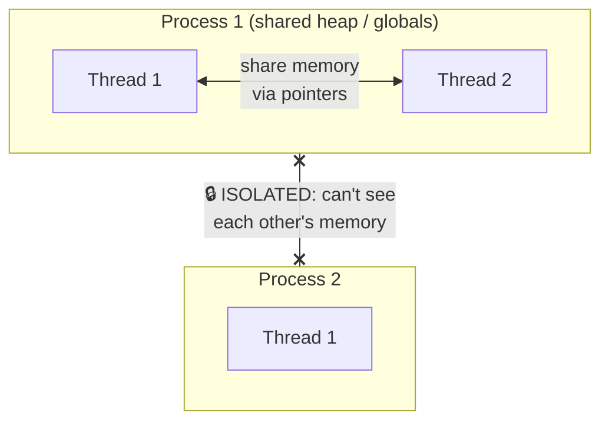

| | Same process | Different processes |
|---|---|---|
| Memory | **Shared** (heap, globals, dynamically allocated objects/structs) | **Isolated** (security, prevents memory corruption) |
| Communication | Read/write the **same memory** via **pointers**: **no copying, no serialization**, so it's **fast** | Needs IPC |

- ⚠️ This **shared memory** is **powerful** but **dangerous** ([§14](#14-race-conditions-and-shared-state-11526)).
- **Multiple cores → threads run in true parallel** (2 cores → 2 threads at the same instant, 4 → 4), which speeds up **CPU-bound** work.

---

## 8. Thread Overhead and Context Switching (32:14)

| Overhead | Details |
|---|---|
| **1. Memory** | Each thread gets its own **stack**, up to ~**8 MB** on Linux (mostly **virtual**, physical memory allocated on demand, but still some real MBs). **Thread-per-request** example: **10,000 requests** × ~0.5–1 MB ≈ **8–9 GB** just for requests. You **run out of memory** and crash. |
| **2. Creation** | Each thread needs a **system call** to the kernel: set up the stack, allocate bookkeeping structures (instruction pointer...), **register with the scheduler**. Takes **microseconds to milliseconds**, which is significant latency per call. |
| **3. Context switching** ⭐ (biggest) | Switching thread A → B means **saving A's CPU registers**, **updating bookkeeping**, **selecting** the next thread, **restoring** B's registers and state. ~**1–10 µs** per switch on modern hardware. 100 threads on 4 cores means constant juggling. 1,000 threads can add up to **milliseconds** of **pure maintenance work**, no real progress. |

```
 Context switch:  [save A regs][update bookkeeping][pick next][restore B regs] → B runs
                  └──────────── pure overhead (1–10 µs each) ────────────┘
 × thousands of threads × constant switching = milliseconds of wasted CPU
```

> 🔑 That's why **thread-per-request** models have **always struggled** with **high concurrency**.

---

## 9. Mechanism 2: The Event Loop (37:12)

> **Usually ONE thread.** Concurrency comes from **waiting via callbacks**, not from many threads.

### How it works

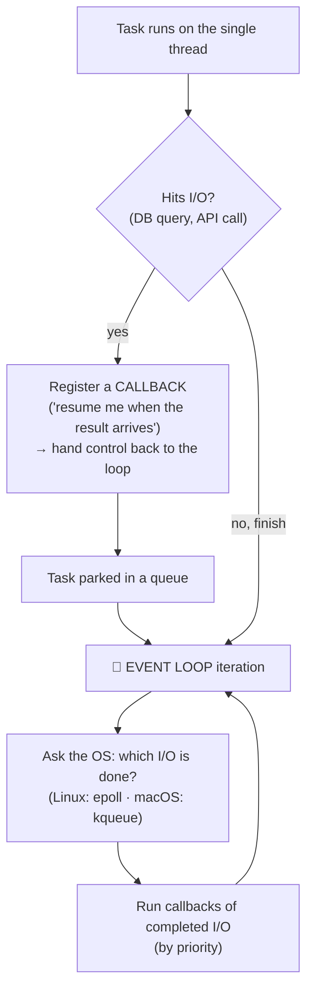

1. A task needs I/O (e.g. a DB query). Instead of **blocking**, it says (via **async** syntax) "**resume me when the result arrives**" and **hands control back** to the loop.
2. It's **queued**. (Real event loops have **multiple queues and priorities**, but think of one queue.)
3. The loop keeps running **other tasks**.
4. Each **iteration**, it checks which I/O operations **completed** (monitoring **thousands of connections** efficiently) and runs their **callbacks**.

> ⚙️ **OS support is required**: languages can't do this alone. **Linux: `epoll`**. **macOS: `kqueue`**. (📌 Windows: **IOCP**.)

### Why it's efficient for I/O

| | Threads | Event loop |
|---|---|---|
| Context switches | Many (expensive) | **None** (one thread) |
| Memory | MBs of stack **per thread** | **One** stack |
| More threads for I/O work? | **Slower** (more switching) | N/A |
| CPU-bound work | ✅ more threads = faster (parallel) | ❌ blocks everything |

> 🔑 **For I/O-bound concurrent work, the event loop beats the threading model.**

### ⚠️ The golden rule: never block the event loop
- A **CPU-heavy** callback (e.g. ~100 ms+) **freezes the entire loop**: no other request progresses.
- Callbacks (the CPU parts) must be **fast**. In typical SaaS backends that's fine, since latency comes from I/O. 100 ms+ CPU work mostly appears in **animations, images, video rendering, ML**.

> 📌 **Extra:** in Node.js, offload heavy CPU work to **`worker_threads`**, a separate process/service, or a **background job queue** ([Background_Jobs_Notes.md](Background_Jobs_Notes.md)).

---

## 10. Async/Await: Syntactic Sugar over Callbacks (42:57)

**Event-loop languages (e.g. JavaScript) provide callbacks, promises, and async/await.** They're **syntactic sugar** that help you **yield control at I/O points** and **avoid blocking the loop**.

- `await` before a DB query or API call means: "**I'm giving up my CPU slice. Give it back when this network operation finishes**, so I can continue this function."

### Callbacks → callback hell → async/await

```js
// ⬅️ Before ES6: callbacks
function handleRequest(req, sendResponse) {
  db.query("SELECT * FROM users WHERE id = ?", [req.userId], function (err, user) {
    // runs AFTER the event loop gets the DB response
    if (err) return sendResponse(500);
    sendResponse(200, user);
  });
}
```

```js
// 😵 Several I/O steps → "callback hell" (pyramid of doom)
db.query("SELECT user...", [id], (err, user) => {
  db.query("SELECT orders...", [user.id], (err, orders) => {
    api.get("/recommendations", (err, recs) => {
      cache.set("...", (err) => {
        sendResponse(200, { user, orders, recs });
      });
    });
  });
});
```

```js
// ✅ Modern: async/await (same mechanics, readable)
async function handleRequest(req) {
  const user   = await db.query("SELECT * FROM users WHERE id = ?", [req.userId]);
  const orders = await db.query("SELECT * FROM orders WHERE user_id = ?", [user.id]);
  return { user, orders };
}
```

> 🔑 **Everything after an `await` (to the end of that function) is effectively passed as the callback** to that I/O operation. Same idea, **no nesting**: multiple I/O steps read **sequentially**. Single thread, no context switches, no expensive stacks, which makes it **lightweight and efficient for I/O**.

---

## 11. Handling Two Requests: Thread Model vs Event Loop (44:02)

### A) Threading model (thread per request)

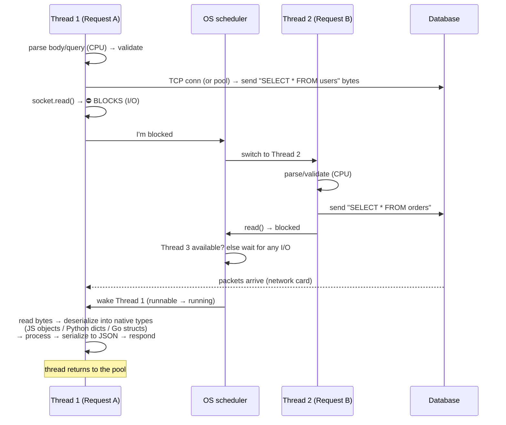

```python
# Python, threading model (no async/await): looks sequential
def handle_request(user_id):
    user = db.query("SELECT * FROM users WHERE id = %s", (user_id,))  # ⛔ thread BLOCKS here
    return user  # resumes when the DB responds (switching is invisible to you)
```

> Reading the code, it **looks line-by-line sequential**. The **blocking and thread switching are invisible** but happen behind the scenes.

### B) Event-loop model

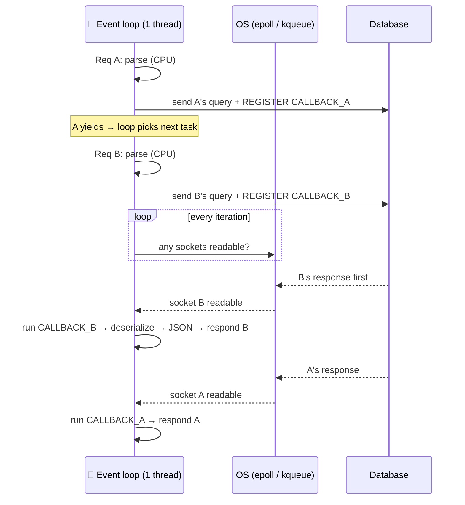

| | Threading model | Event loop |
|---|---|---|
| Result / sequence | Same outcome | Same outcome |
| **How pause/resume works** | OS saves and restores **thread state** (heavy structures, instruction pointers) | **Callbacks** (lightweight) |

---

## 12. Goroutines / Virtual Threads (1:00:02)

> A third model: **not exactly threads, not exactly an event loop**. Conceptually **virtual threads**, called **goroutines** in Go. (Java also has **virtual threads** in modern versions.)

- **Not managed by the OS**: managed by the **language runtime**.
- A Go program starts as the **main goroutine**, which can start others: `go someFunction()`.
- **Go's standard `net/http` server creates a new goroutine for EVERY request.** Its `Serve` function accepts connections and runs `go c.serve(...)` per connection, with your handler. That would be fatal with OS threads (out of memory), but goroutines are **cheap**.

### The two-layer model

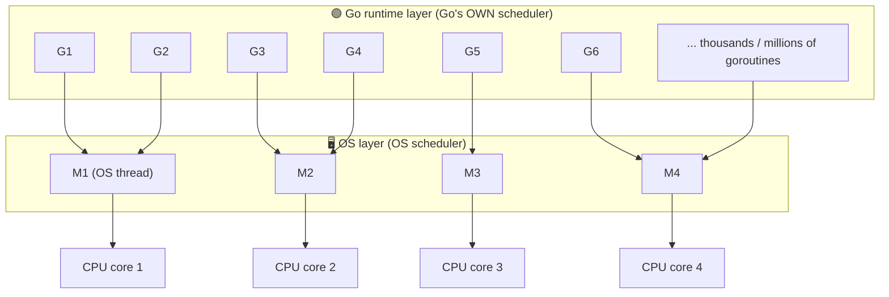

- **OS threads (M1–M4):** by default **≈ number of CPU cores** (configurable with **`GOMAXPROCS`**). With 4 cores you're capped at ~4 running threads.
- Each OS thread has a **queue of goroutines**. The **Go runtime scheduler** assigns goroutines to these queues.
- An OS thread runs **one goroutine at a time**. When **G1 blocks on I/O**, the runtime **pauses G1** and **M1 runs G2**. When G1's I/O completes, it's **runnable again**.
- **Switching goroutines ≈ a pointer swap**: far cheaper than an OS context switch. So you can run **thousands to millions** of goroutines (~**100× more** than OS threads).

```go
// Go handler: looks synchronous, but the goroutine is parked during I/O
func getUser(w http.ResponseWriter, r *http.Request) {
    row := db.QueryRow("SELECT * FROM users WHERE id = $1", r.URL.Query().Get("id"))
    // ⏸ this goroutine pauses here; the scheduler runs other goroutines on the same OS thread
    // ▶ resumes when the DB responds
    // ... scan row, write JSON response
}
```

> 🔑 The same idea as the threading model, **one abstraction layer up**: **runtime scheduler** instead of the OS scheduler, **goroutines** instead of OS threads. That's why **Go handles both CPU and I/O efficiently** without an event loop.
>
> 📌 **Extra:** Go's scheduler is formally the **G-M-P model**: **G**oroutines, **M**achine threads, **P**rocessors (logical run-queues, count = `GOMAXPROCS`). It also does **work stealing** between queues, and uses **netpoll** (epoll/kqueue) internally for network I/O.

---

## 13. Async/Await as a State Machine (1:10:43)

```js
async function fetchUserData(userId) {
  const user   = await db.getUser(userId);     // ⏸ await #1
  const orders = await db.getOrders(user.id);  // ⏸ await #2
  return { user, orders };
}
```

**Conceptually, the runtime turns this into a state machine:**

```js
function fetchUserData(userId) {
  let state = 0;
  let user, orders;

  function step() {
    switch (state) {
      case 0:                                   // ── start
        state = 1;
        return db.getUser(userId).then(r => { user = r; return step(); });
      case 1:                                   // ── after await #1
        state = 2;
        return db.getOrders(user.id).then(r => { orders = r; return step(); });
      case 2:                                   // ── after await #2
        return { user, orders };
    }
  }
  return step();
}
```

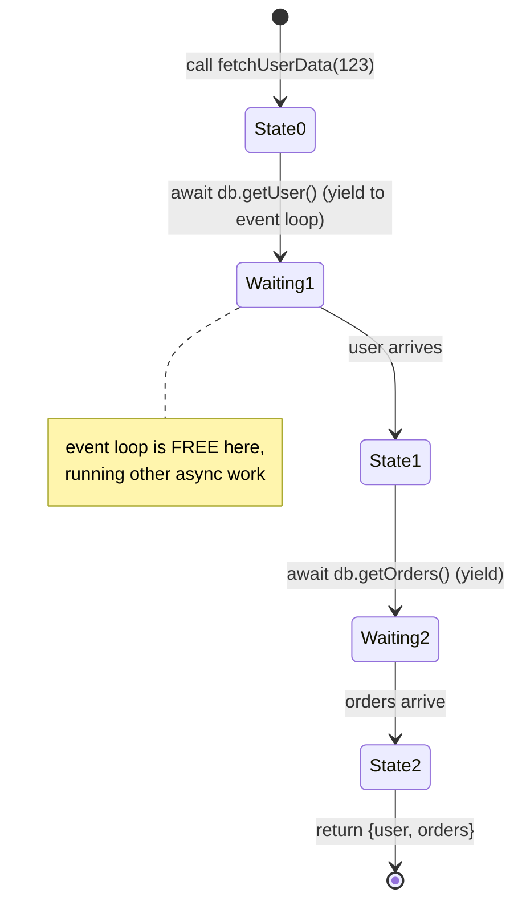

> 🔑 **Each `await` = a state transition.** Between states, the **event loop is free** to run other work.

### What this explains

| Question | Answer |
|---|---|
| **Why can `await` only be used inside `async` functions?** | `async` marks the function to be **transformed into a state machine**. Without it there's no machine for `await` to transition through. |
| **Why is blocking the event loop so bad?** | If the loop is blocked, state machines **can never advance** (state 0 → 1 → 2). Every pending request stalls. |

> You don't have to internalize this, but it helps.

---

## 14. Race Conditions and Shared State (1:15:26)

> Most concurrency problems come down to **one thing: shared state / shared memory**.

### Example 1: lost update (two threads, `counter++`)

`counter++` is **three** operations: **① read** into a CPU register → **② add 1** → **③ write** back.

```
 counter = 0
 time   Thread A                    Thread B                 counter
 ────   ─────────────────────────   ──────────────────────   ───────
  t1    read counter → reg = 0                                  0
  t2                                read counter → reg = 0      0
  t3    reg = 0 + 1 = 1                                         0
  t4                                reg = 0 + 1 = 1             0
  t5    write 1 → counter                                       1
  t6                                write 1 → counter           1   ← expected 2! 😱
```

> This is a **race condition**: the result depends on timing. Here it's a **lost update**: one thread's increment **vanished**.

### Example 2: "but I use single-threaded JS async/await..." ❌ still races

```js
let balance = 100;

async function withdraw(amount) {
  if (balance >= amount) {              // ① CHECK
    await processWithdrawal(amount);    // ② AWAIT → yields to the event loop!
    balance -= amount;                  // ③ DEDUCT (balance may have changed!)
  }
}

withdraw(100);
withdraw(100);
```

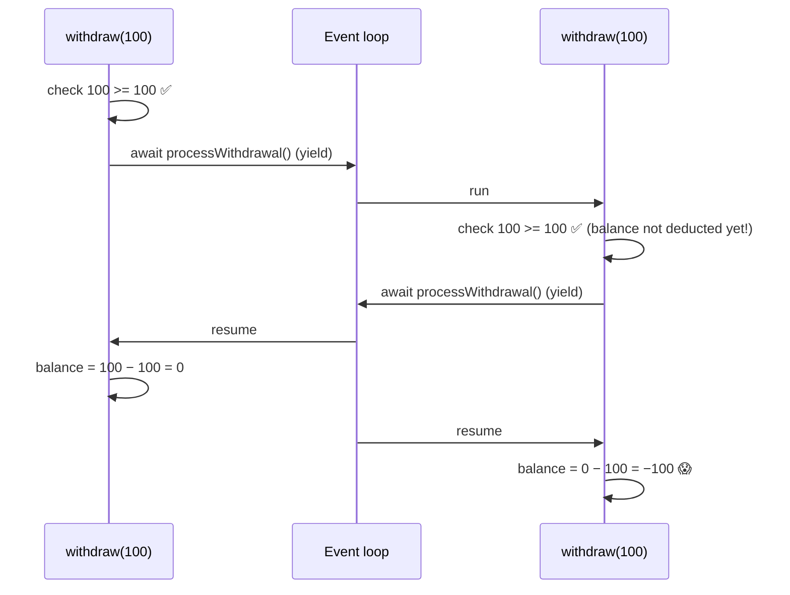

> 🔑 **Single-threaded async code is NOT immune to race conditions.** Any `await` between a **check** and an **update** opens a window for interleaving (the "check-then-act" bug).

---

## 15. Solutions: Locks, Mutexes, Channels (1:23:30)

(Deep coverage lives in OS books. This is a brief overview.)

### Locks / mutexes (mutual exclusion)

```python
import threading

counter = 0
lock = threading.Lock()

def increment():
    global counter
    with lock:              # 🔒 acquire: only ONE thread can be inside at a time
        counter += 1        # read → add → write happens atomically w.r.t. other threads
                            # 🔓 released on exit; waiting threads can now enter
```

- The protected region is a **critical section** (**mut**ual **ex**clusion = **mutex**). Once one thread **acquires** the lock, others **wait** until it's **released**.

### Channels (Go): share memory by communicating

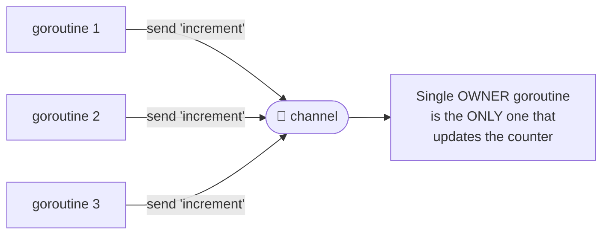

- Instead of many goroutines updating a **shared variable**, they **pass messages**, and **only one goroutine** owns and updates the state.

> 📌 **Extra:** for the **balance** example in a real backend, the shared state is usually in the **database**, so use **transactions** with row locks (`SELECT ... FOR UPDATE`), **atomic conditional updates** (`UPDATE accounts SET balance = balance - 100 WHERE id = $1 AND balance >= 100`), or optimistic locking (version columns).

> 🎯 The video's single core goal: **understand I/O-bound vs CPU-bound.** If you get that, the video succeeded, even if threads, locks and the rest are still fuzzy.

---

## 16. Summary (1:25:57)

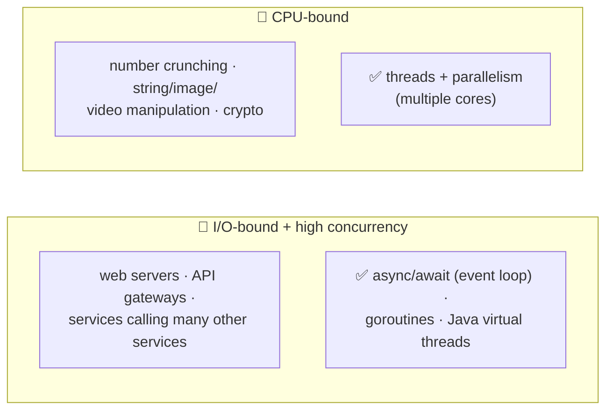

| Concept | Takeaway |
|---|---|
| **Concurrency** | Keeps your program **productive**: no wasted CPU cycles while waiting on I/O (network card, stdin/stdout, external APIs, DBs) |
| **Parallelism** | Uses **multiple cores** to do multiple things **at the same instant** |
| **Backends** | Lean **much more on concurrency** than parallelism, though some cases need both, or more parallelism |
| **The skill** | Know the difference, and choose the **right tool** for each workload |

---

## 🧾 Quick Revision Cheat Sheet

```
CPU ≈ 3 billion instr/s → 100 ms idle wait = ~300 M wasted instructions
Typical API: ~250 ms I/O wait vs ~10 ms CPU → CPU idle ~95%  →  NEED CONCURRENCY
I/O-bound → concurrency     CPU-bound → parallelism     Backends: mostly I/O-bound
Concurrency = DEALING with many things (1 core OK) · Parallelism = DOING many things (multi-core)
```

| Topic | Key points |
|---|---|
| Two mechanisms | **Threads** and **event loops**. Everything else builds on them. |
| OS thread | Own **stack** (~8 MB virtual on Linux) + **instruction pointer**. **OS scheduler**, **preemptive** time slices. Blocking I/O → marked blocked → switch. |
| Memory | Threads in the **same process share** heap/globals (fast, dangerous). **Processes are isolated.** |
| Thread costs | **Memory** (10k threads ≈ GBs) · **creation** (syscalls, µs–ms) · **context switches** (1–10 µs, pure overhead). Thread-per-request struggles at scale. |
| Event loop | One thread. On I/O → **register callback** → yield → loop runs others → **epoll (Linux) / kqueue (macOS)** reports ready sockets → callbacks run. No switches, tiny memory. |
| Golden rule | **Never block the event loop** (CPU-heavy work freezes everything) |
| async/await | **Sugar over callbacks**. The code after `await` = the callback. Fixes callback hell. |
| State machine | async fn → state machine. Each `await` = a transition. Explains `await`-needs-`async` and why blocking is fatal. |
| Goroutines | Go spawns **1 goroutine per HTTP request**. The **runtime scheduler** multiplexes them onto ~CPU-count OS threads (**GOMAXPROCS**). Switch ≈ pointer swap, millions possible. Java virtual threads are similar. |
| Race condition | `counter++` = read → add → write. Interleaving gives a **lost update** (1, not 2). |
| Async races too | Check → **await** → act: double withdraw leaves balance −100 |
| Fixes | **Locks/mutexes** (critical section) · **channels** (message passing, single owner) · 📌 DB transactions / atomic updates |
| Choose | I/O-heavy servers: async/await, goroutines, virtual threads. CPU-heavy: threads + parallelism. |

---

## ❓ Self-Test Questions

<details>
<summary>1. Why must every backend handle multiple things at once?</summary>

A server processing one request at a time makes thousands of other users wait or get "busy" errors, which is unusable in production.
</details>

<details>
<summary>2. Quantify the waste of a synchronous server waiting 100 ms on a DB query.</summary>

A modern CPU runs ~3 billion instructions/s (~3 million/ms), so 100 ms idle ≈ **300 million** instructions that could have run, versus zero.
</details>

<details>
<summary>3. In a typical API call, how is time split between I/O and CPU?</summary>

~5 network operations × ~50 ms ≈ **250 ms waiting on I/O**, versus ~**10 ms CPU**. The CPU is idle ~95% of the time. Overall, >70% of backend time is I/O.
</details>

<details>
<summary>4. Define I/O-bound and CPU-bound, with examples.</summary>

**I/O-bound:** waiting on external resources (DB queries, API calls, Redis, files, logging/stdout). **CPU-bound:** actual computation (image processing, video encoding, encryption/JWT verification, ML, heavy parsing).
</details>

<details>
<summary>5. Concurrency vs parallelism: what's the difference, and which needs multiple cores?</summary>

**Parallelism** = executing multiple things at the same instant, which **needs multiple cores**. **Concurrency** = structuring a program to start, pause and resume tasks so many are in progress, which **works on one core**. "Doing" vs "dealing with" many things at once.
</details>

<details>
<summary>6. With one core and two requests, how does concurrency avoid wasting the CPU?</summary>

When request A starts a DB query (I/O), it releases the CPU and the scheduler gives it to B. When B hits I/O, the CPU goes to whoever is ready. The CPU always works on something while others wait.
</details>

<details>
<summary>7. Which needs concurrency and which needs parallelism?</summary>

**I/O-bound → concurrency. CPU-bound → parallelism.** Backends are mostly I/O-bound.
</details>

<details>
<summary>8. What are the two fundamental mechanisms behind all concurrency primitives?</summary>

**Threads** and **event loops**. Goroutines, async/await and virtual threads build on them.
</details>

<details>
<summary>9. What does the OS allocate per thread, and what is preemptive scheduling?</summary>

A **stack** (function calls, local variables) and an **instruction pointer** (resume position). **Preemptive scheduling:** the OS scheduler gives each thread a time slice and **forcibly pauses** it when the slice ends, saving its state before switching.
</details>

<details>
<summary>10. How does memory sharing differ between threads and processes?</summary>

Threads in the **same process share memory** (heap, globals) and communicate via pointers without copying (fast, but dangerous). **Processes are isolated** and can't see each other's memory.
</details>

<details>
<summary>11. List the three overheads of OS threads.</summary>

**Memory** (a stack per thread, up to ~8 MB virtual, so 10k threads ≈ GBs), **creation** (syscalls to set up the stack, bookkeeping and scheduler registration), **context switching** (save/restore registers and bookkeeping, ~1–10 µs each, pure overhead).
</details>

<details>
<summary>12. How does an event loop achieve concurrency on one thread?</summary>

When a task hits I/O it **registers a callback** and yields. The loop keeps running other tasks. Each iteration it asks the OS (**epoll**/**kqueue**) which I/O completed and runs those callbacks.
</details>

<details>
<summary>13. Why is the event loop more efficient than threads for I/O, and what's its weakness?</summary>

No context switches and no per-thread stacks (one thread). Weakness: any **CPU-heavy callback blocks the whole loop**. Never block the event loop.
</details>

<details>
<summary>14. What is async/await relative to callbacks?</summary>

**Syntactic sugar.** Everything after an `await` (to the end of the function) acts as the callback for that I/O, so sequential-looking code replaces nested "callback hell".
</details>

<details>
<summary>15. How does an async function work under the hood?</summary>

It's compiled conceptually into a **state machine**. Each `await` is a **state transition**, and between transitions the event loop is free to run other work.
</details>

<details>
<summary>16. Why can await only be used inside async functions, and why is blocking the loop fatal?</summary>

`async` marks the function for **state-machine transformation**, which `await` relies on. A blocked loop means state machines **can't advance**, so every pending request stalls.
</details>

<details>
<summary>17. How does Go handle a new goroutine per request without running out of memory?</summary>

Goroutines are **runtime-managed virtual threads**. The **Go scheduler** multiplexes many goroutines onto a few OS threads (≈ CPU cores, `GOMAXPROCS`). Switching is roughly a **pointer swap**, so millions can exist.
</details>

<details>
<summary>18. What happens in Go when a goroutine blocks on a DB query?</summary>

The Go runtime **parks that goroutine** and the same OS thread runs another goroutine from its queue. When the I/O completes, the parked goroutine becomes runnable and resumes.
</details>

<details>
<summary>19. Explain the lost-update race condition with counter++.</summary>

`counter++` = read → add → write. Threads A and B both read 0, both compute 1, both write 1, so the final value is **1 instead of 2**. One increment is lost.
</details>

<details>
<summary>20. How can single-threaded async JS still have a race condition?</summary>

**Check-then-act across an await:** both `withdraw(100)` calls pass `balance >= 100` before either deducts (each yields at `await`), so the balance ends at **−100**.
</details>

<details>
<summary>21. Name two ways to prevent race conditions.</summary>

**Locks/mutexes** (a critical section that only one thread can enter at a time) and **channels** (message passing where a single owner goroutine updates the state). 📌 In DB-backed apps: transactions, row locks, atomic conditional updates.
</details>

<details>
<summary>22. Which concurrency tools suit I/O-heavy servers, and which suit CPU-heavy work?</summary>

**I/O-heavy:** async/await (event loop), goroutines, Java virtual threads. **CPU-heavy:** OS threads with **parallelism** across multiple cores.
</details>

---

*Notes compiled from the video transcript. Timestamps (mm:ss / h:mm:ss) let you jump back to each section. Transcription fixes: "eole / eol" → epoll, "KQ" → kqueue, "go max" → GOMAXPROCS, "radius" → Redis, "asyncate" → async/await, "shoulduler / scheduleuler" → scheduler, "resistors" → registers, "mutexes" kept, "uling" → scheduling. Code snippets are illustrative reconstructions of what the video describes.*
