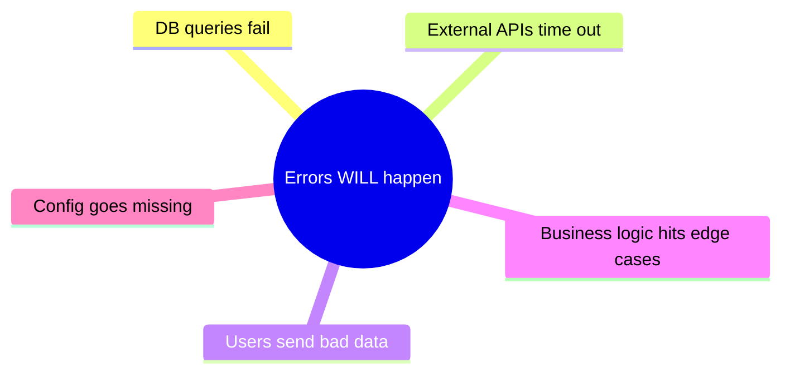
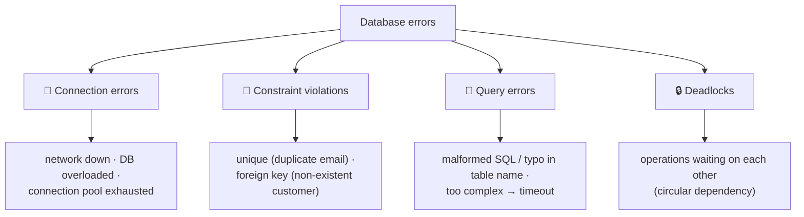
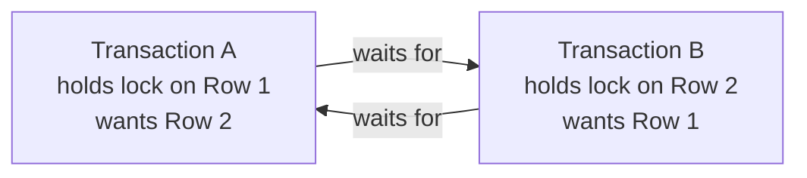
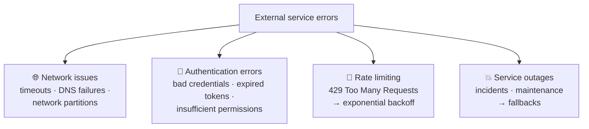
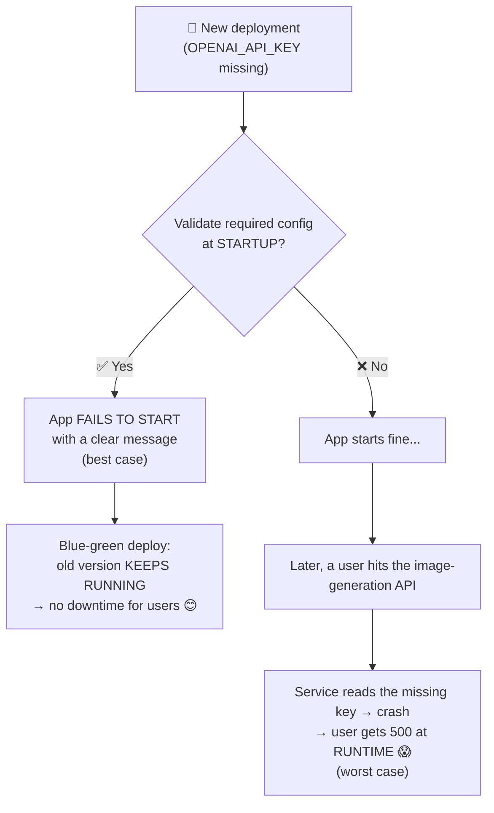
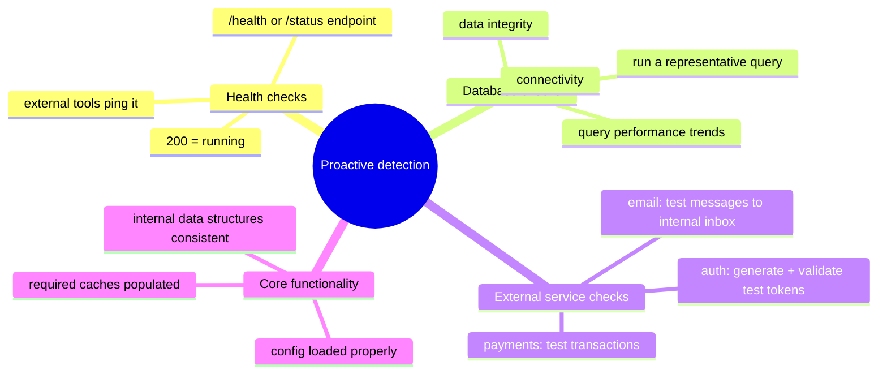
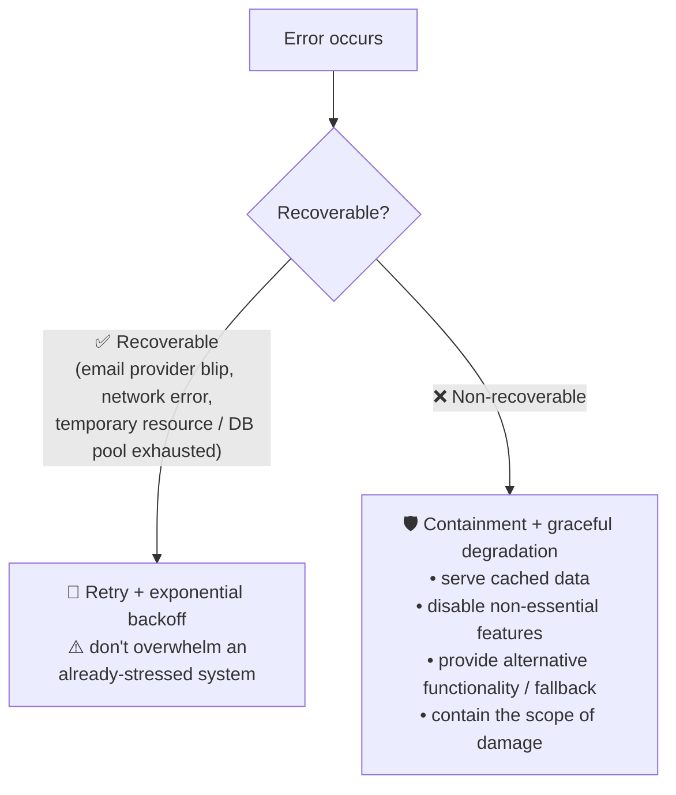
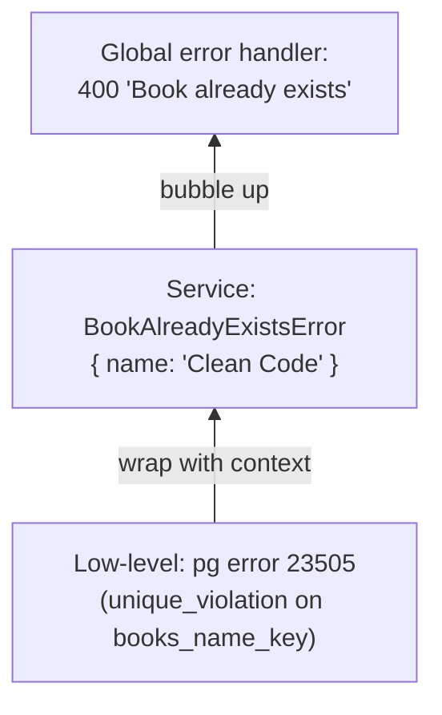
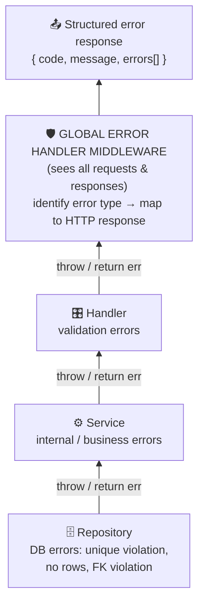
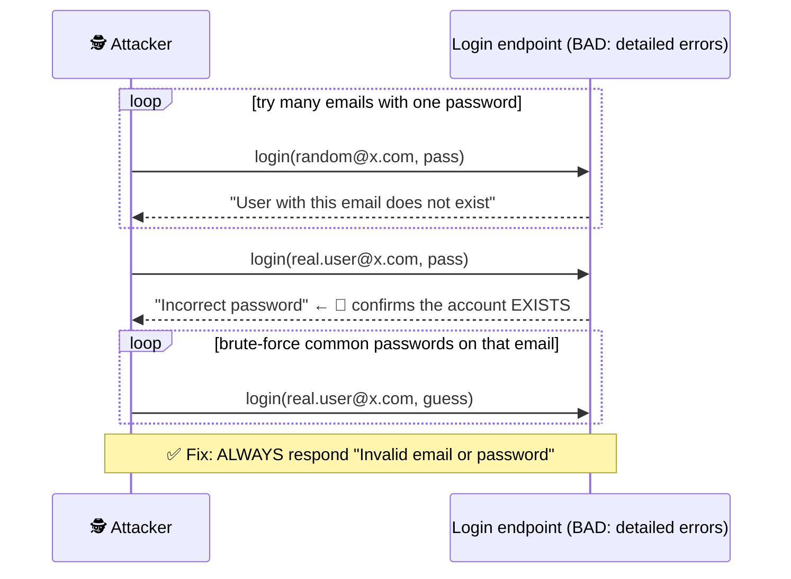

# Error Handling and Fault-Tolerant Backends: Complete Revision Notes

> **Source:** [YouTube: Error Handling (Backend from First Principles series, part 16)](https://www.youtube.com/watch?v=8NaM_9aKS24&list=PLui3EUkuMTPgZcV0QhQrOcwMPcBCcd_Q1&index=16)
> **Length:** ~1h 9m
> **Related notes:** [HTTP_Notes.md](HTTP_Notes.md) (status codes) · [Validation_Notes.md](Validation_Notes.md) · [Handlers_Middleware_Context_Notes.md](Handlers_Middleware_Context_Notes.md) (global error middleware) · [Databases_Notes.md](Databases_Notes.md) (constraints) · [Auth_Notes.md](Auth_Notes.md) (generic auth errors) · [Background_Jobs_Notes.md](Background_Jobs_Notes.md) (retries) · [Caching_Notes.md](Caching_Notes.md)
> **Next videos:** Configuration management → logging, monitoring & observability
> **Goal of the video:** Not tools or code, but a **fault-tolerant mindset**. Errors **will** happen. Know the types, detect them early, respond the right way, centralize handling in a **global error handler**, and don't leak information through error messages or logs.

> 💡 Diagrams use **Mermaid**. They render in GitHub, VS Code (with a Mermaid preview extension), Obsidian, Notion, and the Claude app. Anything marked **📌 Extra** was added to clarify a point and is not in the video.

---

## 📑 Table of Contents

1. [TL;DR: The Whole Video in 12 Lines](#-tldr-the-whole-video-in-12-lines)
2. [The Reality: Errors Will Happen](#1-the-reality-errors-will-happen-0000)
3. [Error Type 1: Logic Errors](#2-error-type-1-logic-errors-0151)
4. [Error Type 2: Database Errors](#3-error-type-2-database-errors-0524)
5. [Error Type 3: External Service Errors](#4-error-type-3-external-service-errors-1037)
6. [Error Type 4: Input Validation Errors](#5-error-type-4-input-validation-errors-1720)
7. [Error Type 5: Configuration Errors](#6-error-type-5-configuration-errors-2006)
8. [Prevention: Proactive Error Detection](#7-prevention-proactive-error-detection-2406)
9. [Monitoring and Observability](#8-monitoring-and-observability-2937)
10. [Handling Philosophies](#9-handling-philosophies-3318)
11. [Global Error Handling: The Final Safety Net](#10-global-error-handling-the-final-safety-net-4143)
12. [Security: Error Messages and Logs](#11-security-error-messages-and-logs-10009)
13. [Cheat Sheet / Quick Revision](#-quick-revision-cheat-sheet)
14. [Self-Test Questions](#-self-test-questions)

---

## ⚡ TL;DR: The Whole Video in 12 Lines

1. Errors are **normal**: DB queries fail, external APIs time out, users send bad data, logic hits edge cases. The question is **how** you handle them, not **whether** they happen.
2. **Logic errors** are the **most dangerous**: no crash, just **wrong results** (a discount applied twice → negative shipping → money lost on every order, unnoticed for weeks). Causes: misunderstood requirements, wrong algorithms, missed edge cases.
3. **Database errors:** **connection** (DB down, overloaded, **pool exhausted**), **constraint violations** (unique, foreign key), **query errors** (typos, timeouts), **deadlocks**.
4. **External service errors:** **network** (timeouts, DNS, partitions), **auth** (bad or expired credentials), **rate limits** (429 → **exponential backoff**), **outages** (→ **fallbacks**).
5. **Validation errors** (format, range, required) are the **easiest** to handle. They're your **first line of defense**: return **400**.
6. **Configuration errors:** a missing env var in production. **Validate all required config at startup and crash early** (blue-green deploys keep the old version running) rather than failing at runtime with a 500.
7. **The best error handling starts before errors happen:** **health checks** (`/health` → 200), **DB checks** (connectivity, query performance), **external service checks** (test transactions, test emails, test tokens), **core functionality** (config, caches).
8. **Monitoring:** track **errors and performance** (degradation is an early warning), **business metrics** (a sudden drop in successful transactions), and **structured JSON logs** (Grafana + Loki).
9. **Recoverable errors** → **retry / exponential backoff** (without overloading a stressed system). **Non-recoverable** → **containment and graceful degradation** (cached data, disable non-essential features, fallbacks).
10. **Recovery:** automatic (restart services, clean corrupted caches, fail over to backups) vs **manual** (documented, tested runbooks). **Protect data integrity above all.** Control **propagation** (wrap low-level errors with context, bubble them up). Use **error boundaries** between services (separate processes, timeouts, message queues).
11. **Global error handler middleware:** every layer bubbles errors up. One place maps them: validation → **400**, unique violation → **400** "already exists", no rows → **404**, FK violation → **404**, unknown → **500 "something went wrong"**. Benefits: **robust** (no forgotten cases) and **no redundancy**.
12. **Security:** never leak internals (table or constraint names) in messages. Use **generic auth errors** ("invalid email or password", see the **OWASP cheat sheets**). **Never log sensitive data**: log **user IDs and correlation IDs**, not emails, passwords, API keys or card numbers.

---

## 1. The Reality: Errors Will Happen (00:00)

> In backend development, **errors aren't just problems to solve. They're a normal part of building applications.** The key is being **ready to detect and fix them**.



- This video has **no tools, frameworks or code**. It's about a **mindset**: a **fault-tolerant mindset**.
- As a backend engineer, you're responsible for core business logic and for **every transaction and user activity going smoothly**. Prepare for the **worst**, know **how bad it can get**, and know how to **detect and prevent** it.

---

## 2. Error Type 1: Logic Errors (01:51)

> **The sneaky ones, and probably the most dangerous.** They **don't crash** your app. They make it **do the wrong thing**. The code runs fine, but the **results are wrong**.

**Example:** an e-commerce store **accidentally applies a discount twice**, so customers get **negative shipping costs**. Nothing crashes, but the platform **loses money on every single order**, possibly for **weeks or months**, unless monitoring or user reports catch it.

### Why they happen

| Cause | Example |
|---|---|
| **Misunderstood requirements** | A confusing point in a sprint discussion with the client or PM gets written down wrong, implemented, and with **little testing** goes **straight to production** |
| **Incorrectly implemented algorithms** | A complex discount algorithm based on behavior and purchase history has **one slight miscalculation** |
| **Unconsidered edge cases** | An unexpected user behavior in a payment or discount workflow |

> ⚠️ In **payments, money or security**, logic errors can **corrupt data** and **produce wrong business results over time without being detected**.

---

## 3. Error Type 2: Database Errors (05:24)

Most backends **depend heavily on the DB**, so DB errors can **bring the whole system down**.



### 3.1 Connection errors
- The app **can't talk to the DB**: the backend throws 500s and the **frontend shows empty screens everywhere**.
- Causes: **network down**, **DB server overloaded**, **connection pool exhausted**.
- **Connection pooling:** the backend keeps several **open TCP connections** to the DB, so it doesn't pay the **TCP handshake / setup cost** on every request (see [HTTP_Notes.md](HTTP_Notes.md)). It's an optimization, but running out of pooled connections is also an error.
- Without its source of data, the app **can't really function**.

### 3.2 Constraint violations
The operation breaks the **DB's rules** (see [Databases_Notes.md](Databases_Notes.md)):

| Violation | Example |
|---|---|
| **Unique** | Creating a user whose **email already exists** |
| **Foreign key** | Inserting into `orders` with a `customer_id` that **doesn't exist** in `customers` (an FK, non-nullable) |

```
 customers                orders
 ┌────┬───────┐          ┌────┬─────────────┐
 │ id │ name  │          │ id │ customer_id │──FK──► customers.id
 ├────┼───────┤          ├────┼─────────────┤
 │ 1  │ Alice │          │ 10 │ 99  ❌      │  customer 99 doesn't exist → FK violation
 └────┴───────┘          └────┴─────────────┘
```

- **Unhandled**, the error **bubbles up** to the main process, and the frontend gets a **500**.
- **Prevention:** strengthen your **validation layer** (frontend and backend).
- **But** some can't be prevented by validation: **only the DB knows** whether an email is unique. For those, focus on **error formatting**: send a **user-friendly message** ("This email already exists, try another").

### 3.3 Query errors
- **Malformed SQL**: e.g. a **typo** in the table name (`SELECT * FROM cusotmers`) → "table doesn't exist".
- Queries too **complex** → **time out**.

### 3.4 Deadlocks
- **Multiple DB operations waiting for each other**, creating a **circular dependency**. They're particularly **tricky**.



---

## 4. Error Type 3: External Service Errors (10:37)

Modern SaaS apps depend on many external services: **payment processors**, **email providers**, **cloud/object storage (S3)**, **Redis**, **auth providers (Auth0, Clerk)**. Each one is a **point of failure you don't control**, and you **can't avoid them** (rebuilding them would take years). So **expect failure and plan for it**.



| Cause | Details and handling |
|---|---|
| **Network** | HTTP/TCP/WebSocket all ride on the **internet, which isn't perfect**: **connection timeouts, DNS failures, network partitions** (routing). Expect and plan for them. |
| **Authentication** | Providers like Clerk or Auth0 **reject requests** because of **bad credentials, expired tokens, insufficient permissions**. ⚠️ Using an external auth provider **doesn't make you secure on its own**. Your own backend can still leak, e.g. by **exposing sensitive user info in logs**. |
| **Rate limiting** | OpenAI, Resend and others limit request volume to stop abuse. A traffic spike or **a logic bug** can make you hit them abnormally often → **429**. Handle with **exponential backoff**: wait 1 min, retry. 429 again → wait 2 min, then 4 min... until it succeeds. |
| **Service outages** | Inevitable: big incidents (GCP, AWS) take down many clients. Also **maintenance**. Handle **gracefully with fallbacks**, e.g. Redis down → a **second Redis node** or an **in-memory cache**, so critical flows like **payments and order processing** keep working. |

```
 Exponential backoff on 429
 request ─429─► wait 1m ─► retry ─429─► wait 2m ─► retry ─429─► wait 4m ─► retry ─✅ 200
```

---

## 5. Error Type 4: Input Validation Errors (17:20)

Caused by **users / API consumers** sending data that doesn't meet your system's rules. The **validation layer** is your **first line of defense** against bad data and **malicious input**, at your backend's **entry point** (details in [Validation_Notes.md](Validation_Notes.md)).

| Validation type | Checks |
|---|---|
| **Format** | Valid email, phone number, date. Be **clear about the exact format** and **accept only that**, for security and fault tolerance. |
| **Range** | Numbers too high or low. Strings too long or short. Arrays with ≥ 3 or ≤ 100 items. |
| **Required fields** | Mandatory fields are present |

- Response: **400 Bad Request**.
- ✅ **The easiest errors to expect and handle.** You already know your data's requirements, so enforce them at the entry point. (Unlike external outages, which you don't control, and logic errors, which are hard to detect.)

> 🔑 **Whatever you're building, have a very robust validation layer.**

---

## 6. Error Type 5: Configuration Errors (20:06)

These can **stop your app from starting** (good) or make **production behave unexpectedly** (bad). They usually show up **when moving between dev, staging and production**.

**Scenario:** during development you add `OPENAI_API_KEY` to your `.env`, the PR is merged, and you **forget to add it** to production config (set manually or via **AWS Parameter Store**). The deployment "succeeds"...



> 🔑 **Validate every required (non-optional) config variable first, before the server starts.** If any is **missing or corrupt**, **fail right there**. Always prefer **crashing at startup** over failing for real users at runtime.

- **Why it's safe:** most deployments use a **blue-green** style setup: the **previous version keeps running** until the new one starts successfully. A failed start leaves the old version serving.
- (Config management gets its own video next.)

```ts
// 📌 Extra: fail-fast config validation at startup (Node + Zod)
const Env = z.object({
  DATABASE_URL: z.string().url(),
  OPENAI_API_KEY: z.string().min(1),
});
export const env = Env.parse(process.env); // throws → process exits before serving traffic
```

---

## 7. Prevention: Proactive Error Detection (24:06)

> 🔑 **The best error handling starts before errors happen.** Find errors **before they spread**, at the moment they happen, before they cause real damage. This holds for frontend, backend and infrastructure.



| Check | What it verifies |
|---|---|
| **Health check endpoint** (`/health`, `/status`) | The server is **running**. The **status code** is what matters: **200 = OK**, 4xx/5xx = problem. External tools keep pinging it. |
| ⚠️ But that's **not enough** | Don't just check services are **running**. Check they're **actually doing their job**. |
| **Database health** | **Connectivity**, **query performance** (a query that took 500 ms now takes 4–5 s means trouble), **data integrity**. Run a **representative query** and track its timing and average. |
| **External services** | **Payments:** periodic **test transactions** (if the one 5 minutes ago succeeded, real ones should too). **Email:** **test messages to internal addresses**. **Auth:** **generate test tokens** and check them against the provider's **validation endpoints**. |
| **Core functionality** | **Config properly loaded** (fail with a meaningful message for operators). **Default caches populated** for production load. **Internal data structures consistent**. |

---

## 8. Monitoring and Observability (29:37)

(A dedicated logging, monitoring and observability video comes later. This is the high-level view.)

**Goal:** **detect errors quickly while they're happening** and give **enough context to debug them**.

| Area | Track |
|---|---|
| **Errors (everywhere)** | HTTP errors, DB errors, external service failures, **business logic errors**. Cover **as many sources as possible**. |
| **Performance** | **Response times**, **resource usage**, **throughput**. 🔑 **Performance degradation is an early warning sign**: a service slowing down may be about to fail. Don't track only error rates. |
| **Business metrics** | KPIs like **successful transactions**, successful authentications. A **sudden drop in successful transactions** can reveal a technical problem **even when error rates look normal**. |
| **Logging** | **Structured logs** (e.g. **JSON**: easy to parse, easy to add metadata). Ship them to log aggregation tools like **Grafana + Loki** for **search, visual dashboards, storage**. |

```json
// Structured (JSON) log example
{ "level": "error", "time": "2025-01-11T10:32:01Z", "requestId": "a1b2-c3d4",
  "userId": 42, "route": "POST /books", "error": "unique_violation", "durationMs": 37 }
```

---

## 9. Handling Philosophies (33:18)

### 9.1 Immediate error response
> Your **immediate response** decides whether an error stays **minor** or becomes a **major failure**. Strategy depends on the **error type and context**.



- **Recoverable** example: sending an email failed. It doesn't need to happen within milliseconds, so retry with backoff (see [Background_Jobs_Notes.md](Background_Jobs_Notes.md)).
- ⚠️ Retry logic must **not add more stress** to a system that's **already under stress**.

### 9.2 Error recovery strategies

| Type | Examples | Notes |
|---|---|---|
| **Automatic recovery** | **Restart** an unresponsive service or process. **Clean up corrupted caches**. **Fail over** to backup systems. | Handles many errors without humans. **Design carefully**, because these can **make things worse**. Use **trial and error**: push the system to its error thresholds ahead of time and learn what works per service. |
| **Manual recovery** | Cases needing **human judgment** | **Document** the processes (runbooks for the team and new hires), **test** them, make sure they can be **executed quickly under stress** |
| **Data recovery** | **Backups** at key moments, **restore from backups**, **replay transaction logs**, specialized recovery tools | 🔑 **Data is the most important (only tangible) part of your app.** Never corrupt it. **Data integrity is priority #1.** |

### 9.3 Propagation control
- **Not every error should be handled where it occurs.** Some must **propagate up** to a higher level that has **more context** (the stack trace shows the path).
- Keep the **bubbling workflow in your control**. Otherwise errors can spread to other services or **crash the main process**.
- **Exception hierarchies** (try/catch in JS, Python...) give **structure**: **catch low-level exceptions → wrap them with context → rethrow as higher-level exceptions** with **business context**, so you can **log the right data**, send a **meaningful response**, or **trigger recovery**.
- This leads to **global error handling** (next section).



### 9.4 Error boundaries (between services)
The **last point where errors stop propagating**. In service architectures they **prevent errors in one service from affecting others**:
- Use **separate processes**.
- Use **timeouts** to protect service-level boundaries.
- **Decouple** services with **message queues** (e.g. **RabbitMQ**) for **asynchronous communication**, so a bug in one service doesn't take down another.

---

## 10. Global Error Handling: The Final Safety Net (41:43)

> The presenter's **favorite** mechanism and **the most important error-handling strategy** in a backend. Mostly a **one-time setup effort** (then small tweaks) that **pays off immediately**.

### Recap of the layers (see [Handlers_Middleware_Context_Notes.md](Handlers_Middleware_Context_Notes.md))

| Layer | Role | Errors it may raise |
|---|---|---|
| **Routing** | Picks the handler | — |
| **Handler** | Extract, deserialize, **validate**, bind, call the service | **Validation errors** |
| **Service** | **Orchestrator** of repository methods (e.g. get user, then get the user's posts) | **Internal / business errors** |
| **Repository** | **Leaf nodes**: **one DB operation each** (e.g. `getUserById`) | **Database errors** |

### The pattern



- **However deep** the error is, **bubble it up** to the **global error handler middleware**. It lives in middleware so it has access to **all requests and responses**.
  - **Exception languages (JS, Python):** **throw**, and catch it in the middleware.
  - **Go** (errors as return values): keep **returning** the error repository → service → handler → middleware.
- Define **custom error types** (every language supports this). The middleware **reads the error type** and returns the right response.

### Worked examples: a book management platform (Goodreads-like)

**API: `POST /books` with `{ name (required), description (optional) }`**

| # | Where | What happened | Global handler response |
|---|---|---|---|
| 1 | **Handler** | Validation: `name` > **500 chars** (user sent 700) | **400 Bad Request** + field errors to fix |
| 2 | **Repository** | `INSERT` → **unique constraint violation** (a book with this name already exists) | **400 Bad Request**, `"Book already exists"` |

**API: `GET /books/123`** (frontend route `/books/123` calls the backend's `/books/123`)

| # | Where | What happened | Global handler response |
|---|---|---|---|
| 3 | **Repository** | `SELECT * FROM books WHERE id = 123` → the driver throws a **"no rows" error** (the book doesn't exist, e.g. a **malformed link** or a **scam link**) | **404 Not Found**, `"Book with ID 123 does not exist"` |

**API: `POST /books` with `{ name, description, authorId }`**

| # | Where | What happened | Global handler response |
|---|---|---|---|
| 4 | **Repository** | `INSERT` → **foreign key violation** (`authorId` doesn't exist in `authors`) | **404**, `"Author does not exist"` |

| Default | **Anything unrecognized** | **500**, `"Something went wrong"` / "Internal server error" (generic, see §11) |
|---|---|---|

```json
// Typical error response structure
{
  "code": 400,
  "message": "Book already exists",
  "errors": [ { "field": "name", "message": "must be at most 500 characters" } ]
}
```

> 📌 **Extra:** many APIs use **409 Conflict** for unique violations ("already exists", see [HTTP_Notes.md](HTTP_Notes.md) / [API_Design_Notes.md](API_Design_Notes.md)) and **400/422** for an invalid foreign key in a request body. The video's 400 and 404 choices are also common. **Pick one convention and be consistent.**

```js
// 📌 Extra: sketch of an Express global error handler (registered LAST)
app.use((err, req, res, next) => {
  if (err instanceof ValidationError) return res.status(400).json({ code: 400, message: "Invalid input", errors: err.details });
  if (err.code === "23505") return res.status(409).json({ code: 409, message: "Resource already exists" }); // pg unique_violation
  if (err.code === "23503") return res.status(404).json({ code: 404, message: "Referenced resource not found" }); // pg foreign_key_violation
  if (err instanceof NotFoundError) return res.status(404).json({ code: 404, message: err.message });
  logger.error({ err, requestId: req.id });             // full details go to LOGS only
  return res.status(500).json({ code: 500, message: "Something went wrong" }); // generic to the client
});
```

### Why a global error handler? Two big advantages

| Advantage | Explanation |
|---|---|
| **1. Robust and secure** | Every error is handled at one **final gateway**, so **no forgotten conditions**. Without it, each layer handles its own errors. Forget the unique-violation check in **one** repository method, and that error falls through to a generic **500** instead of "book already exists". |
| **2. Less redundancy** | Without a central place, **every repository method** repeats "is it a unique violation? an FK violation? no rows?", which means **duplicated code** and **more bugs**. |

---

## 11. Security: Error Messages and Logs (1:00:09)

> Leaking security-related details is bad. **Compromising your users' security is even worse**: it damages your **goodwill and trust** in the market.

### 11.1 Don't leak internals in error messages
- Raw DB errors contain **table names, indexes, constraint names**. If your global handler just copies the lower-layer error into `message`, **attackers learn your schema**, try **more advanced SQL injection**, and make you a **target**.
- **Control every message**: understand what error was thrown and **write a message meant for users**.
- **Default case:** if you've checked every known type (validation, unique violation, business errors...) and still don't know what happened, return **500** with a **generic** message: **"Something went wrong"** / "Internal server error". **Never** attach the raw error.

```
 ❌ 500  "duplicate key value violates unique constraint \"books_name_key\" on table \"books\""
 ✅ 409/400  "Book already exists"
 ✅ 500  "Something went wrong"     (details → server logs only)
```

### 11.2 Authentication errors: be vague on purpose
Authentication is among the **most targeted** modules. Follow security practices, e.g. the **OWASP Cheat Sheet Series** (advice for authentication and many other workflows). See also [Auth_Notes.md](Auth_Notes.md).



> 🔑 Whether the email doesn't exist **or** the password is wrong, return the same message: **"Invalid email or password"**. Otherwise attackers can **enumerate valid accounts** and then **brute-force** their passwords.

### 11.3 Never log sensitive data
- Logs feel "internal", but big companies generate **hundreds of GBs of logs a day** and send them to **multiple external services** (storage, analysis, observability). **In many major data breaches, logs leak.**
- **Never log:** user **emails**, **passwords**, **API keys**, **credit card numbers**...
- **Log instead:** the **user ID** and a **correlation ID** (request ID), which give enough context to debug.

```
 ❌ logger.error("Login failed for john@example.com with password hunter2")
 ✅ logger.error({ event: "login_failed", userId: 42, correlationId: "a1b2-c3d4" })
```

---

## 🧾 Quick Revision Cheat Sheet

```
MINDSET: errors WILL happen → detect early, respond correctly, centralize, don't leak
BEST ERROR HANDLING STARTS BEFORE ERRORS HAPPEN
```

| Error type | Examples | Handle with |
|---|---|---|
| **Logic** ⚠️ most dangerous | Double discount → negative shipping. Misread requirements, wrong algorithms, edge cases. | Testing, clear requirements, **business-metric monitoring** |
| **Database** | Connection (down, overloaded, **pool exhausted**), **unique/FK violations**, query typos/timeouts, **deadlocks** | Validation, user-friendly formatting, global handler |
| **External services** | Network (timeouts, DNS, partitions), auth (bad/expired creds), **429 rate limits**, outages | **Exponential backoff**, **fallbacks** (second Redis node / in-memory cache) |
| **Validation** ✅ easiest | Format, range, required | Robust validation layer → **400** |
| **Configuration** | Env var missing in production | **Validate config at startup, fail fast** (blue-green keeps the old version up) |

| Topic | Key points |
|---|---|
| Proactive detection | `/health` (200), DB checks (connectivity, query timing, integrity), external checks (test payments, test emails, test tokens), core (config, caches, data structures) |
| Monitoring | Errors everywhere + **performance** (early warning) + **business metrics** (successful-transaction drop) + **structured JSON logs** (Grafana + Loki) |
| Recoverable | **Retry / exponential backoff**, without overloading a stressed system |
| Non-recoverable | **Containment + graceful degradation**: cached data, disable non-essential features, fallbacks |
| Recovery | Automatic (restart, clean caches, failover) · manual (documented, tested runbooks) · **data integrity first** (backups, transaction logs) |
| Propagation | Wrap low-level errors with context → bubble up in a controlled way |
| Error boundaries | Separate processes, timeouts, **message queues** (RabbitMQ) |
| Global handler | All layers bubble up → middleware maps: validation **400**, unique **400** (📌 or 409), no rows **404**, FK **404**, unknown **500 generic**. **Robust + no redundancy.** |
| Security | No internal details (tables, constraints) in responses. Auth: **"Invalid email or password"** (OWASP). Logs: **user ID + correlation ID**, never emails, passwords, keys, cards. |

---

## ❓ Self-Test Questions

<details>
<summary>1. Why are logic errors considered the most dangerous?</summary>

They **don't crash** anything. The app quietly produces **wrong results** (e.g. a double discount causing losses on every order) that can go **unnoticed for weeks or months**, corrupting data and business results.
</details>

<details>
<summary>2. Name three causes of logic errors.</summary>

**Misunderstood requirements**, **incorrectly implemented algorithms**, **unconsidered edge cases**.
</details>

<details>
<summary>3. List the four kinds of database errors from the video.</summary>

**Connection errors** (DB down, overloaded, pool exhausted), **constraint violations** (unique, foreign key), **query errors** (malformed SQL, timeouts), **deadlocks**.
</details>

<details>
<summary>4. What is connection pooling, and how can it cause errors?</summary>

The backend keeps several **open TCP connections** to the DB to skip the handshake/setup cost on each request. If all pooled connections are in use (**pool exhausted**), new queries fail or wait.
</details>

<details>
<summary>5. Why can't validation prevent every unique-constraint violation, and what do you do instead?</summary>

Only the **database** knows whether a value (like an email) already exists. **Catch the error and format it** into a user-friendly message ("email already exists").
</details>

<details>
<summary>6. What is a deadlock?</summary>

Multiple DB operations **waiting on each other**: a **circular dependency** where none can proceed.
</details>

<details>
<summary>7. Name four causes of external service errors and how to handle rate limiting.</summary>

**Network issues**, **authentication errors**, **rate limiting (429)**, **outages**. For 429, use **exponential backoff**: wait 1 min → 2 → 4... and retry until it succeeds.
</details>

<details>
<summary>8. Your Redis provider goes down. What should a fault-tolerant backend do?</summary>

**Fall back gracefully**, e.g. to a **second Redis node** or an **in-memory cache**, so critical flows like payments and orders keep working.
</details>

<details>
<summary>9. Why are validation errors the "easiest" type?</summary>

You **already know your data's requirements**, so you can enforce them at the entry point and return **400**. Unlike outages (not in your control) or logic errors (hard to detect).
</details>

<details>
<summary>10. A required env var is missing in production. What's the best-case outcome and why?</summary>

The app **fails to start**, because required config is **validated at startup**. With **blue-green** deployments the **old version keeps running**, so users aren't affected. The worst case is the app starting and **500-ing at runtime** when a user hits the feature.
</details>

<details>
<summary>11. "The best error handling starts ___." Complete it and give examples.</summary>

"...**before errors happen**." Examples: health check endpoints, DB checks (connectivity, query performance), external service checks (test transactions, test emails, test tokens), core checks (config loaded, caches populated).
</details>

<details>
<summary>12. Why isn't a simple /health → 200 endpoint enough?</summary>

It only proves the server is **running**, not that it's **doing its job**. You also need DB, external service, and core functionality checks.
</details>

<details>
<summary>13. Why monitor performance and business metrics, not just error rates?</summary>

**Performance degradation** often comes **before** failures (an early warning). **Business metrics** (e.g. a drop in successful transactions) can expose technical problems **even when error rates look normal**.
</details>

<details>
<summary>14. How should you respond to recoverable vs non-recoverable errors?</summary>

**Recoverable:** retry with **exponential backoff**, without overloading a stressed system. **Non-recoverable:** **containment and graceful degradation**: cached data, disable non-essential features, fallbacks, limit the blast radius.
</details>

<details>
<summary>15. What's the #1 priority during error recovery?</summary>

**Data integrity.** Data is the only tangible asset. Use backups, restores, and transaction-log replay, and never corrupt data.
</details>

<details>
<summary>16. What does "propagation control" mean?</summary>

Don't always handle errors where they occur. **Wrap low-level errors with context** and **bubble them up deliberately** to a level with more business context (logging, user response, recovery), without letting them spread uncontrolled.
</details>

<details>
<summary>17. How do error boundaries protect a multi-service architecture?</summary>

**Separate processes**, **timeouts**, and **message queues** (async communication) stop a failure in one service from cascading into others.
</details>

<details>
<summary>18. Map these to responses in the global handler: validation fail, unique violation, no rows, FK violation, unknown error.</summary>

Validation → **400** (+ field errors). Unique violation → **400** "already exists" (📌 or 409). No rows → **404** "not found". FK violation → **404** "referenced resource doesn't exist". Unknown → **500 "Something went wrong"**.
</details>

<details>
<summary>19. Give two advantages of a global error handler.</summary>

**Robustness:** one final gateway means no forgotten conditions that fall through to a generic 500. **Less redundancy:** no repeated error-type checks in every repository method.
</details>

<details>
<summary>20. Why must the default 500 message be generic?</summary>

Raw errors can reveal **internal details** (table, index, constraint names) that help attackers plan advanced attacks like SQL injection. Return "Something went wrong" and log the details server-side.
</details>

<details>
<summary>21. Why should login return "Invalid email or password" for both cases?</summary>

Separate messages let attackers **enumerate which emails exist**, then **brute-force** those accounts' passwords.
</details>

<details>
<summary>22. What should and shouldn't go into logs?</summary>

**Never:** emails, passwords, API keys, credit card numbers. **Do log:** **user IDs** and **correlation/request IDs**. Logs are often shipped to external services and have leaked in major breaches.
</details>

---

*Notes compiled from the video transcript. Timestamps (mm:ss / h:mm:ss) let you jump back to each section. Transcription fixes: "oz0ero / ozero" → Auth0, "clock" → Clerk, "radius" → Redis, "dreadlock" → deadlock, "exponential backup" → exponential backoff, "Graphana" → Grafana, "OAS cheat sheet" → OWASP Cheat Sheet Series, "fall tolerant" → fault-tolerant, "4handed" → 400, "uni constraint" → unique constraint.*
