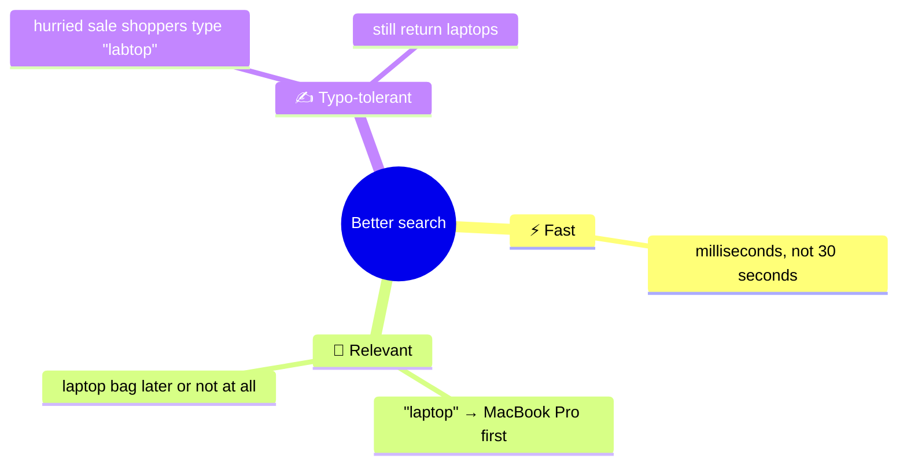
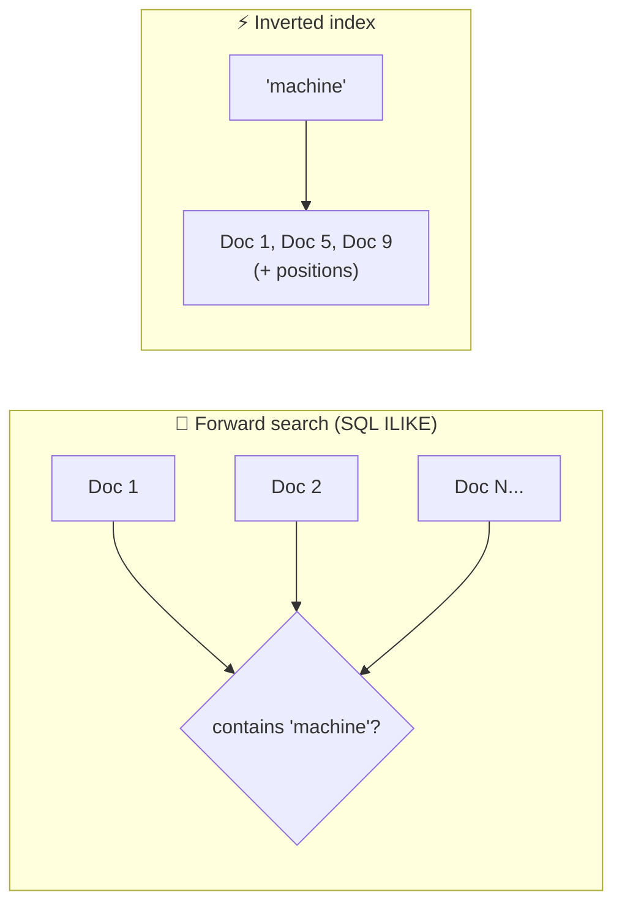
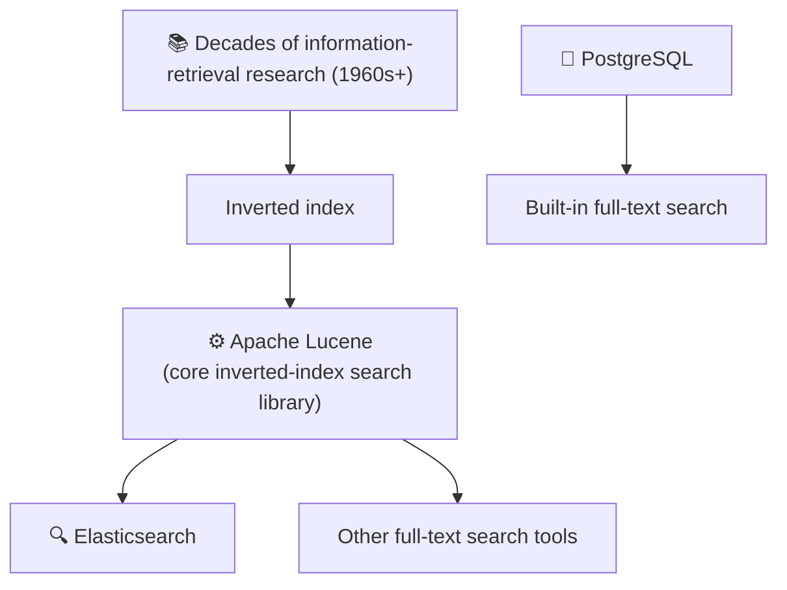
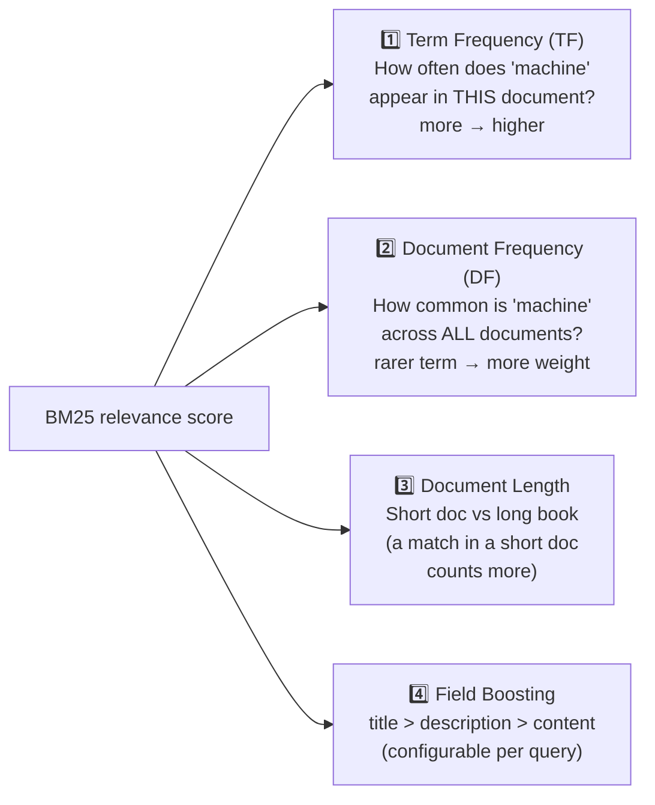
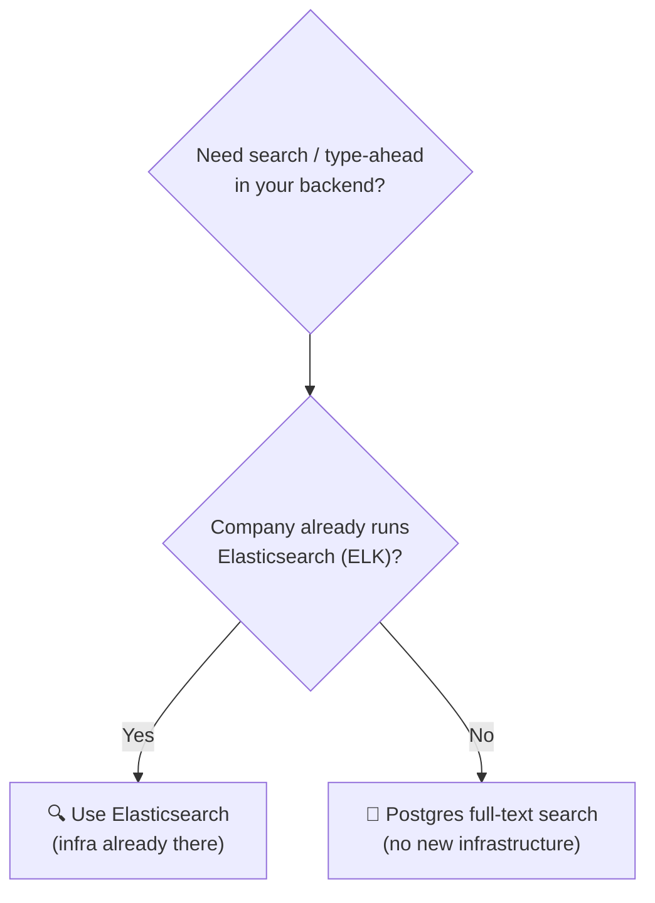
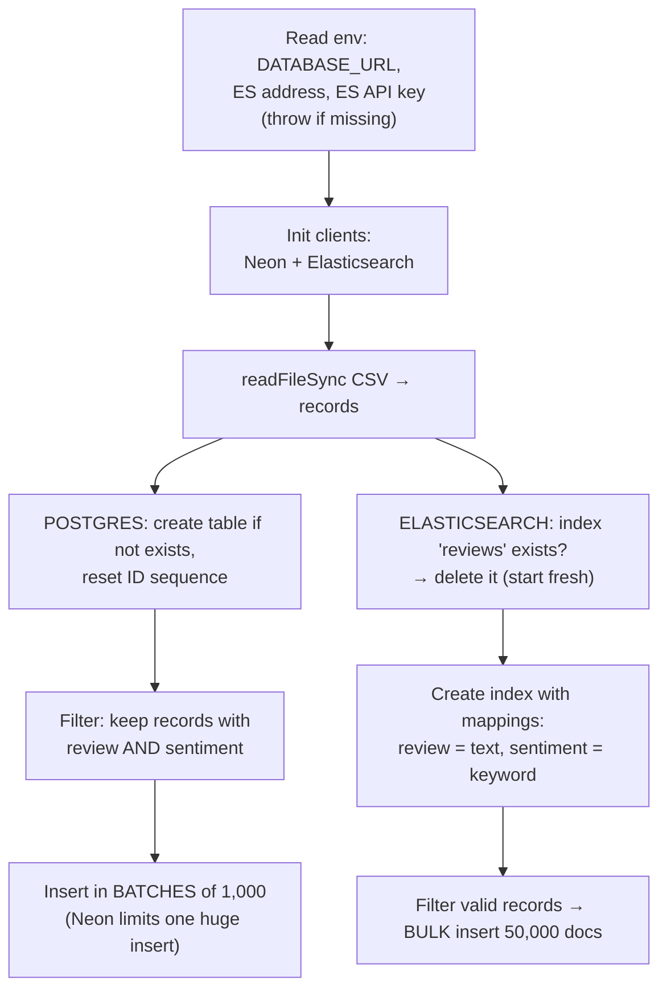
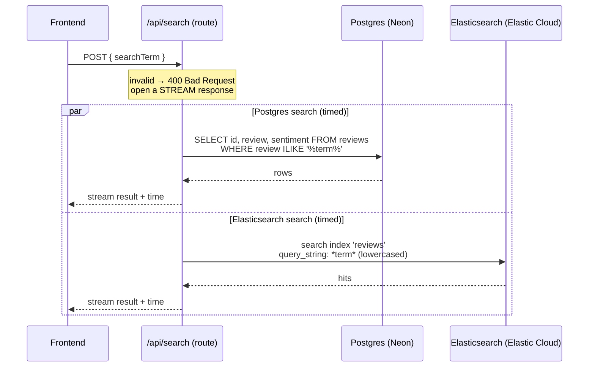

# Full-Text Search and Elasticsearch: Complete Revision Notes

> **Source:** [YouTube: Full-Text Search & Elasticsearch (Backend from First Principles series, part 15)](https://www.youtube.com/watch?v=7_sovzAhRSM&list=PLui3EUkuMTPgZcV0QhQrOcwMPcBCcd_Q1&index=15)
> **Length:** ~32 min
> **Previous videos:** [Databases_Notes.md](Databases_Notes.md) · [Caching_Notes.md](Caching_Notes.md) · [Background_Jobs_Notes.md](Background_Jobs_Notes.md) · [API_Design_Notes.md](API_Design_Notes.md)
> **Goal of the video:** Why `ILIKE '%term%'` breaks down at scale, how the **inverted index** (Apache Lucene → Elasticsearch) fixes **speed**, how **relevance scoring (BM25)** fixes **ranking**, plus typo tolerance, the ELK stack, and a live Postgres vs Elasticsearch benchmark.

> 💡 Diagrams use **Mermaid**. They render in GitHub, VS Code (with a Mermaid preview extension), Obsidian, Notion, and the Claude app. Anything marked **📌 Extra** was added to clarify a point and is not in the video.

---

## 📑 Table of Contents

1. [TL;DR: The Whole Video in 10 Lines](#-tldr-the-whole-video-in-10-lines)
2. [The Story: SQL Search in 2005](#1-the-story-sql-search-in-2005-0000)
3. [The New Requirements: Fast, Relevant, Typo-Tolerant](#2-the-new-requirements-0124)
4. [The Database as a Librarian](#3-the-database-as-a-librarian-0302)
5. [The Information Explosion](#4-the-information-explosion-0601)
6. [The Inverted Index](#5-the-inverted-index-0848)
7. [Apache Lucene and Elasticsearch](#6-apache-lucene-and-elasticsearch-1153)
8. [Relevance Scoring (BM25)](#7-relevance-scoring-bm25-1343)
9. [Typo Tolerance and Type-Ahead](#8-typo-tolerance-and-type-ahead-1906)
10. [Postgres FTS vs Elasticsearch, and the ELK Stack](#9-postgres-fts-vs-elasticsearch-and-the-elk-stack-2045)
11. [Demo: Postgres vs Elasticsearch Benchmark](#10-demo-postgres-vs-elasticsearch-benchmark-2202)
12. [How Much Should You Learn?](#11-how-much-should-you-learn-3105)
13. [Cheat Sheet / Quick Revision](#-quick-revision-cheat-sheet)
14. [Self-Test Questions](#-self-test-questions)

---

## ⚡ TL;DR: The Whole Video in 10 Lines

1. `SELECT * FROM products WHERE name ILIKE '%laptop%' OR description ILIKE '%laptop%'` works for **5,000** products but takes **~30 seconds** for **millions**.
2. Business also wants **relevance** (MacBook Pro before laptop bag) and **typo tolerance** (`labtop` should still find laptops).
3. A relational DB with `ILIKE` is like a **librarian checking every book one by one**: a **full scan**, character-by-character pattern matching, and **no sense of relevance**.
4. Companies like Google, Amazon and LinkedIn couldn't afford slow search. The answer came from **decades of information retrieval research (since the 1960s)**.
5. **Inverted index:** instead of searching documents for terms, build a map **term → documents (+ positions)** when data is stored. Search becomes a quick lookup.
6. **Apache Lucene** implements the inverted index. **Elasticsearch** (and many other tools) are built on it. **Postgres also has full-text search.**
7. **Relevance scoring** uses the **BM25** algorithm: **term frequency**, **document frequency**, **document length**, and **field boosting** (title > description > content, configurable in the JSON **Query DSL**).
8. Full-text engines support **typo tolerance** and **type-ahead/autocomplete** (like Google's "what is treading today" → "trending").
9. **Choose:** Postgres FTS if you just need search. **Elasticsearch** if you already run the **ELK stack** (Elasticsearch, Logstash, Kibana) for logs.
10. **Demo** with 50k reviews in the same region: Elasticsearch **~0.5–1 s** vs Postgres `ILIKE` **~3–7.5 s** for the **same** result count. Master **databases** deeply. For Elasticsearch, docs and snippets cover most needs.

---

## 1. The Story: SQL Search in 2005 (00:00)

**Setting:** 2005, a fast-growing e-commerce company (dot-com era). Your task: build a **search API** over **~5,000 products**.

```sql
SELECT * FROM products
WHERE name        ILIKE '%laptop%'
   OR description ILIKE '%laptop%';
```

- `%` matches **any characters before and after** the term.
- `ILIKE` = **case-insensitive** `LIKE` (see [Databases_Notes.md](Databases_Notes.md)).
- If "laptop" appears in the name **or** description, the row is returned. Simple, and it works.

---

## 2. The New Requirements (01:24)

The company explodes to **millions of products**:

```
 5,000 products   →  ILIKE query: ~50 ms   😊
 millions         →  ILIKE query: ~30 s    😱  (customers, manager... everyone frustrated)
```

And the business wants **more than speed**:



> This combination of requirements is **why search engines like Elasticsearch exist**.

---

## 3. The Database as a Librarian (03:02)

> Your Postgres DB is a **librarian** who knows where **every book** is, but has **one fatal flaw**.

### Flaw 1: Speed, checking every book one by one

You ask: *"Books about machine learning?"*

```
 📚 Shelf scan:
   "Harry Potter and the Philosopher's Stone"  → ❌ no "machine learning"
   "Game of Thrones"                           → ❌
   "Introduction to Machine Learning"          → ✅ match!
   ... keeps going through EVERY book on EVERY shelf ...
   10 million / 1 billion books → minutes, hours, even days
```

### Flaw 2: No concept of relevance

```
 Book A: "Introduction to Machine Learning"    ← title is about ML (very relevant)
 Book B: unrelated topic, "machine learning"   ← mentioned once on the last page
         appears once on the last page            (barely relevant)

 Librarian returns them in ANY order, possibly B first! 😕
```

### Back to SQL


- **Thorough:** it finds every match.
- **Painfully slow:** a full scan.
- **No relevance:** the best result could sit at position 1,000 or 10,000.

> 📌 **Extra:** a leading wildcard (`'%term'`) **can't use a normal B-tree index**, which is why `ILIKE '%term%'` forces a sequential scan even with indexes on the column.

---

## 4. The Information Explosion (06:01)

Around 2005 there was an explosion of websites, servers and data:

| Company | Scale |
|---|---|
| **Google** | Crawling and indexing **billions of web pages** |
| **Amazon** | Cataloging **millions of products** |
| **LinkedIn** | Indexing **millions of profiles** |

- **30 s** search? Customers leave. Even **2 s** is considered a crazy delay today. Search must take **milliseconds**.
- For companies earning millions per second, latency hits **conversion and user base**.
- The fix came from **decades of research** in **text search / information retrieval**, studied since the **1960s**: how to make results **fast** *and* **relevant**.

---

## 5. The Inverted Index (08:48)

### The key idea: flip the problem

> Instead of searching **through documents to find terms**, look up **terms to find documents**.

When books **first arrive** (data is stored/indexed), record for **every word** **which books** contain it **and where**.

```
 TERM        →  DOCUMENTS (pages where it appears)
 ─────────────────────────────────────────────────────────────
 machine     →  "Introduction to Machine Learning"  [p.1, 15, 23]
                "The Machine Age"                   [p.5, 89]
                "Coffee Machine Manual"             [p.1]
 learning    →  "Introduction to Machine Learning"  [p.1, 16, 24]
                "Learning to Cook"                  [p.3, 40]
                "Deep Learning Fundamentals"        [p.2, 7, 51]
```



- Query "machine learning": look up `machine` → its list, look up `learning` → its list, **combine**. Done.
- **"Inverted"** because we go **terms → content** instead of **content → terms**.

> (In a real ML book, "machine" and "learning" would appear on **hundreds** of pages. Three is just for illustration.)

---

## 6. Apache Lucene and Elasticsearch (11:53)



- **Elasticsearch** isn't a brand-new invention. It's built on **Apache Lucene**, the core **inverted-index-based** text search library.
- Most other full-text search tools also use Lucene under the hood.
- **Relational DBs like Postgres** now have **full-text search** too.
- With an inverted index, the librarian just **looks up** "machine" and "learning" and immediately knows the books: **fast**. The second big win is **relevance**.

---

## 7. Relevance Scoring (BM25) (13:43)

> 💡 **Presenter's advice:** you **don't need to master** the internals (scoring math, index structure) unless you're building a search library. Know **when** to use it, follow the **docs/best practices**, and move on. Curious? The **Elasticsearch docs** are a great resource.

### Intuition: ranking "machine"

| Rank | Book | Why |
|---|---|---|
| 🥇 1 | "Introduction to **Machine** Learning" | Term in the **title** (big boost) **+** appears **most often** (3×) |
| 🥈 2 | "The **Machine** Age" | In the **title**, but appears **less often** (2×) |
| 🥉 3 | "Coffee **Machine** Manual" | In the **title**, but appears **rarely** (1×) |

### BM25 factors

Elasticsearch uses the **BM25** algorithm, with several parameters for ranking:



| Factor | Question it answers |
|---|---|
| **Term frequency** | How often does the term appear in **this** document? |
| **Document frequency** | How common is the term across **all** documents? (📌 Extra: **rare** terms carry **more** weight. This is IDF, inverse document frequency.) |
| **Document length** | Is the document short or long (like a whole book)? |
| **Field boosting** | **Which field** matched? Title > description > content, by default intuition |

> In Elasticsearch, each record is a **document**: a **JSON document**, like in MongoDB.

### Field boosting is configurable
You set boosts **per query** with the **Elasticsearch Query DSL**, a **JSON-based query language** with lots of parameters. You could even make `content` matches count more if your use case needs it.

```json
// 📌 Extra: field boosting in the Query DSL (title counts 3x, description 2x)
{
  "query": {
    "multi_match": {
      "query": "machine learning",
      "fields": ["title^3", "description^2", "content"]
    }
  }
}
```

---

## 8. Typo Tolerance and Type-Ahead (19:06)

### Typo tolerance
Google demo: type **"what is t*r*eading today"** (intentional typo). Google works out from context that you meant **"what is trending today"**.

> Whether Google uses Elasticsearch or something proprietary built on Lucene is unknown, but the **capability is similar**.

### Type-ahead / autocomplete
Suggestions appear **as you type** (Google, Amazon). You can build this **type-ahead interface** with Elasticsearch.


```json
// 📌 Extra: typo tolerance via fuzziness
{ "query": { "match": { "name": { "query": "labtop", "fuzziness": "AUTO" } } } }
```

---

## 9. Postgres FTS vs Elasticsearch, and the ELK Stack (20:45)

### Building search: two options



| Option | When |
|---|---|
| **Postgres full-text search** | A modern Postgres has built-in FTS. A good default when you just need search. |
| **Elasticsearch** | Especially when your company **already uses it**, e.g. as part of the **ELK stack** |

> 📌 **Extra:** Postgres FTS uses `tsvector`/`tsquery` with a **GIN index**. The `pg_trgm` extension adds **trigram** similarity for fuzzy, typo-tolerant matching. Both avoid the full scan of `ILIKE '%...%'`.
>
> ```sql
> CREATE INDEX idx_products_fts ON products
>   USING GIN (to_tsvector('english', name || ' ' || description));
> SELECT * FROM products
> WHERE to_tsvector('english', name || ' ' || description) @@ plainto_tsquery('laptop');
> ```

### The ELK stack (log management)
Elasticsearch isn't only for product search. It's famous for **log management**:


| Letter | Tool | Role |
|---|---|---|
| **E** | **Elasticsearch** | Store and **search logs very fast**, compute statistics |
| **L** | **Logstash** | Collect and process logs |
| **K** | **Kibana** | **Visualize** data and dashboards |

> If ELK is already in place for logs, using **Elasticsearch for full-text search** too makes more sense than adding Postgres FTS.

---

## 10. Demo: Postgres vs Elasticsearch Benchmark (22:02)

### Setup

| Piece | Detail |
|---|---|
| App | **Next.js** project (chosen because LLMs prototype in it well). The UI runs the **same search on both**. |
| Postgres | **Neon** (serverless cloud Postgres) |
| Elasticsearch | **Elastic Cloud** |
| Fairness | **Both in the same region (US-West)**, so distance-related latency isn't a factor |
| Data | A **CSV of ~50,000 reviews** with `review` (text) and `sentiment` (positive/negative) |

**Postgres table:**

```sql
CREATE TABLE IF NOT EXISTS reviews (
  id        SERIAL PRIMARY KEY,
  review    TEXT,
  sentiment TEXT      -- 'positive' | 'negative'
);
```

### The populate script (Node.js)



**Elasticsearch mapping:**

```json
{
  "mappings": {
    "properties": {
      "review":    { "type": "text" },
      "sentiment": { "type": "keyword" }
    }
  }
}
```

| ES field type | Meaning |
|---|---|
| `text` | Full text, **analyzed** for full-text search (📌 Extra: broken into tokens/terms, lowercased, fed into the inverted index) |
| `keyword` | **Exact match** on the whole value (good for `positive`/`negative`, filters, aggregations) |

**Verification:** Elastic Cloud shows **50,000 documents**. In Neon, `SELECT COUNT(*) FROM reviews;` → **50,000**.

### The search API route



**Why stream?** The two engines finish at different times. Streaming sends each result **as soon as it's ready**, so one doesn't wait for the other, and you can **see which is faster**.

To keep the comparison **fair**, both search **case-insensitively** and allow **any characters before/after** the term. The demo compares **speed**, not relevance.

### Results

| Query | Elasticsearch | Postgres `ILIKE` | Result count |
|---|---|---|---|
| `laptop` | **~1 s** | ~3–4 s | same |
| `something` (1st run) | **~500 ms** | slower | ~8,000 (same on both) |
| `something` (2nd run) | **~500 ms** | **~7.5 s** | ~8,000 |

```
 "something" query (~8,000 matches, 50k rows)
 Elasticsearch  ██                                    ~0.5 s
 Postgres ILIKE ██████████████████████████████        ~7.5 s
```

> Same results, **massively different speed**. With only **50k rows**. Imagine millions.

---

## 11. How Much Should You Learn? (31:05)

| Skill | How deep |
|---|---|
| **Databases** (SQL, optimization, **indexes**, everything) | 🔴 **Master it.** It touches **~99% of your codebase** as a backend engineer ([Databases_Notes.md](Databases_Notes.md)) |
| **Elasticsearch** | 🟢 **Have it in your arsenal.** No need to master it. Docs, examples and LLM snippets cover **most search use cases**. Go deeper only when you need to optimize. |

> 🔑 **When you have search or type-ahead requirements, reach for full-text search**: Postgres FTS or a tool like Elasticsearch, **not** `ILIKE '%term%'`.

---

## 🧾 Quick Revision Cheat Sheet

```
ILIKE '%term%'  →  full scan, char-by-char matching  →  🐢 slow + 🎲 no relevance + ✍️ no typo tolerance
INVERTED INDEX  →  term → [docs + positions], built at write time  →  ⚡ fast lookup
Lucene (engine) →  Elasticsearch (+ other tools)  ·  Postgres has built-in FTS too
```

| Topic | Key points |
|---|---|
| The problem | `ILIKE '%x%'` fine at 5k rows (50 ms), terrible at millions (30 s) |
| Requirements | **Fast** (ms) · **relevant** (MacBook before bag) · **typo-tolerant** (`labtop`) |
| Librarian analogy | Checks every book (slow) and can't rank relevance |
| History | Info explosion ~2005 (Google, Amazon, LinkedIn). IR research since the 1960s. |
| Inverted index | Flip it: **terms → documents/positions**, built when data is stored |
| Lucene | Core inverted-index library under Elasticsearch and others |
| Relevance | **BM25**: term frequency · document frequency (rarer = stronger) · document length · **field boosting** |
| Field boosting | title > description > content by default, configurable in the **JSON Query DSL** |
| ES document | A JSON document (like MongoDB) |
| Extras | **Typo tolerance**, **type-ahead/autocomplete** |
| Choose | Postgres FTS (simple, no new infra) vs **Elasticsearch** (if you already run **ELK**) |
| ELK | **E**lasticsearch (search/store) · **L**ogstash (collect/process) · **K**ibana (visualize) for logs |
| Mappings | `text` = analyzed full-text. `keyword` = exact match. |
| Demo | 50k reviews, same region: ES **0.5–1 s** vs Postgres ILIKE **3–7.5 s**, same counts |
| Learning priority | **Master databases**. Elasticsearch: docs and snippets are enough for most cases. |

---

## ❓ Self-Test Questions

<details>
<summary>1. Why does WHERE name ILIKE '%laptop%' get so slow as data grows?</summary>

It must **scan every row** and **pattern-match every text field character by character**. A leading `%` prevents normal index use. Fine for thousands of rows, terrible for millions (50 ms → 30 s).
</details>

<details>
<summary>2. What three requirements pushed teams toward search engines?</summary>

**Speed** (milliseconds), **relevance** (best matches first), **typo tolerance**.
</details>

<details>
<summary>3. Explain the librarian analogy's two flaws.</summary>

**Speed:** the librarian checks every book on every shelf one by one. **Relevance:** they return matching books in any order, so a book that mentions the term once on its last page might come before one titled after it.
</details>

<details>
<summary>4. What is an inverted index, and why is it called "inverted"?</summary>

A map from **each term → the documents (and positions) containing it**, built when data is stored. It's "inverted" because you search **terms → content** instead of scanning **content → terms**.
</details>

<details>
<summary>5. What is Apache Lucene, and how does it relate to Elasticsearch?</summary>

Lucene is the core **inverted-index search library**. Elasticsearch (and many other full-text tools) are **built on top of it**.
</details>

<details>
<summary>6. Name the four BM25 / relevance factors from the video.</summary>

**Term frequency**, **document frequency**, **document length**, **field boosting**.
</details>

<details>
<summary>7. Why does "Introduction to Machine Learning" outrank "The Machine Age" for the query "machine"?</summary>

Both have the term in the **title**, but it appears **more often** (higher term frequency) in "Introduction to Machine Learning".
</details>

<details>
<summary>8. What is field boosting, and can you change it?</summary>

Matches in some fields count more (title > description > content). **Yes**: you set boosts per query in the **JSON Query DSL**.
</details>

<details>
<summary>9. What does Elasticsearch call a single record, and what format is it?</summary>

A **document**: a **JSON document**, similar to MongoDB.
</details>

<details>
<summary>10. What's the difference between the "text" and "keyword" field types in an Elasticsearch mapping?</summary>

`text` is **analyzed** for full-text search (tokenized into the inverted index). `keyword` is matched **exactly** as a whole value (e.g. `positive`/`negative`).
</details>

<details>
<summary>11. When would you choose Elasticsearch over Postgres full-text search?</summary>

When your company **already runs Elasticsearch**, e.g. the **ELK stack** for logs. Otherwise Postgres FTS avoids adding infrastructure.
</details>

<details>
<summary>12. What does ELK stand for, and what does each part do?</summary>

**Elasticsearch** (store and search fast), **Logstash** (collect and process logs), **Kibana** (visualize dashboards and stats).
</details>

<details>
<summary>13. In the demo, how was the comparison kept fair, and what were the results?</summary>

Both were in the **same cloud region (US-West)**, used the **same 50k reviews**, and ran equivalent case-insensitive **wildcard** searches returning the **same counts**. Elasticsearch took **~0.5–1 s**, Postgres `ILIKE` **~3–7.5 s**.
</details>

<details>
<summary>14. Why did the demo stream results from the API?</summary>

The two searches finish at different times. Streaming sends each result **as soon as it's ready**, so neither waits for the other and you can see which is faster.
</details>

<details>
<summary>15. Why insert into Neon in batches of 1,000?</summary>

Inserting all 50k rows at once **hits Neon's limits**, so the script loops over batches.
</details>

<details>
<summary>16. How deeply should a backend engineer learn databases vs Elasticsearch?</summary>

**Master databases** (they touch ~99% of the codebase). For Elasticsearch, know when to use it. Docs and snippets cover most cases.
</details>

---

*Notes compiled from the video transcript. Timestamps (mm:ss) let you jump back to each section. Transcription fixes: "lucine / Lucion / Lucen" → Lucene, "posgress / postcrist" → Postgres, "Lock stacks" → Logstash, "I like" → ILIKE, "pull text / full deck" → full-text.*
