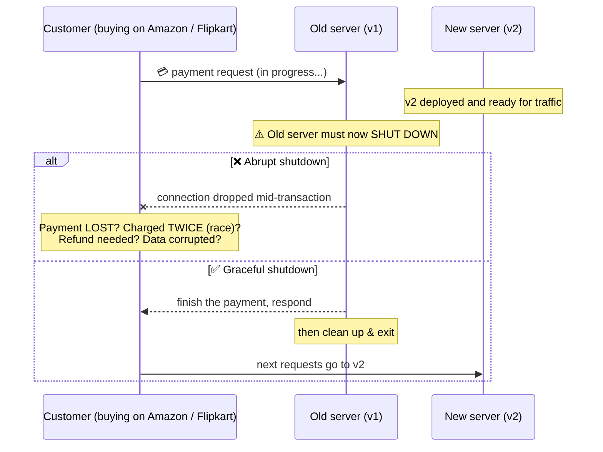
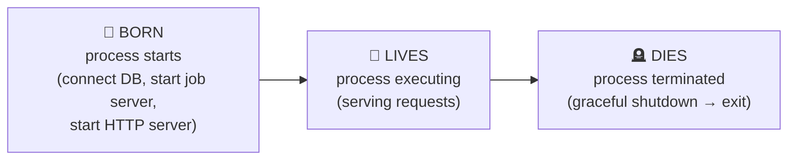
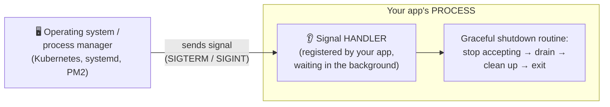
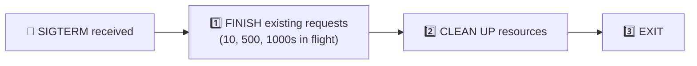
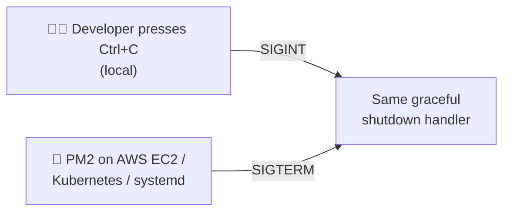
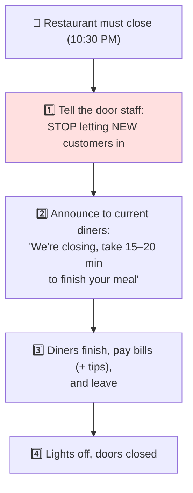
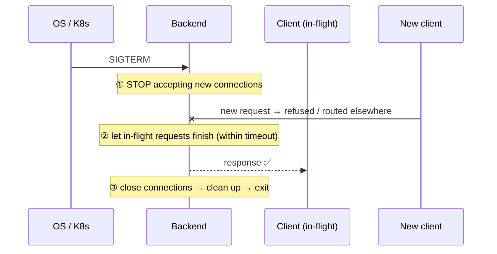
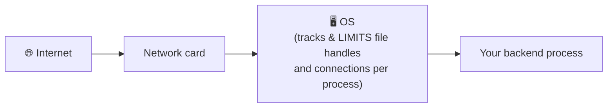
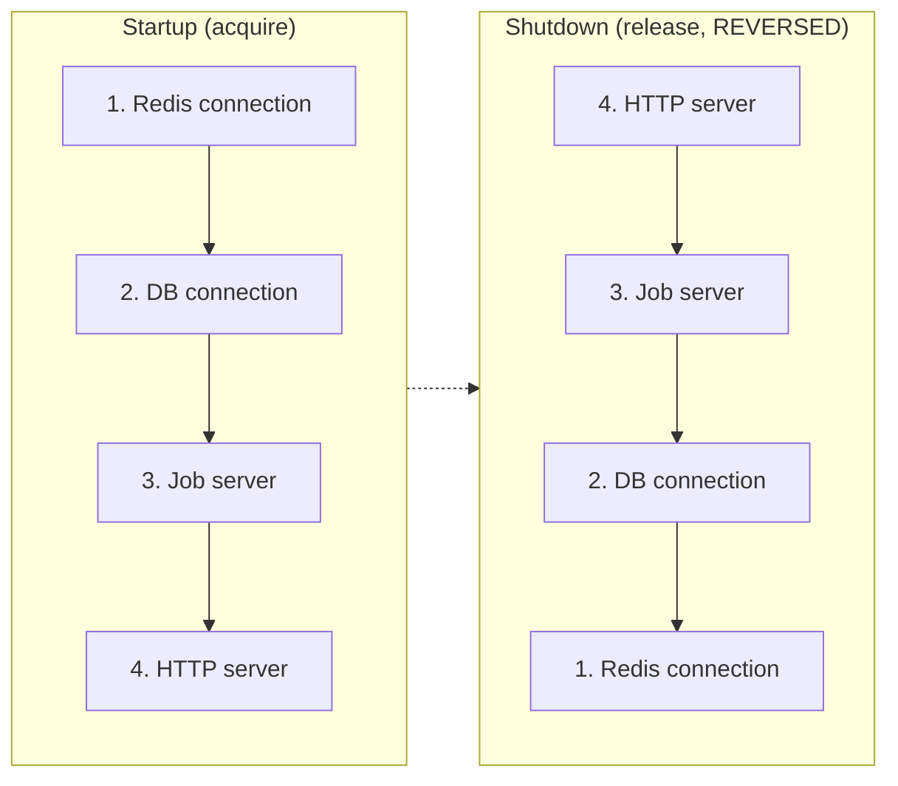
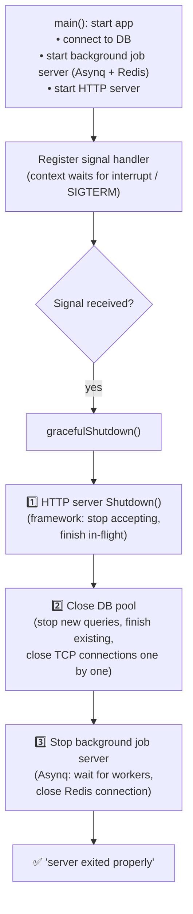

# Graceful Shutdown: Complete Revision Notes

> **Source:** [YouTube: Graceful Shutdown (Backend from First Principles series, part 19)](https://www.youtube.com/watch?v=6rfBgphiCWM&list=PLui3EUkuMTPgZcV0QhQrOcwMPcBCcd_Q1&index=19)
> **Length:** ~36 min
> **Related notes:** [Background_Jobs_Notes.md](Background_Jobs_Notes.md) (Asynq workers) · [Databases_Notes.md](Databases_Notes.md) (connection pools, transactions) · [Error_Handling_Notes.md](Error_Handling_Notes.md) (health checks, data integrity) · [Config_Management_Notes.md](Config_Management_Notes.md) (timeouts) · [Observability_Notes.md](Observability_Notes.md) (logs)
> **Goal of the video:** What happens to in-flight work (e.g. a payment) when a server restarts during a deployment, and how **graceful shutdown** fixes it: **process lifecycle**, **Unix signals** (SIGTERM, SIGINT, SIGKILL), **connection draining**, **timeouts**, **resource cleanup** (in reverse order), and a Go example.

> 💡 Diagrams use **Mermaid**. They render in GitHub, VS Code (with a Mermaid preview extension), Obsidian, Notion, and the Claude app. Anything marked **📌 Extra** was added to clarify a point and is not in the video.

---

## 📑 Table of Contents

1. [TL;DR: The Whole Video in 10 Lines](#-tldr-the-whole-video-in-10-lines)
2. [The Problem: Shutting Down Mid-Payment](#1-the-problem-shutting-down-mid-payment-0000)
3. [Graceful Shutdown = Good Manners](#2-graceful-shutdown--good-manners-0147)
4. [Process Lifecycle](#3-process-lifecycle-0337)
5. [Signals and Inter-Process Communication](#4-signals-and-inter-process-communication-0600)
6. [SIGTERM: The Polite Request](#5-sigterm-the-polite-request-0849)
7. [SIGINT: Ctrl+C](#6-sigint-ctrlc-1216)
8. [SIGKILL: The Nuclear Option](#7-sigkill-the-nuclear-option-1527)
9. [Connection Draining](#8-connection-draining-1744)
10. [Choosing the Timeout](#9-choosing-the-timeout-2416)
11. [Resource Cleanup](#10-resource-cleanup-2603)
12. [Implementation Example (Go)](#11-implementation-example-go-3012)
13. [Cheat Sheet / Quick Revision](#-quick-revision-cheat-sheet)
14. [Self-Test Questions](#-self-test-questions)

---

## ⚡ TL;DR: The Whole Video in 10 Lines

1. **Zero-downtime deployments** keep the old server up until the new one is ready, but **eventually the old server must stop**. What happens to a **payment in progress** at that moment? Lost? **Charged twice**?
2. **Graceful shutdown** = teaching your server **good manners**: finish ongoing conversations, say goodbye, **clean up**, *then* close the door. Don't slam it.
3. Every app runs as a **process** with a **lifecycle**: born (start) → lives (executing) → dies (terminated).
4. The OS talks to processes using **signals**, a Unix **IPC (inter-process communication)** mechanism. Your app **registers handlers** that wait for specific signals.
5. **SIGTERM** = a **polite** "please finish up and leave". Sent by **Kubernetes, systemd, PM2**, and other deployment or process managers.
6. **SIGINT** = **interrupt**, usually **Ctrl+C** from a developer (user-initiated). **Handle it the same way as SIGTERM.**
7. **SIGKILL** = **can't be caught or ignored**. Instant death, like **pulling the power plug**. You get it if you ignore the polite signals.
8. Graceful shutdown steps: **① stop accepting new connections → ② finish in-flight requests (connection draining) → ③ clean up resources → ④ exit**.
9. Draining needs a **timeout** (commonly **30 s**, sometimes 60): too short interrupts legitimate work, too long makes deployments sluggish. Tune it to your request durations. Coordinate with **load balancers, health checks, service discovery**.
10. **Resource cleanup:** file handles, network/DB connections (commit or roll back transactions!), temp files, caches. Clean up in **reverse order of acquisition**. Frameworks provide shutdown methods, so usually you just wire them up.

---

## 1. The Problem: Shutting Down Mid-Payment (00:00)

**Scenario:** someone pushes to production and your server must **restart for a deployment**.

- **Zero-downtime deployment** techniques keep the **old server running** until the **new server** (with the new code) is up and **ready for traffic**.
- **But** at some point the **old server must stop** receiving traffic and **shut down**, and the traffic moves to the new one.



**Questions a backend engineer must ask:**
- Does the payment get **lost in the digital world**?
- Does the customer get **charged twice** because of a **race condition**?

> This problem is as old as **servers and backends**. The established solution is **graceful shutdown**.

---

## 2. Graceful Shutdown = Good Manners (01:47)

> **Graceful shutdown:** stop the server **gracefully**, not **abruptly**.

**Analogy: guests at your house.** It's 9 PM and time to sleep. You **don't push your guests out and slam the door**. You:
1. **Politely finish** ongoing conversations,
2. **Say goodbye** to the guests,
3. **Clean up** after yourself,
4. **Then** close the door.

Your backend should do the same.

### Why it matters

| Benefit | Example |
|---|---|
| ✅ Good **user experience** | No dropped requests during deploys |
| ✅ No **data corruption** | Transactions aren't left half-done |
| ✅ No **double charging / lost transactions** | Payments complete exactly once, with no refunds to process |

---

## 3. Process Lifecycle (03:37)

- Your backend is an application that runs **as a process** on a server/computer.
- **Everything** that runs on an operating system runs **as a process** (an OS concept).
- Like living things, every process has a **lifecycle**:



- When the **OS** decides your app should stop, it **doesn't just pull the plug**. It follows an **established communication protocol**, like a conversation:
  - **OS:** "Hey, it's time for you to stop."
  - **App:** "OK, give me a few seconds, then I'll stop myself (or you can stop me)."
- Programs don't understand text, so this conversation happens through **signals**.

---

## 4. Signals and Inter-Process Communication (06:00)

### Signals = Unix IPC
- **Signals** are an important concept in **Unix** operating systems: **Linux** (Arch, Ubuntu...) and **macOS** (Unix-based core).
- **Servers almost always run Linux** (~99% of the time when you deploy to a cloud provider). Windows only shows up in special cases like Windows Server.
- Signals are a form of **IPC (inter-process communication)**: a way for **two processes to communicate** using an **established protocol**.

### Signal handlers



- Your app **registers handlers**: code that **waits in the background** for specific signals.
- In effect, the app tells the OS: "**When you want me to stop, send me this specific signal**, and I'll stop myself using **predefined steps**."

### The three signals

| Signal | Name | Who sends it | Can the app catch it? | Behavior |
|---|---|---|---|---|
| **SIGTERM** | **Terminate** | **Programs**: Kubernetes, systemd, PM2, deployment systems | ✅ Yes | **Polite** request: finish up, clean up, leave |
| **SIGINT** | **Interrupt** | **Humans**: **Ctrl+C** in a terminal (mostly in development) | ✅ Yes | **Polite**. Handle it **the same as SIGTERM**. |
| **SIGKILL** | **Kill** | OS / process manager (often after SIGTERM is ignored) | ❌ **No: can't be caught or ignored** | **Instant death**, no cleanup |

---

## 5. SIGTERM: The Polite Request (08:49)

> **SIGTERM** = **SIG**nal + **TERM**inate. A **gentle nudge**, like someone softly tapping your shoulder: "**Excuse me, could you please finish up and leave?**"

Because it's polite, your app gets a **window** (a few seconds) to:



1. **Finish existing requests**: at any moment an HTTP backend may be processing **10–12** requests, or **500–600+** concurrently on a big app.
2. **Clean up resources** ([§10](#10-resource-cleanup-2603)).
3. **Exit.**

**Who sends SIGTERM?** **Deployment systems, process managers and orchestration platforms**:
- **Kubernetes**
- **systemd**
- **PM2** (a Node.js process manager)

> 📌 **Extra:** Kubernetes sends **SIGTERM** to a pod's containers, waits **`terminationGracePeriodSeconds`** (default **30 s**), then sends **SIGKILL** if the process is still running. That's why your drain timeout must fit inside that grace period.

---

## 6. SIGINT: Ctrl+C (12:16)

> **SIGINT** = **SIG**nal + **INT**errupt.

- Most famous use: pressing **Ctrl+C** to stop a running terminal program.
- **Demo:** a Go backend running locally. Pressing **Ctrl+C** logged **"signal received: interrupt"**, then the graceful shutdown logs followed.
- It needs a **key press**, so it's **user-initiated**, mostly used by **developers in development**. Processes talking to each other **don't normally use it**.

> 🔑 **Handle SIGINT exactly like SIGTERM.** Whether a **human** (Ctrl+C locally) or a **program** (PM2 on an AWS EC2 instance sending SIGTERM) starts it, the **intention is the same**: shut down **cleanly and gracefully**.



---

## 7. SIGKILL: The Nuclear Option (15:27)

> **SIGKILL** = **SIG**nal + **KILL**. Kill the app **instantly**.

- It **can't be caught**: you **can't register a handler** for it, so no cleanup can run. The app isn't given that capability.
- It **can't be ignored** either: you can't decide "I'll just not stop".
- The process **stops at that exact moment**. Nothing else happens.

```
 Graceful (SIGTERM / SIGINT)        vs        SIGKILL
 🖱️ Click "Shut down" in the OS menu           🔌 Yank the power plug out of the wall
 → apps save, close, clean up                  → computer just dies
```

> 🔑 **This is why graceful shutdown matters.** If you **don't respect the polite signals** (SIGTERM/SIGINT), you'll **eventually get SIGKILL**, and you **won't get a chance to clean up**.

---

## 8. Connection Draining (17:44)

### What are in-flight requests?
An HTTP server handles **many requests concurrently**. When it's time to stop, it may be in the middle of **10s, 100s or 1000s** of requests. Those are the **in-flight** ("on-the-fly") requests.

### 🍽️ The restaurant analogy



The owners **don't** flip off the lights and throw everyone out.

### For your backend: connection draining

> **Connection draining:** on a shutdown signal (SIGTERM or SIGINT), **stop accepting new connections**, let **existing in-flight requests finish**, **then** close.



### It depends on the app type
**Same high-level idea, different technical steps:**

| Application type | What draining means |
|---|---|
| **HTTP server** (the core backend) | Stop accepting **new HTTP requests**. Let **in-flight requests complete**. |
| **Database** (a backend too, just not HTTP) | Stop taking **new queries/transactions**. **Finish existing** queries and transactions, *then* close connections. |
| **WebSocket server** | **Notify clients** that it's closing, *then* close the sockets. Don't close them abruptly. |

> 🔑 Three-step core: **stop accepting new → finish existing → close.**

---

## 9. Choosing the Timeout (24:16)

You can't wait **forever** for in-flight work. Production systems set a **hard limit**:

- Common values: **30 seconds** (the most common) or **60 seconds**.
- With no new requests coming in, **30 s is usually more than enough** to finish existing ones.
- If some **blocking operation** can't finish in time, the server is **forcefully stopped**. The timeout is the **backup plan**.

```
 SIGTERM ──► stop accepting ──► draining in-flight requests ... ──► all done? ──► clean up ──► exit ✅
                                       │
                                       └── timeout (e.g. 30 s) hit? ──► force stop ⛔
```

### The design trade-off

| Timeout too **short** ⏱️ | Timeout too **long** ⏳ |
|---|---|
| ❌ **Interrupts legitimate operations** | ❌ Shutdown becomes **sluggish** |
| | ❌ Slows **deployment speed** and **system responsiveness** |

> 🔑 **No hard rule.** Base it on your app's **typical request duration** and **operational requirements**. A normal REST backend: ~30 s is fine. **WebSockets** or more complex architectures: understand your system and choose accordingly.

### Coordination with infrastructure
Draining must also work with:
- **Load balancers** (stop routing traffic to the instance that's shutting down)
- **Health checks** (report "not ready" during shutdown)
- **Service discovery** (**register/deregister** the instance). Service discovery is how deployed apps (backend, DB, Elasticsearch...) **find and talk to each other**.

> 📌 **Extra:** a common pattern is that on SIGTERM the app first fails its **readiness check**, waits a few seconds so the load balancer stops sending traffic, and then starts draining.

---

## 10. Resource Cleanup (26:03)

**Analogy:** before leaving your desk at night, you **clean up**: put the coffee cup in the sink, tidy the cables...

### Resources a backend acquires while running

| Resource | Why cleanup matters |
|---|---|
| **File handles** | To access the file system, the process asks the OS for a **handle**. If you don't release handles, they **pile up** and eat memory (RAM) until you **run out**. The OS also **limits** how many a process can have open. |
| **Network connections** ⭐ (most common) | All traffic goes through the **OS** (network card → OS → app), and the OS **limits** simultaneous connections per process. Unreleased connections lead to **memory exhaustion / performance problems**. |
| **Database connections** | Transactions in progress must be explicitly **committed or rolled back**. Otherwise they're left **inconsistent**, which can cause **deadlocks** and **data corruption**. |
| **Temporary files**, **caches**, other system resources | Release whatever the app acquired during its run |



### 🔑 Clean up in REVERSE order of acquisition



**Why reverse order?** Later resources often **depend on** earlier ones (the HTTP server's handlers use the DB, and workers use Redis). Shutting down dependents **first** means nothing tries to use a resource that's already closed.

---

## 11. Implementation Example (Go) (30:12)

> "You don't have to understand the code. Just follow the narrative." Most frameworks (Node.js, Go, Rust, Python) provide ready-made graceful shutdown code you can adapt. **Understanding *what* happens and *why* is what matters.**

### The flow in the video



### Illustrative Go code

```go
// 📌 Simplified illustration of the pattern shown in the video
func main() {
    db := connectDB()                 // acquire #1
    jobs := startJobServer(redisCfg)  // acquire #2 (Asynq, Redis)
    srv := &http.Server{Addr: ":8080", Handler: router}

    go func() {                       // serve in the background
        if err := srv.ListenAndServe(); err != nil && err != http.ErrServerClosed {
            log.Fatal().Err(err).Msg("server error")
        }
    }()

    // Register the handler: wait for SIGINT (Ctrl+C) or SIGTERM (K8s, PM2, systemd)
    ctx, stop := signal.NotifyContext(context.Background(), os.Interrupt, syscall.SIGTERM)
    defer stop()
    <-ctx.Done()
    log.Info().Msg("signal received, shutting down gracefully")

    // Hard limit for draining
    shutdownCtx, cancel := context.WithTimeout(context.Background(), 30*time.Second)
    defer cancel()

    srv.Shutdown(shutdownCtx) // 1. stop accepting new requests + drain in-flight ones
    db.Close()                // 2. close DB pool (finish queries, close TCP conns)
    jobs.Shutdown()           // 3. wait for workers to finish, close Redis
    log.Info().Msg("server exited properly")
}
```

> 📌 **Extra:** strict reverse-of-acquisition order would stop the **job server before the DB** here, because workers may still need the DB. The video's demo closed the DB before the job server. Since the job server finished instantly, it worked either way, but **reverse order is the safer rule**.

### The demo output

```
 ── startup ─────────────────────────────────────────
 INF connected to the database
 INF starting background job server
 INF starting server
 ── Ctrl+C pressed (SIGINT) ──────────────────────────
 INF signal received: interrupt
 INF database connection closed
 INF stopping background job server
 INF (asynq) starting graceful shutdown
 INF (asynq) waiting for all workers to finish...
 INF (asynq) all workers have finished
 INF (asynq) exiting
 INF server exited properly
```

- **No in-flight requests** locally, so shutdown was near-instant, but it still took **~1 second**.
- The **Asynq** (Go background-job library) logs show **its own graceful shutdown**: it waits for workers to finish before exiting (see [Background_Jobs_Notes.md](Background_Jobs_Notes.md)).

```js
// 📌 Extra: the same idea in Node.js / Express
const server = app.listen(8080);
async function shutdown(signal) {
  console.log(`${signal} received, shutting down gracefully`);
  server.close(async () => {          // stop accepting, wait for in-flight requests
    await queue.close();              // stop job workers
    await db.end();                   // close DB pool
    await redis.quit();               // close Redis
    process.exit(0);
  });
  setTimeout(() => process.exit(1), 30_000).unref(); // hard timeout
}
process.on("SIGTERM", shutdown);
process.on("SIGINT", shutdown);
```

> This whole lifecycle (**starting → running → stopping**) is the **process lifecycle**. The stopping part is the **graceful shutdown procedure**, which is critical during **deployments** so you don't corrupt in-flight requests or workflows, and so users get a smooth experience.

---

## 🧾 Quick Revision Cheat Sheet

```
SIGTERM (polite, programs) ┐
SIGINT  (polite, Ctrl+C)   ┴─► SAME handler ─► ① stop accepting new ─► ② drain in-flight (≤ ~30 s)
                                              ─► ③ clean up (REVERSE order) ─► ④ exit
SIGKILL (can't catch/ignore) ─► instant death, no cleanup 🔌
```

| Topic | Key points |
|---|---|
| Problem | Old server must stop after a zero-downtime deploy. In-flight payment → lost or double-charged? |
| Graceful shutdown | Good manners: finish conversations, say goodbye, clean up, then close the door |
| Process lifecycle | Born (start) → lives (executing) → dies (terminated) |
| Signals | Unix **IPC**. App **registers handlers** for specific signals. Servers ≈ Linux. |
| SIGTERM | Polite terminate. Sent by **Kubernetes, systemd, PM2**. |
| SIGINT | Interrupt = **Ctrl+C** (dev, user-initiated). **Treat like SIGTERM.** |
| SIGKILL | **Can't be caught or ignored**. Pull-the-plug. What you get if you ignore the polite ones. |
| Connection draining | Stop new → finish in-flight → close. **Restaurant analogy.** |
| Per app type | HTTP: stop new requests. DB: finish queries/transactions. WebSocket: **notify clients**, then close. |
| Timeout | Commonly **30 s** (or 60). Short = interrupts work. Long = sluggish deploys. Base it on request durations. |
| Infra coordination | Load balancers, health checks, **service discovery** (register/deregister) |
| Resources | File handles, **network connections** (most common), **DB connections** (commit/rollback!), temp files, caches. The OS limits handles/connections. |
| Cleanup order | **Reverse of acquisition** (dependents first) |
| Go demo | `signal.NotifyContext(Interrupt, SIGTERM)` → HTTP `Shutdown` → close DB → stop the **Asynq** job server (waits for workers, closes Redis) → "server exited properly" |

---

## ❓ Self-Test Questions

<details>
<summary>1. If zero-downtime deployments exist, why do we still need graceful shutdown?</summary>

Zero-downtime deploys keep the **old server** running until the new one is ready, but **the old server still has to stop eventually**. Requests in flight at that moment (e.g. a payment) need graceful handling to avoid **loss, double charges or corruption**.
</details>

<details>
<summary>2. Explain graceful shutdown using the guest analogy.</summary>

You don't push guests out and slam the door. You finish conversations, say goodbye, clean up, **then** close the door. Your server should finish in-flight requests, clean up resources, then exit.
</details>

<details>
<summary>3. What is a process lifecycle?</summary>

A process is **born** (starts), **lives** (executes), and **dies** (terminates). Graceful shutdown is about the **dying** phase.
</details>

<details>
<summary>4. What are signals, and what is a signal handler?</summary>

**Signals** are a Unix **inter-process communication (IPC)** mechanism the OS uses to send messages to processes. A **handler** is code your app registers that **waits in the background** for a specific signal and runs your shutdown routine when it arrives.
</details>

<details>
<summary>5. Compare SIGTERM, SIGINT and SIGKILL.</summary>

**SIGTERM:** a polite terminate request from programs (Kubernetes, systemd, PM2). Catchable. **SIGINT:** an interrupt from **Ctrl+C**, user-initiated (development). Catchable. **SIGKILL:** instant kill. **Can't be caught or ignored**, so no cleanup.
</details>

<details>
<summary>6. Should SIGINT and SIGTERM be handled differently? Why?</summary>

**No, handle them the same way.** Whether a human (Ctrl+C) or a program (PM2, Kubernetes) starts it, the **intention is identical**: shut down cleanly.
</details>

<details>
<summary>7. What's the analogy for SIGKILL, and why does it make graceful shutdown important?</summary>

**Pulling the power plug** instead of clicking "Shut down". If you ignore the polite signals, you eventually get SIGKILL and **lose the chance to clean up**.
</details>

<details>
<summary>8. What is connection draining? Explain it with the restaurant analogy.</summary>

On a shutdown signal: **stop accepting new connections**, let **in-flight requests finish**, then close. Like a restaurant at closing time: stop letting new customers in, tell current diners they have 15–20 minutes, let them pay and leave, then close.
</details>

<details>
<summary>9. How does draining differ for an HTTP server, a database, and a WebSocket server?</summary>

**HTTP:** stop new requests, let in-flight requests finish. **Database:** stop new queries/transactions, finish existing ones, then close connections. **WebSocket:** **notify clients** it's closing, then close the sockets.
</details>

<details>
<summary>10. Why is a drain timeout needed, and what's the trade-off in choosing it?</summary>

You can't wait forever. A blocking operation could stall shutdown. **Too short** interrupts legitimate work. **Too long** makes shutdowns and deployments sluggish. ~30 s is common, but base it on your typical request duration.
</details>

<details>
<summary>11. Which infrastructure components must draining coordinate with?</summary>

**Load balancers**, **health checks**, and **service discovery** (registering and deregistering the instance).
</details>

<details>
<summary>12. List resources a backend must clean up, and why file handles and network connections matter.</summary>

File handles, network connections, DB connections, temp files, caches. The OS **limits** how many handles and connections a process can hold, and leaked ones **consume memory**, eventually causing exhaustion or performance problems.
</details>

<details>
<summary>13. What must happen to in-progress DB transactions during shutdown?</summary>

They must be explicitly **committed or rolled back**. Otherwise they're left **inconsistent**, risking **deadlocks** and **data corruption**.
</details>

<details>
<summary>14. In what order should resources be released, and why?</summary>

In **reverse order of acquisition**. Later resources often **depend on** earlier ones (e.g. HTTP handlers use the DB), so dependents shut down first and nothing uses an already-closed resource.
</details>

<details>
<summary>15. Walk through the Go demo's shutdown sequence.</summary>

Register a handler for interrupt/SIGTERM → on Ctrl+C, log "signal received: interrupt" → **shut down the HTTP server** (framework method: stop accepting, finish in-flight) → **close the DB** (finish queries, close the pooled TCP connections) → **stop the Asynq job server** (wait for workers, close Redis) → "server exited properly". It took ~1 s with no in-flight requests.
</details>

<details>
<summary>16. Do you need to write graceful shutdown from scratch?</summary>

Usually not. Most frameworks and libraries (Go, Node.js, Rust, Python) provide shutdown methods and examples. What matters is **understanding what happens and why**, so you wire them up correctly.
</details>

---

*Notes compiled from the video transcript. Timestamps (mm:ss) let you jump back to each section. Transcription fixes: "sig term / sigtom / sdum / s term" → SIGTERM, "sig int / sing int" → SIGINT, "sig kill" → SIGKILL, "radius" → Redis, "async Q" → Asynq, "connection training" → connection draining, "dregistering" → deregistering. The Go and Node.js snippets are simplified illustrations, not the exact source.*
