# HTTP for Backend Engineers: Complete Revision Notes

> **Source:** [YouTube: HTTP (Backend from First Principles series, part 5)](https://www.youtube.com/watch?v=a3C1DMswClQ&list=PLui3EUkuMTPgZcV0QhQrOcwMPcBCcd_Q1&index=5)
> **Length:** ~1h 18m
> **Goal of the video:** Understand HTTP well enough to build and debug ~90% of real-world backend systems, focusing on concepts rather than code.

> 💡 Diagrams use **Mermaid**. They render in GitHub, VS Code (with a Mermaid preview extension), Obsidian, and Notion. Anything marked **📌 Extra** was added to clarify a point and is not in the video.

---

## 📑 Table of Contents

1. [TL;DR: The Whole Video in 15 Lines](#-tldr-the-whole-video-in-15-lines)
2. [HTTP Intro: Statelessness and the Client-Server Model](#1-http-intro-0015)
3. [HTTP and the Network Layers (TCP, OSI)](#2-http-and-the-network-layers-0356)
4. [Evolution of HTTP (1.0 → 1.1 → 2 → 3)](#3-evolution-of-http-0552)
5. [HTTP Messages (Request and Response Structure)](#4-http-messages-0729)
6. [Why We Need HTTP Headers (the Parcel Analogy)](#5-why-do-we-need-http-headers-0907)
7. [Types of HTTP Headers](#6-types-of-http-headers-1120)
8. [HTTP Methods](#7-http-methods-1616)
9. [Idempotent vs Non-Idempotent](#8-idempotent-vs-non-idempotent-1807)
10. [OPTIONS Method and the CORS Flow](#9-options-method-and-cors-2008)
11. [CORS Demo with Burp Suite](#10-cors-demo-with-burp-suite-2941)
12. [Response Status Codes](#11-response-status-codes-3853)
13. [Status Codes Demo](#12-status-codes-demo-5213)
14. [HTTP Caching](#13-http-caching-5522)
15. [Content Negotiation](#14-content-negotiation-10232)
16. [HTTP Compression](#15-http-compression-10654)
17. [Persistent Connections and Keep-Alive](#16-persistent-connections-and-keep-alive-10855)
18. [Large Requests and Responses (Multipart and Streaming)](#17-large-requests-and-responses-11105)
19. [SSL, TLS and HTTPS](#18-ssl-tls-and-https-11513)
20. [Cheat Sheet / Quick Revision](#-quick-revision-cheat-sheet)
21. [Self-Test Questions](#-self-test-questions)

---

## ⚡ TL;DR: The Whole Video in 15 Lines

1. **HTTP** is how clients (browsers, apps) talk to servers.
2. HTTP is **stateless**: every request carries everything the server needs, and the server forgets it afterwards.
3. HTTP is **client-server**: the **client always starts** the communication.
4. HTTP runs over **TCP** (reliable). HTTP/3 runs over **QUIC (UDP)**.
5. Versions: 1.0 opened a new connection per request → 1.1 added persistent connections → 2.0 added multiplexing, binary framing and HPACK → 3.0 moved to QUIC/UDP.
6. A message has a **start line**, **headers**, a **blank line**, and a **body**.
7. **Headers** are key-value metadata, like the address label on a parcel.
8. Header types: **Request**, **General**, **Representation**, and **Security**.
9. **Methods** express intent: GET reads, POST creates, PATCH partially updates, PUT fully replaces, DELETE removes, OPTIONS asks about capabilities.
10. **Idempotent** methods (GET, PUT, DELETE) give the same result when repeated. **POST** does not.
11. **CORS** comes in two flows, **simple** and **preflighted**. The preflight is an `OPTIONS` request, and the server answers with `Access-Control-Allow-*` headers.
12. **Status codes**: 1xx info, 2xx success, 3xx redirect, 4xx client error, 5xx server error.
13. **Caching** uses `Cache-Control`, `ETag` and `Last-Modified`. The client sends `If-None-Match`/`If-Modified-Since`, and the server replies **304 Not Modified** if nothing changed.
14. **Content negotiation** uses `Accept`, `Accept-Language` and `Accept-Encoding`. **Compression** with gzip shrank a file from 26 MB to 3.8 MB in the demo.
15. Large uploads use **multipart/form-data** with a boundary. Large downloads are **streamed** (`text/event-stream`, keep-alive). **HTTPS = HTTP + TLS**.

---

## 1. HTTP Intro (00:15)

**HTTP (HyperText Transfer Protocol)** is the medium through which **browsers (clients) talk to servers**, either to **send** data or to **receive** it. Other protocols exist, but HTTP is one of the most used, so the video focuses on it.

Two core ideas sit at the heart of HTTP:

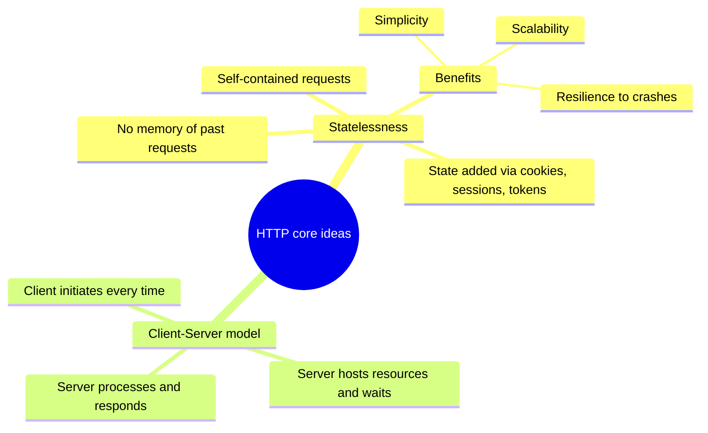

### 1.1 Statelessness

- **Meaning:** the server has **no memory of past interactions**.
- Every HTTP request carries **all the information** the server needs to process it: URL, method, headers, and so on.
- After responding, the server **forgets** the request. The next request from the same client is treated as a **brand-new, unrelated event**.
- **Self-contained requests:** because the server remembers nothing, every request must include things like **auth tokens, cookies, or session info**.
  - *Example:* to fetch a user profile, the client must send credentials (cookie or token) **on every request** so the server knows which user is asking.

**Benefits of statelessness**

| Benefit | Why |
|---|---|
| **Simplicity** | The server doesn't need to store session info, which would cost extra resources and complexity. |
| **Scalability** | Requests can go to **any** of many servers, because no single server needs to track a session. |
| **Resilience** | If a server crashes, no client state is lost, because there is no session or memory to restore. |

```
   Request 1 (token + data) ──►  Server A  ──► response ──► (forgets)
   Request 2 (token + data) ──►  Server B  ──► response ──► (forgets)
   Request 3 (token + data) ──►  Server C  ──► response ──► (forgets)
        ▲
        └── Each request is self-sufficient, so ANY server can handle it
```

> ⚠️ Because HTTP is stateless, developers add **state management techniques** where continuity is needed (logins, shopping carts): **cookies, sessions, tokens**. These are covered later in the series.

### 1.2 Client-Server Model

- **Client:** usually a web browser or an app. It **initiates** communication by sending a request and must provide everything needed (URL, headers, body, ...).
- **Server:** hosts resources (websites, APIs, files) and **waits** for requests. When one arrives, it processes it and sends a response: a web page, JSON, text, an error message, or any other content.
- 🔑 **Rule:** In HTTP, communication is **always initiated by the client**.

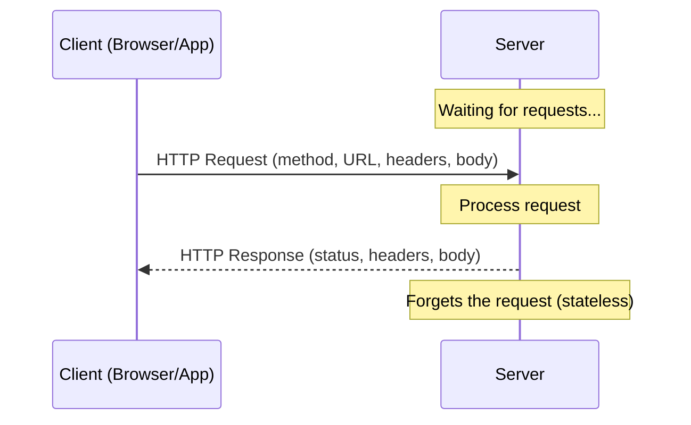

### 1.3 HTTP vs HTTPS

For this discussion, treat **HTTP and HTTPS as interchangeable**. HTTPS is simply a **more secure HTTP**: the same principles plus **encryption, certificates and TLS**. Those details belong to network engineering.

---

## 2. HTTP and the Network Layers (03:56)

- Before any request or response, client and server must **establish a connection**.
- HTTP doesn't strictly require a *connection-based* transport. It only requires a **reliable** one that doesn't lose messages, or at least reports an error when it does.
- Of the two common transport protocols, **TCP** and **UDP**, TCP is the reliable one, so **HTTP (1.x and 2) runs on TCP**, which is connection-based.
- TCP sets up a connection with a **3-way handshake** (SYN → SYN-ACK → ACK). Look it up if you're curious.

### OSI Model (where backend engineers live)

```
┌─────────────────────────────────────────┐
│ 7. Application   ← HTTP lives here  ⭐    │  ← Backend engineers work here
├─────────────────────────────────────────┤
│ 6. Presentation  (TLS/encryption-ish)    │
│ 5. Session                               │
├─────────────────────────────────────────┤
│ 4. Transport     ← TCP / UDP             │  ← "Network engineering" territory
│ 3. Network       ← IP                    │
│ 2. Data Link                             │
│ 1. Physical                              │
└─────────────────────────────────────────┘
```

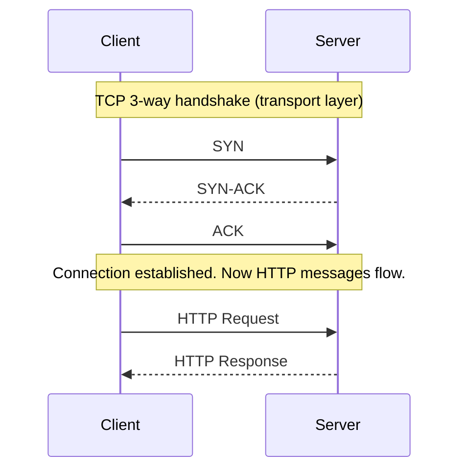

> 🧠 **What to remember:** the client and server establish *some* network connection, and **messages are sent and received** over it. The deep network details (TCP, TLS handshakes) are a rabbit hole you don't need for application-level backend work.

---

## 3. Evolution of HTTP (05:52)

| Version | Key change | Effect |
|---|---|---|
| **HTTP/1.0** | **New TCP connection for every request** | Slow and inefficient, because every request paid the open/close cost |
| **HTTP/1.1** | **Persistent connections** (reuse the same TCP connection), **chunked transfer encoding**, better **caching** | Big performance boost. Still the most used version today. |
| **HTTP/2.0** | **Multiplexing** (many requests/responses at once over one connection), **binary framing** instead of text, **header compression (HPACK)**, **server push** (server sends resources before they are requested) | Much more efficient, but still has **head-of-line blocking** at the TCP level |
| **HTTP/3.0** | Built on **QUIC**, a transport protocol over **UDP** instead of TCP | Faster connection setup, lower latency, better packet-loss handling, **multiplexing without head-of-line blocking** |

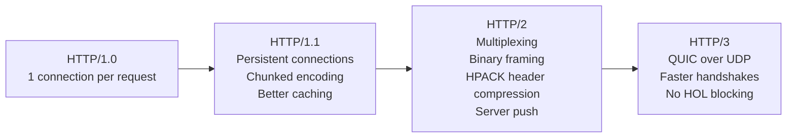

**Visualizing the connection difference:**

```
HTTP/1.0:   [open]─req1─res1─[close]  [open]─req2─res2─[close]  [open]─req3─res3─[close]

HTTP/1.1:   [open]─req1─res1─req2─res2─req3─res3─────────────[close]   (one after another)

HTTP/2:     [open]═╦═ req1/res1 ═╗
                   ╠═ req2/res2 ═╣  (interleaved / multiplexed on ONE connection)
                   ╚═ req3/res3 ═╝─────────────────────────────[close]
```

> 📌 **Extra:** *Head-of-line (HOL) blocking* means one lost or slow packet holds up everything queued behind it. HTTP/2 fixed this at the HTTP level, but TCP still delivers bytes in order. QUIC (HTTP/3) handles each stream independently, which removes it.

---

## 4. HTTP Messages (07:29)

There are two kinds of messages:
- **Request message:** sent **by the client** to the server.
- **Response message:** sent **by the server**, received by the client.

### 4.1 Request Message Anatomy

```http
POST /api/users HTTP/1.1                  ◄── Start line: METHOD  RESOURCE-URL  HTTP-VERSION
Host: api.example.com                     ◄─┐
User-Agent: Mozilla/5.0                     │
Authorization: Bearer eyJhbGciOi...         │  Headers (key: value pairs)
Content-Type: application/json              │
Accept: application/json                  ◄─┘
                                          ◄── BLANK LINE: headers are over, body starts
{"name": "John", "email": "j@x.com"}      ◄── Request body (data the client sends)
```

### 4.2 Response Message Anatomy

```http
HTTP/1.1 200 OK                           ◄── Status line: HTTP-VERSION  STATUS-CODE  STATUS-TEXT
Content-Type: application/json            ◄─┐
Content-Length: 52                          │  Response headers
Cache-Control: max-age=10                 ◄─┘
                                          ◄── BLANK LINE
{"id": 1, "name": "John", "email": "j@x.com"}   ◄── Response body
```

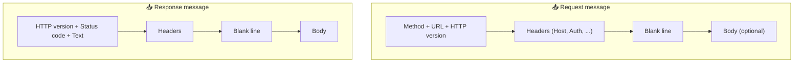

| Part | Request | Response |
|---|---|---|
| First line | `METHOD /path HTTP/1.1` | `HTTP/1.1 200 OK` |
| Headers | Yes (Host, Authorization, ...) | Yes (Content-Type, Cache-Control, ...) |
| Blank line | Yes (separator) | Yes (separator) |
| Body | Optional (POST/PUT/PATCH usually have one) | Optional (204 has none) |

---

## 5. Why Do We Need HTTP Headers? (09:07)

**Definition:** Headers are **key-value pairs** of metadata sent with a request or a response.

**Question:** Why not put everything in the URL or the body? Why a separate section?

### 📦 The parcel analogy

When you send a parcel, where do you write the recipient's address, phone number and PIN code?
**On the outside.** Couriers handling the parcel at each stage need that info **quickly**, without **opening the package**. If it were inside, every handler would have to open the parcel repeatedly, which makes no sense.

```
        ┌──────────────────────────────┐
        │  TO: John, 221B Baker St     │  ◄── HEADERS (metadata, read by everyone
        │  PIN: 560001  Ph: 98xxxx     │       in transit without opening)
        │  FRAGILE ⚠  Express ✈        │
        │ ┌──────────────────────────┐ │
        │ │                          │ │
        │ │     📦 actual contents    │ │  ◄── BODY (the payload)
        │ │                          │ │
        │ └──────────────────────────┘ │
        └──────────────────────────────┘
```

**HTTP headers work the same way.** Servers, proxies, load balancers, caches and browsers can read the metadata **without parsing the body**. Headers also have more uses than this, covered next.

---

## 6. Types of HTTP Headers (11:20)

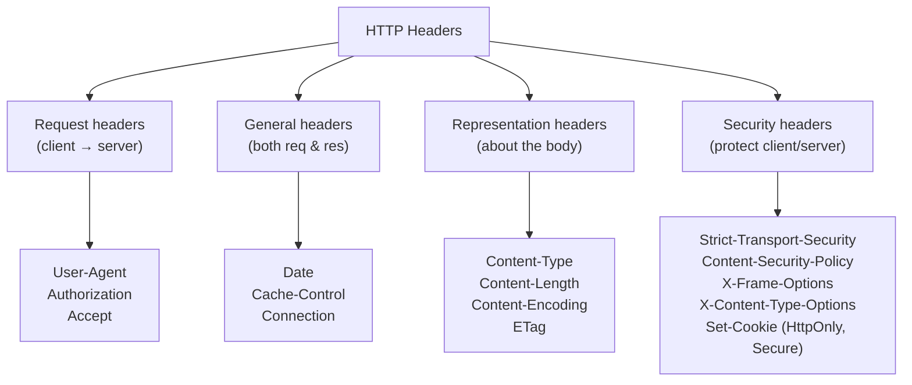

### 6.1 Request Headers (client → server)
These help the server understand the client's **environment, preferences and capabilities**.

| Header | Purpose | Example |
|---|---|---|
| `User-Agent` | Identifies the client type: browser, Postman, server, mobile app | `Mozilla/5.0 ...` |
| `Authorization` | Sends credentials (e.g. a Bearer token) to identify the user | `Bearer eyJ...` |
| `Accept` | What content types the client expects | `application/json`, `text/html` |

### 6.2 General Headers (in both requests and responses)
Metadata about **the message itself**.

| Header | Purpose | Example |
|---|---|---|
| `Date` | When the message was created | `Date: Tue, 15 Nov 2024 08:12:31 GMT` |
| `Cache-Control` | Caching rules | `no-cache`, `max-age=3600` |
| `Connection` | Keep the connection alive or close it | `keep-alive` / `close` |

### 6.3 Representation Headers
Describe the **representation of the resource**, i.e. the body. They tell both sides how to interpret it.

| Header | Purpose | Example |
|---|---|---|
| `Content-Type` | Media type of the body | `application/json`, `text/html` |
| `Content-Length` | Size of the body in **bytes** | `348` |
| `Content-Encoding` | Compression/encoding applied | `gzip`, `deflate` |
| `ETag` | Unique identifier (hash) of the resource version, mostly used for **caching** | `"33a64df5"` |

### 6.4 Security Headers
They **enhance security** by controlling browser behavior around content loading, cookies and encryption.

| Header | What it does | Protects against |
|---|---|---|
| `Strict-Transport-Security` (HSTS) | Client must talk to the server **only over HTTPS** | **Protocol downgrade** attacks |
| `Content-Security-Policy` (CSP) | Restricts **which sources** can load JS, CSS, images | **Cross-site scripting (XSS)** |
| `X-Frame-Options` | Prevents the page from being embedded in an `<iframe>` | **Clickjacking** |
| `X-Content-Type-Options: nosniff` | Browser must **not guess** the MIME type | **MIME-type sniffing** attacks |
| `Set-Cookie` with `HttpOnly` / `Secure` | `HttpOnly` blocks JavaScript access to the cookie. `Secure` sends it only over HTTPS. | Cookie theft (XSS), interception |

### 6.5 Two Big Ideas Behind Headers

#### 🧩 Idea 1: Extensibility
HTTP is **highly extensible**: you can add or customize headers **without changing the protocol**. Add some metadata, and the whole interaction flow can change.
- **Security enhancements:** e.g. `Strict-Transport-Security` forces secure connections.
- **Custom headers:** developers can define their own, e.g. `X-Custom-Header`, for app-specific needs.
- **Content negotiation:** `Accept`, `Accept-Language` and `Accept-Encoding` let servers serve different versions of the content.

#### 🎮 Idea 2: Headers as a "remote control"
Headers let the **client send instructions or preferences** that influence how the **server** responds:
- **Content type negotiation:** `Accept: text/html` gets HTML, `Accept: application/json` gets JSON.
- **Caching and expiration:** the server uses `Cache-Control` / `Expires` to say how long the client may cache.
- **Authentication:** the `Authorization` header drives access-control decisions.

```
   Client  ──[ Accept: application/json ]──►  Server ──► returns JSON
   Client  ──[ Accept: text/html        ]──►  Server ──► returns HTML
   Client  ──[ Accept-Language: es      ]──►  Server ──► returns Spanish
              ▲
              └── headers = the "remote control buttons"
```

---

## 7. HTTP Methods (16:16)

Methods exist to represent **different kinds of actions**. They define the **INTENT** of the interaction, which gives each request a clear semantic meaning.

| Method | Intent | Has body? | Notes |
|---|---|---|---|
| **GET** | **Fetch** data | No | Must **not modify** anything on the server |
| **POST** | **Create** data | ✅ Yes | Sends the new data in the body |
| **PATCH** | **Update** part of a resource | ✅ Yes | Selective/partial replacement, e.g. updating only the name on a profile |
| **PUT** | **Replace** the whole resource | ✅ Yes | The body **completely replaces** the previous instance |
| **DELETE** | **Delete** a resource | Usually no | |
| **OPTIONS** | Ask about server **capabilities** | No | Used in the CORS **preflight** (section 9) |

### PATCH vs PUT

```
Existing resource:  { name: "John", age: 25, city: "Delhi" }

PATCH  { age: 26 }   →  { name: "John", age: 26, city: "Delhi" }    ← only "age" changes
PUT    { age: 26 }   →  { age: 26 }                                  ← whole object REPLACED
```

> 🔑 **Rule of thumb:** **use PATCH** unless you have a specific reason to use PUT. Many developers use PUT when they mean PATCH, which goes against the semantics.

---

## 8. Idempotent vs Non-Idempotent (18:07)

**Idempotent:** calling the method **multiple times** produces the **same result** as calling it once.

| Method | Idempotent? | Reason |
|---|---|---|
| **GET** | ✅ Yes | Fetching any number of times returns the same data and modifies nothing |
| **PUT** | ✅ Yes | Replacing old data with the same new data repeatedly leaves the same final state |
| **DELETE** | ✅ Yes | You can only delete once. After that it's already gone, so the end state is the same. |
| **POST** | ❌ No | Each submit **creates a new** resource. Submitting "create note" twice gives two notes. |

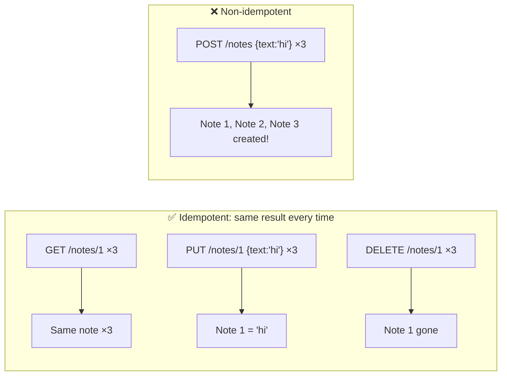

> 📌 **Extra:** **PATCH** is *not guaranteed* to be idempotent (e.g. "increment counter by 1"), though many PATCH implementations are. Idempotency matters for **safe retries**: if a network call fails, retrying an idempotent request is safe.

---

## 9. OPTIONS Method and CORS (20:08)

You rarely call `OPTIONS` yourself, but you'll see it in the browser's **Network tab** as **preflight requests**.

### 9.1 Background: Same-Origin Policy (SOP)

- Browsers enforce the **Same-Origin Policy** by default: a web page can **only make requests to its own origin**, the domain that served the page.
- **Origin = scheme + domain + port.** Different port means a different origin. For example, `localhost:5173` and `localhost:3000` are **different origins**.
- **CORS (Cross-Origin Resource Sharing)** is a **browser-enforced security mechanism** that lets **servers declare who may access their resources, and how**, across origins.
- Without CORS, a request from `example.com` to `api.another-example.com` is **blocked by the browser**.

```
 Frontend origin: https://example.com
 API origin:      https://api.example.com     ← different subdomain = CROSS-ORIGIN
```

There are **two CORS flows**:

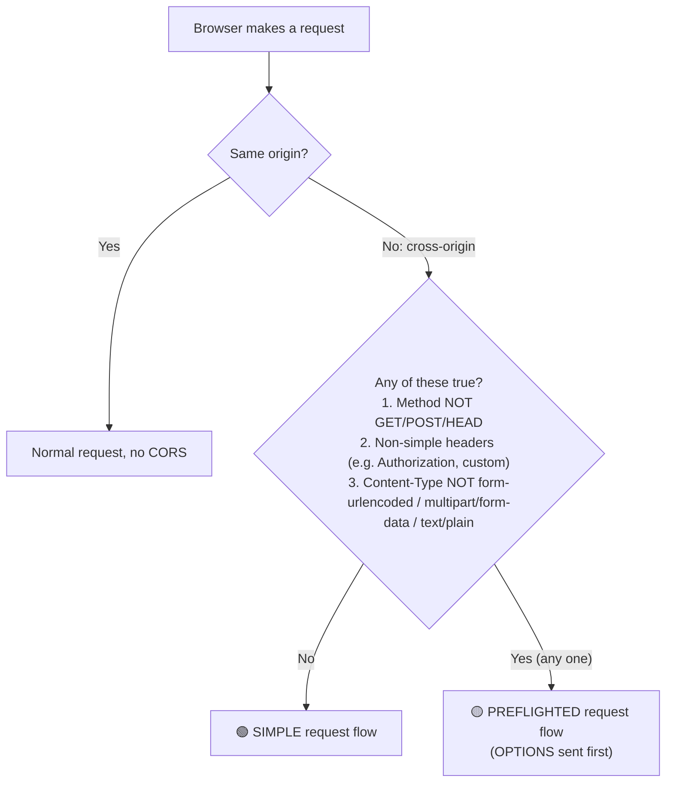

### 9.2 Simple Request Flow

**Setup:** frontend at `example.com`, API at `api.example.com`, request is a `GET`.

1. The client sends the request. The **browser automatically adds the `Origin` header**, e.g. `Origin: https://example.com`.
2. The request uses a **simple method** (GET, POST, or HEAD).
3. The server checks `Origin` against its CORS policy.
4. If allowed, the server adds **`Access-Control-Allow-Origin`** to the response.
5. The browser checks the response:
   - `Access-Control-Allow-Origin: https://example.com` (the exact origin) **or** `*` (allow all) → ✅ the response is passed to the JS code.
   - Header **missing** → ❌ the browser **blocks** the response, and a **CORS error** appears in the console and Network tab.

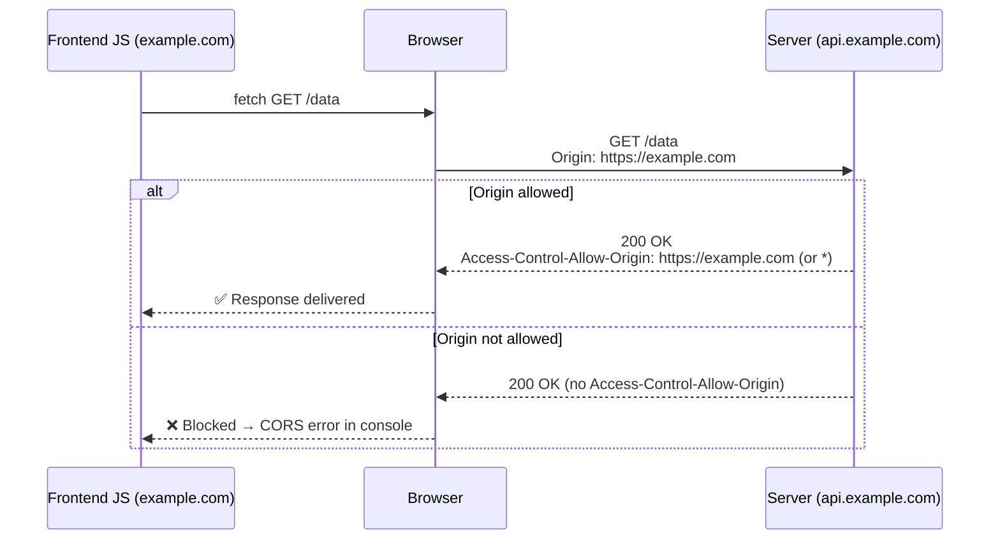

> ⚠️ In the blocked case, the **server still processed and responded**. It is the **browser** that refuses to hand the response to your JavaScript. CORS is a **browser** protection.

### 9.3 Preflighted Request Flow

**When is it preflighted?** It must be **cross-origin**, **AND at least one** of these must be true:

| # | Condition | Example |
|---|---|---|
| 1 | Method is **not** GET, POST, or HEAD | `PUT`, `DELETE`, `PATCH` |
| 2 | Request has **non-simple headers** | `Authorization`, custom `X-...` headers |
| 3 | `Content-Type` is **not** one of the simple types: `application/x-www-form-urlencoded`, `multipart/form-data`, `text/plain` | `application/json` ← very common! |

> 💡 Since most modern APIs use **JSON** (and often an `Authorization` header), **most real requests are preflighted**.

**Step 1: the browser sends a preflight (`OPTIONS`), with no body:**

```http
OPTIONS /api/resource HTTP/1.1
Host: api.example.com
Origin: https://example.com
Access-Control-Request-Method: PUT                ◄── "Do you support PUT on this URL?"
Access-Control-Request-Headers: Authorization     ◄── "Do you allow this header?"
```

**Step 2: the server answers (if it supports CORS):**

```http
HTTP/1.1 204 No Content                           ◄── no body, info is in headers
Access-Control-Allow-Origin: https://example.com  ◄── ✔ origin allowed (or *)
Access-Control-Allow-Methods: PUT, DELETE         ◄── ✔ PUT allowed
Access-Control-Allow-Headers: Authorization       ◄── ✔ header allowed
Access-Control-Max-Age: 86400                     ◄── cache this preflight for 24h
```

| Response header | Meaning |
|---|---|
| `Access-Control-Allow-Origin` | Which origin(s) may access (`example.com` or `*`) |
| `Access-Control-Allow-Methods` | Which methods are allowed for this resource |
| `Access-Control-Allow-Headers` | Which non-simple headers are allowed |
| `Access-Control-Max-Age` | How long (in seconds) the browser may **cache the preflight result**, so it doesn't need a preflight before every request. Saves bandwidth for both sides. |

**Step 3:** the browser checks all conditions ✔✔✔ and sends the **original request** (e.g. the `PUT` with its body).
**Step 4:** the server processes it and responds normally.

If the server doesn't handle CORS (no proper headers), the browser **blocks** the request automatically.

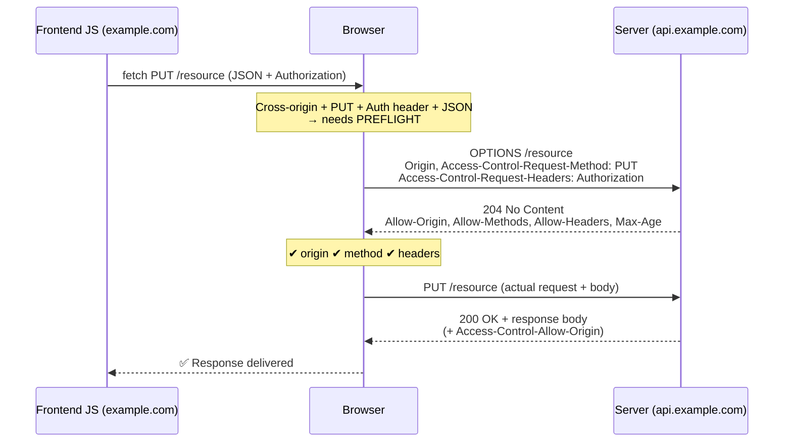

---

## 10. CORS Demo with Burp Suite (29:41)

**Teaching philosophy (first principles):** no code. Understand **what** happens and **how the mechanism works** before learning **how** to implement it. The server could be written in any language or framework.

**Tool: Burp Suite.** Used by ethical hackers. Here it is used to **intercept and visualize HTTP traffic**.

**Setup:** frontend at `localhost:5173`, API at `localhost:3000`. The ports differ, so the browser treats it as **cross-origin**.

### Demo 1: Simple request ✅
- Request headers to watch: **`Origin`** (frontend, `localhost:5173`) and **`Host`** (the API).
- Response contains **`Access-Control-Allow-Origin: http://localhost:5173`**, so the browser lets the response through and it renders in the UI.

### Demo 2: Simple request with the header removed ❌
- The presenter changed the server to **stop sending** `Access-Control-Allow-Origin`.
- Cache was **disabled** to make sure a fresh request went out.
- Result: the browser showed a **CORS error** and blocked the response, even though the server responded.

### Demo 3: Preflighted request ✅
- CORS re-enabled. Firing the request showed **two requests in the Network tab**: first `OPTIONS` (preflight), then the original `PUT`.
- **Why was it preflighted?** All three conditions were met (any one would have been enough):
  1. Method `PUT` is not simple.
  2. It had an **`Authorization`** header (non-simple).
  3. `Content-Type: application/json` with a JSON body.
- **Preflight request** contained `Access-Control-Request-Method: PUT` and `Access-Control-Request-Headers: authorization, content-type`.
- **Preflight response:**
  - `204 No Content`, `Content-Length: 0`
  - `Access-Control-Allow-Origin: http://localhost:5173`
  - `Access-Control-Allow-Methods: GET, POST, PUT, DELETE`
  - `Access-Control-Allow-Headers: Content-Type, Authorization`
  - `Access-Control-Max-Age: 0`, set to 0 for testing so a preflight fires every time (with e.g. 5 minutes it would be cached).
- Then the **actual PUT** went through with its body, origin, Authorization and host, and got a normal response.

> 🧠 **Simple flow + preflight flow = the whole CORS flow.** Knowing these headers and how browsers react to them is all you need to debug CORS issues.

---

## 11. Response Status Codes (38:53)

### Why status codes exist
- They communicate the **result of a request in a standardized way**. The client knows success or failure **without inspecting the body**, so it doesn't have to guess the outcome from the response's shape.
- They help clients **handle errors programmatically**:
  - `401` → log the user out and ask them to log in again.
  - `400` → ask the user to fix the form and resubmit.
- **Standardization:** the same meaning across all servers and languages (Python, Go, Rust, JS, Ruby, ...). Success → `200`, created → `201`, and so on. Before status codes, clients had to infer outcomes from content, which was inconsistent and inefficient. Status codes are a **universal language**.

### The five classes (3-digit numbers)

```
 1xx ── Informational     "Got it, keep going"
 2xx ── Success           "Done!"
 3xx ── Redirection       "Look elsewhere"
 4xx ── Client Error      "YOU messed up"
 5xx ── Server Error      "I (server) messed up"
```

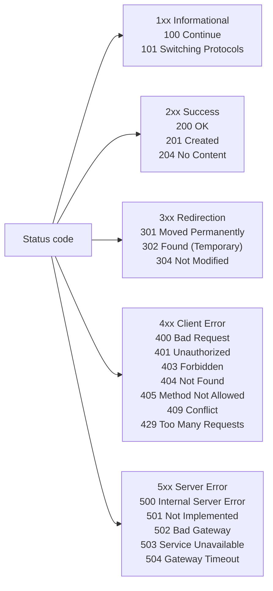

### 1xx: Informational (rarely used day to day)

| Code | Name | When |
|---|---|---|
| **100** | Continue | Server received the **headers** and the client may send the body. Used for **large uploads**: the client sends headers first, and if the server is OK it replies 100 so the client sends the rest. |
| **101** | Switching Protocols | Server switches protocol at the client's request, e.g. **HTTP → WebSocket** upgrade. |

### 2xx: Success

| Code | Name | When | Example |
|---|---|---|---|
| **200** | OK | Request succeeded, resource returned or action done | Successful `GET` |
| **201** | Created | Request fulfilled and a **new resource was created** | `POST` creating a user, form submission |
| **204** | No Content | Success, but **no body** to return | CORS **preflight** response, successful **DELETE** |

### 3xx: Redirection

| Code | Name | When | Example |
|---|---|---|---|
| **301** | Moved Permanently | Resource **permanently** moved. Future requests should use the new URL. | Route `/user` renamed to `/person`. Add a 301 on `/user` → `/person` so old clients don't break (**backward compatibility**). |
| **302** | Found (Temporary Redirect) | Resource **temporarily** elsewhere. Keep using the original URL in future. | A few-hour **campaign** redirecting a route to a special page, reverted later |
| **304** | Not Modified | Resource **unchanged** since the client last fetched it, so use the cache | Used with **conditional GET** and **ETags** (see Caching) |

### 4xx: Client Errors (you'll deal with these the most as a backend engineer)

| Code | Name | When | Example |
|---|---|---|---|
| **400** | Bad Request | Client sent **invalid/illogical data** | Expected a number, got an array/string. Expected an email, got a phone number. |
| **401** | Unauthorized | Auth **required** but credentials are **missing or invalid** | JWT **not sent**, or **expired**/invalid |
| **403** | Forbidden | Server understood and **knows who you are**, but you **lack permission** | User A trying to delete User B's resource |
| **404** | Not Found | Resource **doesn't exist** | Wrong URL, or the resource was deleted |
| **405** | Method Not Allowed | **Wrong HTTP method** for the route | `PUT` on a route that only accepts GET/POST (often a frontend typo: PATCH vs PUT) |
| **409** | Conflict | Request **conflicts with current state** | Creating a folder whose name must be **unique** but already exists |
| **429** | Too Many Requests | **Rate limit** exceeded | Server allows max 60 requests/second per client and the client exceeds it |

#### 🔐 401 vs 403 (frequently confused)

```
401 Unauthorized  →  "WHO are you?"         (not logged in / bad or expired token)
403 Forbidden     →  "I know who you are,    (logged in, but no permission)
                      but you CAN'T do this."
```

### 5xx: Server Errors

| Code | Name | When |
|---|---|---|
| **500** | Internal Server Error | **Unexpected** condition: an unhandled exception or a broken process. Respond with 500 rather than hanging or returning empty. Keep the message vague for **security**. |
| **501** | Not Implemented | Server **doesn't support** the method/feature **yet**, but may in the future |
| **502** | Bad Gateway | A **proxy/load balancer** (e.g. **NGINX**) got an **invalid response from the upstream** server. Usually returned by proxies, not your code. |
| **503** | Service Unavailable | Server **temporarily** can't handle requests (high traffic, **maintenance**). Try again later. |
| **504** | Gateway Timeout | Like 502, but the upstream **didn't respond in time** (NGINX waited for your app server and timed out) |

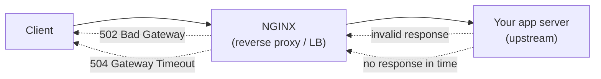

> ✅ These codes cover about **95% of use cases**.

---

## 12. Status Codes Demo (52:13)

A frontend app fires requests to a mock server that responds with different codes. Observations:
- Every original request was preceded by an **`OPTIONS` preflight**, because they were cross-origin.
- `200 OK`: success.
- `201 Created` (POST): "resource created successfully".
- `400 Bad Request`: "missing required data". (The presenter misspoke it as "401" in the video.)
- `401 Unauthorized`: token/cookie missing, expired, or invalid.
- `403 Forbidden`: "you do not have access".
- `404 Not Found`: "requested resource could not be found".
- `409 Conflict`: "resource already exists" (the duplicate folder name example).
- `500 Internal Server Error`: generic message. **Don't leak internal details** to the client, for security.
- `503 Service Unavailable`: "please try again later".

---

## 13. HTTP Caching (55:22)

**HTTP caching** stores **copies of responses for reuse**, reducing repeated requests to the server.
**Benefits:** ⚡ faster load times, 📉 less bandwidth, 🖥️ lower server load. If the data hasn't changed, the client reuses what it already has.

### Key headers

| Header | Sent by | Meaning |
|---|---|---|
| `Cache-Control: max-age=10` | Server | Cache this response for at most **10 seconds** |
| `ETag: "3141"` | Server | A **hash/fingerprint** of the response content (the demo used a random number). Changes when the content changes. |
| `Last-Modified: <date>` | Server | When the resource was last changed |
| `If-None-Match: "3141"` | Client | "Send a new version **only if the ETag no longer matches** this one" |
| `If-Modified-Since: <date>` | Client | "Send a new version **only if it was modified after** this date" |

### Demo walkthrough

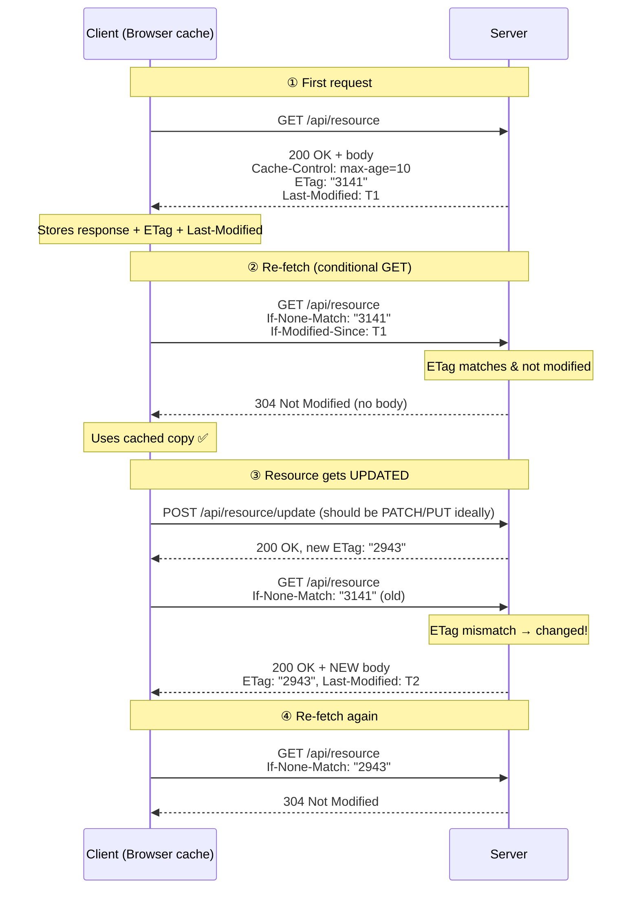

**Logic on the server:**

```
if (request.If-None-Match == current ETag)  or  (not modified since If-Modified-Since):
      return 304 Not Modified        → client uses cache (no body sent, bandwidth saved)
else:
      return 200 OK + fresh body + new ETag + new Last-Modified
```

### ⚠️ Caveats and modern alternatives
- In production this gets **complicated**: the server must generate and manage ETags correctly. If it **forgets to update** an ETag, clients keep using **stale data**.
- Modern alternative: **client-side caching libraries** like **React Query (TanStack Query)**. The client fully controls when to use the cache, when to refetch, and at what interval. The presenter thinks this is a better solution in many cases.
- HTTP caching is still a good option **if your use case is simple**.

---

## 14. Content Negotiation (1:02:32)

**Content negotiation** is how the **client and server agree on the best format** for exchanging data. The client states its **preferences**, and the server responds with a compatible format, or a **fallback** if the preference isn't available.

### The three types

| Type | Request header | Example values |
|---|---|---|
| **Media type** (format) | `Accept` | `application/json`, `application/xml`, `text/html` |
| **Language** | `Accept-Language` | `en`, `es` |
| **Encoding** (compression) | `Accept-Encoding` | `gzip`, `deflate`, `br`, `zstd` |

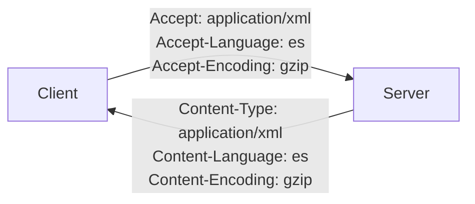

### Demo results

| Request headers | Response |
|---|---|
| `Accept-Language: en`, `Accept: application/json` | JSON in **English** |
| `Accept-Language: es`, `Accept: application/json` | JSON in **Spanish** |
| `Accept-Language: es`, `Accept: application/xml` | **XML** in **Spanish** |

The browser automatically sent `Accept-Encoding: gzip, deflate, br, zstd`.

**Benefit:** the server adapts to the client's preferences for **format** and **language**, which makes the client's job easier.

---

## 15. HTTP Compression (1:06:54)

Compression falls under the **content negotiation** umbrella. The client sends `Accept-Encoding: gzip, ...`, the server compresses the body and responds with `Content-Encoding: gzip`, and the browser **automatically decompresses** it.

### Demo: a large JSON file (11,000 entries)

| Compression | Transfer size |
|---|---|
| **gzip ON** | **3.8 MB** |
| gzip OFF | **26 MB** 😱 |

```
 gzip ON   ███▊                                   3.8 MB
 gzip OFF  ██████████████████████████              26  MB
           └─ ~85% smaller with compression ─┘
```

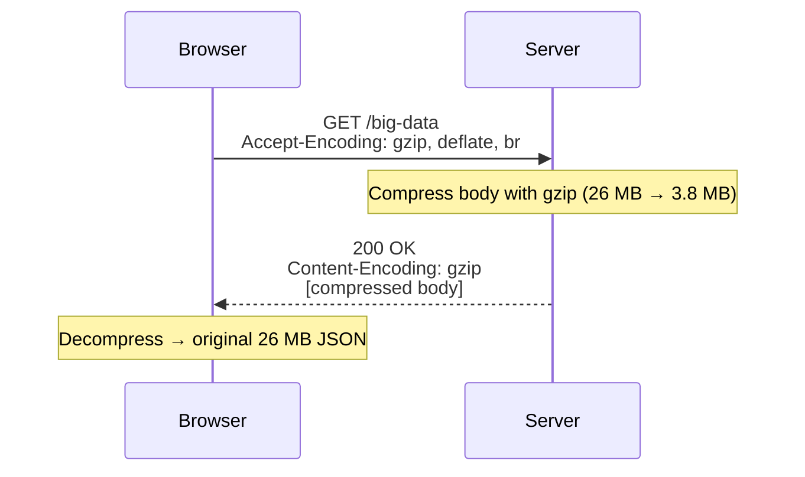

**Why it matters:** imagine **every** client downloading 26 MB. Compression saves a huge amount of **bandwidth** and speeds up delivery.

---

## 16. Persistent Connections and Keep-Alive (1:08:55)

> This runs behind the scenes. You usually won't work with it directly, but it's good to know.

- **HTTP/1.0:** every request/response needed a **separate TCP connection**. Opening and closing TCP connections is **slow and resource-intensive**.
- **HTTP/1.1:** introduced **persistent connections**, so **one TCP connection is reused** for many requests and responses.
- **Keep-Alive** is the mechanism that enables persistent connections. The connection is reused until **either side decides to close it**.

### Key points

1. **HTTP/1.1 connections are persistent by default**, so nothing explicit is needed. They stay open unless closed. Fewer connections means **lower latency** and **fewer resources** used.
2. **`Connection: keep-alive`** can still be sent explicitly to ask the server to keep the connection open. Options:
   - `timeout`: how long to keep the connection open.
   - `max`: how many requests before closing.
   ```http
   Connection: keep-alive
   Keep-Alive: timeout=5, max=100
   ```
3. **`Connection: close`** closes the connection **after the response** is sent. This is the **default in HTTP/1.0**, and it can be forced in HTTP/1.1.

```
Without keep-alive (HTTP/1.0):
  [TCP open]→req→res→[close]  [TCP open]→req→res→[close]  [TCP open]→req→res→[close]
     ▲ handshake cost each time

With keep-alive (HTTP/1.1 default):
  [TCP open]→req→res→req→res→req→res→ ... →[close]
     ▲ handshake cost only once
```

> ✅ The default values work fine in almost all cases.

---

## 17. Large Requests and Responses (1:11:05)

How do servers **receive** large files (video, image, audio), and how do clients **receive** large responses?

### 17.1 Sending large data to the server: Multipart requests

- Use **`multipart/form-data`** to upload files.
- Unlike a normal JSON body, the file's **binary data is sent in parts**, hence the name "multipart".
- A **boundary** string acts as the **delimiter** separating the parts. It appears at the **start** of the binary data and again at the **end**.

```http
POST /upload HTTP/1.1
Content-Length: 245678
Content-Type: multipart/form-data; boundary=----WebKitFormBoundary7MA4YWxk

------WebKitFormBoundary7MA4YWxk                 ◄── boundary: start of a part
Content-Disposition: form-data; name="file"; filename="photo.png"
Content-Type: image/png

<binary data of the image ...>
------WebKitFormBoundary7MA4YWxk--               ◄── boundary + "--" = end
```

```
 Request body
 ┌──────────────────────────────────────────────┐
 │ --boundary                                    │
 │   part 1 headers (name, filename, type)       │
 │   part 1 data (binary file)                   │
 │ --boundary                                    │
 │   part 2 headers (e.g. a text field)          │
 │   part 2 data                                 │
 │ --boundary--   ◄── end marker                 │
 └──────────────────────────────────────────────┘
```

- The server reads the file and replies with some file details to confirm the upload.
- 🔑 **Rule:** to send (large) files to the server, use **multipart requests**.

### 17.2 Receiving large data from the server: Streaming in chunks

The demo streamed a large text file to the client in **chunks**.

**Important response headers:**

| Header | Meaning |
|---|---|
| `Content-Type: text/event-stream` | The data arrives as a **stream of events**, not as one text response |
| `Connection: keep-alive` | Keep the connection open **until all data is sent** |
| (Transfer-Encoding: chunked) | 📌 Extra: the HTTP/1.1 mechanism for sending a body in pieces without knowing the total length upfront |

- The client keeps **appending** each chunk it receives and rebuilds the full file.

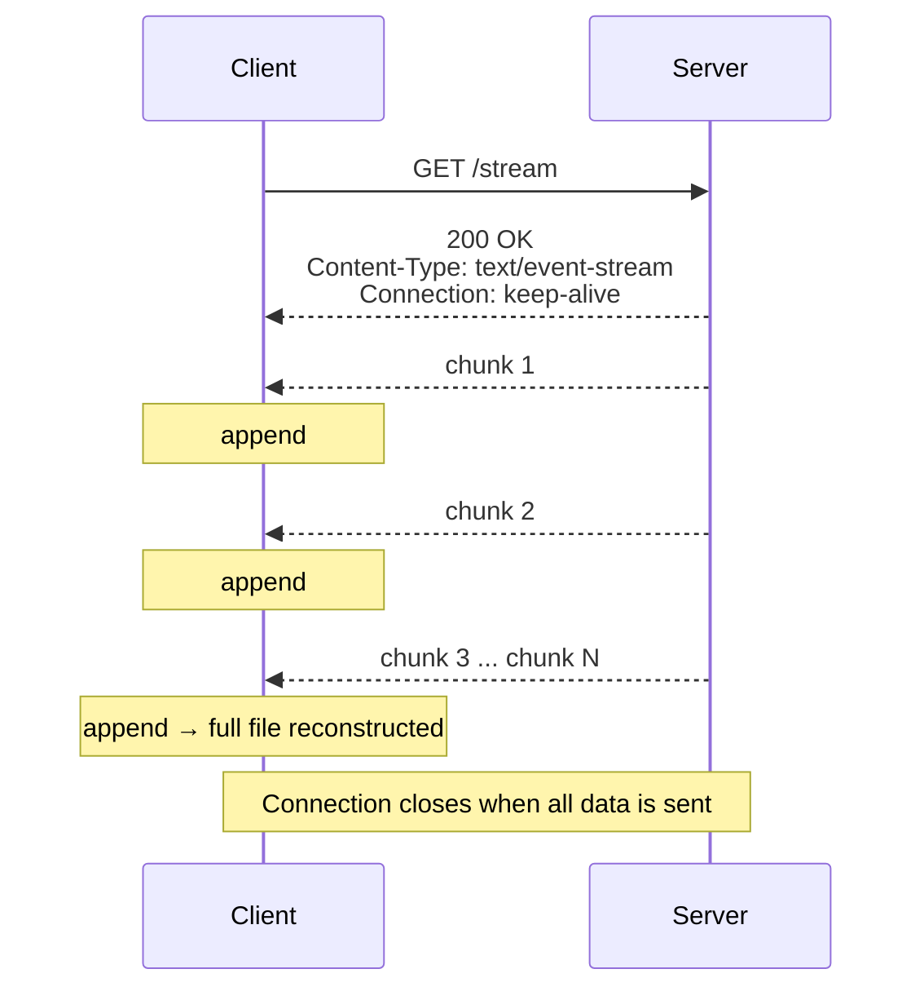

> 📌 **Extra:** `text/event-stream` is the format used by **Server-Sent Events (SSE)**, also used for live updates and AI-chat token streaming.

---

## 18. SSL, TLS and HTTPS (1:15:13)

You don't work with these directly, but you should know what they are.

| Term | What it is |
|---|---|
| **SSL** (Secure Sockets Layer) | The **original** protocol for securing client-server communication. It encrypts data so passwords and card numbers can't be intercepted. Now **outdated** because of security vulnerabilities, and replaced by TLS. |
| **TLS** (Transport Layer Security) | The **modern, more secure successor** to SSL. Encrypts **data in transit**, preventing **interception and tampering**. Uses **certificates** to **authenticate the server** and set up an encrypted connection, which prevents **eavesdropping** and data breaches. Continuously updated. The current recommended version is **TLS 1.3**. |
| **HTTPS** | **HTTP + TLS** (formerly SSL). When you visit an HTTPS site, TLS encrypts all traffic between the browser and the server, protecting login credentials and other sensitive data. |

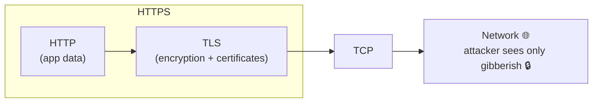

```
  Plain HTTP:   password=hunter2      ──► 👀 attacker can read it
  HTTPS (TLS):  x9#@!kQ2&...           ──► 👀 attacker sees encrypted junk
```

---

## 🧾 Quick Revision Cheat Sheet

### Core concepts
| Concept | One-liner |
|---|---|
| Stateless | Server remembers nothing. Every request is self-contained (send token/cookie each time). |
| Client-server | The client **always** initiates. |
| Transport | HTTP/1.1 and 2 over **TCP**. HTTP/3 over **QUIC (UDP)**. |
| Message | Start line → Headers → **Blank line** → Body |
| Headers | Key-value metadata, like the label on a parcel |

### HTTP versions
`1.0` new connection each time → `1.1` persistent + chunked + caching → `2` multiplexing + binary + HPACK + server push → `3` QUIC/UDP, no HOL blocking

### Header categories
- **Request:** User-Agent, Authorization, Accept
- **General:** Date, Cache-Control, Connection
- **Representation:** Content-Type, Content-Length, Content-Encoding, ETag
- **Security:** HSTS, CSP, X-Frame-Options, X-Content-Type-Options, Set-Cookie (HttpOnly, Secure)

### Methods and idempotency
| Method | Purpose | Idempotent |
|---|---|---|
| GET | Read | ✅ |
| POST | Create | ❌ |
| PUT | Replace entirely | ✅ |
| PATCH | Partial update (**prefer this** for updates) | (not guaranteed) |
| DELETE | Remove | ✅ |
| OPTIONS | Capabilities / CORS preflight | ✅ |

### CORS
- **Origin = scheme + host + port.**
- **Preflight if cross-origin AND any one of:** method not GET/POST/HEAD **or** non-simple header (Authorization, custom) **or** Content-Type not form-urlencoded/multipart/text-plain (e.g. JSON).
- Preflight = `OPTIONS` + `Access-Control-Request-Method` / `-Headers`
- Server replies `204` + `Access-Control-Allow-Origin` / `-Methods` / `-Headers` / `-Max-Age`
- If the allow headers are missing, the **browser** blocks the response (CORS error).

### Status codes
```
200 OK          201 Created        204 No Content
301 Moved Perm  302 Temp Redirect  304 Not Modified
400 Bad Req     401 Unauthorized(who?)  403 Forbidden(can't)  404 Not Found
405 Method Not Allowed   409 Conflict   429 Too Many Requests (rate limit)
500 Internal    501 Not Implemented    502 Bad Gateway (proxy got bad reply)
503 Unavailable (maintenance/overload) 504 Gateway Timeout (proxy waited too long)
100 Continue    101 Switching Protocols (→ WebSocket)
```

### Caching
Server: `Cache-Control: max-age`, `ETag`, `Last-Modified`
Client: `If-None-Match` (ETag), `If-Modified-Since` (date)
Unchanged → **304** (use cache). Changed → **200** + new body + new ETag.

### Content negotiation and compression
`Accept` (format), `Accept-Language` (language), `Accept-Encoding` (gzip/deflate/br/zstd) → server responds with `Content-Type`, `Content-Encoding`, ...
gzip demo: **26 MB → 3.8 MB**.

### Connections and large data
- HTTP/1.1 is keep-alive by default. `Connection: close` = 1.0 behavior. `Keep-Alive: timeout=, max=`.
- Upload files → `multipart/form-data; boundary=...`
- Stream big responses → `Content-Type: text/event-stream` + `Connection: keep-alive`, chunks appended by the client.

### Security
SSL (old, broken) → **TLS** (modern, use 1.3) → **HTTPS = HTTP + TLS**.

---

## ❓ Self-Test Questions

<details>
<summary>1. What does "stateless" mean, and how do we still implement logins?</summary>

The server keeps no memory between requests, so each request carries everything it needs. Logins use **cookies, sessions, or tokens** sent with every request.
</details>

<details>
<summary>2. Why does HTTP use TCP instead of UDP (pre-HTTP/3)?</summary>

HTTP needs a **reliable** transport that doesn't lose messages. TCP is reliable and connection-based. HTTP/3 uses QUIC, which adds reliability on top of UDP.
</details>

<details>
<summary>3. What separates headers from the body in an HTTP message?</summary>

A **blank line**.
</details>

<details>
<summary>4. PUT vs PATCH?</summary>

PUT **replaces the entire** resource. PATCH **partially** updates it. Prefer PATCH unless you need full replacement.
</details>

<details>
<summary>5. Why is POST non-idempotent?</summary>

Repeating it creates a **new** resource each time (e.g. two notes), so the result differs.
</details>

<details>
<summary>6. A frontend at localhost:5173 sends a JSON PUT with an Authorization header to localhost:3000. What happens?</summary>

It's cross-origin (different port), and it meets **all three** preflight conditions. The browser first sends `OPTIONS` with `Access-Control-Request-Method: PUT` and `Access-Control-Request-Headers: authorization, content-type`. The server must reply (e.g. `204`) with Allow-Origin/Methods/Headers. Then the real PUT goes out.
</details>

<details>
<summary>7. What does Access-Control-Max-Age do?</summary>

It tells the browser how long to **cache the preflight result**, so it can skip preflights for that period and save bandwidth.
</details>

<details>
<summary>8. 401 vs 403?</summary>

401: not authenticated (missing, expired or invalid credentials). 403: authenticated but **not permitted**.
</details>

<details>
<summary>9. 502 vs 504?</summary>

Both come from a proxy or gateway like NGINX. 502: the upstream returned an **invalid** response. 504: the upstream **didn't respond in time**.
</details>

<details>
<summary>10. Which status code is returned when a cached resource is still valid, and which request headers trigger that check?</summary>

**304 Not Modified**, triggered by `If-None-Match` (ETag) and `If-Modified-Since` (Last-Modified).
</details>

<details>
<summary>11. Name the three types of content negotiation and their headers.</summary>

Media type: `Accept`. Language: `Accept-Language`. Encoding: `Accept-Encoding`.
</details>

<details>
<summary>12. How does a multipart request separate the parts of an uploaded file?</summary>

With a **boundary** string declared in `Content-Type: multipart/form-data; boundary=...`. It appears before each part and at the end (with a trailing `--`).
</details>

<details>
<summary>13. What's the relationship between SSL, TLS and HTTPS?</summary>

SSL is the original encryption protocol (now outdated). TLS is its modern successor. HTTPS is HTTP running over TLS.
</details>

<details>
<summary>14. Which status code would you return for rate limiting, for a duplicate unique name, and for a wrong method?</summary>

**429** Too Many Requests, **409** Conflict, and **405** Method Not Allowed.
</details>

---

*Notes compiled from the video transcript. Timestamps (mm:ss / h:mm:ss) let you jump back to each section.*
