# Handlers, Services, Repositories, Middleware and Request Context: Complete Revision Notes

> **Source:** [YouTube: Handlers, Services, Repository Pattern, Middleware & Request Context (Backend from First Principles series, part 10)](https://www.youtube.com/watch?v=hyc-7w3pee8&list=PLui3EUkuMTPgZcV0QhQrOcwMPcBCcd_Q1&index=10)
> **Length:** ~1h
> **Previous videos:** [HTTP_Notes.md](HTTP_Notes.md) · [Routing_Notes.md](Routing_Notes.md) · [Serialization_Notes.md](Serialization_Notes.md) · [Auth_Notes.md](Auth_Notes.md) · [Validation_Notes.md](Validation_Notes.md)
> **Next video:** API design (REST principles and best practices)
> **Goal of the video:** Trace what happens **inside the server** during a request's lifecycle: how handlers, services and repositories split the work, how middleware runs in between, and how request context carries per-request data across all of them.

> 💡 Diagrams use **Mermaid**. They render in GitHub, VS Code (with a Mermaid preview extension), Obsidian, Notion, and the Claude app. Anything marked **📌 Extra** was added to clarify a point and is not in the video.

---

## 📑 Table of Contents

1. [TL;DR: The Whole Video in 12 Lines](#-tldr-the-whole-video-in-12-lines)
2. [Why Three Topics in One Video](#1-why-three-topics-in-one-video-0000)
3. [The Request Lifecycle Inside the Server](#2-the-request-lifecycle-inside-the-server-0119)
4. [Handler / Controller Responsibilities](#3-handler--controller-responsibilities-0415)
5. [Step 1: Binding (Deserialization)](#4-step-1-binding-deserialization-0916)
6. [Step 2: Validation and Transformation](#5-step-2-validation-and-transformation-1151)
7. [Step 3: The Service Layer](#6-step-3-the-service-layer-1821)
8. [Step 4: The Repository Layer](#7-step-4-the-repository-layer-2107)
9. [Step 5: Sending the Response](#8-step-5-sending-the-response-2450)
10. [Middleware](#9-middleware-2652)
11. [Common Middleware Examples](#10-common-middleware-examples-3700)
12. [Middleware Order](#11-middleware-order-4954)
13. [Request Context](#12-request-context-5100)
14. [The Full Picture](#13-the-full-picture)
15. [Cheat Sheet / Quick Revision](#-quick-revision-cheat-sheet)
16. [Self-Test Questions](#-self-test-questions)

---

## ⚡ TL;DR: The Whole Video in 12 Lines

1. **Request lifecycle (inside the server):** OS forwards the request to your port → **entry point** → **middlewares** → **routing** → more middlewares → **handler → service → repository** → response → error middleware → client.
2. Splitting work into **Handler / Service / Repository** isn't required. It's a **design pattern** for **scalable, maintainable, debuggable** code.
3. **Handler (controller)** gets a **request** and **response** object from the runtime. Its jobs: **bind** the data (deserialize JSON → native types), **validate and transform** it, **call the service**, and **send the response** with the right **status code**.
4. Binding or validation failure → **400 Bad Request**, and the request stops there.
5. **Transformation** example: **set defaults**, e.g. `sort` defaults to `date` when not sent. Tip: **make all query params optional**.
6. **Service:** pure **business logic**, with **no HTTP concerns**. Looking at a service function, you shouldn't be able to tell it's used by an API. It **orchestrates** repositories, emails, notifications and external APIs.
7. **Repository:** **only database operations**: build the query, run it, return the result. **One method = one kind of data** (`getAllBooks` and `getBookById` are separate methods).
8. **Middleware:** functions that run **in the middle** of the lifecycle. They get **request, response and `next`**. They can **read/modify** the request, **send a response early**, or call **`next()`** to pass control along.
9. **Why middleware:** **avoid duplicating** common logic across hundreds of handlers: CORS, security headers, auth, rate limiting, logging, error handling, compression, body parsing.
10. **Order matters:** CORS early → logging → auth → ... → **global error handler LAST**.
11. **Request context:** **key-value storage scoped to one request**, shared by all middlewares and handlers **without tight coupling**.
12. Context uses: **user ID and role** from the auth middleware (never trust a user ID from the client), a **request ID / trace ID** (UUID) for logging and tracing across microservices, and **cancellation signals / deadlines**.

---

## 1. Why Three Topics in One Video (00:00)

The three topics, **(1) handlers/services/repositories**, **(2) middleware** and **(3) request context**, are so **closely related** that explaining them together avoids repeating the same context in three videos. The handler/service/repository split was mentioned in earlier videos but is **formally covered** here.

> 🧭 **How the series is ordered:** it follows a request **from top to bottom**: [HTTP](HTTP_Notes.md) (how it travels) → [Routing](Routing_Notes.md) (where it goes) → [Serialization](Serialization_Notes.md) (its format) → [Validation](Validation_Notes.md) (checking it) → **this video** (processing it all the way to the database).

---

## 2. The Request Lifecycle Inside the Server (01:19)

Earlier videos covered the lifecycle **outside** the server (sending the request, getting the response). This one covers what happens **inside**.

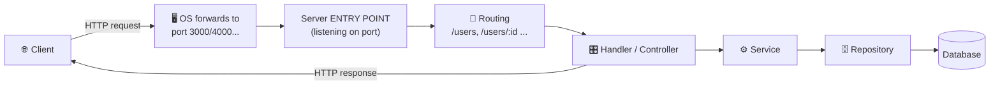

1. **Entry point:** the **OS forwards** the HTTP request to the **port** your server **listens** on (e.g. 3000).
2. **Routing:** the routing algorithm maps the request (static routes like `/users`, dynamic ones like `/users/123`) to a **handler**.
3. **Handler:** a predefined **function** that handles the request for that API.

### Why Handler + Service + Repository and not one big handler?

You **could** do everything in a single handler. There's **no hard requirement**. Separating responsibilities is a **design pattern** that makes the codebase:

| Benefit | Why |
|---|---|
| **Scalable** | Easy to grow as endpoints multiply |
| **Maintainable** | Each layer has one clear job |
| **Easy to extend** | New features slot into the right layer |
| **Easy to debug** | You know where to look for each kind of problem |

---

## 3. Handler / Controller Responsibilities (04:15)

In practically every backend (the presenter has used **Go, Node.js and Python**), each handler receives **two objects/variables**, **provided by the runtime/framework automatically**:

| Object | Used for |
|---|---|
| **Request object** | Reading values from the HTTP request (body, query, params, headers) |
| **Response object** | Sending the response, setting **status codes**, modifying **response headers** |

```js
// 📌 Extra: Express (Node.js) example
app.get("/books", (req, res) => {   // req and res are given by the framework
  res.status(200).json([...]);
});
```

```go
// 📌 Extra: Go net/http example
func getBooks(w http.ResponseWriter, r *http.Request) { // w = response, r = request
    w.WriteHeader(http.StatusOK)
}
```

The handler already knows **which API** is being called, because routing sent the request here. Next it needs the **data**. Processing may involve DB operations, external API calls, emails, notifications, and so on. Then it sends a response (or not). For example, REST convention for a **DELETE** is **204 No Content** with an empty body.

### The handler's job, step by step

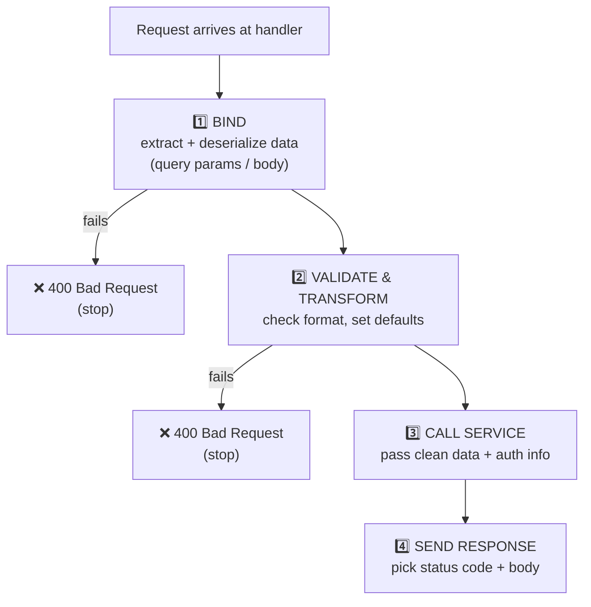

**Where the data comes from, by method:**

| Method | Extract |
|---|---|
| **GET** | **Query params** |
| **POST** | **Request body** |
| **PUT / PATCH** | **Request body** |
| **DELETE** | Request body (or path params) |

---

## 4. Step 1: Binding (Deserialization) (09:16)

The client **serializes** its data into **JSON** to send it over the internet (see [Serialization_Notes.md](Serialization_Notes.md)). The handler's first job is to **deserialize** that JSON into the language's **native format**:

| Language | JSON becomes... |
|---|---|
| **Go** | a native **struct** |
| **Python** | a **dictionary** or a **class** |
| **Rust** | a **struct** |
| **Node.js** | a JS object. Usually done **automatically** by middleware upstream, **before routing** (e.g. `express.json()` / body-parser), so handlers rarely do it themselves. |

> JavaScript has **first-class JSON support** (JSON was inspired by JS objects). Other languages need more manual processing.

- This step is often called **binding** ("binding the request body to a struct").
- **If deserialization fails → respond 400 Bad Request** ("something is wrong with this request payload") and **terminate the request**. Don't proceed.

```go
// 📌 Extra: binding in Go
var input CreateBookInput
if err := json.NewDecoder(r.Body).Decode(&input); err != nil {
    http.Error(w, "invalid request payload", http.StatusBadRequest) // 400, stop here
    return
}
```

---

## 5. Step 2: Validation and Transformation (11:51)

Covered in detail in [Validation_Notes.md](Validation_Notes.md). Quick recap in this context:

- **Validate everything** that comes from an external client: **path params, request body, query params**, and so on. Be **as specific as possible**.
- After binding, the data is in a native format (e.g. a Go struct) with the same values the client sent. Now check that **required values are present**, everything is in the **expected format**, nothing is **missing**, and there's **no malicious intent**.

### Transformation example: setting defaults

**API:** `GET /books?sort=name` or `GET /books?sort=date` (sort by book name or by creation date).

> 💡 **Good API design tip:** try to make **all query parameters optional**. (Covered properly in the next video on API design.)

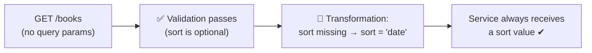

- The client sends `/books` with **no** `sort`. Validation passes (it's optional), so no 400.
- In **transformation**, if `sort` is missing, **set a default** (`sort = "date"`, or `"name"`, depending on requirements).

**Why bother?** Without the default, the **service** has to check "was sort passed? if not do X, else do Y", adding **conditional branches** downstream. Setting defaults early keeps the code **readable** and makes processing follow **one expected path**.

```
 Without default:  service → if (sort == undefined) {...} else if (sort == "name") {...} else {...}
 With default:     service → orderBy(sort)          ← always defined, one clean path
```

After steps 1–2, you have **solid, clean data ready for the downstream layers**.

---

## 6. Step 3: The Service Layer (18:21)

The controller **calls the service** with:
- The **validated and transformed data**.
- Any extra info the service needs, e.g. **authentication info** (user ID, user permissions).

### The golden rule of services

> 🔑 **The service layer should not deal with anything HTTP-related.** Think of it as **just a function**. If you look at a service method, you **shouldn't be able to tell it's used by an API.**

| Service should NOT worry about | Service SHOULD |
|---|---|
| Which response/status code to return | Take data → **process** it → **return** data |
| Request formats, validation | Run the **business logic** |
| HTTP headers, request/response objects | **Orchestrate** repositories and other operations |

This draws a clear **responsibility line** between the handler and the service.

### What a service does

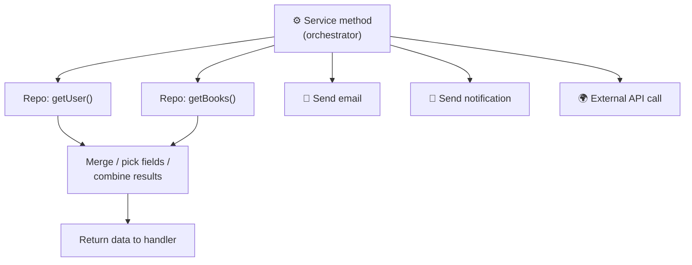

- **Not every service touches the DB.** E.g. a "send email" service receives an email address, sends the email, and returns `{ success: true }` without calling any repository.
- If data must be **persisted or fetched**, it calls the **repository layer**.
- A service can call **multiple repository methods**, **merge** their data, pick the needed fields, make external API calls, send notifications, and so on. **All the actual processing of the API happens here.**

---

## 7. Step 4: The Repository Layer (21:07)

Also called the **database layer**.

**Sole responsibility:** take the data (to insert, or the filters/sorting needed to fetch) → **construct the database query** → **execute it** → **return the result**.

- E.g. `sort` travels **handler → service → repository**, and the repository turns it into `ORDER BY name` or `ORDER BY created_at`.

### Single responsibility per method

> 🔑 **One repository method should return only ONE kind of data.**

```
 ❌ BAD:  getBooks(id?)  → returns ALL books if id is missing, ONE book if id is given
 ✅ GOOD: getAllBooks()      → returns all books
          getBookById(id)   → returns a single book
```

Don't use optional parameters to switch between returning a single item and a list. Keep separate methods.

```ts
// 📌 Extra: a clean repository
class BookRepository {
  getAllBooks(sort: "name" | "date") { /* SELECT * FROM books ORDER BY ... */ }
  getBookById(id: string)            { /* SELECT * FROM books WHERE id = $1 */ }
  insertBook(data: NewBook)          { /* INSERT INTO books ... */ }
}
```

### Separation summary

| Layer | Deals with |
|---|---|
| **Handler** | Data **formats**: **input** (binding, validation, transformation) and **output** (status codes, response body) |
| **Service** | **Actual processing**: business logic, orchestration, emails, external APIs |
| **Repository** | **Database calls only** (fetch / insert / update / delete) |

---

## 8. Step 5: Sending the Response (24:50)

The service fetched the books via the repository and returned them to the handler. Now **back in the controller**:

**Recap of what the handler did:**
1. **Bound** the request data.
2. **Validated and transformed** it.
3. **Called the service**, which did the real processing.
4. Got the data back, so now **send the response**.

> The **controller controls the data flow**: client → server and server → client. That's where the name comes from.

Based on **success or failure** of the service, the controller picks the status code:

| Outcome | Status codes |
|---|---|
| ✅ Success | **200** OK, **201** Created, **204** No Content (any 2xx as appropriate) |
| ❌ Client failure | **400**-series |
| 💥 Server failure | **500**-series |

It also sends an appropriate **error message** on failure, or a **success message/data** on success. In the example: **200** with an **array of books**.

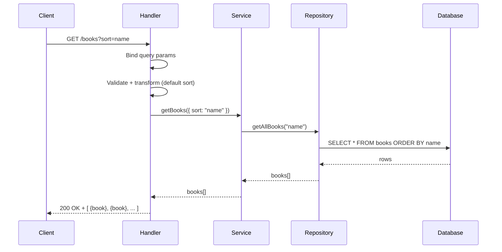

---

## 9. Middleware (26:52)

### Where middleware sits
From the moment the request hits the entry point until the response leaves, there can be **function boundaries** at many points: before routing, after routing, around the handler, before the response goes out.

```
 Request ─►│ MW │─►│ MW │─►│ Routing │─►│ MW │─►│ MW │─►│ Handler→Service→Repo │─►│ MW │─► Response
           └────┘  └────┘               └────┘  └────┘                         └────┘
            ▲ "middle" functions running BETWEEN the main stages of the lifecycle
```

> **Middleware:** functions executed **in the middle**, between routing, handlers/services/repositories, and sending the response. They run at the **boundaries** of different execution contexts.

### What a middleware receives

Like handlers, middlewares are given objects by the runtime/framework, **plus one more**:

| Handler gets | Middleware gets |
|---|---|
| `request` | `request` |
| `response` | `response` |
| | **`next`** (a function) |

### The `next` function
- `next()` **passes execution to the next processing context**: the next middleware, or routing, or the handler.
- It's not always "the next middleware": it might hand off to the **router** or a **handler**. It just moves on to **whatever comes next**.
- **All middlewares are optional.** Use them as your requirements need. Routing can go straight to the handler.

### What a middleware can do

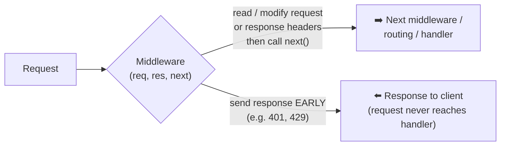

| Capability | Example |
|---|---|
| **Read values** from the request | Read the `Origin` header or auth token |
| **Modify** the request or response | Add response headers, attach user info |
| **Send a response immediately** | Reject with 401/429 so the request **never reaches the routing or handler**, which saves server resources |
| **Pass control on** | Call `next()` |

```js
// 📌 Extra: an Express middleware
function myMiddleware(req, res, next) {
  if (!req.headers.authorization) {
    return res.status(401).json({ message: "Unauthorized" }); // respond early, stop
  }
  next(); // pass execution to the next context
}
```

### Why use middleware? Same reason we use functions

Functions exist so you **don't repeat the same lines** everywhere. Middleware applies that idea to the **request lifecycle**:

- A popular backend gets **thousands to billions** of requests per day and has **hundreds or thousands** of endpoints, each with its own handler.
- **Every** request needs common operations: **security, logging, authentication, parsing, compression**.
- **Without middleware**, you'd duplicate that code in every handler.
- **"Just call a helper function in each handler"** is still duplication: you must remember to call it in every handler.
- **Middleware delegates** common operations to a **separate component of the lifecycle**, placed **before** the request reaches the handler. It can even **reject requests early**, so you don't waste server resources.

> 🔑 **Middleware rule of thumb:** some code needs to run for (almost) **every request**, **and** it needs the **request/response objects**. That's a middleware.

---

## 10. Common Middleware Examples (37:00)

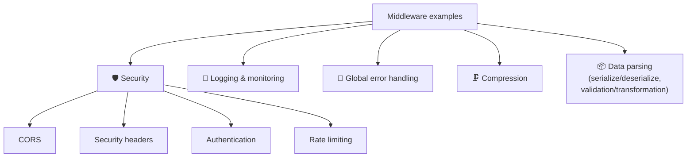

### 10.1 CORS middleware
(Full CORS flow: [HTTP_Notes.md](HTTP_Notes.md).) The browser blocks web apps from accessing resources outside their **own origin**, unless the server sends headers that allow it.

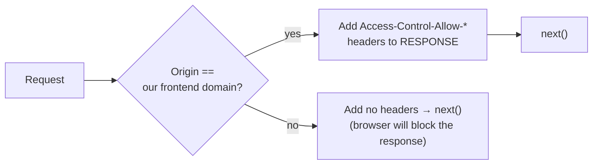

**Why it's a middleware:** ✔ runs for **every API call**, ✔ needs the **request** (reads `Origin`) **and** the **response** (sets headers).

### 10.2 Security headers middleware
Adds headers like **Content-Security-Policy** to **every** response, then calls `next()`.

### 10.3 Authentication middleware
(Details: [Auth_Notes.md](Auth_Notes.md).)

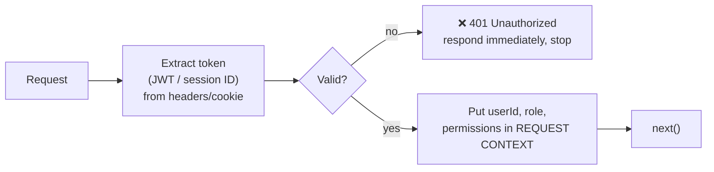

- **Failure** → send **401 Unauthorized** right away, without reaching the handler, and terminate.
- **Success** → extract the **user ID, role** (admin or not) and **permissions**, add them to the **request context**, and call `next()`.

### 10.4 Rate-limiting middleware
Stops one client from making **too many requests in a short time**.
- Usually tracked **per IP address**, e.g. "has this IP made more than 30 calls in the last 2 seconds?"
- **You** choose the thresholds: the time window, and the max calls (30, 500, ...).
- Limit exceeded → **429 Too Many Requests**. Otherwise → `next()`.

### 10.5 Logging and monitoring middleware
For **every** request, log details (method, path, query params, body, ...) to the terminal or a log file. Helps with **debugging**, **auditing** and **reports**.

```
 [2025-01-11 10:32:01] GET /users?page=2  200  34ms
```

### 10.6 Global error-handling middleware ⭐
> The presenter says **every backend application should have global error handling**.

- An error can happen **anywhere**: handler, service, repository, or any middleware.
- The global error handler **catches** that generic, unstructured error and:
  1. Works out whether it's a **client error** or a **server error** (you can define fields on your error types to mark this).
  2. Sends the right status (**4xx** or **5xx**).
  3. Sends a **properly structured error response**, usually a **message** plus a **code/ID**, so the **frontend can show user-friendly messages** based on the code.

```json
{ "status": 404, "code": "BOOK_NOT_FOUND", "message": "The requested book does not exist" }
```

- ⚠️ It must be the **LAST middleware**. If it ran in the middle, errors thrown **later** (e.g. in the handler) would never reach it, because **the request flows one way**.

> 📌 **Extra:** in Express, an error-handling middleware is recognized by having **four** parameters, `(err, req, res, next)`, and it must be registered **after** all routes.

### 10.7 Compression middleware
Compresses large responses (e.g. JSON with thousands of fields) using algorithms like **gzip**. Browsers **decompress automatically**. It's compressed **in transit** and turned back into a usable format (e.g. a JS object) on the client.

### 10.8 Data parsing middleware
**Serialization/deserialization (binding)** and even **validation/transformation** can be delegated to middleware so you don't repeat them in every handler. Whether you do this depends on your codebase's standards.

---

## 11. Middleware Order (49:54)

> 🔑 **The order of middleware is important.** Each middleware passes control to the next with `next()`, in **one direction**, until a response is sent.

### Typical order

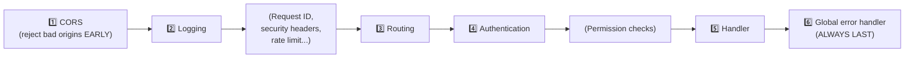

| Position | Middleware | Why there |
|---|---|---|
| **First** | **CORS** | If the origin isn't allowed, find out **early** and stop the request before doing more work |
| Early | **Logging** | Record every incoming request |
| Middle | **Authentication** (+ permission checks) | Identify the user before any handler logic |
| **Last** | **Global error handler** | Must come **after** everything so it can catch errors from **any** earlier step |

> 💡 Spend time thinking about **in what order** the request should be processed to give the client a good experience.

---

## 12. Request Context (51:00)

### What is it?
> **Request context:** **storage / state scoped to a single request**, accessible across all **middleware and handler boundaries**.

- Usually **key-value pairs**.
- Every framework/language/library has some implementation (Node.js, Go, Python, ...). The details vary, but the **concept is the same**.
- Each of the thousands of requests your server handles gets **its own** context.

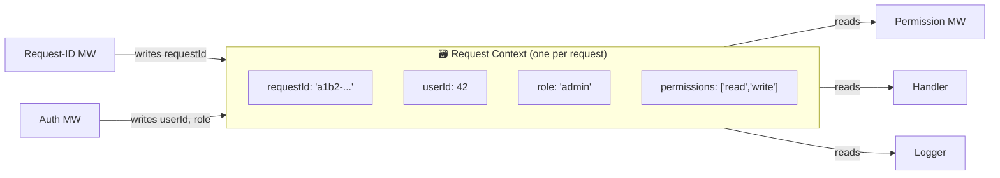

### Why have it?
- Many function boundaries exist between entry and response (CORS → logging → routing → auth → permission checks → handler → error handler).
- One middleware **sets** a value, and later ones **read** it, **without passing values directly** between functions.
- This avoids **tight coupling**: a shared, modifiable, per-request state that all of them can access.

### Use case 1: user info from authentication ⭐

1. The **auth middleware** verifies credentials/token and gets the **user ID**, **role** (user, admin, sales, ...) and **permissions** (read/write per resource).
2. It **stores them in the context**.
3. Later, the handler for **`POST /books`** needs to insert a book with a `user_id` column.
4. It takes `userId` **from the context** (the result of authentication), **NOT from the request payload**.

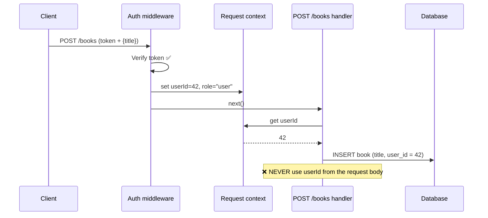

> ⚠️ **Security:** if you take the user ID **from the client**, a malicious client could send **another user's ID** and do unexpected operations. Always take identity from the **authentication result in the context**. Use it for **permission and RBAC checks** too (e.g. "can this user insert a book?").

### Use case 2: request ID / tracing

- An early middleware generates a **unique ID (UUID)** for each request and saves it in the context.
- Throughout the lifecycle, that ID is:
  - Included in every **log line** for this request.
  - Sent to other **microservices** in a header (e.g. **`X-Request-ID`**).
- When **auditing or debugging logs**, you can **trace the request**: where it started, which services it called, and so on.

```
 [req a1b2-c3d4] GET /orders            → order-service
 [req a1b2-c3d4] calling payment-svc     X-Request-ID: a1b2-c3d4
 [req a1b2-c3d4] payment-svc: charged    ← same ID across services = easy tracing 🔍
```

### Use case 3: cancellation signals, abort signals, deadlines

Request context can carry **cancellation/abort signals** and **deadlines** to downstream/external services, so your service **doesn't hang forever** waiting on a slow dependency.

> 📌 **Extra:** Go's `context.Context` is the classic example. It carries values, deadlines (`context.WithTimeout`) and cancellation. If the client disconnects or the deadline passes, every downstream DB query or HTTP call using that context stops too.

---

## 13. The Full Picture

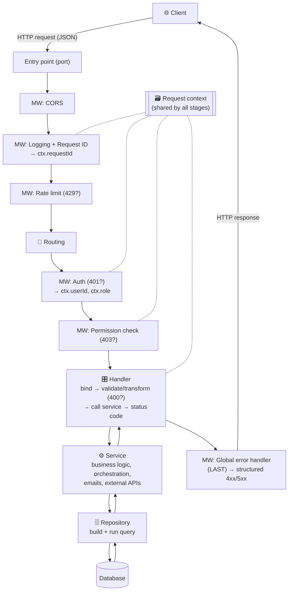

---

## 🧾 Quick Revision Cheat Sheet

```
OS → port → [MW: CORS] → [MW: log] → ROUTING → [MW: auth] → HANDLER → SERVICE → REPOSITORY → DB
                                                                  ↓
                                          response ← [MW: global error handler (LAST)]
```

| Concept | Key points |
|---|---|
| Why layers | Not required. A design pattern for scalability, maintainability, easy features and debugging. |
| Handler gets | `request` + `response` (from the runtime) |
| Handler jobs | 1. **Bind** (deserialize JSON → struct/dict) · 2. **Validate + transform** · 3. **Call service** · 4. **Send response + status code** |
| Binding/validation fails | **400 Bad Request**, stop |
| Node.js binding | Done by middleware (`express.json()` / body-parser) before routing |
| Transformation | E.g. **default** `sort=date`. Make **query params optional**. |
| Service | **No HTTP concerns**. Pure business logic. Orchestrates repos, emails, notifications, external APIs. |
| Repository | **DB only**: build query → run → return. **One method = one kind of data.** |
| Response codes | 2xx success · 4xx client failure · 5xx server failure. Chosen by the **controller**. |
| Middleware gets | `request` + `response` + **`next`** |
| `next()` | Passes execution to the next context (middleware, router, or handler) |
| Middleware can | Read/modify the request, modify the response, **respond early**, or call `next()` |
| Why middleware | Avoid duplicating common per-request logic across many handlers |
| Examples | CORS · security headers · auth (401) · rate limit (429) · logging · **global error handler** · compression · parsing |
| Order | **CORS first**, logging, auth..., **error handler LAST** (requests flow one way) |
| Request context | Per-request key-value store shared by all middlewares/handlers. Avoids tight coupling. |
| Context uses | userId/role from auth (**never from the client**) · request ID (UUID, `X-Request-ID`) for tracing · cancellation / deadlines |

---

## ❓ Self-Test Questions

<details>
<summary>1. Is splitting code into handler, service and repository required? Why do it?</summary>

No, it's a **design pattern**. It makes the code **scalable, maintainable, easy to extend, and easy to debug**.
</details>

<details>
<summary>2. What two objects does every handler receive, and who provides them?</summary>

The **request** object and the **response** object, provided automatically by the **runtime/framework**.
</details>

<details>
<summary>3. List the handler's four responsibilities in order.</summary>

1. **Bind** (extract and deserialize data). 2. **Validate and transform**. 3. **Call the service**. 4. **Send the response** with the right status code.
</details>

<details>
<summary>4. What is "binding", and what happens if it fails?</summary>

Deserializing the incoming JSON into the language's native format (struct, dict, class). If it fails, respond **400 Bad Request** and stop.
</details>

<details>
<summary>5. Why don't Node.js handlers usually deserialize JSON themselves?</summary>

A middleware like `express.json()` / body-parser does it **upstream, before routing**.
</details>

<details>
<summary>6. GET /books arrives with no sort param. Where and how should you handle it?</summary>

Validation passes (query params should be optional). In **transformation**, set a **default** (e.g. `sort = "date"`) so the service always gets a value and doesn't need extra branches.
</details>

<details>
<summary>7. What's the "golden rule" for service methods?</summary>

No HTTP concerns. Looking at a service function, you **shouldn't be able to tell it's used by an API**. It just takes data, processes it, and returns data.
</details>

<details>
<summary>8. Does every service call a repository? Give an example.</summary>

No. A **send-email** service takes an email address, sends the email, and returns `{ success: true }` without touching the DB.
</details>

<details>
<summary>9. What's wrong with getBooks(id?) returning all books or one book depending on the argument?</summary>

It breaks **single responsibility**. One repository method should return **one kind of data**, so use `getAllBooks()` and `getBookById(id)`.
</details>

<details>
<summary>10. Which layer decides the HTTP status code, and why "controller"?</summary>

The **controller/handler**. It **controls the data flow** in both directions (client → server and server → client).
</details>

<details>
<summary>11. What extra parameter does middleware get compared to a handler, and what does it do?</summary>

**`next`**: a function that passes execution to the next processing context (another middleware, the router, or the handler).
</details>

<details>
<summary>12. Name three things a middleware can do with a request.</summary>

**Read** values from it, **modify** the request or response (e.g. headers), and **send a response early** (e.g. 401 or 429), stopping the request before it reaches the handler. Or it calls `next()`.
</details>

<details>
<summary>13. Why is CORS a perfect fit for middleware?</summary>

It must run for **every request**, and it needs both the **request** (to read `Origin`) and the **response** (to set `Access-Control-Allow-*` headers).
</details>

<details>
<summary>14. What does the auth middleware do on success vs failure?</summary>

**Failure:** respond **401** immediately and stop. **Success:** put **userId, role, permissions** in the **request context**, then call `next()`.
</details>

<details>
<summary>15. Which status code does rate-limiting middleware return, and how does it usually identify clients?</summary>

**429 Too Many Requests**. It usually tracks clients by **IP address** against a threshold (e.g. 30 calls in 2 seconds).
</details>

<details>
<summary>16. Why must the global error handler be the LAST middleware?</summary>

Requests flow **one way**. If it ran in the middle, errors thrown later (in handlers or services) would never reach it.
</details>

<details>
<summary>17. Why should CORS run first?</summary>

So requests from disallowed origins are spotted and terminated **early**, without wasting server resources.
</details>

<details>
<summary>18. What is request context, and why not just pass values between functions?</summary>

**Key-value storage scoped to a single request**, readable and writable by all middlewares and handlers. It avoids **tight coupling** between the stages.
</details>

<details>
<summary>19. When creating a book, why take userId from the context instead of the request body?</summary>

A malicious client could send **another user's ID** in the body. The context holds the identity from **verified authentication**, so it can be trusted.
</details>

<details>
<summary>20. Give two more uses of request context besides user info.</summary>

A **request ID (UUID)** for logging and tracing across microservices (e.g. the `X-Request-ID` header), and carrying **cancellation/abort signals and deadlines** so downstream calls don't hang forever.
</details>

---

*Notes compiled from the video transcript. Timestamps (mm:ss) let you jump back to each section. Transcription fixes: "middle ver/middle a" → middleware, "uu ID" → UUID, "Json do body parer" → JSON body-parser, "RB" → RBAC.*
