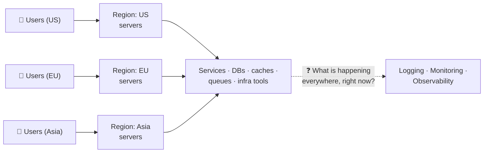
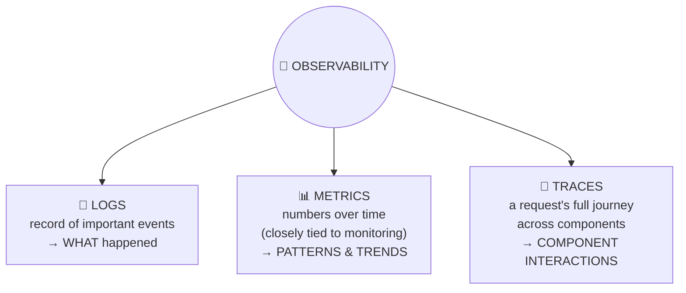
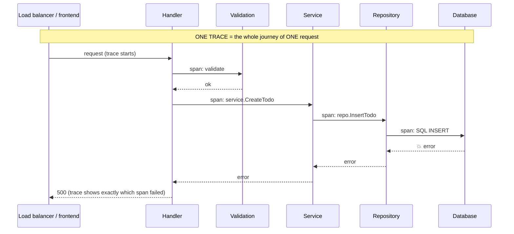
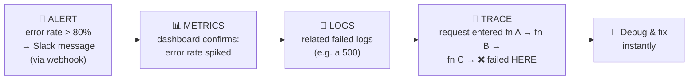
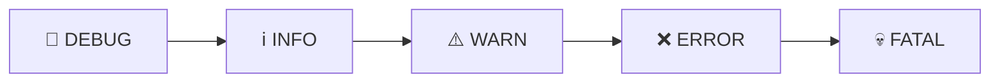
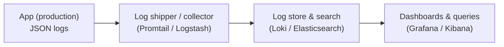
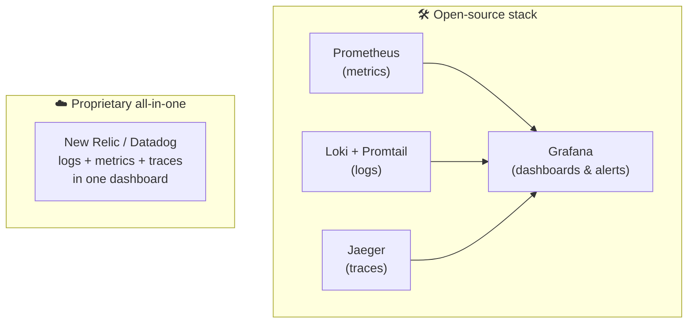
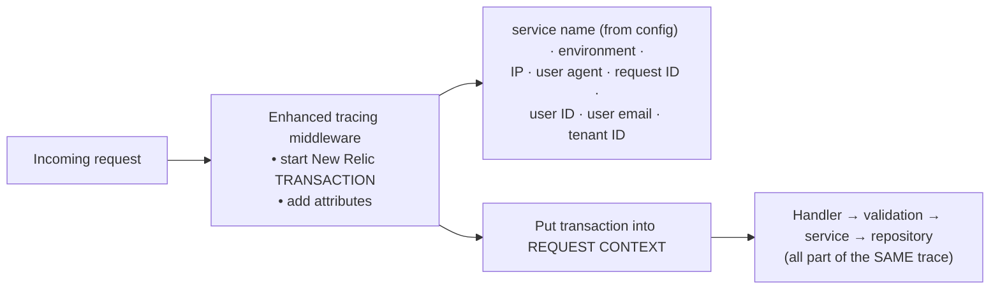
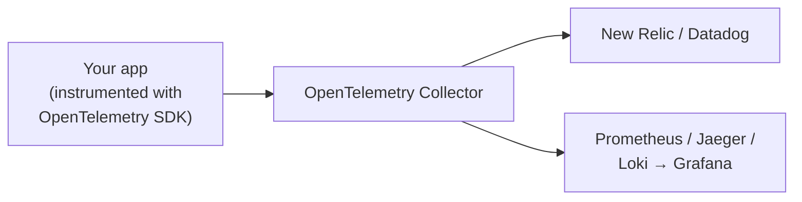
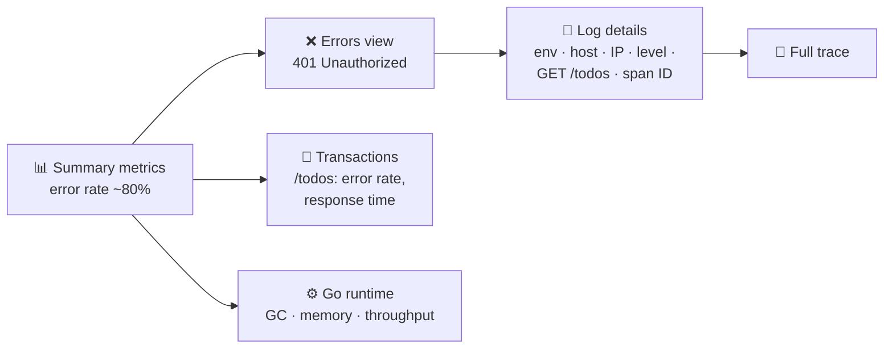

# Logging, Monitoring and Observability: Complete Revision Notes

> **Source:** [YouTube: Logging, Monitoring & Observability (Backend from First Principles series, part 18)](https://www.youtube.com/watch?v=5PEuwgLOQQM&list=PLui3EUkuMTPgZcV0QhQrOcwMPcBCcd_Q1&index=18)
> **Length:** ~40 min (includes a ~3.5 min sponsor segment, 14:41–18:08, skipped here)
> **Related notes:** [Error_Handling_Notes.md](Error_Handling_Notes.md) (monitoring, safe logging) · [Config_Management_Notes.md](Config_Management_Notes.md) (log level per environment) · [Handlers_Middleware_Context_Notes.md](Handlers_Middleware_Context_Notes.md) (middleware, request context, request IDs) · [Background_Jobs_Notes.md](Background_Jobs_Notes.md) · [Full_Text_Search_Notes.md](Full_Text_Search_Notes.md) (ELK stack)
> **Goal of the video:** What logging, monitoring and observability are, why distributed systems need them, the **three pillars (logs, metrics, traces)**, how they connect in a real debugging workflow, **log levels**, **structured vs unstructured logs**, **instrumentation and OpenTelemetry**, and a **Go to-do app instrumented with New Relic**.

> 💡 Diagrams use **Mermaid**. They render in GitHub, VS Code (with a Mermaid preview extension), Obsidian, Notion, and the Claude app. Anything marked **📌 Extra** was added to clarify a point and is not in the video.
>
> ℹ️ This is one of the few videos in the series that **shows code**, because these practices are closely tied to implementation. Don't memorize the code. Understand the **practices**.

---

## 📑 Table of Contents

1. [TL;DR: The Whole Video in 10 Lines](#-tldr-the-whole-video-in-10-lines)
2. [It's a Spectrum, Not a Checklist](#1-its-a-spectrum-not-a-checklist-0000)
3. [Why Distributed Systems Need This](#2-why-distributed-systems-need-this-0112)
4. [Logging](#3-logging-0240)
5. [Monitoring](#4-monitoring-0402)
6. [Observability and the Three Pillars](#5-observability-and-the-three-pillars-0519)
7. [Monitoring vs Observability](#6-monitoring-vs-observability-0732)
8. [How They Work Together: The Debugging Workflow](#7-the-debugging-workflow-1027)
9. [Log Levels](#8-log-levels-1808)
10. [Structured vs Unstructured Logs](#9-structured-vs-unstructured-logs-2106)
11. [Tools: Open Source vs Proprietary](#10-tools-open-source-vs-proprietary-2401)
12. [Code Walkthrough: Go To-Do App + New Relic](#11-code-walkthrough-go-to-do-app--new-relic-2545)
13. [Instrumentation and OpenTelemetry](#12-instrumentation-and-opentelemetry-2815)
14. [The New Relic Dashboard](#13-the-new-relic-dashboard-3400)
15. [Final Thoughts](#14-final-thoughts-3757)
16. [Cheat Sheet / Quick Revision](#-quick-revision-cheat-sheet)
17. [Self-Test Questions](#-self-test-questions)

---

## ⚡ TL;DR: The Whole Video in 10 Lines

1. Logging, monitoring and observability are **practices implemented on a spectrum**. No company is "fully observable", so don't feel intimidated by the tools and buzzwords.
2. Modern backends run **distributed** across servers and regions with users worldwide, so you need ways to **keep track of what's happening**.
3. **Logging:** **recording important events** (business, suspicious, security, errors) with **metadata** (user ID, latency, function...). A **journal/diary** of your backend.
4. **Monitoring:** **near-real-time data** (~10–15 s delay) about system **health and performance** (CPU, memory, requests/sec, DB connections) and **trends over time**.
5. **Observability:** you can work out the system's **internal state from its external outputs**. **Three pillars:** **logs** (*what happened*), **metrics** (*patterns/trends*), **traces** (*how components interacted*, a request's full journey).
6. **Monitoring tells you *that* something is wrong. Observability tells you *what* and *where*.**
7. **Workflow:** **alert** (error rate > 80% → Slack) → **metrics** → related **logs** → **trace** → the exact failing function.
8. **Log levels:** **debug** (dev only), **info** (successful ops / business events), **warn** (not success, not our fault, e.g. a wrong password), **error**, **fatal** (app shuts down). Production level = **info**.
9. **Console (human-readable, colored) logs in development**, **structured JSON logs in production**, so tools (**ELK**, **Grafana + Loki + Promtail**) can parse them.
10. **Instrumentation** = measuring attributes of your code. **OpenTelemetry** = the open standard and SDKs for it. Tools: open source (**Prometheus, Grafana, Loki, Jaeger**) or proprietary all-in-one (**New Relic, Datadog**). It's a **collective effort**: devs instrument the code, DevOps sets up collection.

---

## 1. It's a Spectrum, Not a Checklist (00:00)

- Each of **logging**, **monitoring** and **observability** could fill its own video.
- **Nothing is predetermined and there are no fixed rules.** These are **practices** companies, startups and individuals implement **on a spectrum**.
- **No one can claim** "we follow all good logging, monitoring and observability practices." There's no such thing.

> 💡 Knowing this up front means you **won't feel intimidated** by the many keywords, practices, products and tools you'll see in the industry.

---

## 2. Why Distributed Systems Need This (01:12)



- Modern backend and full-stack apps run in a **distributed environment**: **many servers**, **many regions**, **users worldwide**.
- We need **practices, tools and methodologies** to **keep track of what's happening** across all services, infrastructure and tools.
- (These practices also apply to **frontend** apps. The video focuses on **backend**.)

---

## 3. Logging (02:40)

> **Logging** = **recording** all the **important events** in your application, together with **metadata**.

**What to record:**
- **Important** events (a user logged in, a to-do created, a DB query executed)
- **Suspicious** events
- **Security-related** events
- **Errors** (with full debugging context)

**Metadata examples:** **user ID** that triggered the request, **latency** of the request, **which method/function** ran, **timestamp**, the DB query...

> 📓 **Analogy:** logs are the **journal / diary** your backend keeps, so when the time comes you know **what happened, when, and why**.

```
 [2025-01-11T10:32:01Z] INFO  user logged in        userId=42 requestId=a1b2 latencyMs=37
 [2025-01-11T10:32:05Z] ERROR db query failed       userId=42 requestId=a1b3 query="INSERT INTO todos..."
```

---

## 4. Monitoring (04:02)

> **Monitoring** = **keeping track** of the **state** of your applications and their components: **continuously checking health and performance**, and tracking **patterns over time**.

**What gets monitored:**

| Component | Example metrics |
|---|---|
| Server | **CPU**, **memory** |
| Traffic | **Requests processed per second** |
| Database | **Open DB connections** (because of **connection pooling**) |

### "Real-time" isn't exactly real-time
- Usually there's a **~10–15 second delay**.
- Some tools give near-millisecond freshness, but traditional setups **batch** data so the monitoring system isn't overwhelmed with updates every millisecond.

Monitoring gives **aggregated data**: "this was the performance and behavior of your app over time, including now".

---

## 5. Observability and the Three Pillars (05:19)

> **Observability:** a system is **observable** if you can **determine its internal state** by looking at its **external outputs**.

> A backend can only be called **observable** if **all three pillars** are in place:



| Pillar | What it is | Tells you |
|---|---|---|
| **Logs** | Records of important events across the request lifecycle, app **startup and shutdown** | **What** happened |
| **Metrics** | **Concrete numbers** (current and historical), closely related to monitoring | **Patterns and trends** |
| **Traces** | Think of them as **transactions**: where a request **originated** (frontend, load balancer, or your backend) and **every component it touched** | **How components interacted**, and **where** it broke |

### A trace across layers



> 📌 **Extra:** a trace is made of **spans**. Each span is one unit of work (a function, a DB call, an HTTP call) with a start time, duration and attributes. The New Relic log in the demo shows a **span ID**.

---

## 6. Monitoring vs Observability (07:32)

| | **Traditional monitoring** (≈ a decade ago) | **Observability** (modern, last few years) |
|---|---|---|
| Role | The main way infra-level problems were caught | Monitoring **plus** logs, metrics and traces linked together |
| Tells you | **That** there's a problem (alerts, e.g. via **Grafana**) | **That** there's a problem **and exactly what's wrong** |
| Then what? | "That's pretty much it": you know something's wrong, but not why | You can drill down to the **root cause** |

> 🔑 **Monitoring answers "is something wrong?" Observability answers "what is wrong, and where?"**, provided you've implemented logs, metrics **and** traces.

---

## 7. The Debugging Workflow (10:27)

### What each practice gives you

| Practice | Produces | Answers |
|---|---|---|
| **Logging** | Logs | **What** happened |
| **Monitoring** | **Metrics** | **Patterns and trends** |
| **Observability** | **Traces** | **Component interactions** |

### What metrics are
**Real-time and historical numbers** about your system, **predefined** when you configure your setup (both **in your code** and **in your tool**):
- Requests **processed**
- Requests **failed** (the video's definition: status code **> 200**. 📌 Extra: in practice "errors" usually means **4xx/5xx**, and often only **5xx** counts toward the server error rate)
- **Business metrics**: e.g. for a to-do app, **to-dos created** and **to-do creations failed**
- Over the **last 30 min / 1 hour**, or historically

### A real production workflow



1. **Alert:** e.g. **error rate > 80%** → a **Slack** message via a **webhook**: "something is wrong with your API service".
2. **Metrics:** open the dashboard (**Grafana** or **New Relic**). The error rate really is > 80%.
3. **Logs:** from the metric, jump to the **related logs** (all the failed ones).
4. **Traces:** click a log (e.g. a 500) to see its **trace**: the request started in **function A**, went to **B**, then **C**, and **failed at that exact point**.
5. **Fix it.** You found exactly where it went wrong, instantly.

> This connected workflow is the **whole benefit** of implementing logging, monitoring and observability.

> *(14:41–18:08 is a sponsor segment for a platform-as-a-service. It's not part of the topic and is skipped here.)*

---

## 8. Log Levels (18:08)

Most logging libraries let you assign a **level** to each log:



| Level | When to use | Example | Enabled in |
|---|---|---|---|
| **DEBUG** | Troubleshooting in development. **As much detail as possible.** Can be **overwhelming**. | "Todo created successfully with ID 123" (extra detail) | **Development only** (disabled in production) |
| **INFO** | **General operations**, **business events**, **successful operations** | "Todo created" | Dev + production |
| **WARN** | **Between info and error**: not a success, but **not critical** and **not our fault** | User typed a **wrong password** (auth failed) | Dev + production |
| **ERROR** | **Any error**: validation errors, failed DB queries... The **most common reason to log at all.** | "DB query failed" | Dev + production |
| **FATAL** | **Very serious**: the app **stops** (and usually **restarts**, depending on infra config) | Can't connect to the DB at startup | Dev + production |

> 🔑 **Production log level = `info`** (so `debug` logs are filtered out). **Development = `debug`.** (See [Config_Management_Notes.md](Config_Management_Notes.md).)

---

## 9. Structured vs Unstructured Logs (21:06)

| | **Unstructured / console logs** | **Structured (JSON) logs** |
|---|---|---|
| Format | **Human-readable plain text**, **colors**, attractive | **JSON** with fields: status, message, level, userId, requestId... |
| Where | **Development** (terminal, VS Code console) | **Production** |
| Why | Easier to **read**, **spot issues**, and fix them while developing | **Log management tools** (**ELK stack**, or **Loki + Promtail + Grafana**) can **parse them easily** and **extract fields** (user ID, request ID...). Parsing plain text is **error-prone and inefficient**. |
| Downside | Hard for machines to parse | **Hard for humans to read** in dev, and easy to miss errors |

```
 DEVELOPMENT (console / unstructured, colored):
 10:32:01 INF Connecting to database...
 10:32:01 INF Started background job server
 10:32:01 INF Starting server port=8080

 PRODUCTION (structured JSON):
 {"level":"info","time":"2025-01-11T10:32:01Z","message":"Connecting to database"}
 {"level":"info","time":"2025-01-11T10:32:01Z","message":"Started background job server"}
 {"level":"info","time":"2025-01-11T10:32:01Z","port":8080,"message":"Starting server"}
```



---

## 10. Tools: Open Source vs Proprietary (24:01)

| Route | Tools | Best when |
|---|---|---|
| **Open source** ("the Grafana stack", common in **enterprises**) | **Prometheus** (builds and stores **metrics**: the backend), **Grafana** (**dashboards**: the frontend), **Loki** + **Promtail** (logs), **Jaeger** (**traces**). Also the **ELK** stack. | You have the **team and resources** to run and maintain them |
| **Proprietary / all-in-one** | **New Relic**, **Datadog** | You want a **simple integration** and **don't have the team size or time** to maintain many open-source tools |



> The demo uses **New Relic**, because configuring the whole open-source stack is **complicated** without experience or time.

---

## 11. Code Walkthrough: Go To-Do App + New Relic (25:45)

A **to-do application** with a **Go backend** that follows logging, monitoring and observability practices, integrated with **New Relic**.

> ⚠️ "**Don't try to memorize the code. Don't get overwhelmed.** The code is just there to show how the practices work."
>
> 📌 The snippets below are **simplified illustrations** of what the video describes, not the exact source.

### 11.1 Logger setup (before the app starts)

**Log level by environment:**

```go
// Illustrative: choose the log level from the environment
func getLogLevel(env string) zerolog.Level {
    if env == "production" {
        return zerolog.InfoLevel   // production: info and above
    }
    return zerolog.DebugLevel      // development: everything, including debug
}
```

**Log format: console (dev) vs JSON (prod):**

```go
// Illustrative: format from config
if cfg.LogFormat == "json" {
    logger = zerolog.New(os.Stdout)                                  // structured JSON (production)
} else {
    logger = zerolog.New(zerolog.ConsoleWriter{Out: os.Stdout})      // colored, human-readable (dev)
}
```

**Demo:** switching the format to **JSON** and restarting showed JSON logs ("great for production, not very readable"). Switching back to **console** showed readable lines: **"Connecting to database"**, **"Started background job server"**, **"Starting server"**.

### 11.2 Monitoring: New Relic middleware on the router

```go
// Illustrative: wrap the whole app so every request is instrumented
router.Use(newRelicMiddleware(nrApp))
```

Every incoming request gets **instrumented** automatically, which feeds metrics like throughput, response time and error rate.

### 11.3 Tracing: the "enhanced tracing" middleware

The **first point of contact** in the request lifecycle. It **creates a transaction** (trace) and **stores it in the request context** (see [Handlers_Middleware_Context_Notes.md](Handlers_Middleware_Context_Notes.md)):



```go
// Illustrative
func EnhancedTracing(next http.Handler) http.Handler {
    return http.HandlerFunc(func(w http.ResponseWriter, r *http.Request) {
        txn := nrApp.StartTransaction(r.Method + " " + r.URL.Path)
        txn.AddAttribute("service.name", cfg.ServiceName)
        txn.AddAttribute("environment", cfg.Env)
        txn.AddAttribute("request.id", requestID(r))
        txn.AddAttribute("user.id", userID(r))
        // ... IP, user agent, tenant ID ...
        ctx := newrelic.NewContext(r.Context(), txn)      // store in request context
        next.ServeHTTP(w, r.WithContext(ctx))
    })
}
```

> One request gets **one trace** that starts in this middleware and continues through **validation → service → ...**. That's how you debug a request end to end.

### 11.4 The `CreateTodo` service: logs + trace attributes + error recording

```go
// Illustrative reconstruction of the flow described in the video
func (s *TodoService) CreateTodo(ctx context.Context, userID string, in CreateTodoInput) (*Todo, error) {
    txn := newrelic.FromContext(ctx)                    // 1. get the transaction from context
    defer txn.StartSegment("todo.create.service").End() // 2. end this segment when we return

    txn.AddAttribute("user.id", userID)                 // 3. attributes on the trace
    txn.AddAttribute("todo.title", in.Title)
    log := s.logger.With().Str("operation", "create_todo").Str("title", in.Title).Logger()

    if in.Priority != nil {                             // 4. optional field → attribute + log
        txn.AddAttribute("todo.priority", *in.Priority)
        log = log.With().Int("priority", *in.Priority).Logger()
    }
    log.Info().Msg("creating todo")                     // 5. INFO: starting the operation

    // ... validate parent/child relationship ...

    todo, err := s.repo.InsertTodo(ctx, userID, in)     // 6. DB operation
    if err != nil {
        log.Error().Err(err).Msg("failed to create todo")   // ERROR log
        txn.NoticeError(err)                                // record error on the trace
        txn.AddAttribute("operation", "create")
        return nil, err
    }

    txn.AddAttribute("operation", "create")             // 7. success attributes
    txn.AddAttribute("todo.id", todo.ID)
    log.Debug().Str("todo_id", todo.ID).Msg("todo created successfully") // DEBUG: hidden in prod

    log.Info().                                         // 8. BUSINESS EVENT log
        Str("event", "todo_created").
        Str("todo_id", todo.ID).Str("title", todo.Title).
        Str("category_id", todo.CategoryID).Int("priority", todo.Priority).
        Msg("business event")
    return todo, nil
}
```

| Step | Practice shown |
|---|---|
| Pull the transaction from context, `defer` end | **Tracing**: this function becomes a **segment/span** of the request's trace |
| Add `user.id`, `title`, `priority` attributes | **Rich trace context** for later debugging |
| `log.Info` "creating todo" | **Logging** a significant event |
| On DB error: `log.Error` + `NoticeError` | Error recorded in **logs and in the trace** |
| `log.Debug` "created successfully" | Dev-only detail (**not visible in production** logs) |
| Business event log: `todo_created` + id, title, category, priority | **Business metrics / analytics** |

---

## 12. Instrumentation and OpenTelemetry (28:15)

Two terms you'll hear a lot in observability:

| Term | Meaning |
|---|---|
| **Instrumentation** | The practice of **measuring different attributes of your functions/code** (adding traces, spans, attributes, metrics, logs). It's **what makes a system observable**. |
| **OpenTelemetry (OTel)** | An **open standard** (relatively recent) with a whole **ecosystem of tools, SDKs, best practices and resources** for instrumenting apps. **Language-agnostic**: SDKs for Node.js, Go, Python and other major languages. |

> Even with a proprietary tool like **New Relic**, you can integrate an **OpenTelemetry collector** for **more control** over how requests and components are instrumented.



> 📌 **Extra:** that's the big win of OTel. You **instrument once** with a vendor-neutral standard and can **switch or combine backends** without rewriting instrumentation.

---

## 13. The New Relic Dashboard (34:00)

**Setup for the demo:** log format → **JSON**, environment → **production**, so logs flow to New Relic.

**Triggering errors:** call **`GET /todos`** a few times through the **OpenAPI (Swagger) UI** **without a token** → **401 Unauthorized** each time.

| Dashboard area | What it showed |
|---|---|
| **Summary (metrics)** | **Average transaction time**, **throughput**, **error rate** (~80%): concrete numbers that **quantify** system state |
| **Errors → HTTP error type** | The **Unauthorized** errors, with their **related logs** |
| **A single log** | App name, **environment**, error code (**unauthorized**), **host name**, **IP**, **level**, **message**, **method** (`GET`), **route** (`/todos`), **span ID**, **timestamp** |
| **Trace (from the log)** | Click through to the **full trace** of that request |
| **Transactions** | The transaction paths from the code (e.g. **`/todos`**) with **per-transaction error rate and response times** |
| **Go runtime** | Info about the machine/runtime: **garbage collection time**, **memory usage** (just ~3 MB), **throughput**, **average response time** |



---

## 14. Final Thoughts (37:57)

- These are **practices implemented on a spectrum**. You can't say a system is **completely** observable or logs and monitors **100%** of parameters.
- **Open source:** **Grafana, Loki, Prometheus, Jaeger**. **Proprietary (simpler):** **New Relic, Datadog**. Either way you get insight into **services, the application, infrastructure, and component interactions**, but only if you **implement it in code** first.
- 🤝 **A collective effort:**
  - **Developers** instrument at the **code level** (logs, attributes, traces, metrics).
  - **DevOps/infra** set up **collection and monitoring** of the metrics, logs and traces.
- It's not one particular skill to learn, but **a very important part of any production system**.

---

## 🧾 Quick Revision Cheat Sheet

```
LOGS    → WHAT happened        (journal of important events + metadata)
METRICS → PATTERNS & TRENDS    (numbers over time: throughput, latency, error rate, business KPIs)
TRACES  → COMPONENT INTERACTIONS (one request's journey: handler → service → repo → DB)
Monitoring = "something is wrong"   ·   Observability = "WHAT is wrong and WHERE"
ALERT → METRICS → LOGS → TRACE → FIX
```

| Topic | Key points |
|---|---|
| Mindset | A **spectrum** of practices. Nobody is 100% observable. |
| Why | Distributed apps across servers and regions with global users, so you must track what's happening |
| Logging | Record important, suspicious, security and error events + metadata (user ID, latency, function, timestamp) |
| Monitoring | Near-real-time (~10–15 s delay) health and performance: CPU, memory, req/s, DB connections, trends |
| Observability | Infer internal state from external outputs. Needs **logs + metrics + traces**. |
| Metrics examples | Requests processed/failed, avg transaction time, throughput, error rate, to-dos created/failed |
| Workflow | Alert (error rate > 80% → Slack webhook) → metrics → logs → trace → exact failing function |
| Log levels | **debug** (dev only) · **info** (success, business events) · **warn** (not success, not our fault: wrong password) · **error** · **fatal** (app stops/restarts). Prod = **info**. |
| Log format | **Console** (readable, colored) in dev. **JSON** in prod for parsing (ELK, Loki/Promtail/Grafana). |
| Open-source tools | **Prometheus** (metrics) · **Grafana** (dashboards/alerts) · **Loki + Promtail** (logs) · **Jaeger** (traces) · ELK |
| Proprietary | **New Relic**, **Datadog** (all-in-one, simpler) |
| Instrumentation | Measuring attributes of your code (spans, attributes, logs, metrics) |
| OpenTelemetry | Open standard + SDKs for all major languages. Works with proprietary tools via a collector. |
| Go demo | Log level by env · console/JSON format · New Relic middleware · tracing middleware puts the **transaction in the request context** with service, env, IP, UA, request/user/tenant IDs · service adds attributes, logs info/debug/error, `NoticeError`, business event log |
| Collective effort | Devs instrument code. DevOps collects and monitors. |

---

## ❓ Self-Test Questions

<details>
<summary>1. Why does the video stress that these practices are "a spectrum"?</summary>

There are **no fixed rules**, and no system is 100% observable. Companies implement as much as they need, so you shouldn't feel intimidated by all the tools and buzzwords.
</details>

<details>
<summary>2. Why do modern backends especially need logging, monitoring and observability?</summary>

They're **distributed**: many servers and regions, users worldwide, many services and infra components. Without these practices you can't tell what's happening anywhere.
</details>

<details>
<summary>3. Define logging and give examples of what to log and what metadata to include.</summary>

**Recording important events** with metadata: user logins, DB queries, failures, suspicious or security events. Metadata: **user ID, latency, function/method, timestamp, query**.
</details>

<details>
<summary>4. What does monitoring track, and why isn't it perfectly real-time?</summary>

System **health and performance** (CPU, memory, requests/sec, DB connections) and trends over time. There's usually a **~10–15 s delay**, so the monitoring system isn't overwhelmed by constant updates.
</details>

<details>
<summary>5. When is a system called "observable"? Name the three pillars.</summary>

When you can **determine its internal state from its external outputs**. Pillars: **logs, metrics, traces**.
</details>

<details>
<summary>6. What does each pillar tell you?</summary>

**Logs:** what happened. **Metrics:** patterns and trends. **Traces:** how components interacted (a request's journey and where it failed).
</details>

<details>
<summary>7. What's the key difference between traditional monitoring and observability?</summary>

Monitoring tells you **that** something is wrong (alerts). Observability, with logs, metrics and traces linked, tells you **what is wrong and where**.
</details>

<details>
<summary>8. Describe the production debugging workflow from the video.</summary>

**Alert** (e.g. error rate > 80% → Slack via webhook) → check **metrics** in the dashboard → jump to the **related logs** → open a log's **trace** → see exactly which function failed → fix it.
</details>

<details>
<summary>9. Give three examples of metrics, including a business metric.</summary>

**Requests processed**, **requests failed / error rate**, **average response time / throughput**. Business: **to-dos created** (and failed creations).
</details>

<details>
<summary>10. Match these to log levels: wrong password, to-do created, DB query failed, extra dev detail, can't start up.</summary>

Wrong password → **warn**. To-do created → **info**. DB query failed → **error**. Extra dev detail → **debug**. Can't start → **fatal**.
</details>

<details>
<summary>11. Which log level do you use in production vs development, and why?</summary>

**Production: info** (avoids cluttering valuable logs). **Development: debug** (maximum detail for troubleshooting).
</details>

<details>
<summary>12. Why use console logs in dev but JSON logs in production?</summary>

Console logs are **human-readable** (colors, plain text), so issues are easy to spot locally. **JSON** is easy for **log management tools** (ELK, Loki/Promtail/Grafana) to **parse** and extract fields like user ID and request ID. Parsing plain text is error-prone.
</details>

<details>
<summary>13. Name the open-source observability tools and what each does.</summary>

**Prometheus** (metrics), **Grafana** (dashboards and alerts), **Loki + Promtail** (log storage and shipping), **Jaeger** (traces). Also the **ELK** stack.
</details>

<details>
<summary>14. When would you choose New Relic or Datadog over the open-source stack?</summary>

When you want a **simple, all-in-one integration** and **don't have the team or time** to set up and maintain several open-source tools.
</details>

<details>
<summary>15. What are instrumentation and OpenTelemetry?</summary>

**Instrumentation:** measuring attributes of your code (traces/spans, attributes, metrics, logs), which makes the system observable. **OpenTelemetry:** an **open, language-agnostic standard** with SDKs and tools for instrumentation, usable even with proprietary backends via a collector.
</details>

<details>
<summary>16. In the Go demo, how does one request end up with one trace across all layers?</summary>

An **enhanced tracing middleware** (the first point of contact) **starts a New Relic transaction**, adds attributes (service, environment, IP, user agent, request/user/tenant IDs), and **stores it in the request context**. Later layers (validation, service, repository) **pull it from the context** and add segments and attributes to the **same trace**.
</details>

<details>
<summary>17. What does the CreateTodo service log and record on failure vs success?</summary>

**Failure:** an **error** log, `NoticeError` on the transaction, and an `operation=create` attribute. **Success:** attributes (operation, to-do ID), a **debug** log ("created successfully", hidden in prod), and an **info** business-event log with the to-do's ID, title, category and priority.
</details>

<details>
<summary>18. What information did a single log in New Relic contain?</summary>

App name, **environment**, error code (unauthorized), **host name**, **IP**, **level**, **message**, **HTTP method** (GET), **route** (/todos), **span ID**, **timestamp**, and a link to the **trace**.
</details>

<details>
<summary>19. Why is observability a "collective effort"?</summary>

**Developers** must instrument the code (logs, traces, attributes, metrics), and **DevOps/infra** must set up collection, storage and monitoring of that data.
</details>

---

*Notes compiled from the video transcript. Timestamps (mm:ss) let you jump back to each section. Transcription fixes: "graphana / Graphfana" → Grafana, "Jagger" → Jaeger, "Promptale" → Promtail, "Newelic / new relic" → New Relic, "data dog" → Datadog, "fat" → fatal, "structural logging" → structured logging. The Go snippets are simplified illustrations of the practices shown, not the exact source. The sponsor segment (14:41–18:08) is omitted.*
