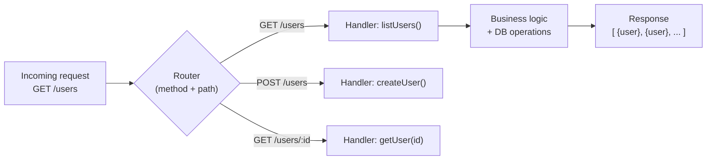
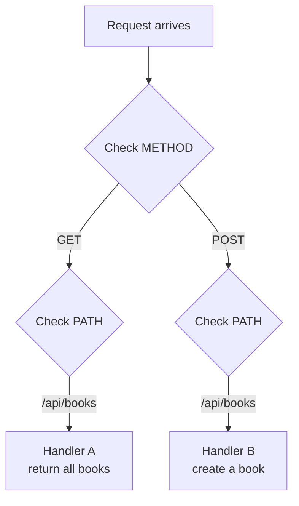
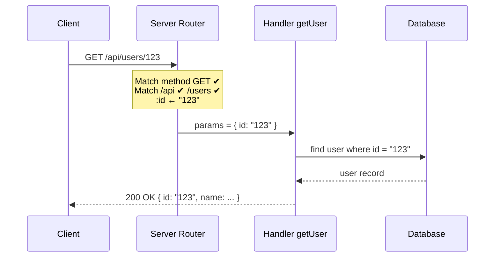
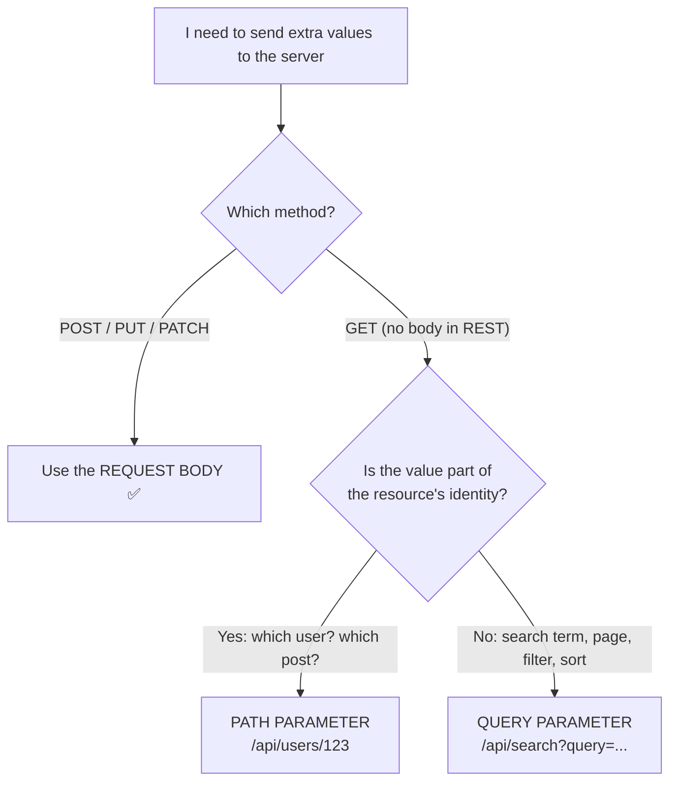
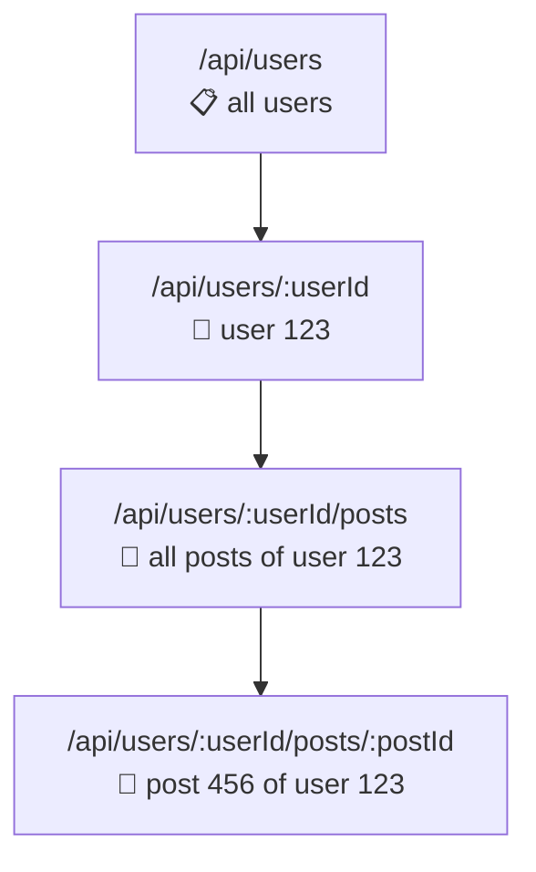
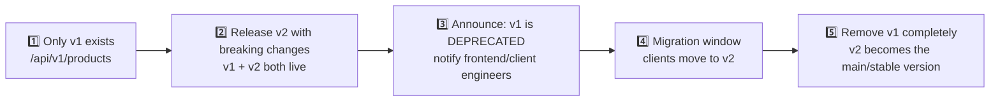
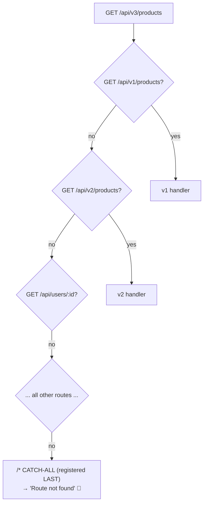
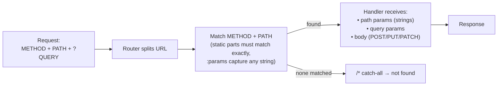

# Routing for Backend Engineers: Complete Revision Notes

> **Source:** [YouTube: Routing (Backend from First Principles series, part 6)](https://www.youtube.com/watch?v=SubuU1iOC2s&list=PLui3EUkuMTPgZcV0QhQrOcwMPcBCcd_Q1&index=6)
> **Length:** ~24 min
> **Previous video:** [HTTP_Notes.md](HTTP_Notes.md). HTTP methods from that video are the starting point here.
> **Goal of the video:** Understand every routing concept you need to open a backend codebase, read its routes, change them, and add new ones.

> 💡 Diagrams use **Mermaid**. They render in GitHub, VS Code (with a Mermaid preview extension), Obsidian, and Notion. Anything marked **📌 Extra** was added to clarify a point and is not in the video.

---

## 📑 Table of Contents

1. [TL;DR: The Whole Video in 10 Lines](#-tldr-the-whole-video-in-10-lines)
2. [What Is Routing? (WHAT + WHERE)](#1-what-is-routing-0000)
3. [How the Server Matches a Request (Method + Path)](#2-how-the-server-matches-a-request-0202)
4. [Static Routes](#3-static-routes-0435)
5. [Dynamic Routes and Path Parameters](#4-dynamic-routes-and-path-parameters-0523)
6. [Query Parameters](#5-query-parameters-0909)
7. [Path Params vs Query Params](#6-path-params-vs-query-params)
8. [Nested Routes](#7-nested-routes-1505)
9. [Route Versioning and Deprecation](#8-route-versioning-and-deprecation-1850)
10. [Catch-All Route](#9-catch-all-route-2216)
11. [Putting It All Together: A Full Route Table](#10-putting-it-all-together)
12. [Cheat Sheet / Quick Revision](#-quick-revision-cheat-sheet)
13. [Self-Test Questions](#-self-test-questions)

---

## ⚡ TL;DR: The Whole Video in 10 Lines

1. The **HTTP method** expresses the **WHAT** (your intent). The **route** expresses the **WHERE** (which resource).
2. **Routing = mapping (method + URL path) to server-side logic (a handler).**
3. The server uses **method + path together** as a unique key, so `GET /api/books` and `POST /api/books` are **different routes** that never clash.
4. **Static route:** a fixed path with no variables, e.g. `/api/books`.
5. **Dynamic route:** contains a variable slot, written `:id` by convention, e.g. `/api/users/:id`.
6. That variable is called a **path parameter** (or **route parameter**). It always arrives as a **string**.
7. **Query parameters:** key-value pairs after `?`, e.g. `/api/search?query=some+value`. They are used mainly with **GET**, which has no body, for **search, pagination, filtering and sorting**.
8. **Nested routes** express relationships: `/api/users/123/posts/456` means post 456 of user 123. Each level is its own route.
9. **Versioning** (`/api/v1/...`, `/api/v2/...`) lets you ship **breaking changes** safely and **deprecate** old versions with a migration window.
10. **Catch-all route** (`/*`) goes **last** and returns a friendly **"route not found"** message for unmatched paths.

---

## 1. What Is Routing? (00:00)

From the HTTP video: **HTTP methods describe your intent**, i.e. the action you want to perform (fetch, add, update, delete).

- **HTTP method = the WHAT** of a request: what you want to do.
- **Route = the WHERE** of a request: which resource you want to do it on, where in the server you want to go.

```
        GET            /users
     ┌───────┐      ┌──────────┐
     │ WHAT? │  +   │  WHERE?  │   ──►  Server finds the matching HANDLER
     │(intent│      │(resource/│        ──► runs business logic + DB operations
     │ action│      │ address) │        ──► returns response (e.g. array of users)
     └───────┘      └──────────┘
```

**Example:** `GET /users` means "I want to **fetch** data (GET), and the data I want is **users** (/users)." The server responds with an array of users.

The server takes the **combination** of the intent and the address, **maps it to a particular handler** (a set of instructions), runs the business logic and database operations, and returns the data.

> 🔑 **Definition:** **Routing is mapping URL paths (plus the method) to server-side logic.** That's all there is to it.



---

## 2. How the Server Matches a Request (02:02)

**Demo setup:** Burp Suite (to inspect traffic) plus a React app firing requests.

Anatomy of the request line:

```http
GET /api/books HTTP/1.1
└┬┘ └────┬───┘
 │       └── ROUTE (the address: where to go in the server)
 └── METHOD (intent / action)
```

- `books` is called a **resource**. This term comes up properly in the REST API video. For now, treat it as part of the route.
- Two demo requests:
  - `GET /api/books` returned the list of books.
  - `POST /api/books` created a book and returned the resources.
- **Same path, different method.** The server **checks the method, then the route, and combines them** into a unique routing key:

```
 "GET"  + "/api/books"   →  key: GET /api/books    → handler A (fetch books)
 "POST" + "/api/books"   →  key: POST /api/books   → handler B (create book)
                                    ▲
                                    └── These NEVER clash: the method differentiates them
```



> 📌 **Extra:** most frameworks (Express, FastAPI, Gin, Spring, ...) work this way. A route is registered with **both** a method and a path, e.g. `router.get("/api/books", handlerA)` and `router.post("/api/books", handlerB)`.

---

## 3. Static Routes (04:35)

- **Static route:** a route with **no variable parameters**. The path is a **constant string**.
- `/api/books` (for both GET and POST in the demo) is static. You always send exactly `/api/books`, nothing in it changes, and it always returns the same *kind* of response.

```
 /api/books        ✅ static  (constant string, nothing variable)
 /api/users        ✅ static
 /api/users/123    ❌ not static: "123" is a variable part
```

---

## 4. Dynamic Routes and Path Parameters (05:23)

**Demo:** `GET /api/users/123`. Here `123` is the **ID of a user**. The endpoint fetches the details of **one particular user**.

- The server **extracts** the ID from the path and uses it (e.g. to fetch that user from the database). In the demo it just echoed the ID back to show it was received.

### How it's declared on the server

```js
// Pseudo-code (the idea is the same in any language/framework)
r.get("/api/users/:id", handler)
//  │        │          │
//  │        │          └── handler that runs when matched
//  │        └── path pattern; ":id" = dynamic slot
//  └── method to match
```

- **`:id`** (a **colon** before a name) marks a **dynamic parameter**. The colon convention is the industry-wide practice across Java, Python, Node.js, Go, Rust, and others.
- It means **"any string in this position"**. Whatever the client sends there gets put into the slot named `id`.

### Matching walkthrough

```
 Request:   GET   /api   /users   /123
                   │      │        │
 Pattern:   GET   /api   /users   /:id
                   ✔      ✔        └── "123" inserted into slot `id`  →  params.id = "123"
```



> ⚠️ **Path params are always strings.** Even though `123` looks like a number, everything in a route path (numbers, special characters) arrives as a **string**. Convert or validate it yourself if you need a number.

### Readability: the point of REST-style routes

You can **read** `GET /api/users/123` like a sentence:
> "**Fetch** me some data (GET), from **users** (/api/users), the one with **ID 123** (/123)."

Human-readable routes are a core idea of **REST APIs**.

### Terminology

| Term | Meaning |
|---|---|
| **Dynamic route** | A route containing a variable part, e.g. `/api/users/:id` |
| **Path parameter** / **Route parameter** (same thing) | The variable value inside the path (after a `/`), e.g. `123` |

---

## 5. Query Parameters (09:09)

**Demo:** typed "some value" into a search box and called:

```
 GET /api/search?query=some+value
     └────┬────┘ └──────┬───────┘
        route       query parameter(s)
   (used for matching  (key = "query", value = "some value";
    the handler)        "+" encodes a space)
```

- `/api/search` is the route. The **method + this path** is what the server matches to a handler.
- `?query=some+value` is the **query parameter**: everything after the **`?`**, as **key=value** pairs.

### Why do query params exist?



1. POST/PUT requests have a **body** for sending user-defined data.
2. **GET requests have no body** (in REST APIs). So how do you send values with a GET?
3. You *could* put them in the path, e.g. `/api/search/some value`. Technically possible, but:
   - It's **hard to maintain**.
   - It **defeats the purpose of REST**: path parameters carry **semantic meaning** (`/users/123` = "user whose ID is 123"). A search term isn't an identity, so it doesn't belong in the path.
4. **Query parameters** solve this. You send a **set of key-value pairs** with the request, typically with **GET**, as **metadata about the request**.

### Main use case: pagination

**First request** (no query params; server uses defaults):

```http
GET /api/books
```

```json
{
  "data": [ { "id": 1, "title": "..." }, "... 20 books ..." ],
  "total": 100,
  "currentPage": 1,
  "totalPages": 5,
  "limit": 20
}
```

- The server paginates: it sends a **chunk** (default **limit 20**) starting from page 1.
- It also returns **metadata**: total books (100), current page (1), total pages (100 ÷ 20 = **5**).
- The client uses that metadata to make the **next requests**:

```http
GET /api/books?page=2
GET /api/books?page=3&limit=20
```

```
 Books: [1 ........ 20][21 ........ 40][41 ........ 60][61 ........ 80][81 ....... 100]
          page=1 (default)   page=2          page=3          page=4          page=5
```

### Other common query-param uses
| Purpose | Example |
|---|---|
| Search | `/api/search?query=harry+potter` |
| Pagination | `/api/books?page=2&limit=20` |
| Filtering | `/api/books?genre=fiction&author=rowling` |
| Sorting | `/api/books?sort=price&order=asc` (or `desc`) |

> 📌 **Extra:** query syntax is `?key1=value1&key2=value2`. Multiple pairs are joined with `&`. Spaces are encoded as `+` or `%20`.

---

## 6. Path Params vs Query Params

| | **Path parameter** | **Query parameter** |
|---|---|---|
| Location | Inside the path, after a `/` | After `?` at the end of the URL |
| Format | `/users/:id` → `/users/123` | `?key=value&key2=value2` |
| Purpose | **Identifies** a specific resource (semantic meaning) | **Modifies/describes** the request: search, filter, sort, paginate |
| Part of route matching? | ✅ Yes, it decides which route/handler matches | ❌ No, the route is matched without it |
| Required? | Usually yes (part of the route) | Usually optional (server uses defaults) |
| Example | `GET /api/users/123` → user 123 | `GET /api/books?page=2` → page 2 of books |

```
 https://api.example.com/api/users/123/posts?sort=latest&limit=10
                        └──────┬──────────┘ └──────────┬────────┘
                         path (with path param 123)    query params
```

---

## 7. Nested Routes (15:05)

Not really a separate *type* of routing. It's a **practice** you'll see everywhere: in REST APIs, expressing meaning often requires **nesting resources** inside each other.

**Demo:** `GET /api/users/123/posts/456`

```
 /api/users  /123      /posts  /456
 └───┬────┘  └─┬─┘     └──┬─┘  └─┬─┘
  static    path param  static  path param
            (user id)           (post id)
```

### Each level is its own route

| Route | Meaning | Handler returns |
|---|---|---|
| `GET /api/users` | All users | List of all users |
| `GET /api/users/123` | One user | Details of user 123 |
| `GET /api/users/123/posts` | That user's posts | **All posts** of user 123 |
| `GET /api/users/123/posts/456` | One specific post of that user | **Post 456** of user 123 |



- You can **stop at any level**, and each level matches a **different handler** with a **different meaning and response**.
- Read it as a sentence: "Fetch data of **user 123**. Specifically their **posts**. Specifically **post 456**."
- Nested routes appear in nearly every API of even **medium complexity**.

> 📌 **Extra:** on the server you'd register something like `r.get("/api/users/:userId/posts/:postId", handler)`, which gives the handler `params = { userId: "123", postId: "456" }`.

---

## 8. Route Versioning and Deprecation (18:50)

**Demo:** two requests that look alike except for the **version segment**:

```http
GET /api/v1/products
GET /api/v2/products
```

**Responses:**

```jsonc
// v1
{ "data": [ { "id": 1, "name":  "Laptop", "price": 999 } ] }

// v2: the field "name" was renamed to "title"
{ "data": [ { "id": 1, "title": "Laptop", "price": 999 } ] }
```

### Why version?

**Scenario:** your API served a **web app** in one format. New requirements arrive, e.g. you now also serve a **React Native / Android / Flutter app** that needs a **different response format**. That is a **breaking change**: old clients expecting `name` would break if you switched to `title`.

| Option | Example | Problem / Benefit |
|---|---|---|
| ❌ Rename the whole route | `/api/new-products` | Messy, unclear naming, and the route-matching part changes |
| ✅ **Version the route** | `/api/v2/products` | Clear intent ("v2 of the response format"), **same route structure**, clean deprecation path |

### The deprecation workflow



```
 Timeline ─────────────────────────────────────────────────────────►
  v1  ███████████████████████████████▒▒▒▒▒▒▒▒▒▒▒░  (removed)
  v2                      ███████████████████████████████████████
                          ▲            ▲              ▲
                     v2 released   v1 deprecated   v1 removed
                                   (migration window ▒)
```

**Benefits:**
- Expresses intent clearly: v1 format vs v2 format.
- No need to invent new route names.
- A **stable, complete workflow for breaking changes**: clients get a **window** to migrate before the old version disappears.

---

## 9. Catch-All Route (22:16)

**Demo:** request to a route the server **doesn't serve**:

```http
GET /api/v3/products        ← no handler exists for v3
```

- After all the real routes (with their methods) are registered, the server adds a **catch-all** route **at the very end**: `/*` (`*` = match anything).
- Any request that **matched none of the earlier routes** falls through to it, and its handler sends a **user-friendly message**: *"This route does not exist / route not found."*
- Without it, the client may get an unhelpful **empty/null response** (the default behavior in the presenter's setup).



> ⚠️ **Order matters:** the catch-all must come **after** all other routes. Otherwise it would swallow every request.
>
> 📌 **Extra:** the catch-all handler should normally respond with status **404 Not Found** (see the status codes section in [HTTP_Notes.md](HTTP_Notes.md)).

---

## 10. Putting It All Together

An example route table for a small bookstore/blog API, covering every concept from the video:

| Method | Route | Type | Meaning |
|---|---|---|---|
| GET | `/api/v1/books` | Static, versioned | List books (paginated) |
| GET | `/api/v1/books?page=2&limit=20&sort=price&order=asc` | Static + query params | Page 2, sorted by price |
| POST | `/api/v1/books` | Static | Create a book (data in the body) |
| GET | `/api/v1/users/:id` | Dynamic (path param) | Get one user |
| GET | `/api/v1/users/:id/posts` | Nested | All posts of a user |
| GET | `/api/v1/users/:id/posts/:postId` | Nested, 2 path params | One post of a user |
| GET | `/api/v1/search?query=...` | Static + query param | Search |
| GET | `/api/v2/products` | Versioned (new format) | Products in v2 shape |
| * | `/*` | Catch-all (LAST) | "Route not found" |



---

## 🧾 Quick Revision Cheat Sheet

```
METHOD  = WHAT (intent)          ROUTE = WHERE (resource / address)
ROUTING = (METHOD + PATH)  ──►  HANDLER (server-side logic)
```

| Concept | Example | Remember |
|---|---|---|
| Static route | `/api/books` | Constant string, no variables |
| Same path, different method | `GET` vs `POST /api/books` | Method + path = unique key, so no clash |
| Dynamic route | `/api/users/:id` | `:name` = dynamic slot (industry convention) |
| Path / route param | `123` in `/api/users/123` | Always a **string**. **Identifies** a resource. |
| Query param | `?query=some+value` | Key-value pairs after `?`. Mainly for **GET** (no body). Search/paginate/filter/sort. |
| Pagination | `?page=2&limit=20` | Server returns data plus metadata (total, currentPage, totalPages) |
| Nested route | `/api/users/123/posts/456` | Each level = separate route and handler |
| Versioning | `/api/v1/...` → `/api/v2/...` | Breaking changes without renaming routes |
| Deprecation | v1 deprecated → migration window → removed | Gives clients time to migrate |
| Catch-all | `/*` (registered **last**) | Friendly "route not found" (📌 use 404) |

---

## ❓ Self-Test Questions

<details>
<summary>1. In one sentence, what is routing?</summary>

Mapping a request's **method + URL path** to the server-side **handler** (logic) that should process it.
</details>

<details>
<summary>2. Which part of a request is the "what" and which is the "where"?</summary>

The **HTTP method** is the what (intent). The **route/path** is the where (resource).
</details>

<details>
<summary>3. Why don't GET /api/books and POST /api/books clash?</summary>

The server combines **method + path** into a unique key, so they map to different handlers.
</details>

<details>
<summary>4. What makes a route "static" vs "dynamic"?</summary>

Static has **no variable parts** (constant string). Dynamic has a **variable slot** like `:id`.
</details>

<details>
<summary>5. In /api/users/123, what type is the value 123 when the server receives it?</summary>

A **string**. Everything in the path arrives as a string.
</details>

<details>
<summary>6. Why use query params instead of path params for a search term?</summary>

Path params carry **semantic meaning** (they identify a resource). A search term doesn't. Putting it in the path is hard to maintain and defeats REST's readable semantics. GET has no body, so query params are the right place.
</details>

<details>
<summary>7. The server returns { total: 100, currentPage: 1, limit: 20 }. How many pages are there, and how do you fetch page 3?</summary>

100 ÷ 20 = **5 pages**. Fetch page 3 with `GET /api/books?page=3`.
</details>

<details>
<summary>8. What does GET /api/users/123/posts return compared with GET /api/users/123/posts/456?</summary>

The first returns **all posts** of user 123. The second returns **only post 456** of user 123.
</details>

<details>
<summary>9. You must rename the field "name" to "title" in a response used by many clients. What do you do?</summary>

Release it as **/api/v2/...**, keep v1 running, mark v1 **deprecated**, give clients a **migration window**, then remove v1.
</details>

<details>
<summary>10. Where must the catch-all route be registered, and why?</summary>

**Last**, after all other routes. Otherwise it would match every request before the real routes get a chance.
</details>

---

*Notes compiled from the video transcript. Timestamps (mm:ss) let you jump back to each section. The transcript's chapter labels were slightly out of sync with its content, so the timestamps here follow where each topic actually starts.*
