# Backend Scaling and Performance Engineering (Part 1): Complete Revision Notes

> **Source:** [YouTube: Backend Scaling and Performance Engineering, Part 1 (Backend from First Principles series, part 21.1)](https://www.youtube.com/watch?v=z7kt_p44rjs&list=PLui3EUkuMTPgZcV0QhQrOcwMPcBCcd_Q1&index=21)
> **Length:** ~1h 47m (Part 1. The transcript ends mid-discussion of horizontal scaling. Part 2 continues.)
> **Part 2:** [Scaling_Performance_Part2_Notes.md](Scaling_Performance_Part2_Notes.md) (statelessness, load balancers, read replicas, sharding, CDNs, edge, async, microservices, serverless)
> **Related notes:** [Databases_Notes.md](Databases_Notes.md) (indexes, N+1, joins) · [Caching_Notes.md](Caching_Notes.md) · [Observability_Notes.md](Observability_Notes.md) (tracing) · [Error_Handling_Notes.md](Error_Handling_Notes.md) · [Background_Jobs_Notes.md](Background_Jobs_Notes.md) · [Graceful_Shutdown_Notes.md](Graceful_Shutdown_Notes.md)
> **Goal of the video:** Build intuition, layer by layer, for **how systems behave under load**, **where bottlenecks hide**, and **how to think clearly about performance**. The aim is a way of thinking that applies to *any* system, not a memorized list of techniques.

> 💡 Diagrams use **Mermaid**. They render in GitHub, VS Code (with a Mermaid preview extension), Obsidian, Notion, and the Claude app. Anything marked **📌 Extra** was added to clarify a point and is not in the video.

---

## 📑 Table of Contents

1. [TL;DR: The Whole Video in 15 Lines](#-tldr-the-whole-video-in-15-lines)
2. [What Does "Fast" Mean? Latency](#1-what-does-fast-mean-latency-0000)
3. [Why Averages Lie](#2-why-averages-lie-0700)
4. [Percentiles: P50, P90, P99](#3-percentiles-p50-p90-p99-0957)
5. [Throughput](#4-throughput-1451)
6. [Utilization (The Ice-Cream Shop)](#5-utilization-1752)
7. [Utilization vs Latency: The Exponential Curve](#6-utilization-vs-latency-the-exponential-curve-2202)
8. [Headroom and Bursty Traffic](#7-headroom-and-bursty-traffic-2620)
9. [Bottlenecks: Never Guess, Always Measure](#8-bottlenecks-never-guess-always-measure-2853)
10. [Profiling and Flame Graphs](#9-profiling-and-flame-graphs-3643)
11. [Distributed Tracing for I/O-Bound Work](#10-distributed-tracing-4043)
12. [Database Performance 1: The N+1 Query Problem](#11-the-n1-query-problem-4108)
13. [Database Performance 2: Indexes](#12-indexes-5317)
14. [Composite and Covering Indexes, EXPLAIN ANALYZE](#13-composite-and-covering-indexes-explain-analyze-10305)
15. [Database Performance 3: Connections and Pooling](#14-connections-and-pooling-10748)
16. [Caching for Performance](#15-caching-for-performance-11742)
17. [Cache Invalidation](#16-cache-invalidation-11914)
18. [Local vs Distributed vs Tiered Caching](#17-local-vs-distributed-vs-tiered-caching-12338)
19. [Caching Patterns: Cache-Aside, Write-Through, Write-Behind](#18-caching-patterns-12641)
20. [Cache Hit Rate](#19-cache-hit-rate-13053)
21. [Vertical Scaling](#20-vertical-scaling-13345)
22. [Horizontal Scaling (Part 1)](#21-horizontal-scaling-14109)
23. [Cheat Sheet / Quick Revision](#-quick-revision-cheat-sheet)
24. [Self-Test Questions](#-self-test-questions)

---

## ⚡ TL;DR: The Whole Video in 15 Lines

1. **Latency:** the total time from a user's action (button click) to the result on screen: browser → internet → server → DB / external API → JSON response → render. "Your app is slow" = latency.
2. Latency **varies per request** (cache hit, idle vs busy server...), so **averages are misleading**: 99% at 50 ms + 1% at 5 s averages ~100 ms and hides **10,000 terrible requests per million**.
3. Use **percentiles**: **P50, P90, P99**. Focus on **P95/P99 (tail latency)**, where your **most complex logic** and often your **most valuable users** (payments, purchases) live.
4. **Throughput:** requests per second/minute. Latency can look great at 10 rps and **explode at 1,000 rps**. Together they answer "**can we survive Black Friday / a viral moment?**"
5. **Utilization:** the % of capacity in use. **Latency grows exponentially near 100% utilization** because of **queueing** (the ice-cream shop and highway analogies).
6. **Never run at 100%.** Keep **headroom**: most production systems run at **60–80%**, because **traffic comes in bursts**.
7. **Bottleneck:** the specific thing causing slowness. **Never guess, always measure.** (The "slow API" was a **synchronous remote logging call** taking 500 ms, not the DB at 10 ms. A week spent adding Redis was wasted.)
8. **Profilers** (sample a running app) and **flame graphs** (wider = more time, stacked = call depth) are great for **CPU-bound** work. Most backend slowness is **I/O-bound**, so use **distributed tracing** (e.g. "2 ms in code, 800 ms in the DB query").
9. **N+1 queries:** 1 query for N items + N queries for related data → **batch fetch / JOIN** (ORM: `select_related`/`prefetch_related`, `includes`, joins in Prisma/Drizzle/TypeORM). **Log the ORM's SQL** to catch it.
10. **Indexes** (B-tree, a sorted copy of a column + pointers) turn **full table scans** (~4 s) into index lookups (~40 ms), but **cost storage** and **slow every write**. Index obvious columns up front, the rest **after measuring**. **Composite** (column order matters), **covering** indexes, and **`EXPLAIN ANALYZE`** to verify.
11. **Connections are expensive** (TCP handshake, auth, encryption, session, memory) and **limited** (~hundreds in Postgres). Use **connection pooling**. With many autoscaled instances, an **external pooler like PgBouncer** stops the combined internal pools from exceeding the DB's limit.
12. **Caching:** store results of expensive operations (800 ms → 50 ms). The hard part is **cache invalidation**: **time-based (TTL)** vs **event-based** (invalidate on write).
13. **Local** (in-process map, fast but inconsistent across instances) vs **distributed** (Redis/Memcached/**Valkey**, consistent but needs a network hop) → **tiered** (local for the hottest data + distributed).
14. **Patterns:** **cache-aside** (lazy, most common), **write-through** (update cache + DB on write, no misses, slower writes), **write-behind** (write cache, update DB async: fast, but risks inconsistency). **Cache hit rate** (90% good, 20% bad) depends on **TTL, cache size, access patterns**.
15. **Vertical scaling** (bigger machine: simple, no code changes, cheap per unit) hits **hard limits**, is a **single point of failure**, and has **no geographic distribution**. **Horizontal scaling** (more machines: linear capacity, no ceiling, redundancy, geo-distribution) brings **complexity**: load balancers, algorithms, sync, network failures, health detection. Distributed systems **trade one set of problems for another**.

---

## 1. What Does "Fast" Mean? Latency (00:00)

Scaling and performance mean different things for frontends, infrastructure and backends. This video **scopes them to backend engineering** and builds up **from first principles**.

### The journey of one click

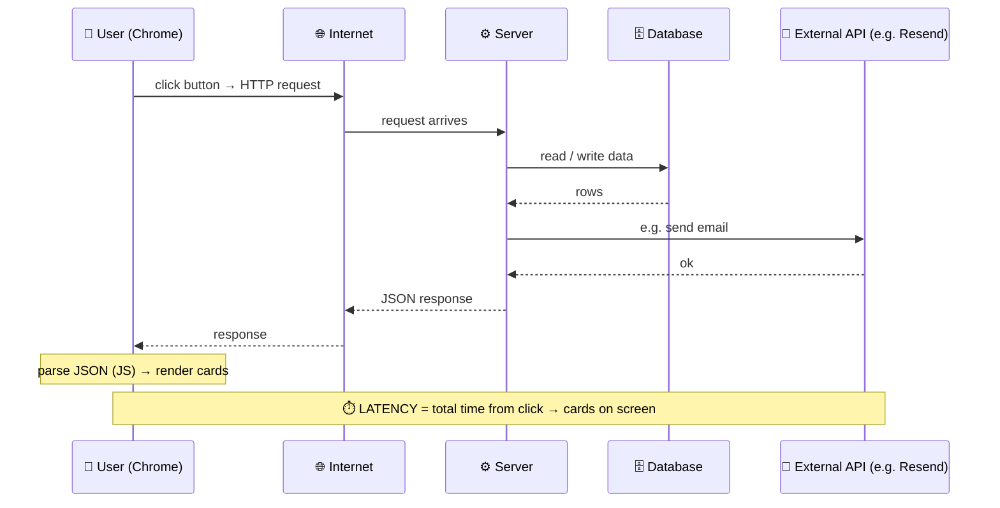

> **Latency** = the total time between the user's action and the result appearing. It's one of the **most fundamental performance metrics**, a **measurable number** instead of vague words like "fast".
>
> 🔑 When users say "your app is slow", **they're talking about latency**, whether or not they know the word.

---

## 2. Why Averages Lie (07:00)

**Latency isn't a single number. It varies from request to request.**

| Request | Latency | Possible reason |
|---|---|---|
| A | **50 ms** | Hit a **cache** (CDN or in-memory like Redis), or reached the server while it was **idle** |
| B | **200 ms** | Had to travel to the server and **query the DB**, or arrived while the server was **busy** with ~50 concurrent requests |

Real-world traffic over the internet is **never as predictable** as whiteboard diagrams.

### The average trap

```
 1,000 requests measured → average = ~100 ms  "Looks great!" 😌

 Reality:
   99% of requests →  < 50 ms   😊
    1% of requests →  ~5 s      😡

 Scale it: 1,000,000 requests/day → 10,000 requests where users stare
           at a loader for 5 seconds. The average HIDES them completely.
```

> 🔑 Averages are useful elsewhere, but **for performance they're misleading and "pretty much useless"**, because the **variation** is what matters.

---

## 3. Percentiles: P50, P90, P99 (09:57)

> Learn the **lingo** of performance first. You'll meet these terms constantly.

| Term | Example | Meaning |
|---|---|---|
| **P50** (median) | P50 = 400 ms | 50% of requests are ≤ 400 ms (half are slower) |
| **P90** | P90 = 900 ms | 90% are ≤ 900 ms. The **slowest 10%** take ≥ 900 ms. |
| **P99** | P99 = 2 s | 99% are ≤ 2 s. The **slowest 1%** take ≥ 2 s. |

> 🧠 **Intuitive trick (from the video):** **100 − N** = the % of users who experience *that latency or worse*. P99 = 2 s means **1%** of users wait **2 s or more**.
>
> 📌 **Extra (precision):** the video phrases it as "10% of users experience 900 ms". Strictly, P90 = 900 ms means 10% of requests take **at least** 900 ms.

```
 latency
   ▲
 2s│                                          ● P99  (slowest 1%)
   │                                     ●
900│                               ● P90  (slowest 10%)
   │                    ●
400│          ● P50  (median)
   │   ●  ●
   └───────────────────────────────────────────────► % of requests (sorted by latency)
```

### Why focus on P95/P99 (tail latency)?

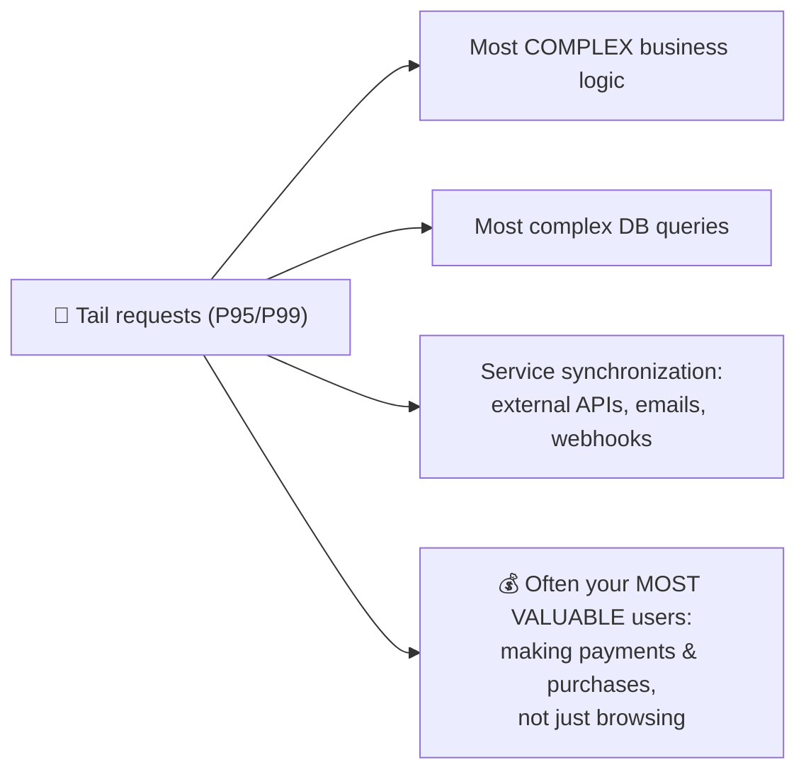

> Backend engineers mostly track **P95 and P99**. It's not only about unhappy users: the slowest requests are where your **hardest workflows** run, done by your **most valuable customers**.

---

## 4. Throughput (14:51)

| Metric | Answers |
|---|---|
| **Latency** | How long does **one request** take, origin to response? |
| **Throughput** | How **many requests** can the system handle **per unit of time** (**requests/second** or **requests/minute**)? |

**Why measure both:** latency can be impressive at low load and terrible at high load:

```
 10 req/s    → latency 150 ms  😊
 1,000 req/s → latency 2 s     😱
```

**The practical questions this answers:**
- Can our system handle the **Black Friday** rush?
- Can we survive the load if we **launch an email campaign**, get **featured on a podcast**, or land on a **popular blog/website**?
- How many **concurrent users** / **requests per second** can we support **before we need more resources**?

### The latency–throughput relationship

```
 latency
   ▲                                  │
   │                                  │  ← latency shoots up
   │                               ╱
   │                           ╱
   │                  ___──╱
   │ ____________──
   └──────────────────────────────────────► throughput (req/s)
      rises slowly at first...      ...then DRAMATICALLY
```

They're **connected, but not intuitively**: as throughput rises, latency increases **slowly at first, then dramatically**.

---

## 5. Utilization (17:52)

### 🍦 The ice-cream shop

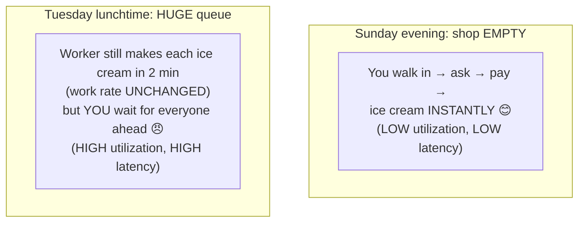

> 🔑 The worker's **speed didn't change** (still 2 min per ice cream), but your **wait time** grew a lot because of the **queue** ahead of you.

**Your servers behave exactly like this:**
- **Low utilization:** the CPU grabs each request, processes it, responds **almost immediately**.
- **High utilization:** each request **waits for those ahead of it**, forming a **queue**. **Higher utilization → longer queue → longer waits.**

> **Utilization** = the **percentage of your system's capacity currently in use**.
> **0%** = idle. **100%** = maxed out, can't do anything else, on the **brink of collapse**.

---

## 6. Utilization vs Latency: The Exponential Curve (22:02)

```
 latency
   ▲                                            │
   │                                            │ 💥
   │                                           ╱
   │                                         ╱    ← REALITY: exponential
   │                                      ╱         near 100%
   │                                 __╱
   │                  ......····˙˙˙        ← what we intuitively EXPECT (linear)
   │ ___________────
   └─────────────────────────────────────────────► utilization %
   0%          50%          80%    90%   100%
```

> 🔑 **Counter-intuitive:** we expect latency to grow **linearly** with utilization. In reality it grows **exponentially** as utilization approaches 100%.

> 📌 **Extra:** queueing theory explains this. In a simple single-server queue, average wait ∝ **1 / (1 − utilization)**: at 50% → 2×, at 80% → 5×, at 90% → 10×, at 99% → 100×.

### 🛣️ The highway analogy

| Highway capacity | Experience |
|---|---|
| **50%** | Smooth. Room to overtake, everyone arrives on time. |
| **80%** | **Slowdowns**. Changing lanes needs thought and strategy. |
| **90%** | **Unpredictable**. Sometimes it flows, sometimes it **jams**. Every brake or lane change sends a **ripple** of honking cars backwards. |
| **100%** | **Nobody can move.** Completely blocked. |

---

## 7. Headroom and Bursty Traffic (26:20)

> 🔑 **You cannot run systems at 100% utilization and expect them to perform.** You need **headroom** (spare capacity) to **absorb traffic**.

- Most production systems run at **60–80% utilization**, keeping **~20%+ as a buffer** for spikes.
- **Traffic is bursty**, not a steady metronome:

```
 req/s
   ▲     ▌▌                       ▌▌▌
   │     ▌▌▌          ▌           ▌▌▌▌                ← bursts
   │ ▌  ▌▌▌▌    ▌   ▌▌▌     ▌    ▌▌▌▌▌   ▌
   │ ▌▌▌▌▌▌▌▌▁▁▁▌▌▁▁▌▌▌▌▁▁▁▁▌▌▁▁▁▌▌▌▌▌▌▁▁▌▌▁▁  ← average looks safe (~40–50%)
   └────────────────────────────────────────────► time
```

- Even if the **average** is 40–50% of capacity, a **burst** can push you **above 100%** instantly. **Without headroom, the system crashes.**

> This intuition comes **before** the textbook "vertical vs horizontal scaling" answers, so you can connect the dots yourself instead of memorizing them.

---

## 8. Bottlenecks: Never Guess, Always Measure (28:53)

> **Bottleneck:** the **specific thing** in your system causing the slowness. **Identifying the bottleneck** is the step engineers most often **skip**.

### ❌ The "by-the-book" reflex
Slow? Then...
- "**Add caching**" (the supposed cure for all latency)
- "**Upgrade Postgres** 16 → 18", upgrade packages
- "**Add more servers**" (horizontal scaling)

Sometimes you get lucky. More often you spend **days or weeks** solving a **problem you don't have**, while the **real bottleneck stays**.

### 📖 Case study: the "slow" product API

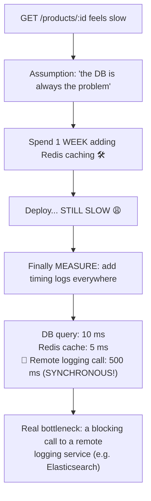

- Using a remote logging service is fine. The problem was calling it **synchronously**, **blocking the request** while the log was written (instead of doing it concurrently or asynchronously; concurrency vs parallelism is covered in the next video).

**Other non-obvious culprits:**
- **JSON / XML serialization**
- A **huge response payload** slowing **network transmission**, even when the code is fast
- **External API calls in a loop**

> 🔑 **Never guess which component causes latency. Always measure.** Measurement is central to performance, scaling and optimization.

---

## 9. Profiling and Flame Graphs (36:43)

> **Profiling:** measuring **where your application actually spends its time**.

- A **profiler attaches to a running app** and, during real processing, **samples** what's happening: which functions run, when they start, when they return, end to end.
- Raw profiler output is **overwhelming** (thousands of functions, each a fraction of total time).

### Flame graphs

```
 ┌───────────────────────────────────────────────────────────────────┐
 │                       handleRequest (100%)                         │  ← bottom = entry
 ├──────────────────────────────────────────┬────────────────────────┤
 │        json.Marshal (55%) 🔥 WIDE!         │  businessLogic (40%)   │
 ├───────────────────┬──────────────────────┼──────────────┬─────────┤
 │ reflect... (30%)  │  encodeString (25%)  │ calcPrice    │ ...     │  ← stacked = called by
 └───────────────────┴──────────────────────┴──────────────┴─────────┘
   width = time spent        height = call-stack depth
```

| Visual | Meaning |
|---|---|
| **Wider** block | Function takes **more time**. Look here first. |
| **Stacked on top** | Functions **called by** the one below (call stack) |

> 😲 **The first time you look at a profile, you'll be surprised.** The bottleneck is **never where you expect**: you'd guess complex business logic, but it's **JSON serialization**. You'd guess DB queries, but it's an **external API call in a loop**.

### ⚠️ Limitation: profilers suit CPU-bound work

| | **CPU-bound** | **I/O-bound** |
|---|---|---|
| What | Actual **computation** using CPU cycles | **Waiting** on input/output: **DB queries, file handling, external API calls, queues** |
| Examples | Image processing, ML / matrix math, serialization | Most SaaS request handling |
| Best tool | **Profiler / flame graph** | **Distributed tracing** |

> In typical SaaS backends, **performance problems are mostly I/O-bound**, which CPU profilers don't capture well.

---

## 10. Distributed Tracing (40:43)

Part of **observability** (see [Observability_Notes.md](Observability_Notes.md)): **follow a request through your system** and record **when it entered each component**: started the DB query, entered or left a function, began an external API call...

```
 Trace: GET /products/5                                   total ≈ 805 ms
 ├─ handler / business logic   ██                            2 ms
 ├─ DB query                    ████████████████████████████ 800 ms   ← 🎯 focus HERE
 └─ serialize + respond         █                              3 ms
```

> With these numbers you **know exactly where to focus**: here, the **database query**.

---

## 11. The N+1 Query Problem (41:08)

**Databases are usually the first suspect**, and for good reasons: they do the hard work: **durable storage on disk**, **crash safety**, **consistency** (concurrent reads/writes, **locking**), and **complex queries over millions or billions of rows**. That takes time. Common low-hanging fruit:

### What N+1 looks like

**Blog home page:** show **20 posts**, each with its **author name** (not included in the list API).

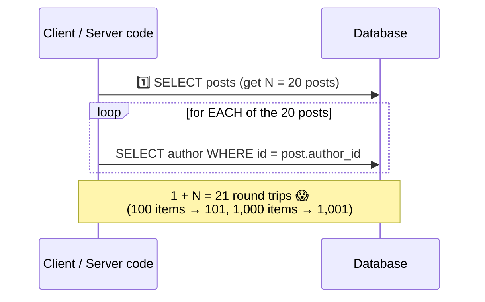

```
 # of queries
   ▲                                      ╱  N+1: grows LINEARLY with items ❌
   │                                 ╱
   │                            ╱
   │                       ╱
   │  ●────────────●────────────●────────    batched: ALWAYS 2 queries ✅
   └──────────────────────────────────────► # of items shown
```

### Why it hurts
- The number of round trips **shouldn't grow with the number of items**.
- **Every query has overhead:** network round trip, possibly **TCP connection setup** (unless pooled), then the DB **parses → plans → executes → returns**.
- Even at a fast **5 ms per query**, **1,000 queries = 5,000 ms = 5 s** of loader. Unacceptable by 2025 standards.

### ✅ The fix: fetch in bulk

```
 Query 1:  SELECT * FROM posts WHERE ...;                         → 20 posts
 Query 2:  SELECT * FROM users WHERE id IN (3, 7, 9, ...);        → all authors at once
           (or a single JOIN)
 → 2 queries total, regardless of whether you show 20, 100, or 1,000 posts
```

### Where it really happens: the server ↔ DB with ORMs
The frontend example builds intuition, but **classic N+1 lives in the backend**. **To the DB, your server is the "frontend".**

```ts
// ❌ ORM code that LOOKS like normal TypeScript...
const posts = await db.select().from(postsTable).where(...);
for (const post of posts) {
  post.author = await db.select().from(users).where(eq(users.id, post.authorId)); // N queries!
}
```

ORMs make data access look like **ordinary language constructs** (arrays, loops), so you **forget each call is a SQL round trip**.

### ORM bulk-fetching primitives

| ORM / Framework | Primitive |
|---|---|
| **Django** | `select_related` (foreign keys / joins), `prefetch_related` (many relationships) |
| **Ruby on Rails** | `includes` |
| **TypeORM** | `leftJoinAndSelect` (joins + select) |
| **Prisma / Drizzle** | `include` / relation queries, joins |
| **Raw SQL** | `JOIN` (inner/left) or `WHERE id IN (...)` |

> 🔑 **Tell the ORM to prefetch related data in bulk** instead of looping. And **turn on SQL query logging** in development to see what the ORM actually runs.

---

## 12. Indexes (53:17)

> The **most common** source of DB performance problems is **missing indexes**. (Basics: [Databases_Notes.md](Databases_Notes.md).)

### 📚 Library analogy
A library of **a million books** with **no catalog**. A reader wants **all books by John Green**, so you walk **the entire library**, checking every book (**~3 days**). The next reader with the same request? **Another 3 days.**

This is a **sequential scan** (**full table scan**): checking **every row**. In a DB that's maybe **1–2 s+** on a big table, still slow by modern standards.

**With a catalog** (sorted by author: A, B, ... **J → John Green → shelf locations**), you go straight to the right shelves. **2–3 minutes.**

### What an index is

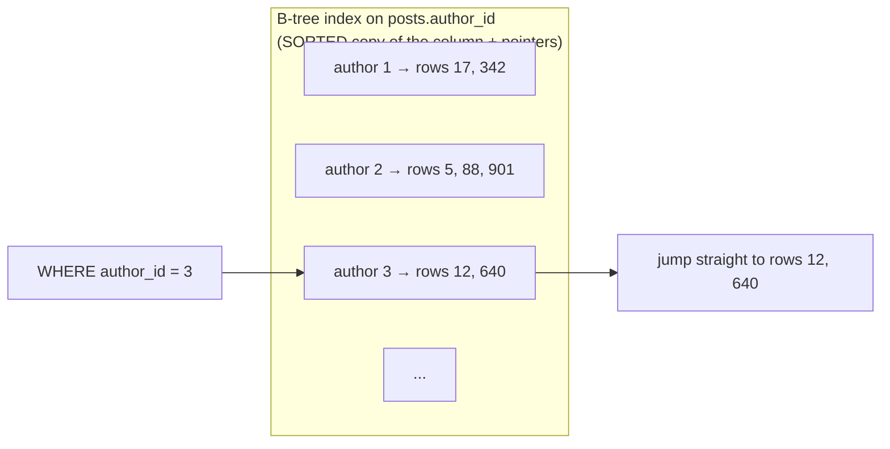

- Usually a **B-tree** (there are others, like **hash** indexes).
- Keeps a **sorted copy of a column's values** with **pointers to the rows**.
- **Impact:** ~**4 s** (scan of a million rows) → ~**40–100 ms** (index lookup).

### ⚠️ Indexes are NOT free

| Cost | Explanation |
|---|---|
| **Storage** | The sorted copy and pointers take space, growing with the table |
| **Write slowdown** (the bigger problem) | **Every INSERT, UPDATE or DELETE** on the table must **also update every index** on it. Index every column and **writes slow dramatically**. |

### 🔑 Strategy: what to index and when

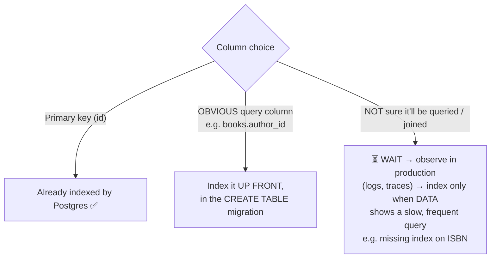

> Be **cautious, not generous**, with indexes. Indexes also help **JOINs**.

---

## 13. Composite and Covering Indexes, EXPLAIN ANALYZE (1:03:05)

### Composite index (multiple columns)

```sql
CREATE INDEX idx_orders_user_created ON orders (user_id, created_at);
```

- Better than two separate indexes when you **frequently query by both** columns.
- 🔑 **Column order matters (leftmost prefix):**

| Query filters on... | Uses `(user_id, created_at)`? |
|---|---|
| `user_id` **and** `created_at` | ✅ Yes |
| `user_id` only | ✅ Yes (leading column) |
| `created_at` only | ❌ No |

### Covering index
- Example: a `departments` table with **~100 columns**, but the UI only needs **id + name**.
- A **covering index** contains **all the columns a query needs**, so the DB can **answer straight from the index** without visiting the table rows.
- Trade-off: more columns in the index means a **bigger index**, so weigh it carefully.

```sql
-- 📌 Extra: Postgres syntax for a covering index
CREATE INDEX idx_departments_name ON departments (name) INCLUDE (id);
-- SELECT id, name FROM departments WHERE name = '...'  → "Index Only Scan"
```

### EXPLAIN ANALYZE: find which column to index

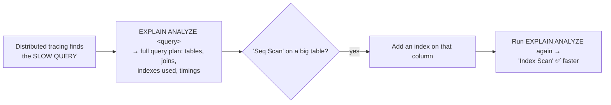

```sql
EXPLAIN ANALYZE
SELECT * FROM books WHERE isbn = '978-0141439518';
-- Before:  Seq Scan on books  (actual time=0.02..1450.3 ms)
-- After:   Index Scan using idx_books_isbn on books  (actual time=0.03..0.05 ms)
```

> 🔑 **Tracing** finds the slow query. **EXPLAIN ANALYZE** finds the exact column. **Re-run it** to confirm the index is used.

---

## 14. Connections and Pooling (1:07:48)

> Locally, DB connections feel **free**. **At scale they're expensive.**

### What happens when your server opens a DB connection

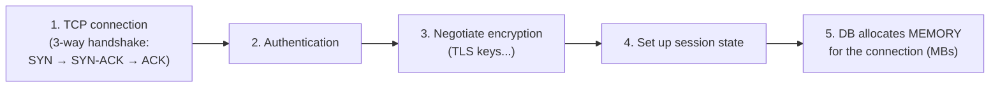

### Two problems without pooling

| Problem | Explanation |
|---|---|
| **Latency** | Open a new connection per query and close it after, and you **pay that setup cost on every request** |
| **Connection limits** | Postgres allows a **limited number of connections** (a few hundred, ~**400–500**, depending on CPU/RAM). A **traffic spike** or sale can **exhaust** them and **crash the DB**. |

### ✅ Connection pooling

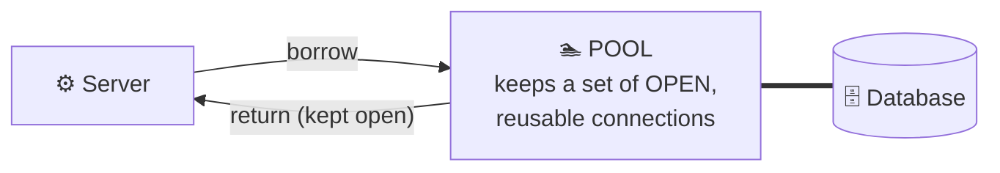

1. The server **borrows** a ready connection from the pool.
2. Runs the query.
3. **Returns** it. The pool **keeps it open** (for a configurable time) for the **next query**.

This solves both problems: **no repeated setup cost**, and a **bounded number of connections**.

### Internal vs external pooling

**Internal pooling:** modern **DB drivers** provide a pool **inside each app instance**. The problem appears with **horizontal autoscaling**:

```
 Traffic spike → Kubernetes autoscaler adds instances
   Instance 1: pool of 150 ┐
   Instance 2: pool of 150 ├── up to 450 connections 😱
   Instance 3: pool of 150 ┘
   Database max: 300 connections  →  next spike → DB CRASHES 💥
```

**External pooling:** e.g. **PgBouncer** for Postgres (a **lightweight, open-source** pooler):

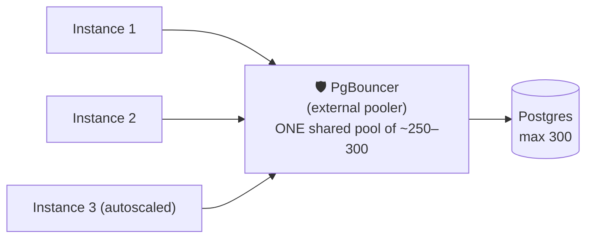

> 🔑 **In production at scale, especially with spiky traffic and autoscaling, prefer an external pooler like PgBouncer.** No matter how many instances spin up, the DB never sees more connections than it can handle.

**Recap of DB performance:** (1) **N+1 queries**, (2) **indexing strategy**, (3) **connection overhead → pooling**.

---

## 15. Caching for Performance (1:17:42)

Queries optimized, indexes added, pooling configured, and the DB is **still** the bottleneck? Next comes **caching** (details in [Caching_Notes.md](Caching_Notes.md)).

> **Idea:** store the **results of an expensive operation** (e.g. a complex query) in a fast store like **Redis**, and serve later requests from there.

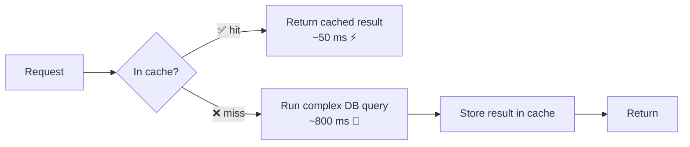

> One move cut **perceived latency from ~800 ms to ~50 ms**.

---

## 16. Cache Invalidation (1:19:14)

> 😅 *"There are only two hard things in computer science: **cache invalidation** and **naming things**."* Not an exaggeration with **multi-layer caching** (servers, CDNs, browsers, reverse proxies...).

When the **underlying data changes**, you **can't keep serving the old cached copy**. Keeping the cache **in sync** with the source of truth (the DB) is the hard part.

| Technique | How | Pros | Cons |
|---|---|---|---|
| **Time-based (TTL) expiration** | Decide up front: valid for **5 or 10 minutes**, then expire automatically | Simple, automatic | Picking the **right TTL** is hard. It depends on access patterns and frequency, **per endpoint and service**. |
| **Event-based invalidation** | When data **changes** (e.g. a user updates name/email/preferences), the update handler **deletes/invalidates** the cache entry. The next GET misses, reads fresh from the DB, and re-caches. | No guessing. You know **exactly** when to invalidate. | You must **remember to invalidate at every write site**. Miss **one**, and users see **stale data**. |

---

## 17. Local vs Distributed vs Tiered Caching (1:23:38)

| | **Local (in-process) cache** | **Distributed (external) cache** |
|---|---|---|
| What | A **map/dictionary in your server's memory** | An external service: **Redis**, **Memcached**, **Valkey** (modern option) |
| Speed | **Near-instant** (~2–3 ms incl. serialization) | Needs a **network round trip** (the video estimates ~50 ms even on an internal network) |
| Multiple instances | ❌ **10 instances = 10 separate caches → inconsistency** | ✅ All instances share **one** cache → **consistent** |

### ✅ Tiered caching (best of both)

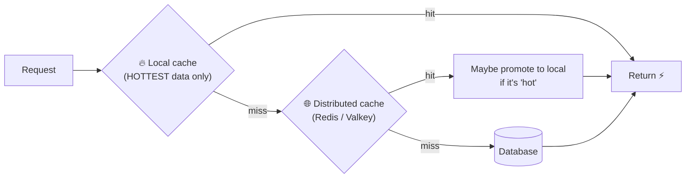

"**Hottest**" = most in-demand data, judged by your caching algorithm (e.g. **most recently used** or **most frequently used**).

---

## 18. Caching Patterns (1:26:41)

> **When** does data enter or update the cache? The right pattern depends on **your app's, your users', and each endpoint's access patterns**.

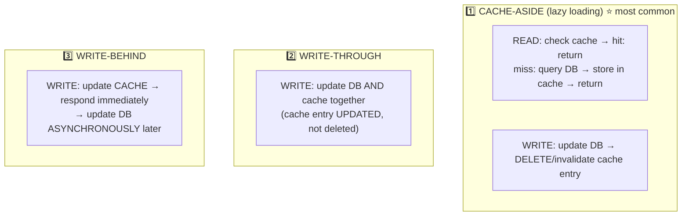

| Pattern | Pros | Cons |
|---|---|---|
| **Cache-aside / lazy loading** | Most intuitive. You probably already use it without knowing the name. Never serves stale data if you invalidate on write. | The first read after invalidation is a **miss** (slow) |
| **Write-through** | **No cache misses**: the entry is always present and fresh | **Writes are slower**: you must write to DB **and** cache before responding |
| **Write-behind** | **Fastest writes** (cache writes are very quick, the DB is updated async) | If the async DB write **fails**, cache and DB are **inconsistent** |

---

## 19. Cache Hit Rate (1:30:53)

> **Cache hit rate** = the **% of requests served from the cache** (the rest go to the source, e.g. the DB).

```
 90% hit rate → 90 of 100 served from cache, only 10 hit the DB   ✅ very good
 20% hit rate → caching layer barely helps → something's wrong with
                your caching algorithm/pattern                    ❌ investigate
```

### What affects the hit rate

| Factor | Effect |
|---|---|
| **TTL** | **Longer TTL → more hits** (items live longer), but **more staleness risk**. A very long TTL (e.g. **7 days**) defeats the purpose of a TTL. |
| **Cache size** | **More memory → more data held → more hits** |
| **Data access patterns** | You must **understand your users**: which endpoints are hot, and **when**. Without that understanding, no strategy will reach ~70–80% hit rates. |

---

## 20. Vertical Scaling (1:33:45)

> **The core question:** as traffic grows, your servers' resources become insufficient. **How do you get more capacity?** Two fundamental approaches:

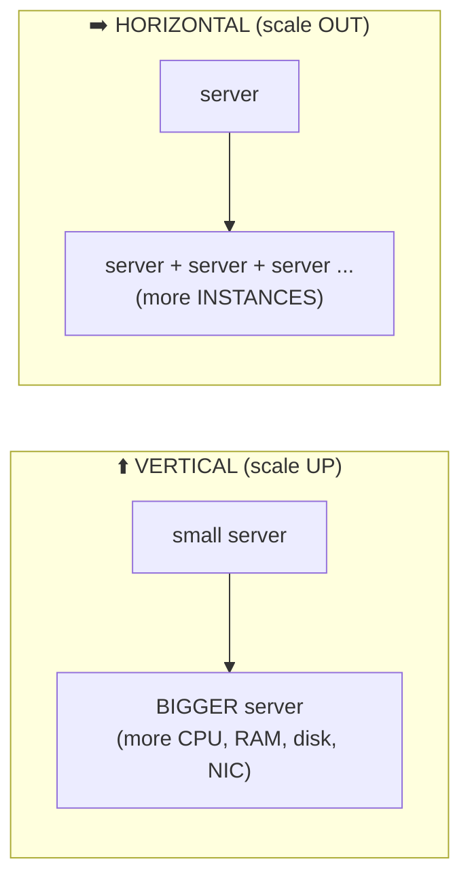

### Vertical scaling (scaling UP)
**Replace the server with a more powerful one:**

| Upgrade | Example |
|---|---|
| **CPU** | More cores: 2 → 4 → 8... |
| **Memory (RAM)** | 2 → 4 → 8 → 16 → 32 GB... |
| **Storage** | 30 GB → 300 GB → 1 TB. Faster **SSDs / NVMe**. |
| **Network card** | Modern **10 Gbps** NICs to handle more traffic |

### ✅ Pros

| Pro | Why |
|---|---|
| **Simplicity** | **Architecture and code don't change**. No thinking about statelessness and the like. Just upgrade the machine. |
| **Predictable math** | **2× CPU ≈ 2× requests**. **2× RAM ≈ 2× local cache**. |
| **Economics** | A machine **twice as powerful** usually **costs less than two half-size machines** |
| **No ops overhead** | No managing multiple machines (security, backups, maintenance), **load balancers**, or **distributed state** |

### ❌ Cons (why not everyone does it)

| Con | Explanation |
|---|---|
| **Hard limits** | There's always a **ceiling** at the hardware level. Even GCP or DigitalOcean have a **biggest machine** (e.g. 32 cores). Need more after that? **You can't scale up any further.** |
| **Single point of failure** | A beast with 32 cores and 96 GB RAM can still **crash** (dependency issues...). If it's down for **2 hours**, your **entire platform is unavailable**. Standby servers and failover help, but it's still a SPOF. |
| **No geographic distribution** | Server in the **USA**, **40% of users in India**, and they get **higher latency**, however powerful the machine |

---

## 21. Horizontal Scaling (1:41:09)

> **Scaling OUT:** add **more instances** of the same server, all working **together** to serve traffic. **Multiple medium machines** instead of one giant.

### ✅ (Theoretical) advantages

| Advantage | Explanation |
|---|---|
| **Linear capacity** | 1 server = 1,000 rps → **5 servers = 5,000 rps** |
| **No hard limit** | Campaign coming? **Keep adding instances.** No ceiling. |
| **Redundancy** | One server fails → traffic **redistributes** to the others, with **no service interruption** |
| **Geographic distribution** | Put instances in **different regions**. A **load balancer** routes users to the **nearest** one, giving **minimal latency**. |

> The video stresses "**theoretical**": the real-world caveats come next (and in Part 2).

### ❌ The cost: complexity
Exactly the complexity vertical scaling avoids:

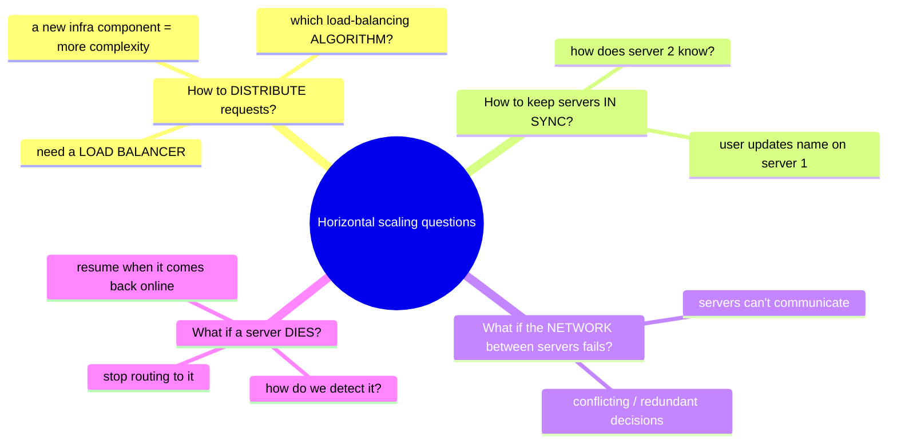

> 🔑 All these questions **have answers**, but the answers are **complex** and involve **trade-offs**. **Distributed systems don't eliminate problems. They transform one set of problems into another.** Sometimes the new set is **more favorable**, sometimes the original is **easier to solve**. Choosing **which set of problems you'd rather deal with** is the real decision.
>
> *(The transcript ends here. Part 2 continues with load balancing, statelessness, and more.)*

---

## 🧾 Quick Revision Cheat Sheet

```
LATENCY  = time for ONE request (what users feel)     → track P50 / P90 / P99 (NOT averages)
THROUGHPUT = requests per second/minute               → latency rises slowly, then EXPLODES
UTILIZATION = % capacity used                         → latency grows EXPONENTIALLY near 100%
KEEP HEADROOM: run at 60–80% (traffic is BURSTY)
NEVER GUESS → MEASURE: profiler (CPU-bound) · tracing (I/O-bound) · EXPLAIN ANALYZE (queries)
```

| Topic | Key points |
|---|---|
| Averages | Misleading: 99% < 50 ms + 1% at 5 s ≈ 100 ms avg, hiding 10k bad requests per 1M |
| Percentiles | P50 median · P90 → slowest 10% · P99 → slowest 1%. Focus on **P95/P99** (complex logic, valuable users). |
| Throughput | Can we handle Black Friday, a campaign, a podcast feature? |
| Ice-cream shop | Worker speed constant, but **queue** → longer waits |
| Highway | 50% smooth · 80% slowdowns · 90% unpredictable jams · 100% standstill |
| Bottleneck story | Week spent on Redis. Real culprit: **synchronous remote logging** (500 ms) vs DB 10 ms. |
| Hidden culprits | JSON/XML serialization · huge payloads · external API calls in a loop · sync logging |
| Profiler / flame graph | Samples a running app. **Wider = slower**, stacked = callees. Best for **CPU-bound**. |
| Distributed tracing | Per-component timings for **I/O-bound** work ("2 ms code, 800 ms DB") |
| N+1 | 1 + N queries, linear growth (1,000 × 5 ms = 5 s) → **bulk fetch / JOIN** (`select_related`, `prefetch_related`, `includes`, joins). Log the ORM's SQL. |
| Indexes | B-tree sorted copy + pointers. Seq scan ~4 s → index ~40 ms. Cost: **storage + slower writes**. PK auto-indexed. Index obvious FKs up front, others **after measuring**. |
| Composite | `(user_id, created_at)`: works for both or `user_id` alone, **not** `created_at` alone |
| Covering | Index holds every column a query needs → served from the index (📌 `INCLUDE`) |
| EXPLAIN ANALYZE | Shows the plan. Seq Scan → add index → re-run → Index Scan |
| Connections | TCP handshake + auth + encryption + session + memory. Postgres limit ~hundreds. |
| Pooling | Borrow/return reusable open connections. **Internal** (per instance; autoscaling can exceed the DB limit) vs **external** (**PgBouncer**, one shared pool) |
| Caching | 800 ms → 50 ms. Invalidation is the hard part. |
| Invalidation | **TTL** (simple, hard to tune) vs **event-based** (precise, must remember every write site) |
| Cache location | **Local** (fast, inconsistent across instances) · **distributed** (Redis/Memcached/**Valkey**, consistent, network hop) · **tiered** (hot local + distributed) |
| Patterns | **Cache-aside** (lazy, invalidate on write, most common) · **write-through** (update both, no misses, slower writes) · **write-behind** (cache first, DB async: fast, inconsistency risk) |
| Hit rate | 90% good, 20% bad. Depends on **TTL, size, access patterns**. |
| Vertical | Bigger CPU/RAM/disk/NIC. Simple, no code change, cheaper per unit, no ops overhead. ❌ **hard limit, SPOF, no geo-distribution**. |
| Horizontal | More instances. Linear capacity, no ceiling, redundancy, geo-distribution. ❌ **complexity**: LB + algorithm, sync, network failures, health detection. |
| Big idea | Distributed systems **transform** problems. Pick the set you'd rather solve. |

---

## ❓ Self-Test Questions

<details>
<summary>1. Define latency using the "button click" journey.</summary>

The total time from the user's action (click) to the result rendering on screen: browser → internet → server (→ DB / external API) → JSON response → back over the internet → parse and render.
</details>

<details>
<summary>2. Why are average latencies misleading? Give the video's numbers.</summary>

Variation matters most. 99% of requests under 50 ms plus 1% at 5 s averages ~100 ms, which looks great but hides 10,000 five-second waits per million requests.
</details>

<details>
<summary>3. Interpret P50 = 400 ms, P90 = 900 ms, P99 = 2 s.</summary>

Half of requests take ≤ 400 ms. The slowest 10% take ≥ 900 ms. The slowest 1% take ≥ 2 s. (Shortcut: 100 − N = % of users experiencing that latency or worse.)
</details>

<details>
<summary>4. Why do backend engineers focus on P95/P99?</summary>

Tail requests run the **most complex logic** (complex queries, external services, emails, webhooks) and often belong to the **most valuable users** (payments, purchases).
</details>

<details>
<summary>5. What's throughput, and why measure it alongside latency?</summary>

Requests handled per second/minute. Latency can be 150 ms at 10 rps but 2 s at 1,000 rps. Together they answer "can we handle Black Friday or a viral spike?"
</details>

<details>
<summary>6. Explain the ice-cream shop analogy.</summary>

The worker always takes 2 minutes per ice cream. On an empty Sunday you're served instantly. On a busy Tuesday you wait for the queue ahead. Servers behave the same: work speed is constant, but at high utilization requests **queue**, so latency grows.
</details>

<details>
<summary>7. How does latency relate to utilization, and what's the highway analogy?</summary>

It's **exponential** near 100%, not linear. Highway: 50% smooth, 80% slowdowns, 90% unpredictable jams with ripple effects, 100% nobody moves.
</details>

<details>
<summary>8. Why keep headroom, and what's a typical utilization target?</summary>

Traffic is **bursty**. Even a safe-looking average can spike past 100% and crash the system. Run at **60–80%** with a buffer.
</details>

<details>
<summary>9. Retell the "slow API" case study and its lesson.</summary>

A week was spent adding Redis caching assuming the DB was slow, but the API stayed slow. Timing logs showed the DB took 10 ms, the cache 5 ms, and a **synchronous remote logging call** 500 ms. Lesson: **never guess, always measure**.
</details>

<details>
<summary>10. What is a flame graph, and how do you read it?</summary>

A visualization of profiler output showing call stacks. **Wider** blocks = more time spent. Blocks **stacked on top** are functions called by the one below.
</details>

<details>
<summary>11. Why aren't profilers enough for typical backends? What do you use instead?</summary>

Profilers shine on **CPU-bound** work, but most backend slowness is **I/O-bound** (DB queries, external APIs, files, queues). Use **distributed tracing** for per-component timings.
</details>

<details>
<summary>12. Explain the N+1 query problem and its cost.</summary>

1 query fetches N items, then N more queries fetch related data, so round trips grow linearly. At 5 ms each, 1,000 items = 5 s. Every query carries network, (maybe) connection-setup, parse, plan and execute overhead.
</details>

<details>
<summary>13. How do you fix N+1 in raw SQL and in ORMs?</summary>

Fetch in bulk: a **JOIN** or `WHERE id IN (...)` (2 queries total). ORMs: Django `select_related`/`prefetch_related`, Rails `includes`, TypeORM `leftJoinAndSelect`, Prisma/Drizzle relation includes and joins. Turn on SQL logging to spot loops.
</details>

<details>
<summary>14. What's a B-tree index, and what does it cost?</summary>

A **sorted copy** of a column's values with **pointers** to the rows. It turns full scans (~4 s) into lookups (~40 ms). Costs: **storage**, and **every write must update every index**, which slows inserts, updates and deletes.
</details>

<details>
<summary>15. When should you add an index?</summary>

Primary keys are auto-indexed. Index **obvious** query columns (e.g. `author_id`) up front. For others, **wait for production data** (logs, traces) showing a slow, frequent query, then index.
</details>

<details>
<summary>16. For index (user_id, created_at), which queries benefit?</summary>

Queries on **both** columns, or on **user_id alone** (leading column). **Not** queries on created_at alone.
</details>

<details>
<summary>17. What's a covering index?</summary>

An index containing **all the columns a query needs**, so the DB answers from the index without touching table rows. Trade-off: a larger index.
</details>

<details>
<summary>18. How does EXPLAIN ANALYZE help?</summary>

It shows the actual query plan and timings: tables, joins, and whether a **Seq Scan** or **Index Scan** was used. Add an index for scanned columns on big tables, then re-run to confirm it's used.
</details>

<details>
<summary>19. What happens when opening a DB connection, and what two problems does pooling solve?</summary>

TCP 3-way handshake, authentication, encryption negotiation, session setup, memory allocation. Pooling avoids **paying that setup cost per query** and **exhausting the DB's limited connections**.
</details>

<details>
<summary>20. Why prefer an external pooler like PgBouncer when autoscaling?</summary>

Each instance's internal pool (e.g. 150) multiplies as instances are added (3 × 150 = 450), which can exceed the DB's limit (e.g. 300) and crash it. One external shared pool caps total connections regardless of instance count.
</details>

<details>
<summary>21. Compare TTL-based and event-based cache invalidation.</summary>

**TTL:** expire after a fixed time. Simple, but the right TTL is hard to choose. **Event-based:** invalidate when data changes. Precise, but you must remember **every** write site, or users see stale data.
</details>

<details>
<summary>22. Local vs distributed caching, and what's tiered caching?</summary>

**Local:** in-process map. Near-instant, but **inconsistent** across instances. **Distributed:** Redis/Memcached/Valkey. Consistent, but needs a network hop. **Tiered:** small local cache for the **hottest** data, backed by the distributed cache.
</details>

<details>
<summary>23. Compare cache-aside, write-through and write-behind.</summary>

**Cache-aside:** lazy loading on read, invalidate on write (most common). **Write-through:** update DB and cache together. No misses, slower writes. **Write-behind:** update the cache, then the DB asynchronously. Fastest writes, but inconsistency if the DB write fails.
</details>

<details>
<summary>24. What's cache hit rate, and which three factors affect it?</summary>

% of requests served from the cache (90% good, 20% means something's wrong). Factors: **TTL** (longer = more hits but staler), **cache size**, **data access patterns** (understanding your users).
</details>

<details>
<summary>25. Give the pros and cons of vertical scaling.</summary>

**Pros:** simple, no architecture or code change, predictable (2× CPU ≈ 2× capacity), cheaper per unit, no multi-machine ops. **Cons:** **hard hardware ceiling**, **single point of failure**, **no geographic distribution**.
</details>

<details>
<summary>26. Give the advantages of horizontal scaling and the complexities it brings.</summary>

**Advantages:** linear capacity (5 × 1,000 rps), no ceiling, redundancy, geo-distribution. **Complexities:** a load balancer and algorithm, keeping servers in sync, network failures causing conflicting decisions, detecting dead servers and re-routing.
</details>

<details>
<summary>27. What's the video's big idea about distributed systems?</summary>

They **don't eliminate problems. They transform one set into another.** Choosing between vertical and horizontal scaling means choosing **which set of problems you'd rather solve**.
</details>

---

*Notes compiled from the video transcript (Part 1, which ends mid-section on horizontal scaling). Timestamps (mm:ss / h:mm:ss) let you jump back to each section. Transcription fixes: "radius" → Redis, "Valky" → Valkey, "recent" → Resend, "OM / OMS" → ORM(s), "type OM" → TypeORM, "excellent analyze" → EXPLAIN ANALYZE, "cash aside / right through / right behind" → cache-aside / write-through / write-behind, "stailness" → staleness, "jarens" → jargon, "PG bouncer" → PgBouncer, "geoic" → geographic.*
