# Backend Scaling and Performance Engineering (Part 2): Complete Revision Notes

> **Source:** [YouTube: Backend Scaling and Performance Engineering, Part 2 (Backend from First Principles series, part 21.2)](https://www.youtube.com/watch?v=sOhAopEwjH4&list=PLui3EUkuMTPgZcV0QhQrOcwMPcBCcd_Q1&index=22)
> **Length:** ~2h 18m
> **Part 1:** [Scaling_Performance_Part1_Notes.md](Scaling_Performance_Part1_Notes.md) (latency, percentiles, throughput, utilization, bottlenecks, N+1, indexes, pooling, caching, vertical vs horizontal scaling)
> **Related notes:** [Auth_Notes.md](Auth_Notes.md) (sessions) · [Caching_Notes.md](Caching_Notes.md) (CDNs, Redis) · [Databases_Notes.md](Databases_Notes.md) · [Background_Jobs_Notes.md](Background_Jobs_Notes.md) · [Error_Handling_Notes.md](Error_Handling_Notes.md) (health checks) · [Observability_Notes.md](Observability_Notes.md) · [Security_Notes.md](Security_Notes.md)
> **Goal of the video:** Continue from horizontal scaling: **statelessness**, **load balancers** (algorithms, health checks), **database scaling** (read replicas, sharding, distributed DBs), **CDNs**, **edge computing**, **async processing**, **microservices vs monoliths**, **serverless**, and the **key mental models** for scaling.

> 💡 Diagrams use **Mermaid**. They render in GitHub, VS Code (with a Mermaid preview extension), Obsidian, Notion, and the Claude app. Anything marked **📌 Extra** was added to clarify a point and is not in the video.
>
> ℹ️ The video was split into two parts only because of a recording issue (frame corruption). Watch Part 1 first.

---

## 📑 Table of Contents

1. [TL;DR: The Whole Video in 15 Lines](#-tldr-the-whole-video-in-15-lines)
2. [Statelessness: The Key to Horizontal Scaling](#1-statelessness-0039)
3. [Load Balancers](#2-load-balancers-0909)
4. [Load-Balancing Algorithms](#3-load-balancing-algorithms-1156)
5. [Health Checks](#4-health-checks-2228)
6. [Database Scaling: The Stateful Problem](#5-database-scaling-the-stateful-problem-2736)
7. [Read Replicas and Replication Lag](#6-read-replicas-and-replication-lag-3002)
8. [Sharding (Partitioning)](#7-sharding-4236)
9. [Distributed and Managed Databases](#8-distributed-and-managed-databases-4808)
10. [CDNs: Beating the Speed-of-Light Limit](#9-cdns-5119)
11. [Edge Computing](#10-edge-computing-10437)
12. [Asynchronous Processing](#11-asynchronous-processing-11340)
13. [Monolith vs Microservices](#12-monolith-vs-microservices-13042)
14. [Serverless](#13-serverless-14420)
15. [Key Takeaways and Mental Models](#14-key-takeaways-and-mental-models-20939)
16. [Cheat Sheet / Quick Revision](#-quick-revision-cheat-sheet)
17. [Self-Test Questions](#-self-test-questions)

---

## ⚡ TL;DR: The Whole Video in 15 Lines

1. **Statelessness** is what makes horizontal scaling work: **no instance holds data the others can't access**. Any request to any instance gives the **same result**. **Externalize state**: sessions → **Redis**, files → **S3 / R2 / MinIO**, DB → **Postgres/RDS**, not a local SQLite file.
2. **Load balancer (LB):** a middleman that receives all requests and **decides which instance** gets each one, using an **algorithm**.
3. **Algorithms:** **round robin** (rotate; fine for similar requests and equal servers) · **weighted round robin** (bigger servers get more) · **least connections** (send to the server with the fewest active connections; better for mixed light and heavy requests) · weighted least connections · **least response time** · **resource-based** (CPU/RAM).
4. **Health checks:** the LB pings each instance (e.g. every second). A non-2xx response means it **stops routing** there but **keeps probing**, and re-adds the instance when it returns 200.
5. **Databases are the hard (stateful) part:** you can't just clone them, because the data must stay **consistent**.
6. **Read replicas:** one **primary** handles all writes, **replicas** (spread across regions) handle reads. ~70–90% of SaaS traffic is reads, so this cuts primary load and latency. Problem: **replication lag** (US→India ~200 ms) causes **stale reads right after writes**. Fixes: route reads-after-writes to the **primary**, wait for replication, or delay the refetch.
7. **Sharding / partitioning:** split one huge table (billions of `orders`) across **multiple physical DBs** by a **sharding key** (e.g. order date). More throughput and lower query latency. Choosing the **key** is the hard part.
8. **In practice:** use **managed / distributed DBs** (RDS, Cloud SQL, **PlanetScale**, **Neon**, **CockroachDB**, **YugabyteDB**) that handle replication, sharding and backups. **Don't roll your own DB infra.** But know the concepts so you can **configure** them.
9. **CDNs:** light in fiber is ~**200,000 km/s**, so Tokyo↔Virginia is ~**100 ms minimum** round trip. Edge **PoPs** near users cut it to ~2–3 ms. Benefits: **latency**, **less origin load**, **DDoS protection** (Cloudflare). Cache **static assets** and some **API responses**, and **purge** by tags when data changes.
10. **Edge computing:** run **logic** at CDN edge nodes (e.g. **Cloudflare Workers**, V8 isolates): **auth checks** (reject 401s in ~2 ms), **localization**, routing. Limits: **small resources**, restricted runtime (no file system, raw TCP...).
11. **Async processing:** respond **before** slow, non-urgent work (emails, invites, video encoding, account deletion) by **enqueueing** it (Redis queue/BullMQ, RabbitMQ, Kafka) for **workers**. Invite flow: 400 ms → 100 ms perceived. Adopt it **early**.
12. **Monolith:** a single deployable unit, simple to develop, test, refactor and deploy. **Microservices** mostly scale your **team/organization**, not your machines. Use them when you have a **large team (~100–200+ devs)**, **different scaling needs**, or **different tech stacks**. Costs: **network calls** (latency, failures, retries, timeouts), **harder debugging** (distributed tracing), **data consistency**.
13. **Serverless:** you provide **functions + events** (routes via an **API gateway**). No machine management, **pay per execution**, **scale to zero**. This solves **capacity planning** problems, while **autoscaling** is slow, capped, reactive, and always costs a minimum.
14. **Serverless trade-offs:** **cold starts** (fixes: keep-warm pings, **Firecracker** microVMs, **V8 isolates**, interpreted languages), **execution limits** (e.g. Lambda max ~15 min), **statelessness** (DB TCP connections, WebSockets need rethinking). Best for **event-driven, irregular** jobs (image/video processing, queue messages, uploads), **not** latency-critical or long-running work.
15. **Mental models:** ① **start with the problem: measure first** (avoid premature optimization), ② **prefer simple solutions** (complexity has a cost), ③ **scale for the problems you actually have**, ④ **observability from day one**, ⑤ **it's a mindset learned from experience**.

---

## 1. Statelessness (00:39)

> 🔑 **Statelessness is the key enabler of horizontal scaling.**

| Term | Meaning |
|---|---|
| **Stateful server** | Holds data **exclusive to itself**: remembers info about a client/user that other instances can't access |
| **Stateless server** | Holds **no exclusive data**. Any persistent data lives **outside** all servers, accessible by **every** instance. |

> **Rule:** it must **not matter which server gets a request**. The result is always the same. Delete instance B, and A + C + D behave **exactly the same**.

- That's why horizontal scaling needs **planning from the ground up** and affects **code, infrastructure, the whole stack**, while vertical scaling is just "add CPU/RAM in the dashboard".

### Example 1: sessions (stateful authentication)

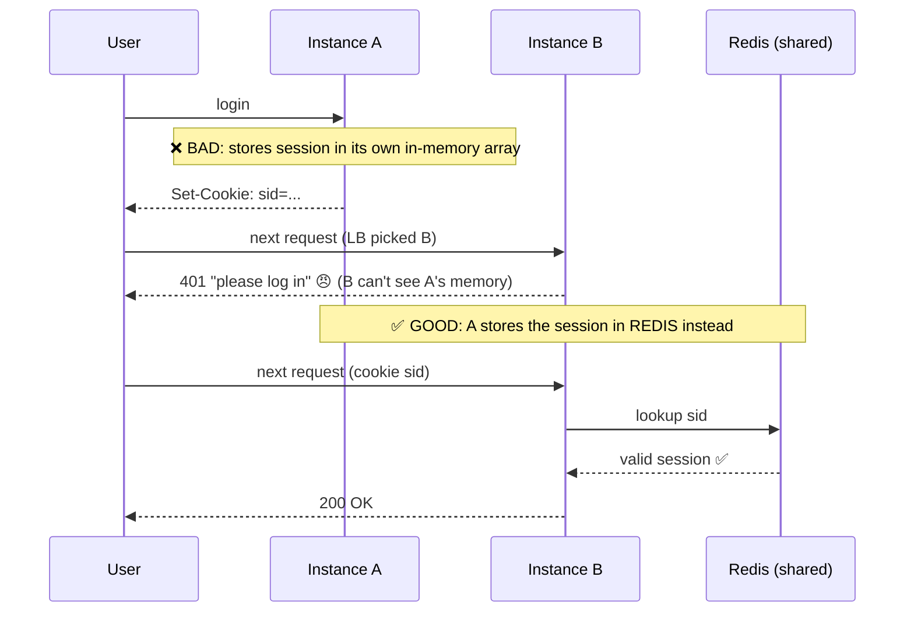

### Example 2: file uploads
- ❌ Instance A saves an uploaded file to **its own SSD**. The next request hits C and fails (C doesn't have the file).
- ✅ Upload to **object storage** reachable by every instance: **S3**, **Cloudflare R2**, or an on-premise **MinIO**.

### The rule of thumb

| State | ❌ Don't keep it in an instance | ✅ Externalize it to |
|---|---|---|
| Sessions / in-memory data | In-process arrays/maps | **Redis** |
| Files | Local disk | **S3 / R2 / MinIO** (object/blob storage) |
| Database | SQLite file on the server | Centralized **Postgres / RDS** (📌 or a hosted/replicated SQLite service) |

> 🔑 Once you pick horizontal scaling, make sure **at the code level** that **no information or file is ever saved inside a single instance**. Centralize everything.

---

## 2. Load Balancers (09:09)

> Load balancers are a **mandatory** component of horizontal scaling. In fact, horizontal scaling **starts** by setting one up.

**The question:** with multiple instances, **where** and **how** do we decide which instance gets each request?

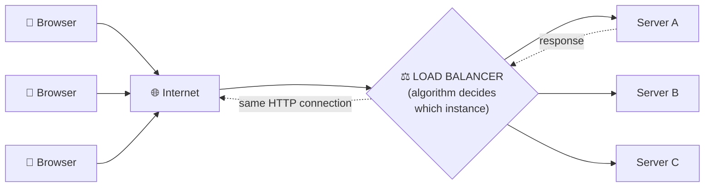

- **All requests go to the LB**, never directly to servers.
- The LB **forwards** each request to an instance chosen by its **algorithm**, gets the response, and **returns it over the same HTTP connection**.
- The middleman part is simple. **The interesting part is the algorithm.**

---

## 3. Load-Balancing Algorithms (11:56)

### 3.1 Round robin

```
 Requests:  1   2   3   4   5   6   7 ...
 Server:    A   B   C   A   B   C   A ...   (rotating order)
```

- ✅ Works well when **requests cost about the same** and **servers have equal capacity** (e.g. all 4 GB RAM / 2 cores). Simple, and handles lots of traffic.
- ❌ **Blind to request cost.** With two request types:

| Type | Work | Time |
|---|---|---|
| **Request 1 (light)** | Simple read (`SELECT` user profile) | ~200–300 ms |
| **Request 2 (heavy)** | External HTTP call (Elasticsearch / email) + **write** to a big table with many indexes (each write updates every index) | ~2 s |

Round robin can keep sending **heavy requests to the same server** by chance. That **skew** can crash it.

### 3.2 Weighted round robin
Servers with **more capacity** get **proportionally more** requests:

```
 A: 8 GB / 4 cores (weight 2)   B: 4 GB / 2 cores (weight 1)   C: 4 GB / 2 cores (weight 1)
 Burst of 8 requests →  A A B C A A B C   (A gets twice as many)
```

Still **blind to what kind** of request it is.

### 3.3 Least connections (smarter)
Send each request to the server with the **fewest active connections**.

- An HTTP request keeps its connection (and the TCP connection underneath) **active** while the server works on it (external calls, DB writes...). On HTTP/1.1 it closes after the response. (HTTP/2 and 3 multiplexing differs.)
- **Heavy requests keep connections open longer**, so busy servers naturally get fewer new requests.

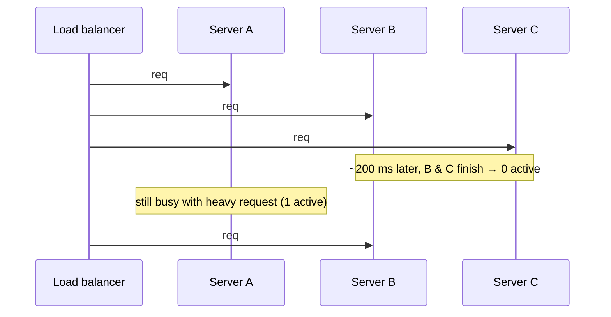

### 3.4 Other algorithms

| Algorithm | Logic |
|---|---|
| **Weighted least connections** | Least connections + capacity weights (an 8 GB server gets ~2×) |
| **Least response time** | Prefer servers **responding fastest**. Struggling, slow servers get fewer requests. |
| **Resource-based** | Prefer servers with **lower CPU / memory usage** |

> The idea is always the same: **some logic decides which instance gets the next request.**

---

## 4. Health Checks (22:28)

**Problem:** server A **crashes**. With round robin (or least connections), the LB keeps sending some requests to A, so those users get **502 / 503**. With rotation, **any** user may eventually hit A. Frustrating.

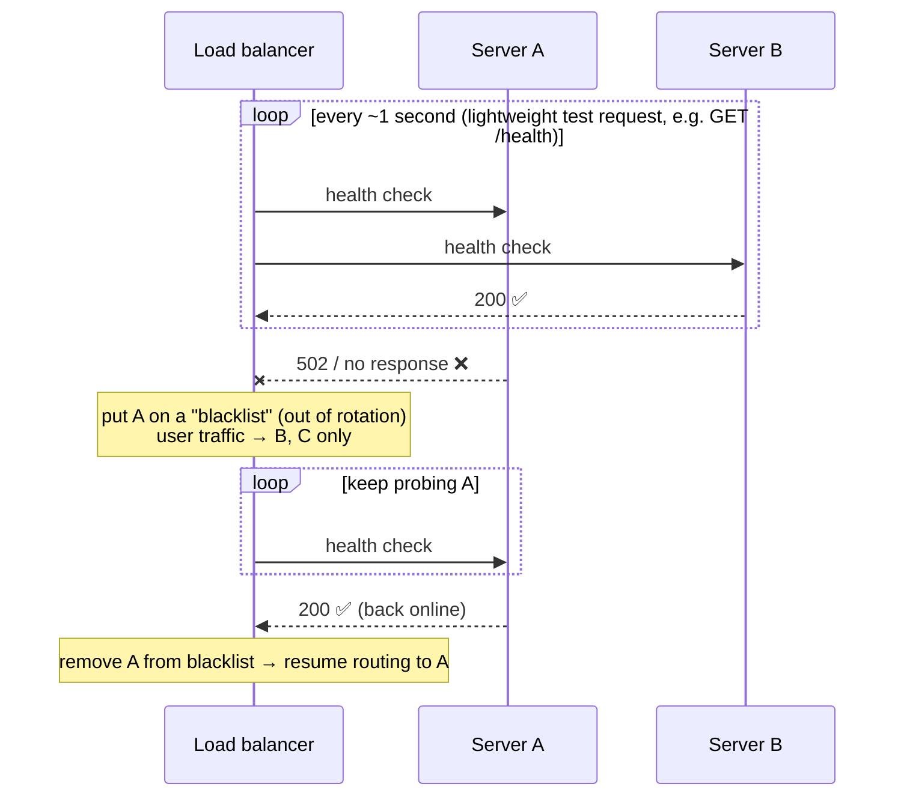

- The LB sends a **simple test request** (a GET) to **every instance**, e.g. **every second**, alongside real traffic. It's cheap, with no heavy work involved.
- **2xx** = healthy. **Non-2xx / no response** (e.g. 502) = take it **out of rotation**.
- It **keeps probing** the failed instance and **puts it back** when it returns **200**.

> 📌 See [Error_Handling_Notes.md](Error_Handling_Notes.md) (health endpoints) and [Graceful_Shutdown_Notes.md](Graceful_Shutdown_Notes.md) (failing readiness checks while draining).

---

## 5. Database Scaling: The Stateful Problem (27:36)

- After **externalizing state**, scaling the **app tier** is straightforward: add servers behind the LB and capacity grows **linearly**.
- The **database** is the **stateful** part. You **can't just duplicate** it like a server:
  - Each instance holds **lots of data** on its own storage.
  - That data must be **consistent**: every instance must return **the same data** for the same request.
  - Coordinating that is **tricky**.
- Meanwhile a **single DB server** (e.g. 4 GB RAM / 4 cores) serving an **ever-growing fleet** of app servers will eventually **run out of resources**.

---

## 6. Read Replicas and Replication Lag (30:02)

### Architecture

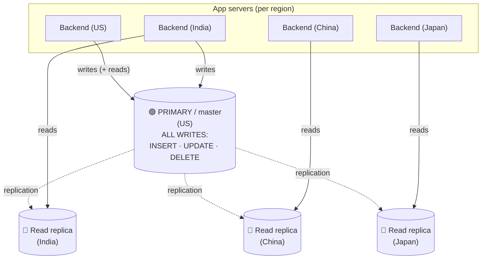

| Node | Also called | Handles |
|---|---|---|
| **Primary** | parent, master | **All writes** (and can serve reads) |
| **Replicas** | secondary, child, slave | **Reads only** (`SELECT`). Never writes. |

**Benefits:**
1. **Less load on the primary:** in SaaS apps **~70–90%** of queries are **reads**, which now go to replicas. The primary goes from **100%** of traffic to **~30%**.
2. **Lower latency:** replicas sit **near users** (India, China, Japan) alongside regional backends.

### ⚠️ The problem: consistency (replication lag)

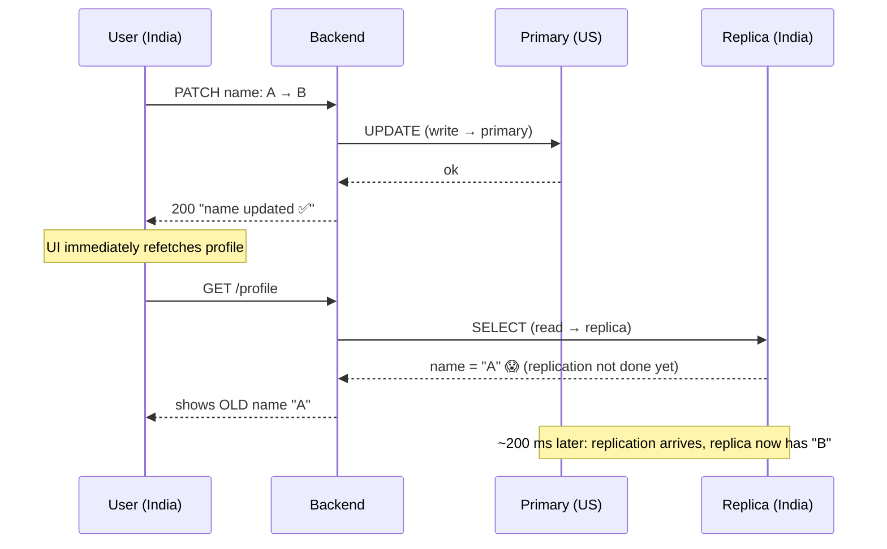

- Databases (**Postgres, MySQL, SQLite...**) have **native replication** that copies primary changes to replicas.
- But **physics**: data travels over **(undersea) fiber**, and **physical distance is the biggest latency factor**. US → India might be ~**200 ms**. That delay is the **replication lag**.
- Forms usually **save → get a 200 → instantly refetch**. That refetch is a **read**, which hits a replica that **hasn't caught up**, so the user sees **stale data**. It's confusing for profiles and **dangerous** for **payments/invoices**.

### Fixes (each a trade-off)

| Fix | How |
|---|---|
| **Read-your-writes routing** | After a write to a table (e.g. `users`), route the **following reads** for that user/table to the **primary** |
| **Track replication lag** | Measure it (~200–250 ms) and **make reads wait** until replication finishes |
| **Frontend design** | Don't refetch instantly. Add a **planned delay** (e.g. ~300 ms) before the GET. |

> 🔑 Every **distributed-system** solution involves a **trade-off**, and it's **most often about consistency**: how do all instances stay up to date?
>
> Managed providers (**RDS**, **Google Cloud SQL**...) make read replicas a **few config flags / toggles** per region, with **tested solutions** for consistency, so you rarely handle it at the infra level yourself.

---

## 7. Sharding (42:36)

> **Sharding (partitioning):** **splitting one table's data across multiple physical database instances**.

**Scenario:** an e-commerce (Amazon/Flipkart-style) `orders` table with **billions of rows**.

```sql
SELECT * FROM orders WHERE user_id = 5;   -- slow on billions of rows, EVEN WITH an index
```

**Two problems:**
1. **Query latency:** the sheer **row volume** slows queries despite indexes.
2. **Scaling instances:** handling more requests needs **more DB resources and instances**.

### How sharding solves both

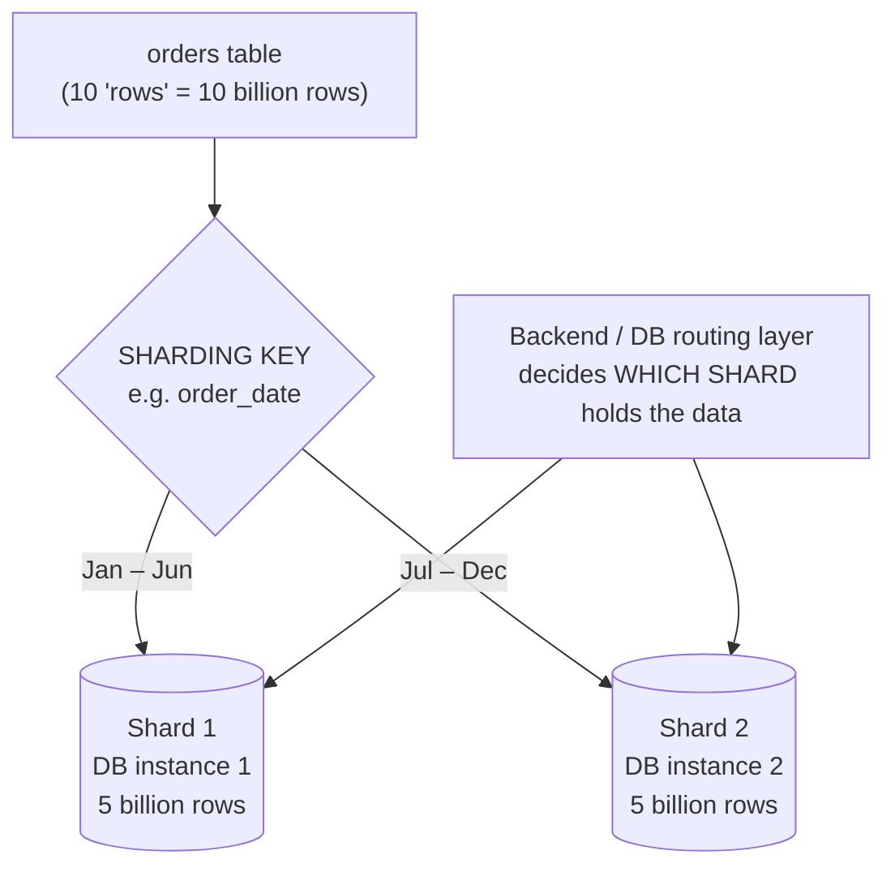

| Benefit | Why |
|---|---|
| **More throughput** | **Two physical DBs** serve more requests per second than one |
| **Lower query latency** | Each shard scans **fewer rows** (5B instead of 10B) |

- The data **lives physically** in separate DB instances.
- **The hard part: choosing the sharding key**, the criterion that decides which data lives where (e.g. **order date**: Jan–Jun vs Jul–Dec, or **one shard per month**).
- A **routing layer** (in the backend or a DB proxy) works out **which shard** holds the requested data, queries it, and returns the result.

> **Replication** (read replicas) and **sharding** are the two DB-scaling terms you'll hear constantly. The video covers the **concepts**. Implementation details are for your own reading.

---

## 8. Distributed and Managed Databases (48:08)

**Current trend (Dec 2025): distributed databases** that automatically handle **sharding, replication, distributed transactions**:

| Database | Notes from the video |
|---|---|
| **PlanetScale** | MySQL-based (📌 built on **Vitess**) |
| **Neon** | Serverless Postgres (the video notes it's written in Rust, 📌 largely its storage layer) |
| **CockroachDB** | Distributed SQL |
| **YugabyteDB** | Distributed SQL |

### 💡 Realistic advice for backend engineers

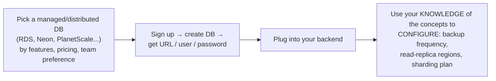

- ❌ **Don't roll your own database infrastructure** unless you have **deep DBA / scaling expertise**: replication, sharding and **backups** (keeping user data safe in multiple places) are **very complex**.
- ✅ You won't **perform** replication or sharding yourself, but you must **understand the terms** to **configure** them in your provider's console. That's why the concepts matter.

---

## 9. CDNs (51:19)

> So far, caching was **inside data centers**. **CDNs (Content Delivery Networks)** cache at a **global, geographic** level. (Deeper coverage: [Caching_Notes.md](Caching_Notes.md) and the presenter's serverless/Vercel video.)

### The physics problem: speed of light

```
 Light in fiber optic cable ≈ 200,000 km/s   ← hard cap, all intercontinental data rides undersea cables

 Tokyo ⇄ North Virginia (us-east-1, home of many commercial apps)
 Round trip ≈ 20,000 km  →  ≈ 100 ms MINIMUM, no optimization can beat this
```

And that's **just the network round trip**. Add server-side work:

```
 ~100 ms  network round trip (physics floor)
 + routing (fast, regex-based route matching)
 + deserialization (JSON → JS object / Go struct, size-dependent)
 + DB query (same region): ~50–100 ms for mid-complex queries
 + external API calls: ~200 ms
 ──────────────────────────────────────────────
 ≈ 500–800 ms for a Tokyo user
```

Even with every DB and cache optimization, **geography** remains the floor.

### The CDN solution

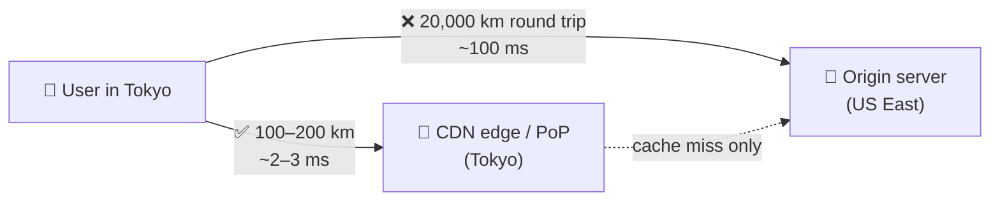

- Put **edge locations / PoPs (points of presence)** **near users** (Tokyo, Mumbai, Singapore...) and serve cached content from there. ~100 ms → ~**2–3 ms**.

### Benefits

| Benefit | Explanation |
|---|---|
| **1. Latency** | Content served from a node **near the user** |
| **2. Less origin load** | Traffic spreads across CDN nodes. The origin gets maybe **~50% less**, so you need horizontal scaling less often. |
| **3. Security / DDoS protection** | Attackers with **botnets** (e.g. **20,000** malware-infected machines) flood your server. It either **crashes** (hard limits) or **autoscales** and runs up a huge bill (e.g. **$50,000 in a day**). **Cloudflare** in front absorbs the traffic across its huge network, **detects attacks** (years of tooling), and triggers mitigations like **CAPTCHAs** for suspicious users. Even **terabytes/petabytes** of traffic can't reach your servers. |

### What to put on a CDN

| Content | Examples |
|---|---|
| **Static content** (the obvious one) | **JS/CSS bundles, HTML**, **images, videos, fonts**. SPAs (React) and static sites (blogs) are deployed this way: the bundle sits in something like an **S3 bucket** and is cached at the edge. |
| **Some API responses** | E.g. an e-commerce **product catalog** that rarely changes |

**Invalidation ("purging"):** CDNs like **Cloudflare** support **tags**. E.g. tag a user's blog content with their user ID, and when they publish a new post, **purge by tag**. The next request fetches fresh content from the origin and re-caches it.

---

## 10. Edge Computing (1:04:37)

### "Edge" in CDNs
CDN nodes are **edge nodes**: placed at the **edge of the network**, the **first point of contact**, often **in collaboration with ISPs**. That's why CDN responses are so fast.

### Edge computing = logic at the edge

| | Traditional CDN | **Edge computing** |
|---|---|---|
| What happens at the edge | Request a file by name → **send it back**. **No processing.** | Request → **some processing at the edge node** → response |

- There are **far more edge nodes** than primary data centers (DCs need big investment and geographic strategy). Edge nodes are close to users, so even if processing takes as long as on your origin, the **round trip is much shorter**, and it **feels faster**.

### Use cases

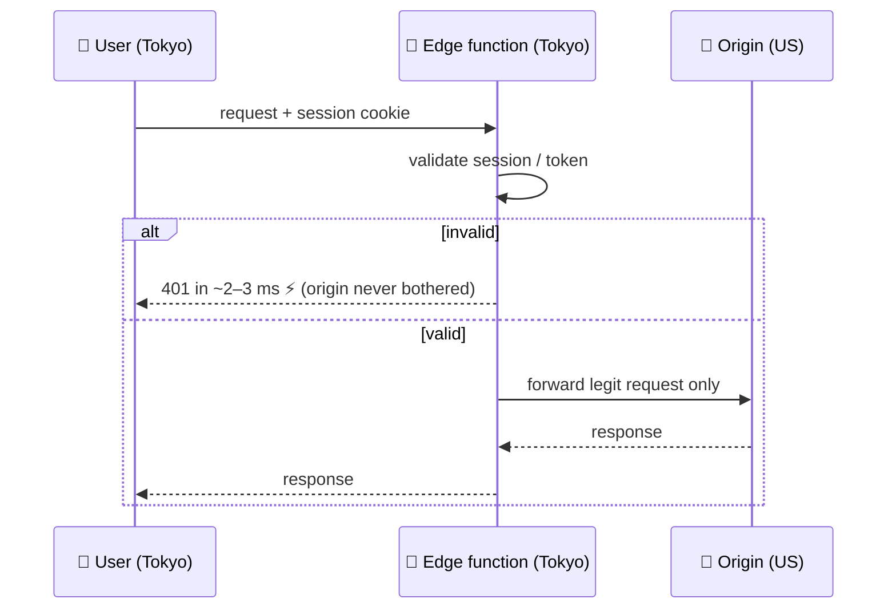

| Use case | Example |
|---|---|
| **Authentication** ⭐ | Reject unauthorized requests **at the edge** (~2–3 ms) instead of a ~100 ms trip to the origin. The origin only sees **legit** requests, which cuts unnecessary traffic. |
| **Localization / personalization** | Edge nodes know their region. Read headers (e.g. **browser language = Japanese**) and serve the **Japanese version** directly. |
| **Validation, routing** | Decide which server a request should go to |

### Why not run everything at the edge? Constraints

| Constraint | Detail |
|---|---|
| **Limited resources** | Edge infra is often hosted **with ISPs** (Cloudflare and AWS partner with them). An ISP's main job is **routing traffic**, so you might get **~1 GB RAM / 1 CPU core**, not 8–16 GB. |
| **Restricted runtimes** | E.g. **Cloudflare Workers** use **V8 isolates** (Chrome's JS engine): **no file-system access**, **no raw TCP**, etc. Built for **low-latency** work. |

> 🔑 Edge nodes **complement, not replace**, primary servers. Offload **strategic logic** (auth, customization, validation, routing) to the edge and keep heavy work on robust data-center servers.

---

## 11. Asynchronous Processing (1:13:40)

> **One of the easiest ways to cut *perceived* latency, and something to adopt from the START** (unlike horizontal scaling, which you adopt at a threshold like 10k–50k users).

(Details on queues: [Background_Jobs_Notes.md](Background_Jobs_Notes.md).)

### Sync vs async behavior
- **Must be synchronous:** e.g. updating a profile name A → B. You can only say "updated" **after the DB write succeeds**, so the user sees B on refresh.
- **Can be asynchronous:** the user **doesn't need the result instantly**.

### Example: inviting a team member (Jira/Notion-style workspaces)

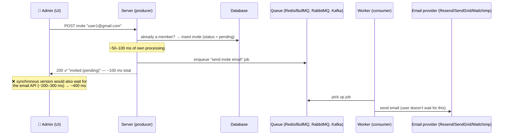

| Version | User waits for |
|---|---|
| **Synchronous** | Own processing (~100 ms) + **external email API** (~200–300 ms) ≈ **400 ms** (worse if the provider is slow or down) |
| **Asynchronous** | Own processing only ≈ **100 ms** ⚡ |

### Producer → queue → consumer
- **Producer:** your server **pushes a task** into the queue.
- **Queue:** **Redis**-based (e.g. **BullMQ** for Node, on managed Redis like **Upstash**) or **RabbitMQ**. Also **Kafka** / event-driven processing.
- **Consumers / workers:** pick up tasks and run them. They can live **in the same codebase** or a **separate one**, which lets you **scale workers horizontally** on their own.

### Good candidates for async

| Task | Why async works |
|---|---|
| **Emails / notifications** | Users don't expect them within milliseconds |
| **Video processing** (e.g. YouTube) | After upload, you can close the tab. **Thumbnails, HD encoding, subtitles** run in the background over 10–20+ minutes. |
| **Image uploads / resizing** | Background processing |
| **Account deletion** | Deleting a user's data across **7–8 tables** with **millions of rows** in one transaction could take **~8 s** of spinner. Instead: sanity checks (~50–80 ms) → respond "deleted", log the user out → **enqueue `delete_user`** → the worker deletes everything, however long it takes. |

> 🔑 **First identify which tasks can be offloaded** (where users don't need the result immediately), then queue them. It's an easy, highly recommended performance win.

---

## 12. Monolith vs Microservices (1:30:42)

### The monolith

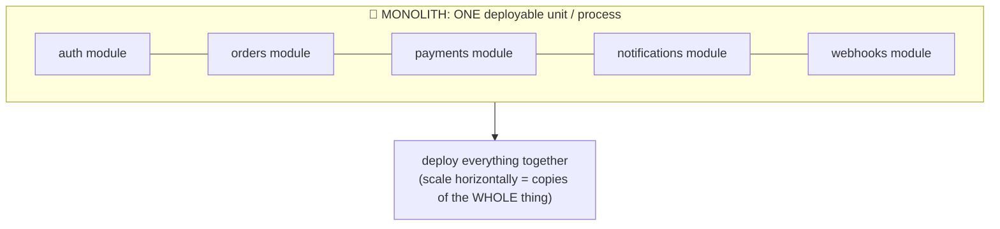

- All functionality (**auth, orders, notifications, payments, webhooks**) is just **files/modules in one codebase/repo**, deployed as **one unit** (one process, or many copies of it when scaled horizontally).
- ✅ **Simple to develop, test, refactor (change module A then module B in one place), and deploy.**
- You can **always scale a monolith horizontally**.

> 🔑 **Microservices aren't mainly about machine performance. They're about scaling your TEAM / organization**, the humans behind the machines. The prerequisite is a **large team** (subjective, but think **100–200+ developers** on the same app).

### Monolith pain points at scale

| Problem | Example |
|---|---|
| **1. Deployment coupling** | The **payments** team wants to ship a critical change, but the **notifications** team has **not-yet-ready** code on `main`. One deployable unit means one team **blocks** another. (Feature flags and strict branching help, and small startup teams of 10–30 coordinate fine. With **500–1,000 devs** it becomes real.) |
| **2. Can't scale modules independently** | **Notifications** is light (DB inserts, WebSockets). **Orders/payments** are heavy. Scaling the monolith scales **everything**, so you can't scale just payments. |
| **3. One tech stack** | A blogging platform (Medium/Hashnode/dev.to-style) needs **Node/Python** for markdown parsing (huge npm/PyPI ecosystems) but **Go/Rust** for CPU-heavy **image manipulation** (e.g. **500 ms → 50 ms**). A monolith forces one language. |

### Microservices fix those...

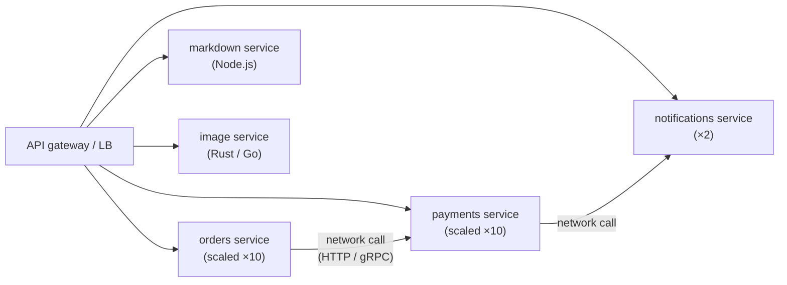

✅ Independent **deploys**, independent **scaling**, **per-service tech stacks**, **team boundaries** that match service boundaries.

### ...but bring big costs

| Cost | Detail |
|---|---|
| **Network** | Function calls become **network calls** (HTTP/gRPC), adding **latency** and **failures**. You must handle **retries, timeouts**... |
| **Debugging** | One request crosses LB → routing → **orders → payments → notifications**, so you check **logs of 4 services**. You need **distributed tracing** and services designed for traceability. |
| **Data consistency** | Each service often has **its own database**, which means **replication lag** and consistency issues across DBs |
| ...and more | Worth further reading |

### When to choose microservices

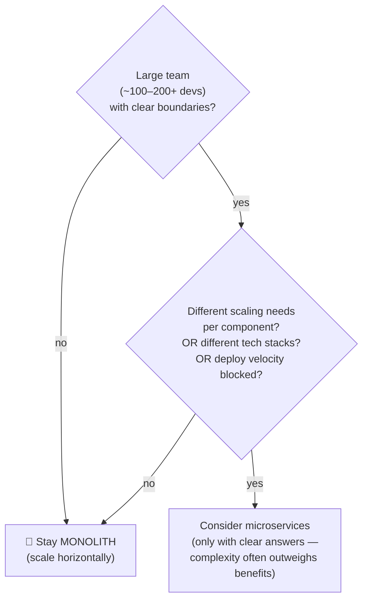

> 🔑 Choosing microservices is a **big decision**. Without clear answers (large team, distinct tech or scaling needs, deployment velocity), it's **typically not worth it**.

---

## 13. Serverless (1:44:20)

> Serverless has become a go-to scaling approach, popularized by **Vercel, Netlify, Cloudflare**. (The presenter has a separate serverless playlist.)

### What came before: traditional "serverful"

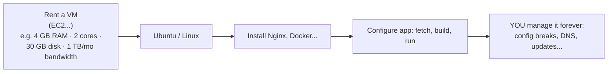

You know **exactly** what you get, and your app serves requests within those limits.

### Problem 1: capacity planning
You must **predict traffic up front**: how many servers, and how big?

| Mistake | Consequence |
|---|---|
| **Under-provision** (e.g. 4 GB) and a spike hits (campaign, blog feature) | **Crashes** or **3–4 s responses** and **error toasts**. New users never convert, paying users look for **alternatives**. Financial and **reputational** loss. |
| **Over-provision** (e.g. 32 GB when 8 GB was enough) | It works, but you **pay for unused capacity** (e.g. **~$5,000 vs ~$500 a week**, only ~20% used) |

> Predicting user behavior is **impossible**, so you lose either way.

### Problem 2: autoscaling helps, but has limits
**Autoscaling:** e.g. 2 × 4 GB servers. When memory passes **70%**, add an instance, and load spreads (~40% each).

| Autoscaling drawback | Detail |
|---|---|
| **Time** | Spinning up an instance means **booting the OS**, fetching/building the code, starting the process, **registering with the LB**: **seconds to minutes**. A spike within **3–4 s** outruns it. |
| **Min/max limits** | **Max too low** puts you back to under-provisioning. **Max too high** (e.g. 1,000): an attack or Black Friday scales you to 500–600 instances, maybe **$100,000 in a day**. |
| **Reactive, not proactive** | Scales **after** crossing the threshold, when you're **already overloaded**. It can't predict, so crashes or errors are still possible. |
| **Always-on minimum cost** | You always pay for the **minimum** (e.g. 4 GB / 2 cores), whether at **500 rps or 0 rps** |

> Autoscaling is still **standard practice**, and the serverful model fits **steady, predictable traffic** (most SaaS apps). For **unpredictable** workloads, **serverless** was born.

### What serverless is
> **You don't worry about servers.** (Servers still exist, but there's **no machine/OS/capacity management**.) You only provide:
> 1. **Functions** (your code)
> 2. **Events** that trigger them (e.g. HTTP routes)

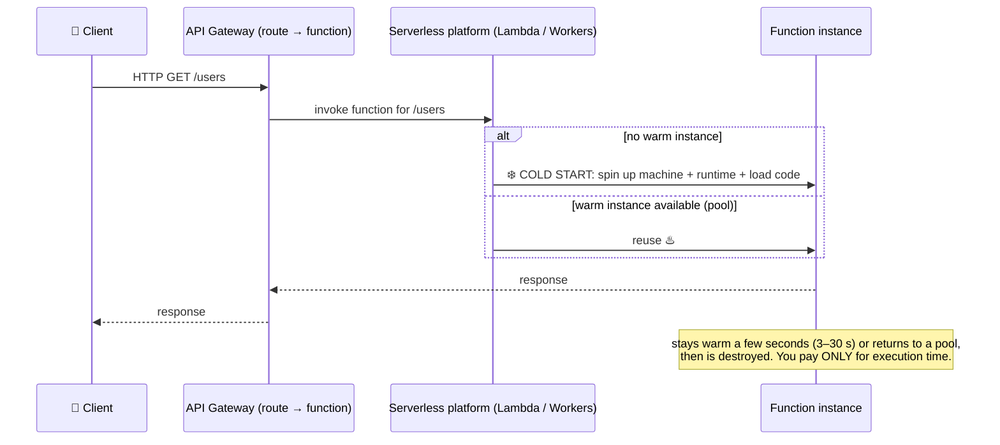

| | **Traditional (serverful)** | **Serverless** |
|---|---|---|
| Computing model | Machine **always on**, always listening (0 or 500 rps) | **Nothing running** until a request or event arrives. Then an instance spins up, runs your code, responds, lingers briefly or is pooled, then is destroyed. |
| You manage | VM, OS, software, capacity, config | **Just code (functions) + events** |
| Pricing | **24/7**, regardless of use | **Per execution**: only the CPU/memory time actually used. Monthly cost = the sum of those milliseconds. |

### The catches

#### 1. Cold starts ❄️ (the #1 problem)
Time to **spin up a new instance** on the first request (or after it's been destroyed).

| Mitigation | Notes |
|---|---|
| **Keep-warm pings** | Automated requests every few seconds keep instances alive. ⚠️ Overdo it and you **pay 24/7 again**, which defeats serverless. |
| **Lighter isolation tech** | **AWS Firecracker** (KVM-based **microVMs**, used for **Lambda**), now an industry standard. **Cloudflare Workers** use **V8 isolates** (claimed **~0–1 ms** to start). |
| **Language runtime** | **Interpreted** languages (**JavaScript, Python**) start faster than **compiled/JVM** ones (**Java**). Workers = V8 isolates + JS ≈ **~5 ms** cold starts. |

> Cold starts **can never fully match** always-on servers. They're inherent to serverless.

#### 2. Execution limits
E.g. **AWS Lambda** functions run for **~15 minutes max**, so long requests (e.g. 30 min) **fail midway**.

#### 3. Statelessness
- Traditional servers are **stateful** in practice: **persistent TCP connections to the DB**, **WebSocket connections**...
- Serverless instances **live seconds** and **machines keep changing**, so you **can't hold data or connections**. TCP DB connections and WebSockets must be **rethought** (e.g. **serverless databases**).

### When (not) to use serverless

| ❌ Avoid serverless for | ✅ Great for |
|---|---|
| **Latency-sensitive** user-facing apps (banking, payments) | **Irregular, heavy jobs**: **image/video processing**, resizing, instead of paying 24/7 for heavy infra |
| **Long-running** requests / **WebSockets** | **Event-driven** work: a **new queue message**, a **file upload**, a **database change** triggering a pipeline |
| Apps needing **many DB connections** (unless you also adopt a serverless DB) | Spiky / unpredictable workloads |

> 💡 **Presenter's opinion:** the industry **overhypes serverless**. It's **powerful for specific use cases** but **not a universal replacement** for servers. Know where it fits.

---

## 14. Key Takeaways and Mental Models (2:09:39)

Both videos covered: latency and throughput → DB optimization and caching → vertical and horizontal scaling → distributed systems → infra components (API gateways, LBs) → organizational choices (microservices) → serverless.

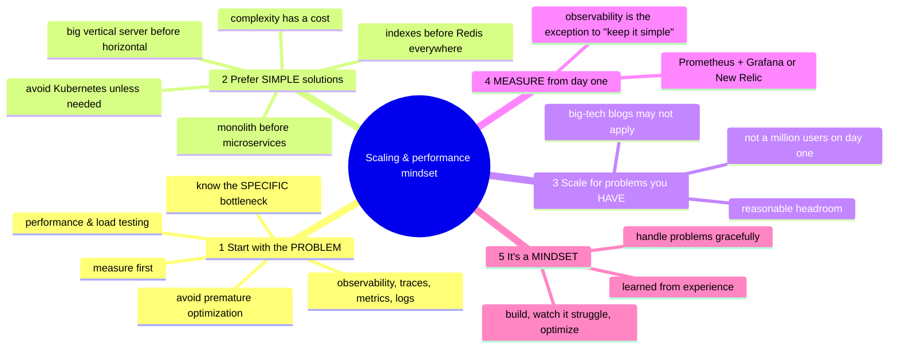

| # | Principle | Details |
|---|---|---|
| **1** | **Start with the problem** | Everything in these videos is a **solution**. First learn **whether** and **how** you're slow: observability (traces, metrics, logs), performance and load testing. Know the **specific** bottleneck ("DB slow because index X is missing" or "...no sharding"). Otherwise it's **premature optimization**. **Fixing the wrong bottleneck** is the worst outcome: it gives a false sense of a fix and grows into a bigger problem. Tools: **Prometheus + Grafana**, or managed tools like **New Relic**. |
| **2** | **Prefer simple solutions** | **Microservices** and **Kubernetes** aren't simple. Prefer **one big vertical server** before day-one horizontal scaling, **proper indexes** before Redis in front of every query, a **monolith** before microservices. **Complexity has costs**: every component can **fail** and must be **monitored, understood, operated**. Accept complexity **only when simplicity is genuinely insufficient** and it's **justified**. |
| **3** | **Scale for the problems you have** | Don't build for a **million users on day one** (most platforms never get there). Build for **current scale + reasonable headroom**, and let observability show you the bottlenecks as you grow. **Generic advice and big-tech blogs** (Netflix, Facebook, Google) **may not apply** to your system. Learn from **measuring your own**. |
| **4** | **Measure (observability from day one)** | The **exception** to "keep it simple": production-grade **logs, metrics and traces from day one** always pay off. No random errors or crashes, no guessing bottlenecks, and **early warning** to scale before problems hit. |
| **5** | **It's a mindset** | Like security, performance is **ongoing learning from experience**: build, watch the system struggle, optimize, see what helps. A tutorial can't teach it all. Your job isn't to **predict every problem** but to build systems that **handle problems gracefully**, and to develop the skills to **measure, diagnose and resolve** them **quickly**. |

---

## 🧾 Quick Revision Cheat Sheet

```
STATELESS servers (state → Redis / S3 / central DB) + LOAD BALANCER (+ health checks) = horizontal scaling
DB scaling: READ REPLICAS (reads → replicas, writes → primary; beware replication lag) + SHARDING (split by key)
Physics: light in fiber ≈ 200,000 km/s → Tokyo⇄Virginia ≈ 100 ms → CDN / EDGE near users
ASYNC: respond first, enqueue slow non-urgent work for workers
MICROSERVICES scale TEAMS; SERVERLESS = functions + events, pay-per-use, cold starts
MEASURE FIRST · PREFER SIMPLE · SCALE FOR REAL PROBLEMS · OBSERVABILITY DAY ONE · MINDSET
```

| Topic | Key points |
|---|---|
| Statelessness | No instance holds exclusive data. Any instance gives the same result. Sessions → Redis, files → S3/R2/MinIO, DB → central Postgres/RDS. |
| Session example | Session in A's memory → request hits B → 401. Fix: shared Redis. |
| Load balancer | All traffic → LB → instance chosen by algorithm → response back over the same connection |
| Round robin | Rotate A→B→C. Fine for uniform requests and servers. Blind to heavy requests. |
| Weighted RR | Bigger server (8 GB/4c) gets ~2× |
| Least connections | Fewest active connections. Heavy requests hold connections longer, so load spreads naturally. |
| Others | Weighted least-conn · least response time · resource-based (CPU/RAM) |
| Health checks | Ping every ~1 s → non-2xx → out of rotation → keep probing → 200 → back in |
| Read replicas | Primary = writes. Replicas = reads in user regions. ~70–90% reads offloaded. Primary load 100% → ~30%. |
| Replication lag | ~200 ms US→India causes stale read-after-write. Fixes: route to primary, wait for replication, delay the UI refetch. |
| Sharding | Split a huge table across physical DBs by a **sharding key** (e.g. date/month). More throughput and fewer rows per query. Key choice is hard. |
| Distributed DBs | PlanetScale (MySQL/Vitess), Neon (serverless Postgres), CockroachDB, YugabyteDB. Use managed ones and configure them. Don't DIY. |
| CDN | Edge PoPs near users (100 ms → 2–3 ms) · less origin load · DDoS protection (Cloudflare) · static assets and some APIs · purge by tags |
| Edge computing | Logic at the edge (Cloudflare Workers / V8 isolates): auth (fast 401s), localization, routing. Limits: small resources, restricted runtime. |
| Async | Invite: 400 ms → 100 ms. Producer → queue (Redis/BullMQ/Upstash, RabbitMQ, Kafka) → workers. Emails, video, images, account deletion. Adopt early. |
| Monolith | One deployable unit. Simple to develop, test, refactor, deploy. Can scale horizontally. |
| Microservices | Scale **teams** (100–200+ devs). Pros: independent deploys, scaling, tech stacks. Cons: network calls (latency, failures, retries, timeouts), distributed debugging, data consistency. |
| Serverful problems | Capacity planning (under → crashes, over → wasted $). Autoscaling: slow boot, min/max limits, reactive, always-on minimum cost. |
| Serverless | Functions + events, API gateway maps routes → functions, no machine management, pay per execution |
| Serverless cons | **Cold starts** (keep-warm pings, Firecracker microVMs, V8 isolates, interpreted langs) · **execution limits** (Lambda ~15 min) · **statelessness** (TCP DB connections, WebSockets) |
| Serverless fit | ✅ irregular heavy jobs, event-driven pipelines · ❌ latency-critical, long-running, connection-heavy apps |
| Mindset | Measure first · simple first · scale for current problems · observability day one · learn from experience |

---

## ❓ Self-Test Questions

<details>
<summary>1. What does statelessness mean, and why is it essential for horizontal scaling?</summary>

No instance holds data **exclusive to itself**. All persistent state lives outside the servers, accessible by every instance. So **any instance can serve any request with the same result**, and instances can be added or removed freely.
</details>

<details>
<summary>2. A user logs in via instance A (session stored in A's memory), and their next request hits B. What happens, and what's the fix?</summary>

B can't see A's in-memory session, so it returns **401** and the user is confused. Fix: store sessions in a **shared store like Redis** that every instance can access.
</details>

<details>
<summary>3. Where should files, sessions and the database live in a horizontally scaled app?</summary>

Files → **object storage** (S3, Cloudflare R2, MinIO). Sessions/in-memory data → **Redis**. DB → a **centralized** database (Postgres/RDS), not a local SQLite file.
</details>

<details>
<summary>4. What does a load balancer do?</summary>

It receives **all client requests**, picks an instance using an **algorithm**, forwards the request, and returns the instance's response over the same HTTP connection.
</details>

<details>
<summary>5. When does round robin work well, and when does it fail?</summary>

It works when **requests cost about the same** and **servers are equal**. It fails with mixed light (~200 ms) and heavy (~2 s) requests: being blind to cost, it may pile heavy requests onto one server and crash it.
</details>

<details>
<summary>6. How does weighted round robin differ?</summary>

Servers get requests **in proportion to their capacity**. An 8 GB / 4-core server with weight 2 gets twice as many as 4 GB / 2-core servers. It's still blind to request type.
</details>

<details>
<summary>7. Why is least connections smarter for mixed workloads?</summary>

Heavy requests **keep connections open longer**. Sending new requests to the server with the **fewest active connections** automatically steers traffic away from servers busy with heavy work.
</details>

<details>
<summary>8. Name three other load-balancing algorithms.</summary>

**Weighted least connections**, **least response time** (prefer the fastest responders), **resource-based** (prefer the lowest CPU/RAM usage).
</details>

<details>
<summary>9. How do health checks work?</summary>

The LB sends a lightweight test request (e.g. GET /health) to each instance about **every second**. On non-2xx or no response it **removes the instance from rotation**, keeps **probing** it, and **re-adds** it when it returns 200.
</details>

<details>
<summary>10. Why is the database the hardest part to scale?</summary>

It's **stateful**: each instance holds lots of data on its own storage that must stay **consistent**, so you can't just clone it like a stateless app server.
</details>

<details>
<summary>11. Describe the read-replica architecture and its benefits.</summary>

A **primary** handles **all writes**. **Read replicas** (often in user regions) serve **reads only**, kept in sync by replication. Benefits: **less primary load** (70–90% of SaaS queries are reads) and **lower latency** for distant users.
</details>

<details>
<summary>12. What is replication lag, and how does it cause bugs?</summary>

The delay (e.g. ~200 ms US → India) before a primary's write reaches the replicas. A user saves (write → primary), the UI instantly refetches (read → replica that hasn't caught up), and they see **stale data**. That's dangerous for payments and invoices.
</details>

<details>
<summary>13. List three fixes for read-after-write staleness.</summary>

**Route reads after a write to the primary** (for that table/user), **wait out the replication lag** before serving reads, or **delay the frontend refetch** (e.g. ~300 ms).
</details>

<details>
<summary>14. What is sharding, and which two problems does it solve?</summary>

**Splitting one table's data across multiple physical DB instances** by a **sharding key**. It solves **query latency** (fewer rows per shard) and **throughput** (more DB instances serve more requests).
</details>

<details>
<summary>15. What's the hardest part of sharding? Give an example key.</summary>

Choosing the **sharding key**, the criterion for which data goes where. Example: **order date** (Jan–Jun on shard 1, Jul–Dec on shard 2, or one shard per month), with a routing layer that picks the right shard.
</details>

<details>
<summary>16. What should a typical backend engineer do about DB scaling in practice?</summary>

Use a **managed/distributed DB** (RDS, Neon, PlanetScale, CockroachDB, YugabyteDB). **Don't build your own DB infra** without deep expertise, but **understand replication, sharding and backups** to **configure** them properly.
</details>

<details>
<summary>17. Why can't optimization beat ~100 ms for a Tokyo user hitting a US server?</summary>

**Physics**: light in fiber travels ~200,000 km/s, and the round trip is ~20,000 km, so ~100 ms minimum before any server work. Only moving content or compute **closer** (CDN/edge) helps.
</details>

<details>
<summary>18. List three benefits of a CDN.</summary>

**Lower latency** (edge near users, ~100 ms → 2–3 ms), **reduced origin load**, and **security / DDoS protection** (e.g. Cloudflare absorbs and filters attack traffic, with CAPTCHAs).
</details>

<details>
<summary>19. What content belongs on a CDN, and how do you invalidate it?</summary>

**Static assets** (JS/CSS/HTML bundles, images, videos, fonts) and some **rarely-changing API responses** (e.g. product catalogs). Invalidate by **purging**, e.g. via **cache tags** when data changes.
</details>

<details>
<summary>20. What is edge computing? Give two use cases and two limitations.</summary>

Running **logic at CDN edge nodes** near users. Use cases: **auth checks** (instant 401s, origin only sees legit traffic), **localization** (serve the Japanese version from headers), routing. Limits: **small resources** (~1 GB / 1 core) and **restricted runtimes** (e.g. V8 isolates: no file system, no raw TCP).
</details>

<details>
<summary>21. Explain asynchronous processing with the team-invite example.</summary>

Validate, insert the invite (pending), **enqueue** the "send email" job, and **respond in ~100 ms** instead of also waiting ~300 ms for the email API. A **worker** sends the email later. The user doesn't need the email instantly.
</details>

<details>
<summary>22. Why should account deletion be asynchronous?</summary>

Deleting millions of rows across many tables could take **~8 s** of spinner. Instead, do quick checks, respond "deleted" and log out, then **enqueue a delete-user job** for a worker. The user isn't waiting, however long it takes.
</details>

<details>
<summary>23. What's the primary purpose of microservices?</summary>

**Scaling the team/organization**, not machine performance: independent deploys, scaling and tech stacks for **large teams** (~100–200+ devs) with clear boundaries.
</details>

<details>
<summary>24. List three monolith pain points that microservices address.</summary>

**Deployment coupling** (one team's unready code blocks another's release), **can't scale modules independently** (light notifications vs heavy payments), **single tech stack** (Node for markdown vs Rust/Go for image processing).
</details>

<details>
<summary>25. What are the main costs of microservices?</summary>

**Network calls** instead of function calls (latency, failures, retries, timeouts), **harder debugging** across services (needs distributed tracing), and **data consistency** across per-service databases.
</details>

<details>
<summary>26. What problems with traditional servers led to serverless?</summary>

**Capacity planning** (under-provisioning crashes, over-provisioning wastes money) and **autoscaling limits**: slow instance boot, min/max caps (too low = crashes, too high = huge bills), **reactive** scaling, and an **always-on minimum cost**.
</details>

<details>
<summary>27. What do you provide in serverless, and how is it priced?</summary>

**Functions** (code) and the **events** that trigger them (e.g. HTTP routes via an **API gateway**). You pay **only for execution time** (CPU/memory ms), not 24/7.
</details>

<details>
<summary>28. What's a cold start, and how is it mitigated?</summary>

The delay to **spin up a new instance** when no warm one exists. Mitigations: **keep-warm pings** (careful, or you pay 24/7 again), lightweight isolation (**Firecracker** microVMs for Lambda, **V8 isolates** for Cloudflare Workers), and **interpreted runtimes** (JS/Python start faster than JVM languages).
</details>

<details>
<summary>29. Besides cold starts, what are two serverless limitations?</summary>

**Execution time limits** (e.g. Lambda ~15 min max) and **statelessness**: no persistent DB TCP connections or WebSockets across short-lived, constantly replaced instances.
</details>

<details>
<summary>30. When is serverless a good fit, and when not?</summary>

**Good:** irregular heavy jobs (image/video processing), event-driven work (queue messages, uploads, DB changes). **Bad:** latency-critical apps (banking, payments), long-running requests and WebSockets, connection-heavy apps.
</details>

<details>
<summary>31. State the five closing mental models.</summary>

**Start with the problem (measure first)** · **prefer simple solutions** (complexity costs) · **scale for the problems you have** · **observability from day one** · **performance is a mindset** learned from experience.
</details>

---

*Notes compiled from the video transcript. Timestamps (mm:ss / h:mm:ss) let you jump back to each section. Transcription fixes: "radius" → Redis, "roundroin / round dropping" → round robin, "leash / list connections" → least connections, "L checks" → health checks, "cydians" → CDNs, "DOS" → DDoS, "opt stash" → Upstash, "bull mq" → BullMQ, "pus" → Vitess (PlanetScale), "menu instance" → MinIO, "KVM technology called firecrackers" → Firecracker microVMs, "NX" → Nginx, "Etel" → Airtel, "text stack" → tech stack, "wagon" → backend.*
