# Backend Security: Complete Revision Notes

> **Source:** [YouTube: Security (Backend from First Principles series, part 20)](https://www.youtube.com/watch?v=xB1C1xZZW4k&list=PLui3EUkuMTPgZcV0QhQrOcwMPcBCcd_Q1&index=20)
> **Length:** ~2h 50m
> **Related notes:** [Auth_Notes.md](Auth_Notes.md) · [Databases_Notes.md](Databases_Notes.md) (parameterized queries) · [Validation_Notes.md](Validation_Notes.md) · [Error_Handling_Notes.md](Error_Handling_Notes.md) (safe messages and logs) · [Config_Management_Notes.md](Config_Management_Notes.md) (secrets) · [HTTP_Notes.md](HTTP_Notes.md) (CORS, security headers) · [Handlers_Middleware_Context_Notes.md](Handlers_Middleware_Context_Notes.md) (rate limiting, request context) · [Observability_Notes.md](Observability_Notes.md) (log levels)
> **Goal of the video:** Not a list of fancy techniques. The goal is to make you **paranoid** about your code and give you an **attacker's mindset**: always ask "**where did I make an assumption?**" Covers **injection** (SQL, NoSQL, command), **authentication** (password storage, sessions, cookies, JWT, rate limiting), **authorization** (BOLA, BFLA, IDOR), **XSS**, **CSRF**, **misconfiguration**, **defense in depth**, and resources (PortSwigger, OWASP).

> 💡 Diagrams use **Mermaid**. They render in GitHub, VS Code (with a Mermaid preview extension), Obsidian, Notion, and the Claude app. Anything marked **📌 Extra** was added to clarify a point and is not in the video.

---

## 📑 Table of Contents

1. [TL;DR: The Whole Video in 15 Lines](#-tldr-the-whole-video-in-15-lines)
2. [Scope and Goal: Become Paranoid](#1-scope-and-goal-0000)
3. [Think Like an Attacker: "Where Did I Assume?"](#2-think-like-an-attacker-0435)
4. [Injection: Your App Speaks Many Languages](#3-injection-your-app-speaks-many-languages-0750)
5. [SQL Injection Deep Dive](#4-sql-injection-deep-dive-1129)
6. [Prevention: Parameterized Queries + Least Privilege](#5-prevention-parameterized-queries--least-privilege-2930)
7. [NoSQL Injection](#6-nosql-injection-3925)
8. [Command Injection](#7-command-injection-4104)
9. [The Injection Mental Model](#8-the-injection-mental-model-4620)
10. [Authentication: Use an Auth Provider?](#9-authentication-use-an-auth-provider-4817)
11. [Password Storage: Plain Text → Hash → Salt → Slow Hash](#10-password-storage-5800)
12. [Sessions](#11-sessions-11933)
13. [Cookie Security Flags](#12-cookie-security-flags-12421)
14. [JWT (Stateless Auth) and Its Problems](#13-jwt-stateless-auth-and-its-problems-12955)
15. [Rate Limiting for Authentication](#14-rate-limiting-for-authentication-14625)
16. [Authorization Vulnerabilities: BOLA, BFLA, IDOR](#15-authorization-vulnerabilities-15155)
17. [Preventing Authorization Bugs](#16-preventing-authorization-bugs-21250)
18. [Cross-Site Scripting (XSS)](#17-cross-site-scripting-xss-21827)
19. [CSRF (Cross-Site Request Forgery)](#18-csrf-23110)
20. [Security Misconfiguration](#19-security-misconfiguration-23517)
21. [The Big Picture: Boundaries and Defense in Depth](#20-the-big-picture-24110)
22. [Resources: PortSwigger and OWASP](#21-resources-24605)
23. [Cheat Sheet / Quick Revision](#-quick-revision-cheat-sheet)
24. [Self-Test Questions](#-self-test-questions)

---

## ⚡ TL;DR: The Whole Video in 15 Lines

1. Security is **huge** (browser, network, server OS, backend). This video focuses on **backend code**. Its goal: make you **paranoid** and give you a **security mindset**. No app is ever truly secure.
2. **Attackers don't care about your language or framework.** They ask one question: **"Where did the developer make an assumption?"** (Input is clean, the user is who they claim, the request came from my frontend, nobody opens the Network tab.)
3. **Injection:** your app **speaks many languages** (SQL to the DB, HTML/JS to browsers, shell to the OS). When user input **crosses into another language's boundary**, its special characters can become **code**.
4. **SQL injection:** concatenating input into SQL means `' OR '1'='1' --` dumps all users and `'; DROP TABLE users; --` deletes tables. **Root cause: data confused with code.**
5. **Fix:** **parameterized queries / prepared statements** (send the **query and the data separately**). Plus **least-privilege DB users** (DML only, no DDL), and **validation**. ORMs and modern drivers parameterize by default.
6. **NoSQL injection** (MongoDB `$ne`, `$gt` operators) and **command injection** (`; rm -rf /`) have the same root cause. Fix: **argument arrays / APIs that separate structure from data**, never string-concatenate.
7. **Auth:** if you can, **use an auth provider** (Clerk, etc.), because production auth is complex (stateful sessions, revocation, OAuth, account linking). But still **understand** how it works.
8. **Passwords:** plain text ❌ (breaches + password reuse + insiders) → **hash** (one-way) → **rainbow tables** break plain hashes → add a **per-user random salt** → GPUs brute-force fast hashes (SHA-256/MD5, billions per second) → use **slow, tunable** hashes: **bcrypt / scrypt / Argon2id** (the current standard).
9. **Sessions:** a **cryptographically random** session ID (≥128 bits), stored server-side (Redis/DB) with metadata (user, expiry, IP, user agent), sent in a **cookie**. Cookie flags: **HttpOnly**, **Secure**, **SameSite** (Strict/Lax, never None).
10. **JWT:** header.payload.signature. The payload is only **Base64** (**readable**), but **tamper-proof** thanks to the signature. Problems: **revocation is hard** (workarounds: blacklists, **short-lived access + refresh tokens**) and **storage** (localStorage is XSS-prone). The presenter's advice: **prefer stateful sessions**.
11. **Rate-limit auth in layers:** **per IP**, **per account** (lockouts), **global** (catches password spraying across accounts and IPs). Be stricter on auth endpoints.
12. **Authorization bugs** come from a false sense of security after the auth middleware. **BOLA:** check ownership **at the point of access** (`WHERE id = $1 AND user_id = $ctx.user`) and return **404 (not 403)** to avoid leaking existence. **BFLA:** admin functions need **role checks** (no "security through obscurity"). **IDOR:** avoid **sequential IDs** (use UUIDs). Horizontal vs vertical attacks.
13. **Authz prevention:** **centralize** the logic, **default deny**, **automated authz tests** in CI, **audit logs** of sensitive access and failed checks.
14. **XSS:** attacker JS runs in other users' browsers (stored, reflected, DOM-based). Again data treated as code. Fix: **sanitize** user markup (e.g. strip `<script>`), be careful with `dangerouslySetInnerHTML`, and use **CSP** as the **last line of defense**. **CSRF:** largely mitigated today by **SameSite** cookies (default Lax) and CORS.
15. **Misconfiguration:** secrets in Git (rotate if leaked, since history keeps them), **debug logging in production**, missing **security headers** (X-Frame-Options against clickjacking; use the framework's security middleware). **Big picture:** watch **data crossing boundaries**, question **assumptions**, and build **defense in depth**. Learn more at **PortSwigger Web Security Academy** and the **OWASP Top 10 / Cheat Sheets**.

---

## 1. Scope and Goal (00:00)

Security is among the most important topics: neglecting it is **destructive**, financially and to your business.

### Security has many contexts

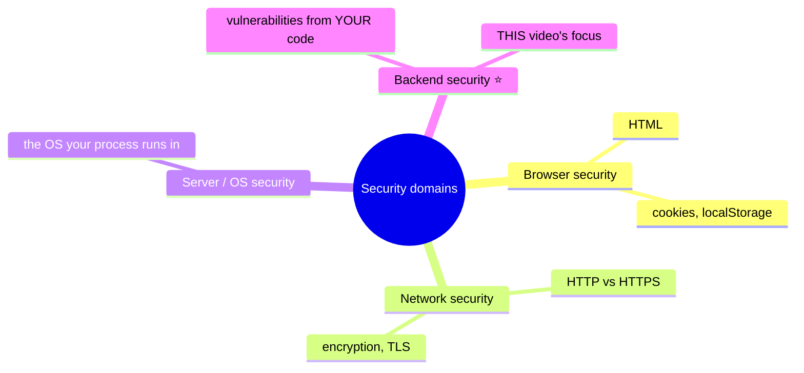

### The real goal

> 🎯 Not to teach every fancy technique for you to implement tomorrow (impossible). The goal is to **make you paranoid** about your app and your code, and to give you a **mindset** that **always keeps security in the back of your head**.

- "**No application can ever be truly secure.**" Technology, libraries and languages keep evolving, and new vulnerabilities keep appearing. **Try your best.**
- Security needs **lots of your own reading and research**. If something major is missing here, that's expected. The video succeeds if you take away the **mindset**.

---

## 2. Think Like an Attacker (04:35)

The video avoids a fixed list of abstract vulnerabilities and teaches you to **think like an attacker** (it says "attacker", not "hacker").

> 🔑 **Attackers don't care about your framework, library or language. They ask one question: "Where did the developer make an assumption?"**

**Every vulnerability in this video comes down to an assumption:**

| Assumption | Reality |
|---|---|
| "Input from the user/frontend will be **clean**" | Attackers send crafted input |
| "The user is **who they say** they are" | Identities can be faked or stolen |
| "The request came from **my frontend**" | Anyone can call your API directly (curl, scripts) |
| "**Nobody will open the Network tab** and modify parameters" | They will |

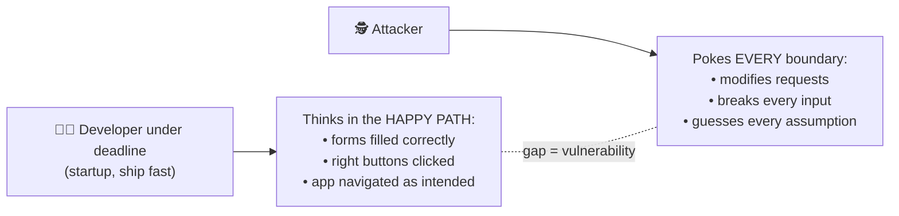

> By the end, you should **always ask "what could go wrong here, security-wise?"** whenever you write code, in Go, Python, Node.js, Rust or anything else.

---

## 3. Injection: Your App Speaks Many Languages (07:50)

Injection attacks have existed **for decades**, are **still common**, and **share one root cause**. Understand it and you understand the whole category.

### Fundamental truth: your app speaks multiple languages

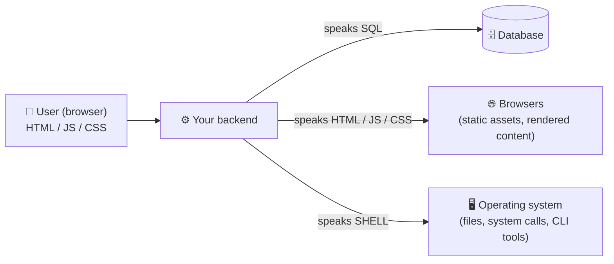

- Each language has its **own grammar**, its **own special characters**, and its **own way of separating commands from data**.
- **Vulnerabilities appear when input in one language crosses the boundary into another**: characters that are innocent in the user's context can be **special commands** in the target language (SQL, shell, HTML...).
- **SQL injection** and **XSS** are both examples.

---

## 4. SQL Injection Deep Dive (11:29)

### Setup: a simple login page

```mermaid
sequenceDiagram
    participant B as Browser (login form)
    participant S as Server
    participant DB as Database
    B->>S: email + password
    S->>DB: SELECT * FROM users WHERE email = '<input>'
    DB-->>S: user row (if found)
    S->>S: check password
    S-->>B: login success / failure
```

### ❌ The vulnerable code: string concatenation

```js
// ❌ NEVER do this
const query = "SELECT * FROM users WHERE email = '" + userInput + "'";
```

### Happy path

```
 Input:   alice@gmail.com
 Query:   SELECT * FROM users WHERE email = 'alice@gmail.com'
 Result:  Alice's row ✅
```

### Attack 1: dump every user

```
 Input:   ' OR '1'='1' --
 Query:   SELECT * FROM users WHERE email = '' OR '1'='1' --'
```

Breaking it down:

```
 SELECT * FROM users WHERE email = '  ' OR '1'='1'  --'
                                   ▲▲    ▲▲▲▲▲▲▲▲▲  ▲▲▲
                                   ││    │          └── "--" comments out the trailing quote
                                   ││    │              (otherwise: syntax error)
                                   ││    └── '1'='1' is ALWAYS TRUE
                                   │└── attacker's first ' CLOSES the opening quote
                                   └── email = '' (empty string → false)

 false OR true = TRUE for every row  →  effectively: SELECT * FROM users;
```

**Demo:** a `users` table with Alice and Bob. The happy-path query returned **only Alice**. The malicious one returned **both users with their emails**, with **no valid email supplied**. In production, the `users` table has **password hashes, addresses, phone numbers**...

> The characters themselves aren't malicious. **Combined with the SQL template**, they create an **always-true condition** that cancels the `WHERE`.

### Attack 2: destroy data

```
 Input:   '; DROP TABLE users; --
 Query:   SELECT * FROM users WHERE email = ''; DROP TABLE users; --'
                                              ▲ ends statement 1 ▲ statement 2 deletes the table!
```

- In the demo **the table survived**: TablePlus's driver **blocks multiple back-to-back statements by default** (SQL injection is so well known that modern drivers have safety mechanisms).
- **Older or less safe drivers would run it**, and the users table would be **deleted**.

### What skilled attackers can also do
- **`UNION`** statements to pull data from **other sensitive tables** (e.g. payments)
- **DB-specific functions** to **read files** from the server's file system
- In some configurations, **run OS commands** through the database

### Why it works: special characters in SQL

| Character / keyword | Meaning in SQL |
|---|---|
| `'` | String delimiter |
| `;` | Ends one statement, starts another |
| `--` | Comment: ignore the rest of the line |
| `OR`, `DROP`, `WHERE`, `UNION` | Keywords with special meaning |

> 🔑 Concatenating user input **trusts that the input contains none of these**, which is impossible to guarantee. Even an innocent user might type them.
>
> **Essence of all injection attacks: confusion between code and data**, where data gets treated as code.

---

## 5. Prevention: Parameterized Queries + Least Privilege (29:30)

### Parameterized queries (prepared statements)

```js
// ✅ Query STRUCTURE and user DATA sent SEPARATELY
const statement = "SELECT * FROM users WHERE email = $1";  // $1 = a slot/parameter
await db.query(statement, [userInput]);                     // data passed separately
```

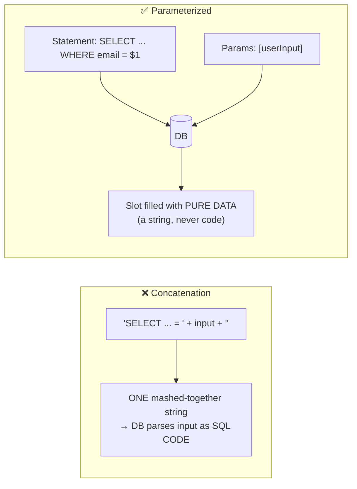

- **Part 1 (statement):** tables, conditions, operations. **No user data.**
- **Part 2 (parameters):** the **slots** filled at runtime with data you don't know at compile time (e.g. from a query param).
- The DB sees `$1` as a **slot** and inserts the value **purely as data**. So `' OR '1'='1' --` is just a **garbage string** that matches no email. ✅
- **Validation should catch it even earlier** (it isn't a valid email). But if validation is weak, the **driver still protects you**.

> 🔑 **Every modern DB driver supports parameterized queries, and every ORM uses them by default.** The only way to be vulnerable is to **deliberately bypass them** by building raw SQL strings yourself. (See [Databases_Notes.md](Databases_Notes.md).)

### Least privilege for the DB user
The credentials your backend uses to connect to the DB should have **only DML permissions**:

| Type | Statements | Backend DB user should have it? |
|---|---|---|
| **DML** (Data Manipulation Language) | `SELECT`, `INSERT`, `UPDATE`, `DELETE` | ✅ Yes |
| **DDL** (Data Definition Language) | `CREATE`, `ALTER`, `DROP` (tables) | ❌ No |

So even a successful injection **can't drop tables**.

---

## 6. NoSQL Injection (39:25)

> "I use MongoDB, I don't write SQL, so I'm safe." ❌ **Wrong.**

- MongoDB queries are **JSON-like objects**, and they can contain **operators**: `$ne` (not equal), `$gt` (greater than), `$exists`... as nested keys starting with `$`.
- If an attacker controls the **structure** (not just the value), they can inject operators.

```js
// Normal intent:  find user where email equals a string
db.users.findOne({ email: req.body.email, password: req.body.password });

// Attacker sends JSON body:
// { "email": "admin@site.com", "password": { "$ne": null } }
// → query becomes: password NOT EQUAL null → matches! 😱  (logs in without a password)
```

- **Never pass raw user JSON directly into a DB query.** Validate types: `email` must be a **string**, not an object (see [Validation_Notes.md](Validation_Notes.md)).

---

## 7. Command Injection (41:04)

Same idea as SQL injection, but the target is the **operating system**: input concatenated into a **shell command** (system command or CLI tool).

**Example:** users upload images, and your server **resizes/compresses** them with a CLI tool (the video mentions **FFmpeg**). The **output filename comes from the user**:

```bash
# Intended (filename from user = "output.jpg")
ffmpeg -i input.jpg -vf scale=220:120 -o output.jpg

# Attacker's filename:  "output.jpg; rm -rf /"
ffmpeg -i input.jpg -vf scale=220:120 -o output.jpg; rm -rf /
#                                                  ▲ ends command 1, runs "delete everything from root"
```

- Attackers can get creative: **pipes `|`** to send output to other commands, **`&`** to run things in the **background** (e.g. spyware). Each shell (bash, zsh, fish) has its own special characters and escape sequences.

### ✅ Fix: separate the command from its arguments
Use language APIs that take the **command** and an **argument array** separately and pass arguments **directly to the process**, **bypassing the shell interpreter**:

```js
// ❌ Vulnerable: goes through a shell
exec(`ffmpeg -i input.jpg -vf scale=220:120 ${userFilename}`);

// ✅ Safe: argument array, no shell interpretation
execFile("ffmpeg", ["-i", "input.jpg", "-vf", "scale=220:120", userFilename]);
```

```go
// ✅ Go
exec.Command("ffmpeg", "-i", "input.jpg", "-vf", "scale=220:120", userFilename).Run()
```

---

## 8. The Injection Mental Model (46:20)

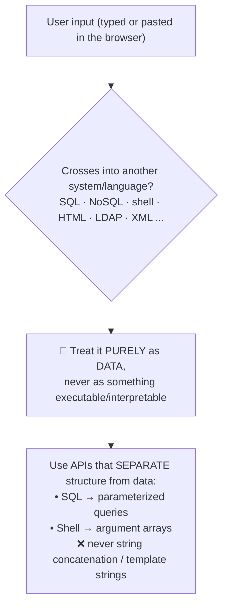

> 🧠 **The paranoia trigger:** whenever you build a **string that another system will interpret**, and it **includes user input**, **stop and look for a parameterized alternative**. One almost always exists.

---

## 9. Authentication: Use an Auth Provider? (48:17)

**Authentication** = verifying identity: working out **which row in your `users` table** the current requester is. Get it wrong and attackers can **impersonate users, read private data, act on their behalf, steal money** (**account takeover**, which happens in the real world every day). See [Auth_Notes.md](Auth_Notes.md).

### 💡 Advice: in production, use an auth provider if you can

It's not about avoiding your own crypto. It's about avoiding the **whole auth flow**:

| Why production auth is hard | |
|---|---|
| **Stateful auth** (preferred) | Track **all devices** a user is logged in on. Let users (or you) **revoke all sessions instantly**. Needs DB, cache (Redis), permission storage, timeouts, revocation across cache and DB... |
| **Social login** | "Sign in with Google / GitHub / Twitter" means **OAuth flows** in backend **and** frontend (redirects, smooth UX) |
| **Account linking** | A user who signed up with **email+password** who later clicks **"Sign in with Google"** (same email) must be recognized as the **same user** |
| ...and more | Weeks of developer time. Cutting corners hurts **security or UX**. |

| Benefits of a provider (e.g. **Clerk**) | Notes |
|---|---|
| Saves **time and developer salary** | A few buttons and an API key give world-class UX and security |
| A **dedicated security team, 24/7** | Handles edge cases you won't think of and reacts quickly to new attacks |
| Extras like **RBAC permissions**, advanced security | |
| Cost | Bills grow with users. At **millions of users** ($10k–20k bills) you'll likely have the **revenue and bandwidth** to migrate to your own auth. |

> Even with a provider, **understand how auth works** to configure and integrate it securely, which is why the next sections exist.

---

## 10. Password Storage (58:00)

The evolution, step by step:

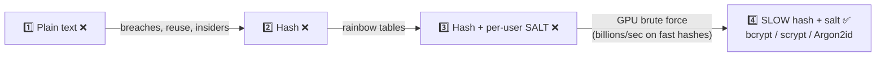

### 1️⃣ Plain text ❌

```
 users: email=a@x.com  password=12345     ← stored as-is
```

Why it's terrible:
- **Databases get breached constantly**, at companies of every size (revenge-seeking insiders, breached third-party services...).
- **Password reuse:** **>70% of users** reuse the same email+password on many sites, so **one breach** lets attackers try those credentials on **banking, e-commerce, social sites** (**credential stuffing**). Forcing resets on *your* site doesn't protect the others, and users rarely notice breaches.
- **Insiders:** every developer, DBA, contractor or freelancer with DB access can **read every password**.

### 2️⃣ Hashing

A **hash function** is:

| Property | Meaning |
|---|---|
| **One-way** ⭐ | Infeasible to get the input back from the output (with today's computing) |
| **Fixed-length output** | Any input length (1 char or 100s) → output of a **fixed length** (e.g. always 27 chars for that algorithm) |
| **Deterministic** | Same input → **always the same output** |

```
 Signup:  "12345" → hash() → "$2b$10$Xk...Q2"  → store the HASH
 Login:   typed "12345" → hash() → compare with stored hash → match? ✅ log in
 Breach:  attacker gets hashes only → can't reverse them (in theory)
```

### ❌ But rainbow tables
Hashing became the industry standard, so attackers built huge **precomputed tables** mapping **common passwords → their hashes** for popular algorithms:

```
 "12345"     → "e3b0c4..."
 "password"  → "5f4dcc..."
 "qwerty"    → "d8578e..."
```

Since hashes are **deterministic**, a breached hash that matches a table entry **reveals the password**. Some percentage of users always use common passwords.

> 📌 **Extra:** strictly, a "rainbow table" is a space-efficient variant of a **precomputed lookup table**. The idea is the same.

### 3️⃣ Salting
Kill the **sameness**: generate a **unique random salt per user** with a **cryptographically secure pseudo-random generator** (e.g. from **OpenSSL**), **store it** with the user, and hash **`password + salt`**.

```
 user 14: email=a@x.com
          salt=SP3k9...            (random, unique to this user)
          hash=H("12345" + "SP3k9...") = "9fa1..."
```

- Now **"12345" hashes differently for every user**, so a rainbow table finds **zero matches**, even though the password is common.

### ❌ But GPU brute force
- Modern **GPUs** (cheaply rentable, thanks to the LLM boom) can compute **billions of SHA-256 hashes per second**.
- With the breached DB (**hash + salt**), attackers do **offline brute force** per user: try `common_password + salt`, compare. They can cover **every password up to 8 characters** and common patterns **within days**.
- **SHA-256 and MD5** are **general-purpose fast hashes** (e.g. **file-integrity checks**). **Don't use them for passwords.**

### 4️⃣ Slow, tunable password hashes ✅

| Algorithm | Status |
|---|---|
| **bcrypt** | Long-time default for web apps |
| **scrypt** | Memory-hard alternative |
| **Argon2id** ⭐ | **Current industry standard**: most secure and performant |

- Built **deliberately slow**, with a **cost / work factor** you tune to your system (e.g. ~**100 ms** vs **5 ms** per hash).

```
                       Genuine user                 Attacker (offline brute force)
 Hash time = ~400 ms   Login takes 400–600 ms        Billions/sec → ~4–5 attempts/sec
                       → imperceptible ✅             Days → DECADES or CENTURIES 🛡️
```

> 📚 Recommended reading: **Lucia** (formerly an auth library, now a **guide to implementing secure authentication** with industry best practices).
>
> 📌 **Extra:** bcrypt and Argon2id **generate and embed the salt in their output automatically**, so in practice you rarely manage salts by hand. Just call `bcrypt.hash(password, cost)` / `argon2.hash(password)` and `verify`.

---

## 11. Sessions (1:19:33)

After login, you can't make users type their password on every request. You must **remember** that they authenticated.

```mermaid
sequenceDiagram
    participant B as Browser
    participant S as Server
    participant ST as Session store (Redis / Postgres)
    B->>S: login (email + password)
    S->>S: verify password (Argon2id/bcrypt)
    S->>S: ① generate RANDOM session ID (CSPRNG, ≥128 bits)
    S->>ST: ② store session ID + metadata<br/>(user ID, created_at, expires_at, IP, user agent)
    S-->>B: ③ Set-Cookie: sid=<id>; HttpOnly; Secure; SameSite=Strict
    B->>S: later requests (cookie sent automatically)
    S->>ST: look up session ID → user
    S-->>B: response as that user
```

| Step | Details |
|---|---|
| **① Random session ID** | **Long and random** (the video says 128–256 *characters*. 📌 the usual guidance is **≥128 bits of entropy**). From a **cryptographically secure pseudo-random number generator**. If guessable, attackers can **hijack any session**. With 128 bits, possible IDs outnumber **atoms in the universe**. |
| **② Store server-side** | In **Redis** (fast) or the **primary DB** (Postgres/MySQL), with metadata: **user**, **created at**, **expires at** (e.g. 7 days, for timeouts and revocation), **IP address** (show "where you're logged in"), **user agent** (device/browser: Chrome, Firefox, Android, iPhone...) |
| **③ Send in a cookie** | Sent automatically with every request. The server **extracts it → looks it up → identifies the user**. |

> JWTs differ (stateless, nothing stored), but the **philosophy of identifying the user is the same**.

---

## 12. Cookie Security Flags (1:24:21)

```http
Set-Cookie: sid=9f8a...; HttpOnly; Secure; SameSite=Strict; Path=/; Max-Age=604800
```

| Flag | What it does | Protects against |
|---|---|---|
| **HttpOnly** | **JavaScript can't read** the cookie | **XSS** stealing the session ID or JWT. (That's also why **localStorage is discouraged** for tokens: any injected JS can read it.) |
| **Secure** | Cookie sent **only over HTTPS** (TLS) | Interception on **public Wi-Fi / cafés**, **malicious ISPs**, compromised routers, or sniffers like **Wireshark** reading plain HTTP traffic |
| **SameSite** | Controls whether the cookie is sent on **cross-site requests** | **CSRF** ([§18](#18-csrf-23110)) |

### SameSite values

| Value | Behavior | Use for session cookies? |
|---|---|---|
| **Strict** | Sent **only** for requests originating from **your own site**. Not even when someone clicks a link to your site from another site. | ✅ **Best** |
| **Lax** | Sent for **top-level navigation** (clicking a link to your site), **not** for embedded elements like **images or iframes** from other sites | ✅ OK (needed if frontend and backend are on different sites) |
| **None** | Sent with **all** requests. **Requires `Secure`.** | ❌ **Never** for session cookies |

---

## 13. JWT (Stateless Auth) and Its Problems (1:29:55)

### Sessions vs JWT

| | **Session (stateful)** | **JWT (stateless)** |
|---|---|---|
| Server stores | Session data (user, IP, UA...) in DB/Redis | **Nothing** |
| Client gets | **Just the session ID** | **The whole session data** (as claims) |

> "If the client tells us who the user is, can't they just claim to be user B?" **No, because of the signature.**

### JWT structure (see jwt.io)

```
 eyJhbGciOiJIUzI1NiJ9 . eyJzdWIiOiI0MiIsIm5hbWUiOiJKb2huIERvZSIsImFkbWluIjp0cnVlLCJpYXQiOjE3...} . SflKxwRJSMeKKF2QT4fw...
 └──── HEADER ──────┘   └──────────────────────── PAYLOAD (claims) ───────────────────────────┘   └──── SIGNATURE ────┘
   algorithm used          sub (user ID), iat (issued at), + custom: name, admin...                HMAC(header.payload, SECRET)
```

| Part | Contains |
|---|---|
| **Header** | Describes the token: the **algorithm** |
| **Payload (claims)** | Key-value info: **`sub`** (subject = user ID, e.g. UUID), **`iat`** (issued-at timestamp, used to check expiry), plus **custom claims** (`name`, `admin`...) |
| **Signature** | **header + payload signed with a secret** (random, cryptographically secure, kept in an **env variable**) |

### Flow

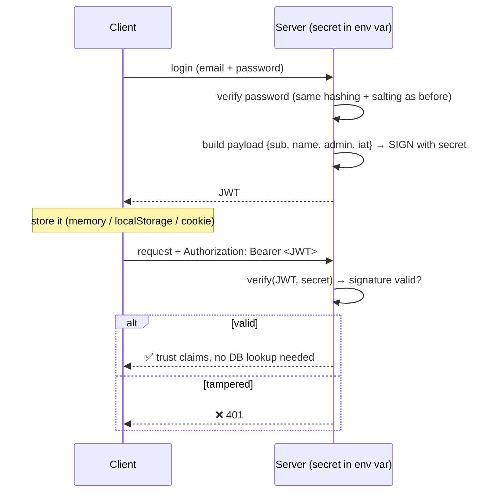

- **Advantage:** **no DB/Redis lookup** per request, so **easier scaling**.

### 🔍 The payload is just Base64 (readable!)

**Demo:** decoding the payload with a Base64 tool shows the full JSON (ID, name, admin, iat). Editing it (`John Doe` → `John Do`), re-encoding, and pasting it back into jwt.io gives **"signature verification failed"**, so the server **rejects** the tampered token.

> 🔑 JWTs are **tamper-proof, not secret**. **Never put sensitive info in the payload**, only things that are harmless if exposed.

### ⚠️ JWT problem 1: revocation is hard
- **Sessions:** delete the row and the user is logged out instantly.
- **JWT:** the token lives on the client and you **can't delete it remotely**. If an account is **compromised** and the user asks support to "**log out all my devices**", stateless auth **can't help** (short of rotating the secret, which logs out everyone).

**Community workarounds:**

| Workaround | How |
|---|---|
| **Blacklist** | Store revoked tokens in a DB or Redis and reject requests carrying them (which brings back a lookup) |
| **Short-lived access + refresh tokens** | On login, issue an **access token** (expires in **5–10 min**) and a **refresh token** (**1–7 days**). When the access token expires → **401** → the client sends the refresh token → the server validates it and issues **new access + refresh tokens**. A stolen access token is only useful for minutes. |

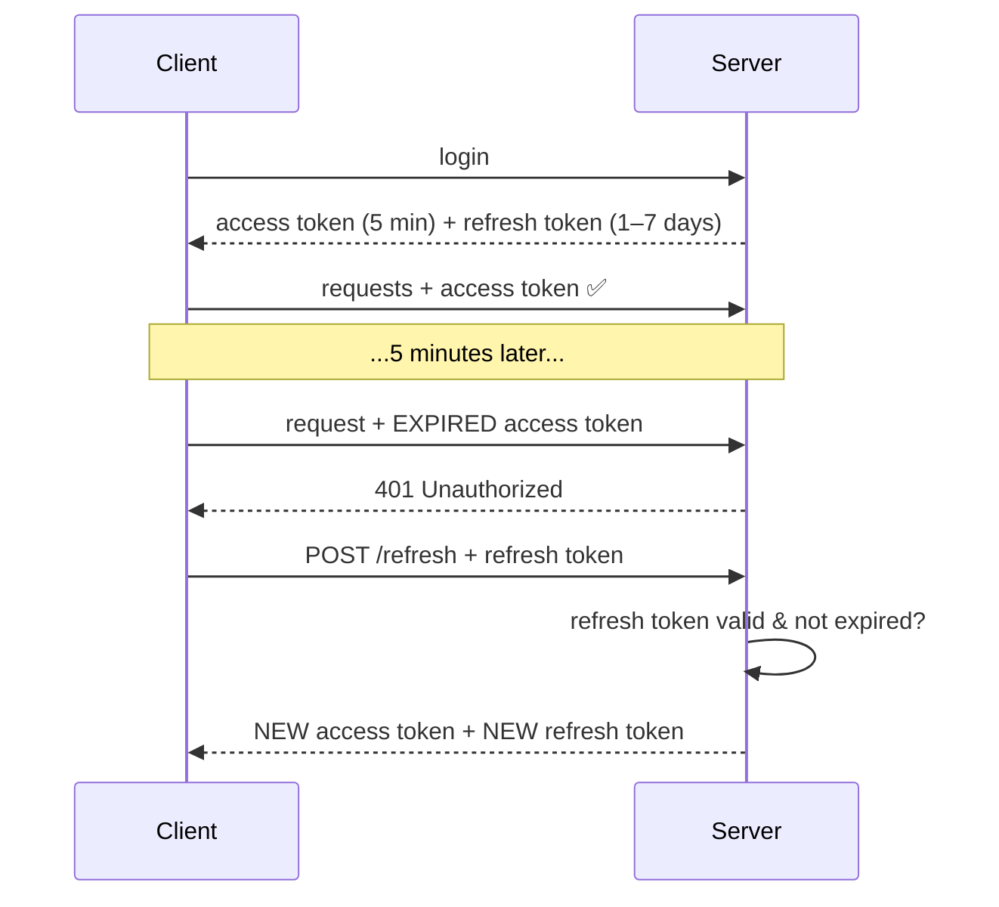

### ⚠️ JWT problem 2: storage
- **localStorage** (still the most used) → **readable by any JS → XSS can steal it** ❌
- **HttpOnly cookie** → safe from JS... and now you're **back to cookie-based sessions** anyway.

### 💡 The presenter's verdict

> **Prefer stateful sessions** unless you have specific scaling needs. Even then, **distributed key-value stores like Redis** can hold sessions across many servers. Stateful is **simpler**, revocation is **straightforward**, and it **fits most SaaS projects**. JWT trade-offs "**just aren't worth it**".
>
> **If you do use JWTs:** **short expiry** (minutes to hours, not days), **refresh tokens with server-side storage**, and **HttpOnly cookies, not localStorage**. Even so, these feel like **hacks** compared to stateful auth.

---

## 14. Rate Limiting for Authentication (1:46:25)

**Without rate limiting:** attackers try **thousands to billions** of credential combinations on your login endpoint, leading to **(1) account takeover** or **(2) a server crash** from the volume.

> Rate limiting is **mandatory**. Be **stricter on auth endpoints** and **more generous elsewhere**. For auth, use **multiple layers**:

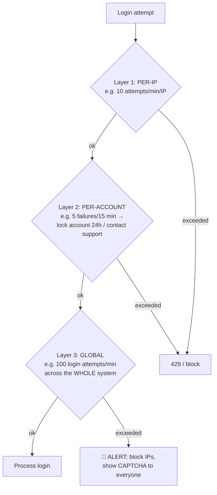

| Layer | Stops | Weakness |
|---|---|---|
| **Per IP** | Simple automated attacks from one machine | Orgs and universities **share one outgoing IP**. Attackers **rotate IPs** (botnets, proxies, VPNs). |
| **Per account** | Attacks that **rotate IPs** against **one account** | **Password spraying:** try **one common password** (`12345`) across **many accounts** (one attempt each) from many IPs |
| **Global** | Spraying across accounts **and** IPs. Too many system-wide (failed) logins per minute trigger an **alert**. | Your last resort: then **block IPs** and **show CAPTCHAs** to separate real users from attackers |

> The layered approach prevents both **brute-force account takeover** and **server crashes** from attack volume. (See the rate-limiting middleware in [Handlers_Middleware_Context_Notes.md](Handlers_Middleware_Context_Notes.md).)

---

## 15. Authorization Vulnerabilities (1:51:55)

**Authorization** = **what an identified user may do** (permissions). Everyone understands the definition. The **vulnerabilities come from confusion in the technical implementation**.

### The false sense of security

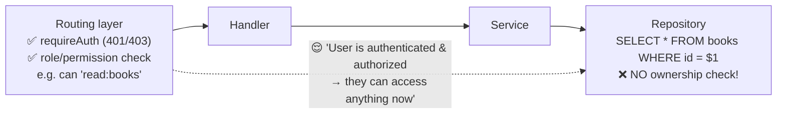

- **Auth middleware** at the routing layer checks the session cookie or JWT (some routes, like login, are public). It may also check **role** (member/admin) or **granular permissions** (`read:books`, `write:books`).
- **But** "has `read:books` permission" **≠** "**can read ALL books**".

**Scenario:** the UI has a filter where users pass book IDs → `GET /books?id=5` → passes auth and the `read:books` check → repository runs `SELECT * FROM books WHERE id = 5` → **returns book 5, which belongs to someone else**. 😱

### 🔴 BOLA: Broken Object Level Authorization

> The system checks auth and authorization at the **routing layer**, but **not at the object/data level** in the repository.

- It sounds harmless with books. Now imagine **invoices**: a script **iterates over every ID**, downloading every invoice and users' **financial data**, maybe even **tampering** with invoice URLs or account numbers.

**✅ Fix: check ownership at the point of access (the repository):**

```sql
-- ❌ Vulnerable
SELECT * FROM invoices WHERE id = $1;

-- ✅ Ownership enforced in the query itself
SELECT * FROM invoices WHERE id = $1 AND user_id = $2;   -- $2 = ctx.userId (from the auth middleware, request context)
```

- This applies to **every** query: **SELECT, UPDATE, DELETE, INSERT**, not just reads.
- The user ID comes from the **request context** set by the auth middleware, **never from the client** (see [Handlers_Middleware_Context_Notes.md](Handlers_Middleware_Context_Notes.md)).

### 🤫 Subtle leak: 403 vs 404

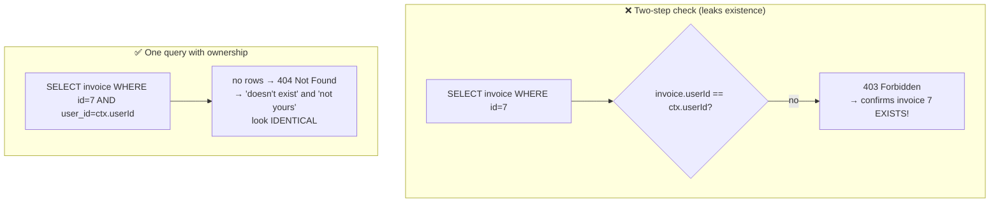

- Returning **403** "technically" fits, but **confirms the resource exists**. Attackers can loop over IDs (5, 17, 18...) to **enumerate existing invoices**, then plan **social engineering** attacks (tricking humans into revealing data).
- Returning **404** means the attacker **can't tell "doesn't exist" from "belongs to someone else"**.

> 📌 This complements [Error_Handling_Notes.md](Error_Handling_Notes.md) (no rows → 404) and the generic-auth-errors idea in [Auth_Notes.md](Auth_Notes.md): **don't leak information**.

### 🔴 BFLA: Broken Function Level Authorization

> Restricting access to **functions**, especially **admin-only** ones, rather than to **data**.

- **Example:** `GET /admin/invoices` lists **all** invoices for support staff. There's **no** `user_id` filter, by design (admins see everything), so this **isn't** a BOLA issue.
- **The mistake:** "protecting" the admin panel by **not sharing its URL**. Admin login uses the **same flow** as members, and the only difference is **knowing the URL**. Anyone who **spots that URL** (e.g. in network traffic) can log in as a normal user and **call the API directly**.
- This is **security through obscurity**: hiding information and making clever assumptions instead of real protection.

**✅ Fix:** after auth and permission checks, add a **role middleware**. Both members and admins may have `read:invoices`, but **only `role = admin`** may call admin functions.

```js
router.get("/admin/invoices", requireAuth, requirePermission("read:invoices"), requireRole("admin"), listAllInvoices);
```

### 🔴 IDOR: Insecure Direct Object References (sequential IDs)
- **Sequential IDs** (`/invoices/101`, `/102`, `/103`) let attackers **guess** other resources and **enumerate** them.
- **✅ Use UUIDs** as primary keys: **random**, **URL-friendly**. 📌 Note: UUIDs have some **performance trade-offs** (index locality). Read up on them (e.g. time-ordered UUIDv7).

### 🧭 Simple mental model: horizontal vs vertical

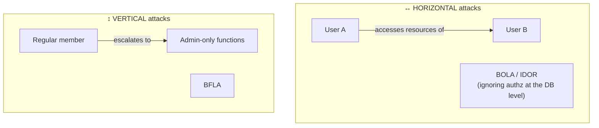

| Type | What widens | Examples |
|---|---|---|
| **Horizontal** | Scope across **other users** at the same level | **BOLA**, **IDOR** |
| **Vertical** | Scope **up** into **higher privileges** | **BFLA** (member calls admin functions) |

---

## 16. Preventing Authorization Bugs (2:12:50)

| # | Practice | Why |
|---|---|---|
| 1 | **Centralize authorization logic** | Not scattered (applied inconsistently or forgotten). One clear **authorization layer** every request passes through: easy to understand, maintain, scale. |
| 2 | **Default deny** | If the logic doesn't **explicitly allow** something, **deny** it. New resources and endpoints are **protected by default**, even if you forget to configure them. |
| 3 | **Test authorization specifically (automated)** | Not just happy paths. Test that **User A ✗ User B's resources**, **member ✗ admin functions**, **unauthenticated ✗ protected resources**. Run in **CI/CD** on every change, because manual testing misses regressions. |
| 4 | **Audit logs** | Log **sensitive access** (admin endpoints: who, what, when) and **failed authz checks** (A trying to reach B's data) as **security events**. Someone may be **probing** your system. |

---

## 17. Cross-Site Scripting (XSS) (2:18:27)

> **XSS:** an attacker gets **their JavaScript** to **execute in another user's browser** **in the context of your site**.

> *The video promises a small XSS demo near the end, but the transcript doesn't include one. These notes cover the explanation.*

### Why it's dangerous
JS running in your page's context can:
- **Read everything on the page**, including sensitive data
- **Make API requests as the logged-in user** (cookies and localStorage, unless the cookie is **HttpOnly**)
- **Redirect** users to **phishing pages** to steal credentials
- **Alter page content** to trick users

### Stored XSS: how it happens

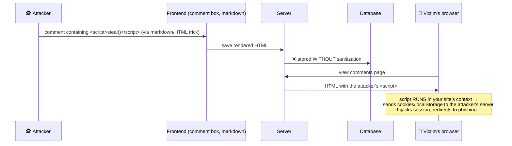

- **Example:** a blog **comment / discussion board** with **markdown** support. Markdown (`# heading`, `- bullets`) is converted to **HTML** (e.g. `<ul><li>...`) with libraries like **remark / rehype** (plugin-based) and **injected into the DOM** to render.
- If the attacker sneaks a `<script>` into the HTML, and the server **stores it unsanitized**, **every viewer** runs it.
- **React** deliberately names its raw-HTML prop **`dangerouslySetInnerHTML`**: when you use it, **you're on your own** regarding XSS.
- Popular libraries (React, remark, rehype) handle safety by default. The risk is in **DIY or legacy** rendering.

### Types

| Type | Where the payload comes from |
|---|---|
| **Stored XSS** | Saved in your DB (comments, profiles) and served to every viewer |
| **Reflected XSS** | Comes from the **URL** (e.g. a query param echoed into the page) |
| **DOM-based XSS** | Client JS writes untrusted data into the DOM (e.g. `innerHTML`) |

> 🔑 **Root cause of all XSS: user content treated as code instead of data**, just like SQL injection, but in the **browser** (HTML/JS context) instead of the DB.

### ✅ Prevention

| Defense | Role |
|---|---|
| **Sanitize user-provided markup** in the validation layer before storing (e.g. strip `<script>` tags) | **Primary fix.** Handle every piece of user data mindfully (search queries, HTML, large images...). |
| **Content Security Policy (CSP)** header | **Last line of defense, not the prevention.** The server tells the browser which resources to trust: e.g. **scripts only from your domains**, **no inline scripts** (which blocks injected `<script>`), images only from allowed domains. |

```http
Content-Security-Policy: default-src 'self'; script-src 'self'; img-src 'self' https://cdn.example.com; object-src 'none'
```

> 📌 **Extra:** also **escape/encode output** by default (React's JSX does this automatically), and when you must render user HTML, use a well-tested sanitizer like **DOMPurify** rather than hand-rolled filters.

---

## 18. CSRF (2:31:10)

> **CSRF (Cross-Site Request Forgery):** in the presenter's view, **not a major threat for modern apps** using up-to-date tech, but legacy systems still exist.

### How it works

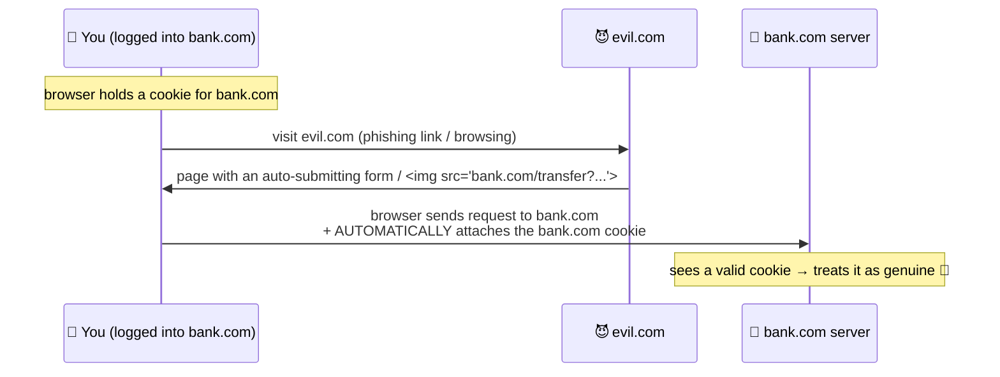

The root cause: browsers **automatically attach cookies** for a site to requests **to that site**, **even when the request originates from another site**.

### Why it's mostly mitigated today

| Defense | How |
|---|---|
| **SameSite cookies** ([§12](#12-cookie-security-flags-12421)) | **Strict** or **Lax**. **Modern browsers default to Lax.** Unless you set **None**, cross-site sub-requests won't carry your session cookie. |
| **CORS config** | Your backend only sets CORS headers for **your own frontend's origin**, so the browser blocks other origins' responses (see [HTTP_Notes.md](HTTP_Notes.md)). Not a robust security mechanism on its own, but another line of defense. |

> 📌 **Extra:** for state-changing endpoints in apps that must allow cross-site cookies, use **anti-CSRF tokens** (synchronizer or double-submit pattern), and never change state on GET requests.

---

## 19. Security Misconfiguration (2:35:17)

### 1. Secrets management (the most abused concept)
Secrets = **API keys, DB passwords, encryption keys, JWT/auth secrets**.

- ❌ **Never commit secrets to source code**: anyone with **GitHub/GitLab/Bitbucket** repo access can read them and access your DB, external services and users' data.
- ✅ Keep them in **environment variables** or a **secrets manager** (AWS Parameter Store, HashiCorp Vault...). See [Config_Management_Notes.md](Config_Management_Notes.md).
- ⚠️ If a secret is **accidentally committed**, **deleting it isn't enough**: it stays in **commit history**. **Rotate it immediately** (revoke and create a new one).

### 2. Debug mode in production
- **Locally** the log level is **debug**: stack traces (function and file names, code structure), **raw SQL queries**, **DB pool/transaction info**, possibly user data.
- **Production** must be **info** (or anything except debug). Otherwise all of that lands in **production logs**, and if logs are **breached**, attackers learn your **code structure**, **user data**, **DB details**.
- Know the log level of **each environment** (local, staging, production). See [Observability_Notes.md](Observability_Notes.md).

### 3. Security headers

| Header | Protects against |
|---|---|
| **Content-Security-Policy** | XSS ([§17](#17-cross-site-scripting-xss-21827)) |
| **X-Frame-Options** | **Clickjacking:** other sites **embedding your site in an iframe** and overlaying invisible elements or running scripts to capture credentials and interactions (phishing) |
| Others (HSTS, X-Content-Type-Options...) | See the security headers section of [HTTP_Notes.md](HTTP_Notes.md) |

> ✅ Every major framework (Node/**Express**, Go/**Echo**/**Gin**, Python/**Django**...) offers **ready-made security middleware**. It's a **one-line change** that sets the industry-standard headers. 📌 e.g. **`helmet`** for Express.

```js
// 📌 Extra: Express
import helmet from "helmet";
app.use(helmet()); // CSP, X-Frame-Options, HSTS, X-Content-Type-Options, ...
```

---

## 20. The Big Picture (2:41:10)

### Every vulnerability is about BOUNDARIES

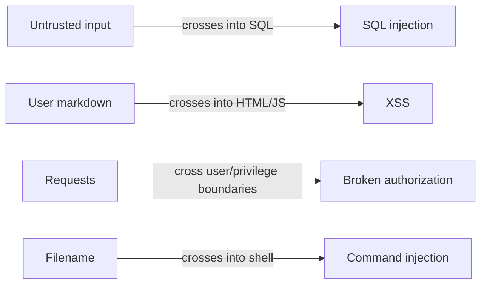

Data crosses boundaries **between systems, privilege levels, languages and markup structures**. Every time, be careful.

> 🧠 **Ask these three questions every time you write code:**
> 1. **Where is data crossing a boundary?**
> 2. **What assumptions am I making about the data?**
> 3. **What if those assumptions are wrong?**
>
> Ask them repeatedly and you'll avoid **~99%** of the vulnerabilities modern backends suffer from.

### Defense in depth: think in layers

> **No single defense is perfect.** An attacker should have to **bypass every layer at once**, which is very unlikely.

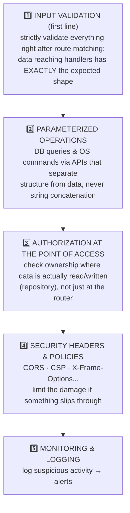

> 🔑 "Security isn't a technique you learn and implement. It's **being paranoid about your systems** and the **mindset you bring before writing every line of code**. Always think about **boundaries** and **assumptions**."

---

## 21. Resources (2:46:05)

| Resource | What it is |
|---|---|
| **PortSwigger Web Security Academy** | From the makers of **Burp Suite** (a famous ethical-hacking / penetration-testing tool). A **comprehensive catalog** of vulnerabilities with **theory and practical labs**: SQL injection, XSS, CSRF, clickjacking, **SSRF**, OS command injection, authentication, OAuth, JWT attacks, and more. **Completely free.** The presenter learned a lot here. |
| **OWASP Top 10** | A famous list of the **most critical web app vulnerabilities**, republished every few years. **Broken access control** (BOLA/BFLA...) tops it. It also covers **security misconfiguration** and **injection**, with severity and real-world examples. |
| **OWASP Cheat Sheet Series** | Per-topic best practices: e.g. **Authentication** (good and bad practices, threats), **Session Management** (why session IDs must come from a CSPRNG, configs...), and many more. The presenter has read them **multiple times over the years**. Approaching security from many domains builds the mindset. |

---

## 🧾 Quick Revision Cheat Sheet

```
ATTACKER'S QUESTION: "Where did the developer make an ASSUMPTION?"
ROOT OF INJECTION & XSS: DATA treated as CODE when crossing a language BOUNDARY
DEFENSE IN DEPTH: validate → parameterize → authorize at point of access → headers/policies → monitor
```

| Topic | Key points |
|---|---|
| Mindset | Be paranoid. No app is fully secure. Think beyond the happy path. |
| SQL injection | `' OR '1'='1' --` dumps rows. `'; DROP TABLE users; --`. Special chars: `'` `;` `--` OR DROP UNION. |
| SQLi fix | **Parameterized queries** (`$1` + params). **DML-only DB user** (no DDL). Validation. ORMs/drivers do it by default. |
| NoSQL injection | Mongo operators (`$ne`, `$gt`) injected via raw JSON. Validate types. |
| Command injection | `file; rm -rf /`, pipes, `&`. Fix: **argument arrays** (`execFile`, `exec.Command`), no shell. |
| Auth provider | Use one in production if possible (stateful sessions, revocation, OAuth, account linking are hard). Still understand auth. |
| Passwords | Plain text ❌ → hash (one-way, fixed length, deterministic) → rainbow tables ❌ → **per-user salt** → GPU brute force ❌ on SHA-256/MD5 → **bcrypt / scrypt / Argon2id** (slow, cost factor). Read **Lucia**. |
| Sessions | CSPRNG ID (≥128 bits) → store in Redis/DB with user, expiry, IP, UA → cookie |
| Cookie flags | **HttpOnly** (no JS/XSS) · **Secure** (HTTPS only) · **SameSite** Strict ✅ / Lax ✅ / None ❌ |
| JWT | header.payload.signature. Payload is **Base64 = readable** (no secrets!), signature = tamper-proof. Problems: **revocation** (blacklist, **short access + refresh tokens**), **storage** (localStorage XSS-prone). **Prefer sessions.** |
| Auth rate limiting | **Per IP** → **per account** (lockout) → **global** (password spraying → alert, CAPTCHA). Stricter on auth. |
| BOLA | Ownership check **at the point of access**: `WHERE id=$1 AND user_id=$ctx`. Applies to all CRUD. Return **404 not 403** (no existence leak). |
| BFLA | Admin functions need a **role check**. No security through obscurity (hidden URLs). |
| IDOR | Sequential IDs are enumerable, so use **UUIDs** (mind perf trade-offs) |
| Horizontal vs vertical | ↔ other users' data (BOLA/IDOR) · ↕ higher privileges (BFLA) |
| Authz prevention | **Centralize** · **default deny** · **automated authz tests in CI** · **audit logs** |
| XSS | Stored / reflected / DOM-based. Attacker JS runs in your context. **Sanitize** user markup. Beware `dangerouslySetInnerHTML`. **CSP** = last line of defense. |
| CSRF | Cookies auto-sent cross-site. Mitigated by **SameSite** (default Lax) + CORS. |
| Misconfiguration | No secrets in Git (**rotate** if leaked, since history persists) · **no debug logs in production** · **security headers** (X-Frame-Options vs clickjacking) via framework middleware |
| 3 questions | Where does data cross a boundary? What am I assuming? What if I'm wrong? |
| Resources | **PortSwigger Web Security Academy** (free labs) · **OWASP Top 10** · **OWASP Cheat Sheets** |

---

## ❓ Self-Test Questions

<details>
<summary>1. What is the stated goal of this security video?</summary>

Not to teach every technique, but to make you **paranoid** about your code and build a **security mindset**: always thinking like an attacker, because no app is ever truly secure.
</details>

<details>
<summary>2. What single question do attackers ask? Give four examples of assumptions.</summary>

"**Where did the developer make an assumption?**" Examples: input is clean, the user is who they claim, the request came from my frontend, nobody will open the Network tab and modify parameters.
</details>

<details>
<summary>3. What is the root cause shared by all injection attacks (and XSS)?</summary>

**Confusion between code and data.** User input crossing into another language's context (SQL, shell, HTML/JS) gets **interpreted as code** because of that language's special characters.
</details>

<details>
<summary>4. Explain why ' OR '1'='1' -- returns every user.</summary>

The leading `'` closes the email string (`email = ''`), `OR '1'='1'` is always true, and `--` comments out the trailing quote. `false OR true` is true for every row, so it's effectively `SELECT * FROM users`.
</details>

<details>
<summary>5. Why did '; DROP TABLE users; -- not delete the table in the demo?</summary>

The tool's DB driver **blocks multiple back-to-back statements** by default (a common modern safety mechanism). An older or unsafe driver would execute it.
</details>

<details>
<summary>6. How do parameterized queries prevent SQL injection?</summary>

The **statement** (with slots like `$1`) and the **data** are sent **separately**. The DB fills the slots with values treated **purely as data**, so injected quotes and keywords are just part of a harmless string.
</details>

<details>
<summary>7. What least-privilege rule applies to your app's DB user?</summary>

Grant only **DML** (SELECT/INSERT/UPDATE/DELETE), not **DDL** (CREATE/ALTER/DROP), so even a successful injection can't drop tables.
</details>

<details>
<summary>8. How can MongoDB be injected?</summary>

If raw user JSON reaches the query, attackers can inject **operators** like `{"$ne": null}` (e.g. as a password) to change the query's logic. Validate that fields are the expected primitive types.
</details>

<details>
<summary>9. Show a command injection and its fix.</summary>

A filename like `out.jpg; rm -rf /` concatenated into `ffmpeg ... -o <name>` runs `rm -rf /`. Fix: use **argument arrays** (`execFile("ffmpeg", [...args])`, `exec.Command(...)`) that bypass the shell interpreter.
</details>

<details>
<summary>10. Why does the presenter recommend an auth provider in production?</summary>

Production auth is complex: stateful sessions, device tracking, instant revocation, OAuth social logins, linking email and social accounts. Providers save time and money and have 24/7 security teams. You can migrate later when bills are large and you have revenue.
</details>

<details>
<summary>11. Why is storing plain-text passwords terrible beyond the breach itself?</summary>

**Password reuse** (>70% of users) means leaked credentials unlock accounts on **other sites**. Also, **insiders** (devs, DBAs, contractors) can read every password.
</details>

<details>
<summary>12. List the three properties of a hash function.</summary>

**One-way** (can't recover the input), **fixed-length output**, **deterministic** (same input gives the same output).
</details>

<details>
<summary>13. What are rainbow tables, and how does salting defeat them?</summary>

**Precomputed maps of common passwords → hashes.** A **unique random salt per user** (stored with the user) is mixed in before hashing, so identical passwords produce different hashes and the table finds no matches.
</details>

<details>
<summary>14. Why isn't salt + SHA-256 enough, and what should you use?</summary>

GPUs compute **billions** of SHA-256 hashes per second, enabling offline brute force within days. Use **slow, tunable** password hashes: **bcrypt, scrypt, or Argon2id** (current standard) with a **cost factor**. About 400 ms is fine for a user but cuts attackers to a few guesses per second.
</details>

<details>
<summary>15. How should session IDs be generated and stored?</summary>

**Long and random** from a **CSPRNG** (≥128 bits, unguessable). Stored server-side (Redis/DB) with **user, created/expiry time, IP, user agent**. Sent in a **cookie**.
</details>

<details>
<summary>16. Explain HttpOnly, Secure and SameSite.</summary>

**HttpOnly:** JS can't read the cookie (protects against XSS theft). **Secure:** sent only over HTTPS (protects against sniffing on public Wi-Fi, malicious ISPs). **SameSite:** controls cross-site sending (Strict best, Lax OK, **never None** for sessions), which mitigates CSRF.
</details>

<details>
<summary>17. If a JWT payload is readable Base64, why can't users just edit it to become admin?</summary>

The **signature** covers header and payload using the server's secret. Any change makes verification fail, so the server rejects it. But since it's readable, **never put secrets in the payload**.
</details>

<details>
<summary>18. What are JWT's two big problems and the workarounds?</summary>

**Revocation** (can't log out a compromised user instantly): blacklists, or **short-lived access tokens + refresh tokens**. **Storage** (localStorage is XSS-prone): HttpOnly cookies, which is basically sessions again. The presenter recommends **stateful sessions**.
</details>

<details>
<summary>19. Describe the three layers of auth rate limiting and what each misses.</summary>

**Per IP** (misses shared IPs and rotating IPs via botnets/VPNs). **Per account** with lockouts (misses **password spraying**: one password across many accounts). **Global** (caps system-wide attempts, triggers alerts, IP blocks, CAPTCHAs).
</details>

<details>
<summary>20. What is BOLA, and how do you fix it?</summary>

**Broken Object Level Authorization:** auth and role checks pass at the router, but the data query doesn't check **ownership**, so users can read others' objects (e.g. invoices by ID). Fix: enforce ownership **at the point of access**: `WHERE id = $1 AND user_id = $ctxUser`, for every CRUD operation.
</details>

<details>
<summary>21. Why return 404 instead of 403 when a user requests someone else's invoice?</summary>

403 **confirms the resource exists**, enabling **enumeration** and follow-up attacks like social engineering. A single ownership-filtered query returning **404** makes "doesn't exist" and "not yours" indistinguishable.
</details>

<details>
<summary>22. What is BFLA, and why is a hidden admin URL not protection?</summary>

**Broken Function Level Authorization:** privileged functions (e.g. `/admin/invoices`) lack **role checks**. A hidden URL is **security through obscurity**: once someone sees it, any logged-in user can call it. Add a **role middleware** (`role = admin`).
</details>

<details>
<summary>23. Horizontal vs vertical authorization attacks?</summary>

**Horizontal:** user A accesses user B's resources (BOLA/IDOR). **Vertical:** a regular user accesses higher-privilege functions (BFLA).
</details>

<details>
<summary>24. List four practices to prevent authorization bugs.</summary>

**Centralize authz logic**, **default deny**, **automated authorization tests in CI** (A ✗ B, member ✗ admin, anonymous ✗ protected), **audit logs** of sensitive access and failed checks.
</details>

<details>
<summary>25. What is stored XSS, and how do you prevent it?</summary>

Attacker script saved in your DB (e.g. a comment), served to and executed in every viewer's browser in your site's context (stealing cookies or localStorage, redirecting to phishing). Prevent it by **sanitizing user markup before storing** (strip `<script>`), being careful with `dangerouslySetInnerHTML`, and adding **CSP** as the last line of defense.
</details>

<details>
<summary>26. Is CSP a prevention for XSS?</summary>

**No.** It's a **last line of defense** that limits damage (only trusted script sources, no inline scripts). The real fix is properly handling and sanitizing user input.
</details>

<details>
<summary>27. How does CSRF work, and why is it mostly mitigated today?</summary>

A malicious site makes your browser send a request to another site (e.g. a bank), and the browser **auto-attaches that site's cookie**, so it looks genuine. **SameSite** cookies (browsers default to **Lax**) and **CORS** configs largely prevent this today.
</details>

<details>
<summary>28. You accidentally committed an API key and then deleted it in the next commit. Are you safe?</summary>

**No.** It's still in **commit history**. **Rotate** the secret immediately (revoke it and issue a new one).
</details>

<details>
<summary>29. Why is debug logging in production a security risk?</summary>

Debug logs contain **stack traces** (code structure), **raw SQL**, DB config and maybe user data. If production logs are breached, attackers learn a lot. Production should log at **info**.
</details>

<details>
<summary>30. What does X-Frame-Options prevent, and how do you set security headers easily?</summary>

**Clickjacking:** your site embedded in an attacker's iframe to trick users and capture interactions. Use your framework's **security middleware** (one line, e.g. `helmet` for Express).
</details>

<details>
<summary>31. What three questions should you ask whenever you write code?</summary>

**Where is data crossing a boundary? What assumptions am I making about the data? What if those assumptions are wrong?**
</details>

<details>
<summary>32. List the defense-in-depth layers from the video.</summary>

**Input validation** → **parameterized operations** → **authorization at the point of access** → **security headers & policies** (CORS, CSP...) → **monitoring & logging**.
</details>

<details>
<summary>33. Name the recommended resources for learning more.</summary>

**PortSwigger Web Security Academy** (free labs, from the makers of Burp Suite), the **OWASP Top 10**, and the **OWASP Cheat Sheet Series**.
</details>

---

*Notes compiled from the video transcript. Timestamps (mm:ss / h:mm:ss) let you jump back to each section. Transcription fixes: "skill injection / excss" → SQL injection / XSS, "BA" → BOLA, "BFA / DFL" → BFLA, "ID or" → IDOR, "argu ID / argon do id" → Argon2id, "decrypt / brypt" → bcrypt, "Lucia O" → Lucia, "radius" → Redis, "fmmppg / mpg" → FFmpeg, "OASP" → OWASP, "port sugar academy" → PortSwigger Web Security Academy, "BSU" → Burp Suite, "train table" → rainbow table, "sendation" → sanitization, "clickjing" → clickjacking, "Jin" → Gin, "radius security middleares" → ready-made security middleware.*
