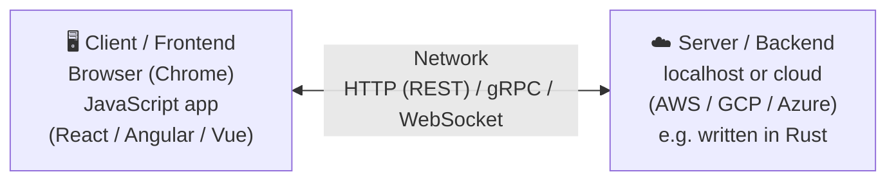
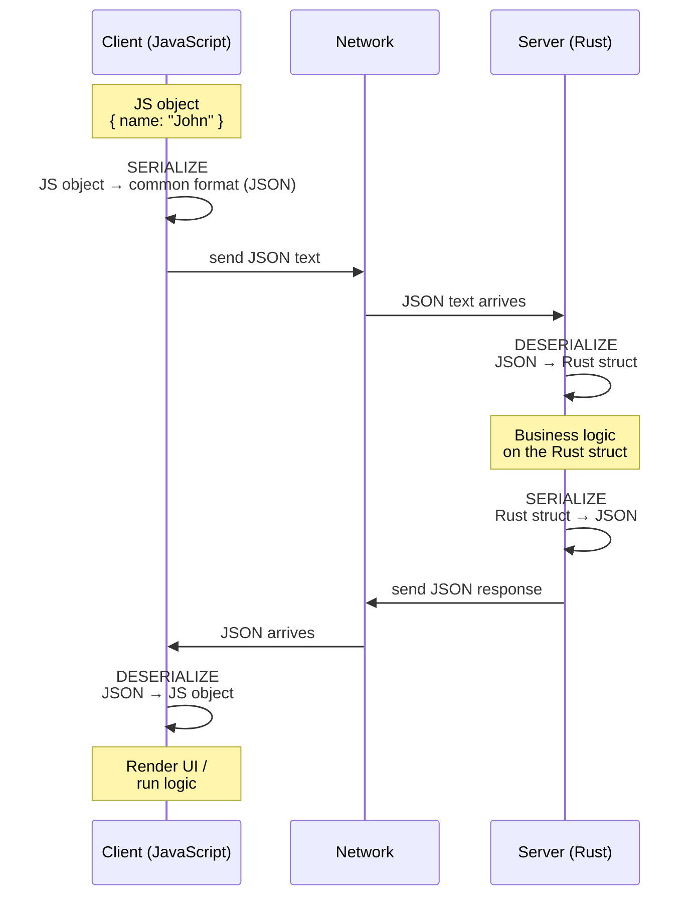
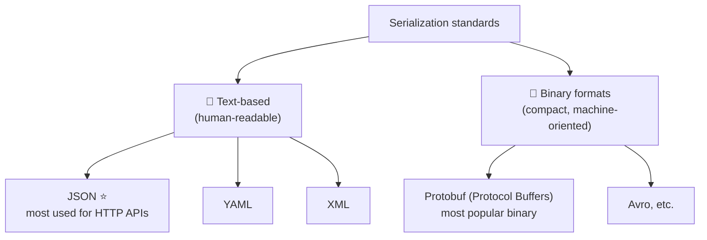
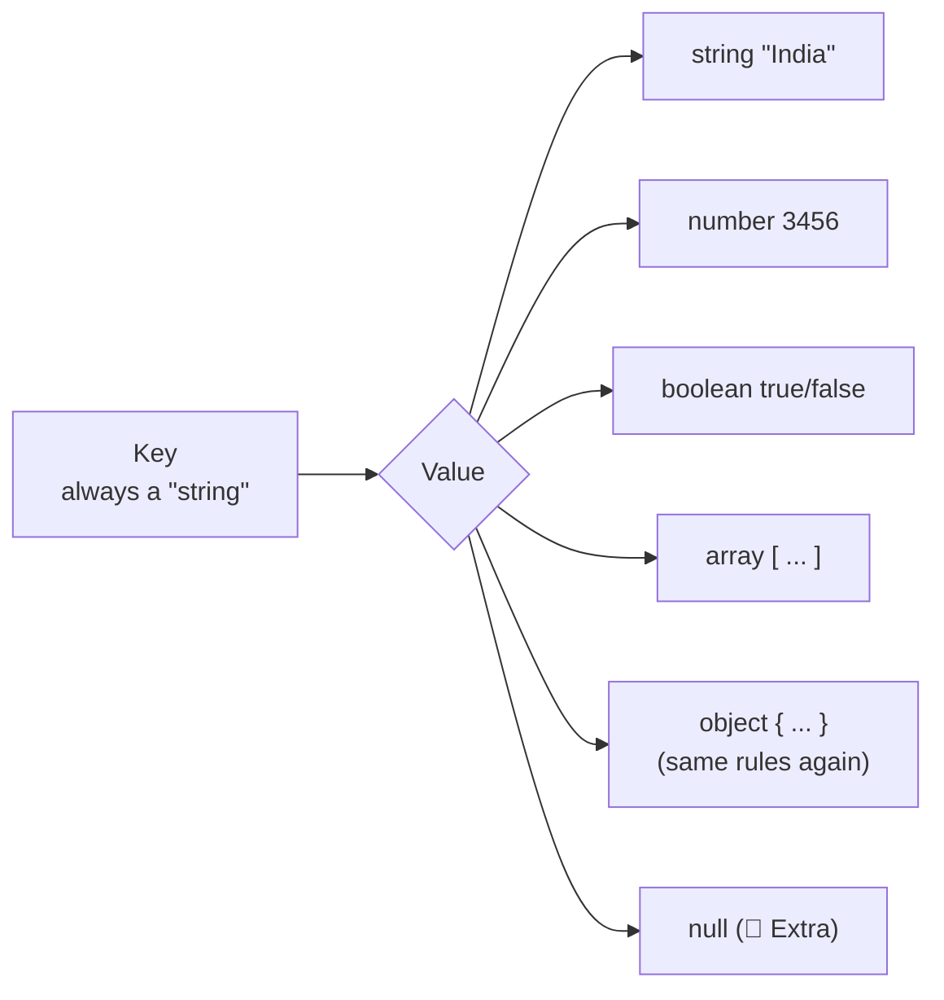
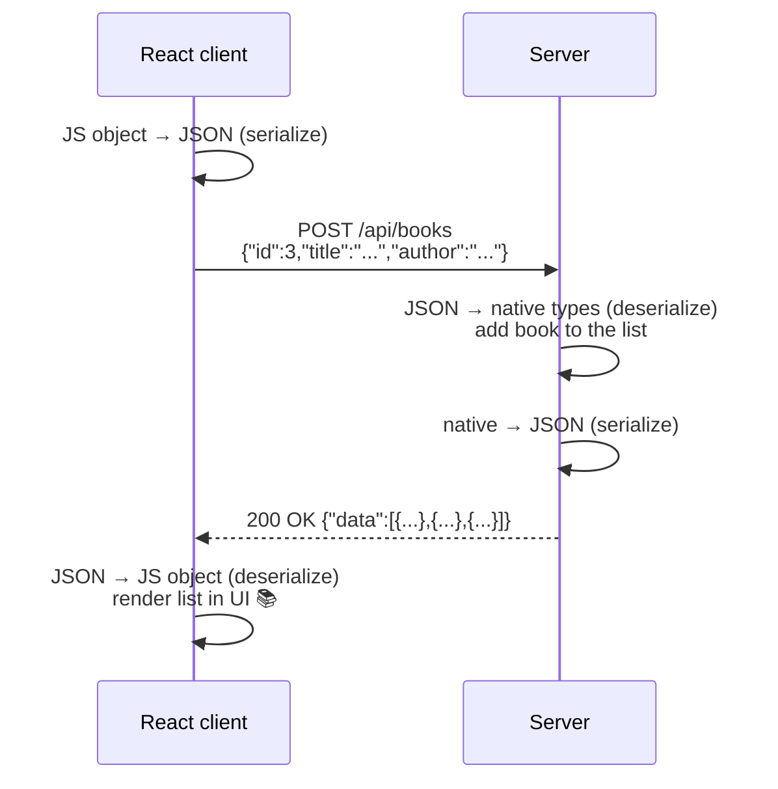

# Serialization and Deserialization: Complete Revision Notes

> **Source:** [YouTube: Serialization & Deserialization (Backend from First Principles series, part 7)](https://www.youtube.com/watch?v=vzg90tY3uM0&list=PLui3EUkuMTPgZcV0QhQrOcwMPcBCcd_Q1&index=7)
> **Length:** ~22 min
> **Previous videos:** [HTTP_Notes.md](HTTP_Notes.md) · [Routing_Notes.md](Routing_Notes.md)
> **Goal of the video:** Understand how a client and a server written in completely different languages (e.g. JavaScript and Rust) can still exchange data and understand each other.

> 💡 Diagrams use **Mermaid**. They render in GitHub, VS Code (with a Mermaid preview extension), Obsidian, and Notion. Anything marked **📌 Extra** was added to clarify a point and is not in the video.

---

## 📑 Table of Contents

1. [TL;DR: The Whole Video in 8 Lines](#-tldr-the-whole-video-in-8-lines)
2. [The Problem: Different Languages, Same Data](#1-the-problem-different-languages-same-data-0000)
3. [Data Transmission Basics (OSI Model, High Level)](#2-data-transmission-basics-0410)
4. [The Solution: A Common Standard](#3-the-solution-a-common-standard-0600)
5. [Definition of Serialization and Deserialization](#4-definition-0830)
6. [Why the Series Picks HTTP, PostgreSQL and JSON](#5-why-the-series-picks-the-most-used-tech-0911)
7. [Types of Serialization Standards](#6-types-of-serialization-standards-1104)
8. [JSON in Detail](#7-json-in-detail-1300)
9. [JSON in an API Demo](#8-json-in-an-api-demo-1612)
10. [The Backend Engineer's Mental Model](#9-the-backend-engineers-mental-model-1722)
11. [Cheat Sheet / Quick Revision](#-quick-revision-cheat-sheet)
12. [Self-Test Questions](#-self-test-questions)

---

## ⚡ TL;DR: The Whole Video in 8 Lines

1. Client (e.g. a **JavaScript** app) and server (e.g. a **Rust** app) use **completely different data types**. JS is dynamic and not compiled. Rust is strict and compiled.
2. To exchange data, both sides **agree on a common standard format**.
3. **Serialization:** converting your language's data (a JS object, a Rust struct) **into the common format** before sending or storing it.
4. **Deserialization:** converting **from the common format back** into your language's own data types after receiving it.
5. This makes communication **language-agnostic / domain-agnostic**.
6. Standards come in two families: **text-based** (**JSON**, YAML, XML) and **binary** (**Protobuf**, Avro, ...).
7. **JSON** (JavaScript Object Notation) is used ~**80%** of the time for client-server HTTP communication. It's human-readable, keys are double-quoted strings, and values are string, number, boolean, array, or nested object.
8. **Mental model:** as a backend engineer you only care that **JSON leaves the client's application layer and JSON arrives at the server's application layer**. Packets, frames and bits in between are not your concern.

---

## 1. The Problem: Different Languages, Same Data (00:00)

### The setup



- **Client:** a browser running a JavaScript app. This is the **frontend**. Most client-side apps are JS-based and highly interactive.
- **Server:** running on `localhost` or remotely in the cloud (AWS, GCP, Azure).
- **Communication** can be over **HTTP (REST APIs)**, **gRPC**, or **WebSockets**. The series focuses on **HTTP/REST**.

The client sends an HTTP request, as seen in the HTTP video:

```http
POST https://somedomain.com/something HTTP/1.1
Content-Type: application/json
                                        ← headers above, body below
{ "name": "some string" }
```

The server sends back a response, which the client must parse and **make sense of**.

### The core question

The client sends this **JavaScript object**:

```js
{ name: "some string" }
```

The server is written in **Rust**:

| | JavaScript | Rust |
|---|---|---|
| Typing | **Dynamic** | **Very strict** |
| Execution | Not compiled (interpreted/JIT) | **Compiled** |
| Data types | JS objects, numbers, strings, ... | structs, i32, String, ... (completely different) |

> ❓ **How can data created as a JS object travel over the network to a different machine, be understood as a Rust struct, have business logic run on it, and come back as a response the JS client can understand and render?**

```
  JS object  ──── ??? ────►  Rust struct
     ▲                            │
     └────────── ??? ◄────────────┘
```

---

## 2. Data Transmission Basics (04:10)

It helps to have a **high-level** idea of the **OSI model**: how layers of the network stack cooperate to send data across hardware.

- You **don't** need to master it (IP packets, data frames, and so on). Plenty of other resources cover it in depth.
- The **top layer** is the **Application layer**, and the **bottom layer** is the **Physical layer**. There are layers in between, and **both** the client and the server have the full stack.

```
        CLIENT                                    SERVER
 ┌──────────────────────┐                 ┌──────────────────────┐
 │ 7 Application  ⭐ JSON│                 │ 7 Application  ⭐ JSON│  ← backend engineers live here
 │ 6 Presentation        │                 │ 6 Presentation        │
 │ 5 Session             │                 │ 5 Session             │
 │ 4 Transport  (segments)                 │ 4 Transport           │
 │ 3 Network    (IP packets)               │ 3 Network             │
 │ 2 Data Link  (frames) │                 │ 2 Data Link           │
 │ 1 Physical   (bits)   │ ══ 0101 0110 ══►│ 1 Physical            │
 └──────────────────────┘  cables / fiber  └──────────────────────┘
                           (voltage / light signals)
```

---

## 3. The Solution: A Common Standard (06:00)

**Thought experiment:** two machines in different locations are connected over the internet. Design a way for one to send data that the other can **parse and understand**, in a **language-agnostic** way.

**The obvious answer:** a **common standard**, which is a fancy way of saying **a set of rules both sides agree to follow** for the format of the data.

### How it works step by step



1. **Client** (while the user's session runs) converts its JavaScript data **into the standard format**, then sends it over the network.
2. **Server** receives it and converts it **from the standard into its own types**, e.g. a **Rust struct**. Now it understands the data and runs its logic.
3. **Server** converts the response **from the Rust struct into the standard format** and sends it.
4. **Client** parses it **back into JavaScript** and uses it.

```
  ┌───────────────┐   serialize    ┌──────────────┐   deserialize   ┌───────────────┐
  │  JS object    │ ─────────────► │  COMMON      │ ──────────────► │  Rust struct  │
  │ {name:"John"} │                │  FORMAT      │                 │ User{name}    │
  │               │ ◄───────────── │  (JSON)      │ ◄────────────── │               │
  └───────────────┘  deserialize   └──────────────┘    serialize    └───────────────┘
       CLIENT                       on the wire                          SERVER
```

> 🔑 The agreed-upon common format is called a **serialization standard**.

---

## 4. Definition (08:30)

> **Serialization and deserialization = converting data to and from a common format, so it can be transmitted (or stored) in a way that is domain-agnostic / language-agnostic.**

| Term | Direction | Example |
|---|---|---|
| **Serialization** | Native data → **common format** | JS object → JSON string. Rust struct → JSON. |
| **Deserialization** | **Common format** → native data | JSON string → Rust struct. JSON → JS object. |

- It's used for **transmission** (over the network) **and storage** (the video mentions storage will come later).
- Thanks to it, machines, servers and clients from **different domains, languages and environments** can understand each other's data.

> 📌 **Extra:** in JavaScript, `JSON.stringify(obj)` serializes and `JSON.parse(text)` deserializes. In Rust, the `serde` / `serde_json` crate does it. In Python, it's `json.dumps()` / `json.loads()`.

```js
// 📌 Extra: JavaScript example
const user = { id: 1, name: "John" };
const text = JSON.stringify(user);   // SERIALIZE   → '{"id":1,"name":"John"}'
const back = JSON.parse(text);       // DESERIALIZE → { id: 1, name: "John" }
```

---

## 5. Why the Series Picks the Most-Used Tech (09:11)

Backend is **huge**, with hundreds of technologies. You can't learn the concepts behind all of them at once, so the series picks the **most used** option in each area. Once you have experience with those, you learn the others along the way.

| Area | Options that exist | Chosen for the series | Why |
|---|---|---|---|
| Data transmission | HTTP, WebSockets, gRPC, ... | **HTTP (REST)** | Still the most common way clients and servers communicate. Knowing it well is enough to get started. |
| Databases | **Relational:** PostgreSQL, MySQL, SQLite · **Non-relational:** MongoDB, DynamoDB (AWS) | **PostgreSQL** | One of the most popular relational DBs, often the first choice for startups and enterprises today |
| Serialization | JSON, YAML, XML, Protobuf, Avro, ... | **JSON** | Used roughly **80%** of the time for client-server communication |

---

## 6. Types of Serialization Standards (11:04)



| Family | Examples | Notes from the video |
|---|---|---|
| **Text-based** | **JSON**, YAML, XML | JSON dominates HTTP client-server communication. YAML and XML are also used for serialization, though not necessarily for HTTP APIs. |
| **Binary** | **Protobuf** (most popular), Avro, ... | Another family, not the focus of this video |

> 📌 **Extra:** binary formats are smaller and faster to parse but **not human-readable**. **Protobuf** is the format used by **gRPC**. YAML is common for config files (Docker Compose, Kubernetes, CI pipelines).

**Focus of this video and the series: JSON.**

---

## 7. JSON in Detail (13:00)

### What is JSON?

- **JSON = JavaScript Object Notation.**
- It looks and behaves **very much like a JavaScript object**, hence the name.
- But it's **not limited to JavaScript**. It's used everywhere:
  - **HTTP / REST API** data transmission (the focus here)
  - **Configuration files**
  - **Log files** (a popular choice for logging application/server data at runtime)
- **Key strength:** it's **human-readable** by design, and its data types are fundamental ones any programmer knows.

### A typical JSON object

```json
{
  "id": 1,
  "name": "John Doe",
  "isActive": true,
  "skills": ["JavaScript", "Rust", "SQL"],
  "address": {
    "country": "India",
    "phoneNumber": 3456
  }
}
```

### The rules

```
 {                                ◄── 1. Starts with an opening curly brace
   "id": 1,                       ◄── 2. KEYS are ALWAYS strings in "double quotes"
   "name": "John Doe",            ◄── 3. Values: string
   "isActive": true,              ◄──           boolean
   "skills": ["JS", "Rust"],      ◄──           array
   "address": {                   ◄──           nested object (same rules apply inside)
     "country": "India",
     "phoneNumber": 3456          ◄──           number
   }
 }                                ◄── 4. Ends with a closing curly brace
```

| Rule | Detail |
|---|---|
| Braces | Object starts with `{` and ends with `}` |
| Keys | **Must be strings inside double quotes** (`"name"`). No other type can be a key. |
| Value types | **string**, **number**, **boolean**, **array**, **nested object** (📌 Extra: also `null`) |
| Nesting | A nested object follows **exactly the same rules** (double-quoted string keys, valid values) |



> 📌 **Extra: common JSON mistakes**
> - Single quotes: `{'name': 'John'}` ❌ → `{"name": "John"}` ✅
> - Unquoted keys: `{name: "John"}` ❌ (valid JS, invalid JSON)
> - Trailing commas: `{"a": 1,}` ❌
> - Comments are not allowed in JSON.
> - Store phone numbers as **strings** in real apps (to keep leading zeros and `+` signs). The video used a number just to show the number type.

---

## 8. JSON in an API Demo (16:12)

The same **Burp Suite** + React app demo from the routing video, this time focused on the **data format**.

### Request: `POST /api/books`

```http
POST /api/books HTTP/1.1
Content-Type: application/json

{
  "id": 3,
  "title": "Some Book",
  "author": "Some Author"
}
```

- Curly braces ✔, all keys double-quoted strings ✔, values are one **number** (`id`) and two **strings** (`title`, `author`) ✔.

### Response

```json
{
  "data": [
    { "id": 1, "title": "Book One",   "author": "Author A" },
    { "id": 2, "title": "Book Two",   "author": "Author B" },
    { "id": 3, "title": "Some Book",  "author": "Some Author" }
  ]
}
```

- One key holding an **array**, and each element is a JSON **object** with number and string values.
- The client **parses** it and **renders** the book list in the UI. The client could be JavaScript, PHP, or anything else.



> 🧠 This **whole flow** is **serialization and deserialization**. There aren't many concepts to it: it's a **phenomenon** in the backend world that you need to know exists.

---

## 9. The Backend Engineer's Mental Model (17:22)

Deep in the OSI model, data goes **application layer → segments → IP packets → data frames → bits (0101)**, sent as **voltage/light signals over optical fiber** and so on, then rebuilt in reverse on the other side.

**As a backend engineer, none of the intermediate steps are your concern.** Your mental model:

```
  CLIENT                                                           SERVER
 ┌────────┐                                                       ┌────────┐
 │  JSON  │──► [frames → packets → 0101 bits → ... → 0101] ──────►│  JSON  │
 └────────┘        ▲  network's job, NOT yours  ▲                 └────────┘
     ▲                                                                 │
     │ You care about THIS            and                  THIS        │
     └─────────────── same JSON in, same JSON out ─────────────────────┘
```

- The **client** must **adhere to the standard** (JSON) when sending.
- The **server** must **understand the standard** (JSON) when receiving, and respond in the same standard.
- Whatever happens in between, the server **only ever reads JSON** at its application layer.

### Final summary (from the video)

> Serialization and deserialization are techniques that convert data into a **common, standard format** so that **clients can send data** in that format, **servers can receive, parse and understand it**, run business logic, and **send data back in the same format**, so the client can do the same. The point is to make data **understandable across domains and languages**.

---

## 🧾 Quick Revision Cheat Sheet

```
SERIALIZE   = native data  ──►  common format   (JS object / Rust struct → JSON)
DESERIALIZE = common format ──►  native data     (JSON → Rust struct / JS object)
WHY         = different languages have different types → need a language-agnostic standard
WHEN        = transmitting over the network  +  storing data
```

| Topic | Key points |
|---|---|
| The problem | JS (dynamic, not compiled) ↔ Rust (strict, compiled): completely different types |
| The solution | A common standard (agreed rules) both sides convert to and from |
| Text formats | **JSON** ⭐, YAML, XML (human-readable) |
| Binary formats | **Protobuf** ⭐, Avro (compact) |
| JSON | JavaScript Object Notation. Used in APIs, config files, logs. ~80% of client-server comms. |
| JSON rules | `{ }` braces · keys = **double-quoted strings** · values = string, number, boolean, array, object (+ null) · nested objects follow the same rules |
| Series choices | HTTP (REST) · PostgreSQL · JSON (the most-used tech in each area) |
| Mental model | JSON out of the client app layer = JSON into the server app layer. Network layers aren't your concern. |

---

## ❓ Self-Test Questions

<details>
<summary>1. Why can't a JavaScript client just send its object "as is" to a Rust server?</summary>

The two languages have **completely different data types**: JS is dynamic, Rust is strictly typed and compiled. Rust can't interpret a JS object directly. Both sides need a shared, language-agnostic format.
</details>

<details>
<summary>2. Define serialization and deserialization.</summary>

**Serialization:** converting native data into a common format (e.g. JSON) for transmission or storage. **Deserialization:** converting from that common format back into native data types.
</details>

<details>
<summary>3. Name three text-based and two binary serialization formats.</summary>

Text: **JSON, YAML, XML**. Binary: **Protobuf, Avro**.
</details>

<details>
<summary>4. What does JSON stand for, and where is it used besides HTTP APIs?</summary>

**JavaScript Object Notation.** It's also used in **configuration files** and **log files**.
</details>

<details>
<summary>5. Is { name: 'John' } valid JSON? Fix it.</summary>

No. Keys must be double-quoted strings, and string values need double quotes. Correct: `{"name": "John"}`.
</details>

<details>
<summary>6. What value types can JSON hold?</summary>

String, number, boolean, array, nested object (and `null`).
</details>

<details>
<summary>7. In a POST /api/books request, where is serialization and where is deserialization happening?</summary>

Client serializes the JS object → JSON. Server deserializes JSON → native types, runs its logic, then serializes the response → JSON. Client deserializes the JSON → JS object and renders it.
</details>

<details>
<summary>8. As a backend engineer, which OSI layer do you care about for serialization, and why not the others?</summary>

The **application layer**. JSON goes out of the client's application layer and the same JSON arrives at the server's. The conversion into packets, frames and bits is handled by the network stack, not by you.
</details>

<details>
<summary>9. Why does the series use HTTP, PostgreSQL and JSON?</summary>

They're the **most used** technologies in their areas (transmission, databases, serialization). Learning them gets you started, and the rest can be learned along the way.
</details>

---

*Notes compiled from the video transcript. Timestamps (mm:ss) let you jump back to each section.*
