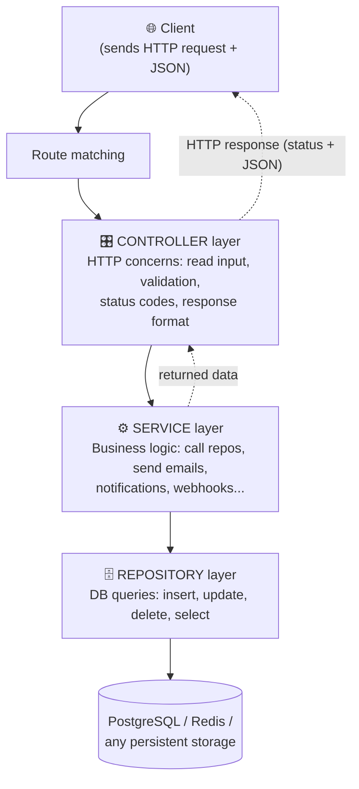
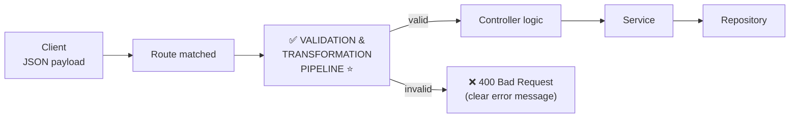
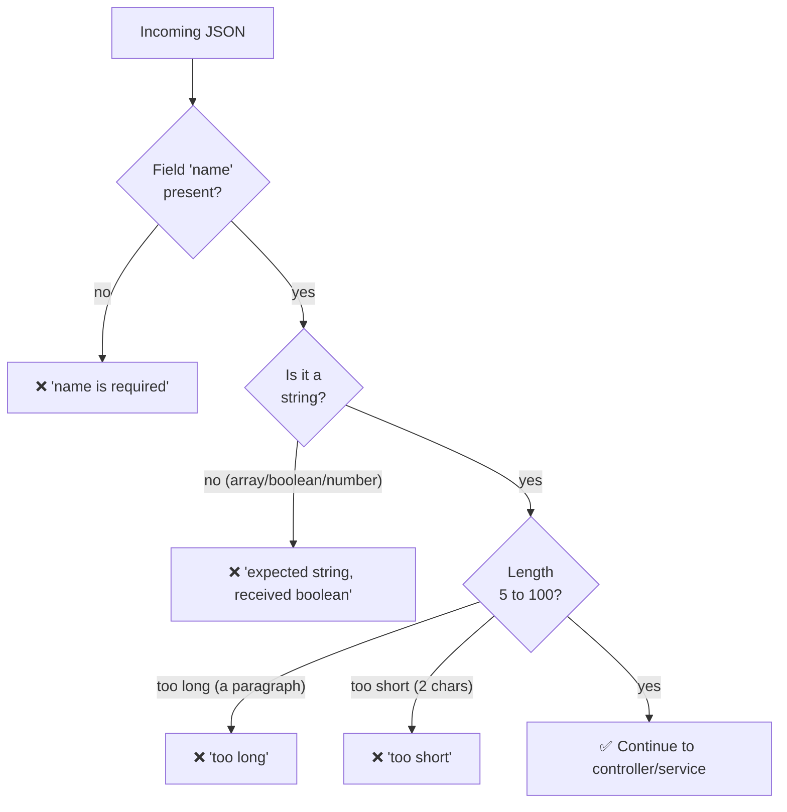
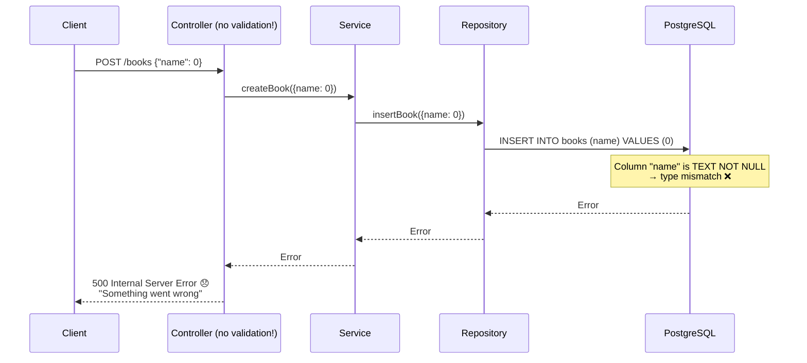
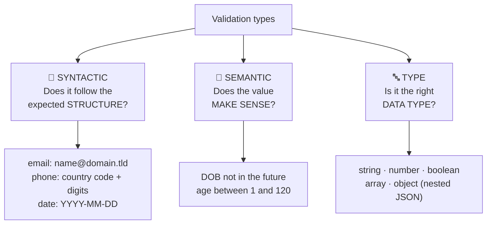
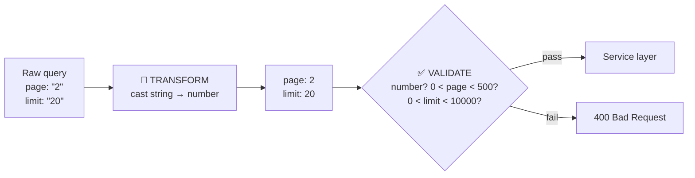
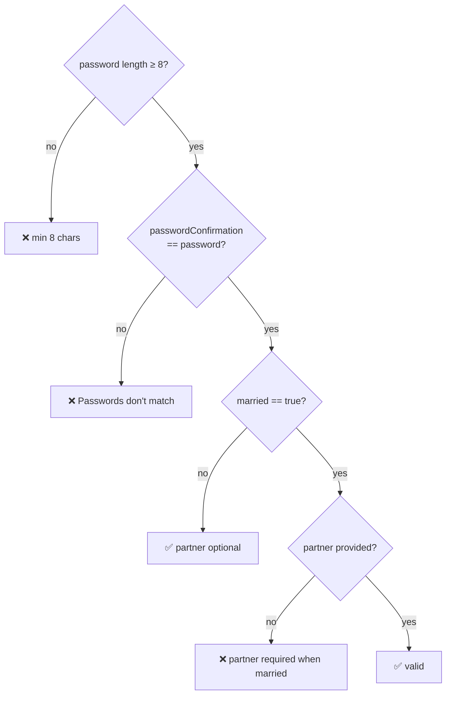
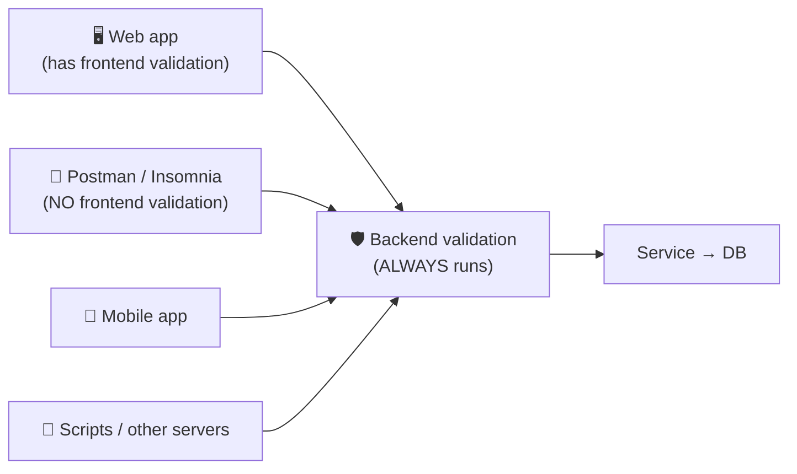
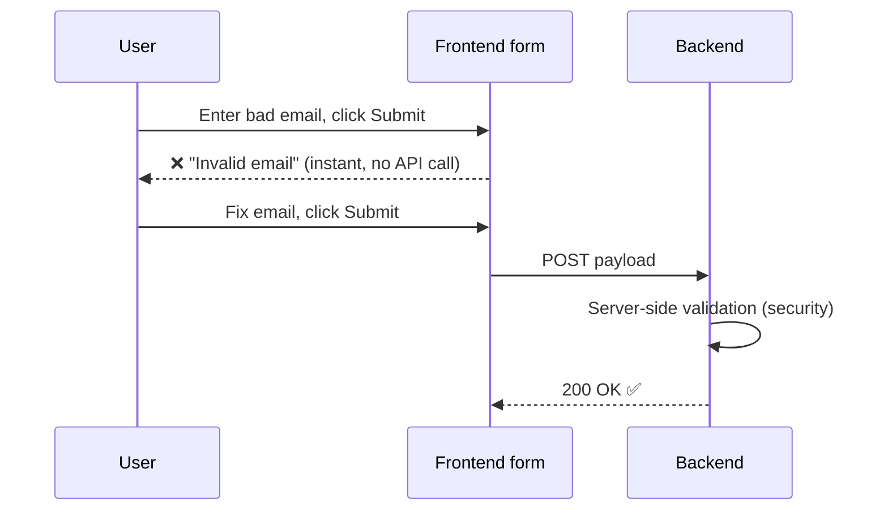

# Validations and Transformations: Complete Revision Notes

> **Source:** [YouTube: Validations & Transformations (Backend from First Principles series, part 9)](https://www.youtube.com/watch?v=qedj_JjjL-U&list=PLui3EUkuMTPgZcV0QhQrOcwMPcBCcd_Q1&index=9)
> **Length:** ~43 min
> **Previous videos:** [HTTP_Notes.md](HTTP_Notes.md) · [Routing_Notes.md](Routing_Notes.md) · [Serialization_Notes.md](Serialization_Notes.md) · [Auth_Notes.md](Auth_Notes.md)
> **Goal of the video:** A set of rules and guidelines to keep in mind when designing APIs, mostly about **data integrity** and **security**: where, why and how to validate and transform incoming data.

> 💡 Diagrams use **Mermaid**. They render in GitHub, VS Code (with a Mermaid preview extension), Obsidian, Notion, and the Claude app. Anything marked **📌 Extra** was added to clarify a point and is not in the video.

---

## 📑 Table of Contents

1. [TL;DR: The Whole Video in 10 Lines](#-tldr-the-whole-video-in-10-lines)
2. [Backend Architecture: Controller → Service → Repository](#1-backend-architecture-0000)
3. [Where Validation and Transformation Happen](#2-where-validation-and-transformation-happen-0350)
4. [How a Validation Pipeline Works](#3-how-a-validation-pipeline-works-0724)
5. [Why Validate at the Entry Point (400 vs 500)](#4-why-validate-at-the-entry-point-0941)
6. [Three Types of Validation](#5-three-types-of-validation-1538)
7. [Transformation](#6-transformation-2040)
8. [Demos: Syntactic, Semantic, Complex, Transformation, Type](#7-demos-1331--3520)
9. [Frontend vs Backend Validation](#8-frontend-vs-backend-validation-3720)
10. [Cheat Sheet / Quick Revision](#-quick-revision-cheat-sheet)
11. [Self-Test Questions](#-self-test-questions)

---

## ⚡ TL;DR: The Whole Video in 10 Lines

1. A typical backend has layers: **Controller** (HTTP concerns) → **Service** (business logic) → **Repository** (database).
2. **Validation and transformation happen at the entry point**: right after the route matches and **before** the controller runs any significant logic or calls the service.
3. **Everything** from the client gets validated: **JSON body, query params, path params, headers**.
4. A **validation pipeline** (a reusable middleware/utility) checks the data against a **schema**: field present? right type? meets constraints (e.g. length 5–100)? If not, it errors **immediately**.
5. **Without validation**, bad data (e.g. `name: 0`) travels down to the DB, the DB rejects it, and the user gets a vague **500 Internal Server Error** (poor UX). **With validation**, they get a clear **400 Bad Request**.
6. Three types: **Syntactic** (structure: email, phone, date format), **Semantic** (does it make sense: DOB not in the future, age 1–120), **Type** (string, number, boolean, array, object).
7. **Complex validation:** cross-field rules, e.g. `passwordConfirmation` must equal `password`, and `partner` is required when `married` is true.
8. **Transformation:** changing data into the format the server needs, e.g. **casting** query-param strings `"2"` to numbers, **lowercasing emails**, adding `+` to phone numbers, normalizing dates.
9. Keep validation and transformation **together in one pipeline**, so all input-data rules live in one place.
10. **Frontend validation = user experience** (instant feedback). **Backend validation = security and data integrity** (mandatory). Never rely on the frontend: clients like Postman/Insomnia skip it entirely.

---

## 1. Backend Architecture (00:00)

A typical backend has **layers of execution**:



| Layer | Responsibility |
|---|---|
| **Repository** (bottom) | Database connections and queries: inserts, deletions, everything data-related. Can be a relational DB, Redis, or any persistent store. |
| **Service** (middle) | **Business logic**: everything an API call is supposed to do. Calls one or more repository methods, sends notifications/emails, stores data, makes **webhook** calls, etc. |
| **Controller** (top) | Calls the right service method for the API and returns its data to the user over HTTP. Handles **HTTP-related stuff**: which **status code** to return (success/error), the **response format**, and **validations**. |

**Why separate Controller and Service?** To keep **HTTP-related logic** (status codes, data formats, validation, everything about data coming in from and going out to clients) in **its own layer**, apart from the business logic.

> The service may or may not call the repository, depending on the requirements.

---

## 2. Where Validation and Transformation Happen (03:50)



**Exactly here:** after the **route is matched** and the controller method for that route is called, but **before** any significant logic runs, before calling service methods or executing business logic.

### The idea
Your server receives API calls from **many clients all over the world**. Before any of their data **enters** your server, make sure it's in the **expected format**:

| Data source | Example |
|---|---|
| **JSON body (payload)** | `{"name": "Clean Code"}` |
| **Query parameters** | `?page=2&limit=20` |
| **Path parameters** | `/users/:id` |
| **Headers** | `Authorization`, custom headers |

**Example requirement:** the API expects a JSON body with a field `name` that is a **string** with **length between 5 and 100**. You can be as specific as you want.

---

## 3. How a Validation Pipeline Works (07:24)

- A **middleware function or utility function**, **reused in every API**.
- You give it a **schema** to validate against, and it walks through the fields of the JSON.



1. **Presence:** is the `name` field there? If not → "name is required".
2. **Type:** is the value a string, or an array, boolean, ...? If wrong → "expected string, received boolean".
3. **Constraints:** is the length within 5–100? Too long or too short → a custom error message.

> 📌 **Extra:** in Node.js this is usually done with **Zod**, Joi or Yup. The error messages in the demos ("Expected number, received string") look like Zod. Other ecosystems have **Pydantic** (Python), **go-playground/validator** (Go), and **class-validator** (NestJS).

```ts
// 📌 Extra: what the "name" schema could look like with Zod
const CreateBookSchema = z.object({
  name: z.string().min(5).max(100),
});
```

---

## 4. Why Validate at the Entry Point (09:41)

**Goal:** the system should never reach an **unexpected state** or **break** under unexpected input.

### ❌ Scenario without validation

Client sends `{"name": 0}` (a number instead of a string) to create a book.



The table was created with a **data-type constraint**:

```sql
CREATE TABLE books (
  name TEXT NOT NULL   -- expects a string ("text" in PostgreSQL terms)
);
```

PostgreSQL **validates data types** before running the operation, so the insert **fails**. Depending on error handling, the client gets **500 Internal Server Error**, which is a **very poor user experience** for a basic form.

### ✅ Scenario with validation

```
 Client ── {"name": 0} ──► [VALIDATION PIPELINE] ──► ❌ 400 Bad Request
                                                       "name: expected string, received number"
                           (service, repository and DB are never touched)
```

| | Without validation | With validation |
|---|---|---|
| Where the error is caught | Deep in the DB | At the entry point |
| Status code | **500** Internal Server Error | **400** Bad Request |
| Message | Vague ("something went wrong") | Clear ("the data you sent doesn't meet our constraints, retry with the right format") |
| Wasted work | Controller + service + repository + DB call | None |

---

## 5. Three Types of Validation (15:38)

These aren't the only types, but they're the three you'll meet most often.



### 5.1 Syntactic validation: structure
Does the string **follow a particular structure**?

| Data | Expected structure |
|---|---|
| **Email** | `something` + `@` + domain name + top-level domain (`.com`, `.org`, `.co.in`, thousands more) |
| **Phone number** | **Country code** + the right number of digits for that country (e.g. +91 followed by 10 digits) |
| **Date** | A fixed format, e.g. **year-month-day** (`2025-01-11`) |

### 5.2 Semantic validation: does it make sense?
The value might be **structurally valid** but **meaningless**.

| Field | Invalid example | Why |
|---|---|---|
| **Date of birth** | Today is 11 Jan 2025 and the user enters 13 Jan 2025 | You can't be born **in the future** |
| **Age** | `365` | Not a realistic human age (yet!) |

### 5.3 Type validation: data types
The basic check: is the field a **string, number, boolean, array**, or a **nested JSON object** (which itself contains primitive types)?

> 💡 These aren't rules to memorize. They're things to **keep in mind** while designing APIs: **how strict and how specific** you want to be with your data.

---

## 6. Transformation (20:40)

> **Transformation:** running operations on user-provided data to convert it into the **format the server needs**. It can happen **before** validation (so validation can succeed) or **after** it (to prepare the data for the service).

### The classic example: query params are always strings

```http
GET /bookmarks?page=2&limit=20
```

**Validation rules:**

| Param | Rule |
|---|---|
| `page` | **number**, > 0, < 500 |
| `limit` | **number**, > 0, < 10,000 (max rows per request) |

**Problem:** **all query-param values reach the server as strings.** They may *look* like numbers, but their type is always string.

```
 Received:   { page: "2",  limit: "20" }     ← strings!
 Rule:       page must be a NUMBER
 Result:     ❌ "page should be a number, received string"
```

The **client did nothing wrong**. Query params are always strings. It's the **server's responsibility** to **transform** (**cast**) them first.

> **Casting:** forcing a value of one data type to convert into another (string `"2"` → number `2`).



> 📌 **Extra (Zod):** `page: z.coerce.number().int().gt(0).lt(500)` does the cast and the validation in one line.

### Why pair them in a single pipeline?
All input-data logic (**requirements** and **operations**) **stays in one place**. You don't have to hunt through different files to find what the API expects and what's done to the data before the business logic runs.

```
 ┌──────────── VALIDATION & TRANSFORMATION PIPELINE ────────────┐
 │  transform (cast, trim, lowercase, normalize)                  │
 │  validate  (presence, type, syntax, semantics, cross-field)    │
 │  transform (shape data for the service)                        │
 └───────────────────────────────────────────────────────────────┘
                     one place for ALL input rules
```

---

## 7. Demos (13:31 – 35:20)

Tool: **Insomnia**, an API client like Postman, used to send requests to a local server.

### 7.1 Syntactic demo: `POST /api/validation/syntactic` (13:39)

| Step | Request body | Response |
|---|---|---|
| 1 | `{}` | ❌ Array of errors: **email, phone, date are all required** |
| 2 | `{"email": "randomstring", "phone": 12345, "date": "2025-01-11"}` | ❌ **"Invalid email format"** · phone: **"expected string, received number"** |
| 3 | email → `"x@test.com"` | ❌ only the phone error remains |
| 4 | phone → `"12345"` (string) | ✅ **200 OK** |

### 7.2 Semantic demo (27:16)

| Step | Request body | Response |
|---|---|---|
| 1 | `{}` | ❌ **dateOfBirth required**, **age: expected number, received none** |
| 2 | `{"dateOfBirth": "1995-06-12"}` | ❌ age required |
| 3 | `{"dateOfBirth": "1995-06-12", "age": 43}` | ✅ 200, echoes the values |
| 4 | DOB → `"2026-06-12"` | ❌ **"Date of birth cannot be in the future"** |
| 5 | age → `430` | ❌ **"Number must be less than or equal to 120"** (valid range 1–120) |

> 💡 **Bonus benefit:** validation errors act as **documentation**. Hit the API with an empty body and the errors tell you exactly which fields and values it expects. Very handy when docs are missing.

### 7.3 Complex validation demo (30:23)

Fields: `password`, `passwordConfirmation`, `married`, and conditionally `partner`.

| Step | Request body | Response |
|---|---|---|
| 1 | `password: "random"`, `passwordConfirmation: "another"`, `married: false` | ❌ passwordConfirmation: **"Passwords don't match"** · password: **"String must contain at least 8 characters"** |
| 2 | Both set to the same 8+ char string | ✅ 200 |
| 3 | `married: true` (no partner) | ❌ **"Partner name is required when married is true"** |
| 4 | Add `"partner": "some name"` | ✅ 200 |



**Why "complex":** the rules **depend on other fields** (cross-field and conditional rules), defined by the service layer's requirements.

### 7.4 Transformation demo (33:13)

Same `email` / `phone` / `date` API, sent with "messy" but structurally valid data:

| Field | Sent | Returned (after transformation) |
|---|---|---|
| email | Mixed case, e.g. `"TeSt@GMail.com"` | **All lowercase** `"test@gmail.com"` |
| phone | No `+` prefix, e.g. `"919876543210"` | **`+` added**: `"+919876543210"` |
| date | One date format | **Converted** to a different, standardized format |

The server normalizes the data **in the pipeline**, before any execution, for the **convenience/requirements of the service layer**.

> 📌 **Extra:** lowercasing emails matters because `John@X.com` and `john@x.com` are the same inbox. Without it, a user could sign up twice or fail to log in.

### 7.5 Type validation demo (35:20)

Fields: `stringField`, `numberField`, `arrayField`, `booleanField`.

| Step | Sent | Response |
|---|---|---|
| 1 | All four as strings | ❌ number: "expected number, received string" · array: "expected array, received string" · boolean: same |
| 2 | `numberField: 10` | ✅ number fixed |
| 3 | `arrayField: [1, 2]`, `booleanField: false` | ❌ **"arrayField[0]: expected string, received number"** (element-level rule) |
| 4 | `arrayField: ["1", "2"]` | ✅ 200, all values returned |

> 🔑 You can enforce rules **on each element of an array**, not just on the array itself (e.g. "array of strings").

```ts
// 📌 Extra: Zod version of the type demo
z.object({
  stringField:  z.string(),
  numberField:  z.number(),
  arrayField:   z.array(z.string()),   // each element must be a string
  booleanField: z.boolean(),
});
```

---

## 8. Frontend vs Backend Validation (37:20)

**Common mistake:** relying on **frontend** validation **instead of** backend validation.

Typical form: an input `name`. If it passes client-side checks (min/max length, type...), **Submit** calls the API. If not, the **form shows errors** and **no API call is made**.

| | **Frontend (client-side) validation** | **Backend (server-side) validation** |
|---|---|---|
| Purpose | **User experience (UX)**: immediate feedback | **Security and data integrity** |
| Required? | Nice to have | ✅ **Mandatory, always** |
| Can it be bypassed? | **Yes**: Postman, Insomnia, curl, scripts skip it entirely | No, it's the last line of defense |



**Why the backend can't trust the frontend:**
- A server has **many kinds of clients**. A polished web app may validate, but an **API client** like Postman or Insomnia sends requests **directly**, with **no UI in between**, so **no frontend validation at all**.
- If the backend relies on the frontend for security or integrity, it **breaks as soon as the client changes**.

> 🔑 **Rule:** design server-side validation to be **as strict and specific as possible**, **without assuming anything** about what the client validates.

### Demo (40:48)
- A frontend form for the same APIs. Entering a bad email and phone and clicking **Submit** → **no API call**. The **frontend** caught it and showed an error.
- Fixing the email (`...@gmail.com`) and submitting → a **real API call** goes out, the backend validates, and returns **200**.



> Validation and transformation isn't a large or complex topic. It's **a set of rules and guidelines to follow when designing APIs**.

---

## 🧾 Quick Revision Cheat Sheet

```
Client ─► Route match ─► [ VALIDATE + TRANSFORM ] ─► Controller ─► Service ─► Repository ─► DB
                                 │
                                 └─ invalid ─► 400 Bad Request (clear message)
```

| Concept | Key points |
|---|---|
| Layers | **Controller** (HTTP: status codes, formats, validation) → **Service** (business logic) → **Repository** (DB) |
| Where to validate | **Entry point**: after route match, before any significant logic |
| What to validate | Body · query params · path params · headers |
| Pipeline | Reusable middleware + **schema**: presence → type → constraints |
| No validation | Bad data hits the DB → DB rejects → **500** (bad UX) |
| With validation | **400 Bad Request** + clear message, nothing else runs |
| Syntactic | Structure: email, phone, date format |
| Semantic | Makes sense: DOB not in the future, age 1–120 |
| Type | string / number / boolean / array (+ element types) / object |
| Complex | Cross-field: passwords match. Conditional: partner required if married. |
| Transformation | Cast query strings → numbers · lowercase email · add `+` to phone · normalize dates |
| Query params | **Always strings**, so cast them before validating numbers |
| One pipeline | Validation + transformation together, so all input rules live in one place |
| Bonus | Validation errors double as API documentation |
| Frontend validation | **UX** (instant feedback), optional, bypassable |
| Backend validation | **Security + data integrity**, **mandatory**, strict and specific |

---

## ❓ Self-Test Questions

<details>
<summary>1. Name the three backend layers and what each is responsible for.</summary>

**Controller:** HTTP concerns (status codes, response format, validation) and calling the service. **Service:** business logic (calls repos, emails, notifications, webhooks). **Repository:** database queries.
</details>

<details>
<summary>2. Why keep the controller separate from the service?</summary>

To keep **HTTP-related logic** (status codes, formats, validation, incoming and outgoing data) in its own layer, separate from business logic.
</details>

<details>
<summary>3. Exactly where in the request lifecycle should validation run?</summary>

At the **entry point**: after the route is matched and the controller method is invoked, **before** any significant logic or service calls.
</details>

<details>
<summary>4. List four sources of client data that must be validated.</summary>

**JSON body, query parameters, path parameters, headers.**
</details>

<details>
<summary>5. A client sends {"name": 0} to a books API with no validation. What happens, and what should happen?</summary>

It reaches the DB, where the `TEXT NOT NULL` column rejects the number, and the client gets a vague **500**. With validation, it's caught at the entry point and the client gets a clear **400 Bad Request**.
</details>

<details>
<summary>6. Classify each: (a) email format, (b) DOB in the future, (c) age sent as "abc".</summary>

(a) **Syntactic**. (b) **Semantic**. (c) **Type**.
</details>

<details>
<summary>7. GET /bookmarks?page=2 fails with "page must be a number". Whose fault is it, and what's the fix?</summary>

The **server's**. Query params always arrive as **strings**, so the server must **transform (cast)** `"2"` → `2` before validating.
</details>

<details>
<summary>8. Give two examples of "complex" validation from the video.</summary>

`passwordConfirmation` must **equal** `password`. `partner` is **required only when** `married` is true.
</details>

<details>
<summary>9. Give three examples of transformation from the demo.</summary>

**Lowercasing** the email, **adding `+`** to the phone number, **converting the date** into a standard format (plus casting query strings to numbers).
</details>

<details>
<summary>10. Why put validation and transformation in one pipeline?</summary>

So all input-data requirements and operations **live in one place**, and you don't have to search multiple places to understand what an API expects.
</details>

<details>
<summary>11. Your frontend already validates the form. Do you still need backend validation? Why?</summary>

**Yes, always.** Frontend validation is for **UX** and can be bypassed (Postman, Insomnia, curl, scripts). Backend validation is for **security and data integrity**.
</details>

<details>
<summary>12. What's a hidden benefit of good validation error messages?</summary>

They act as **documentation**: sending an empty payload reveals which fields and values the API expects.
</details>

---

*Notes compiled from the video transcript. Timestamps (mm:ss) let you jump back to each section.*
